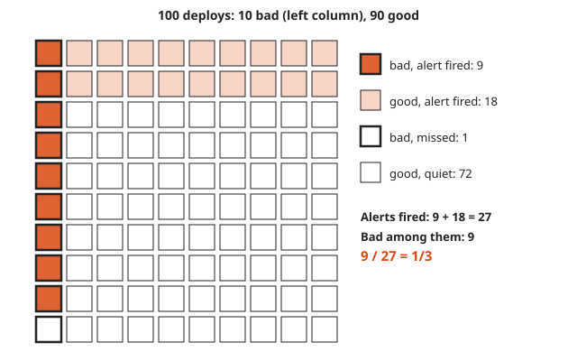
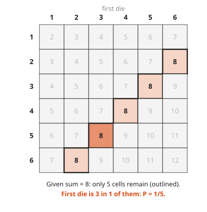
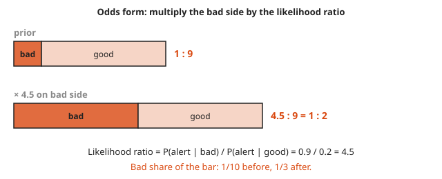

# Conditional Probability and Bayes

**Level:** 501 · **Unit:** 2, Probability · **Time:** 60 to 75 minutes
**Prerequisites:** [Probability Basics](../04-probability-basics/README.md) · Next: [Random Variables, Expectation and Variance](../06-random-variables-expectation-variance/README.md)

## The Big Idea

New information shrinks the sample space. **Conditional probability** $P(A \mid B)$ asks: among the outcomes where $B$ happened, what fraction also has $A$? **Bayes' rule** turns a question around: from `how often does the alert fire when the deploy is bad?` to `how likely is the deploy bad, given the alert fired?`. Those two numbers are very different, and mixing them up is the most common reasoning error in on-call work.

## Picture It

<!-- diagram: type=probability-tree root=deploy branches="bad 0.1 (alert 0.9, none 0.1); good 0.9 (alert 0.2, none 0.8)" highlight=alert caption="deploy alert tree" -->


A deploy is bad 10% of the time. A canary alert catches 90% of bad deploys, but it also fires on 20% of good ones. Multiply along each path to get the probability of that whole story. Then look only at the highlighted leaves, the worlds where the alert fired: 0.09 of them are bad deploys and 0.18 are good. The chance a firing alert means a bad deploy is $0.09 / (0.09 + 0.18) = 1/3$.

<!-- diagram: type=area-square widths=0.1,0.9 heights=0.9,0.2 caption="area diagram for Bayes" -->


A third view counts whole deploys instead of probabilities. Picture 100 deploys:

<!-- diagram: type=icon-array n=100 groups="bad 10 (alert 9); good 90 (alert 18)" caption="100 deploys" -->


27 alerts, 9 of them real. Counting people (or deploys) instead of percentages is the easiest way to keep Bayes honest.

The **area diagram** shows the same thing as a picture of sizes. Column widths are the prior probabilities, heights inside each column are the alert rates, and every area is a joint probability. The alert puts you somewhere in the shaded region. The dark strip is tall but thin, and the light strip is short but wide. Width wins: the light strip is twice as big.

## Step by Step

1. **Definition.** For $P(B) > 0$:

   $$P(A \mid B) = \frac{P(A \cap B)}{P(B)}$$

   Read the bar as `given`. Zoom into region $B$, and ask what share of it is also $A$.

<!-- diagram: type=grid rows=6 cols=6 keep="sum=8" highlight="first=3" caption="conditioning shrinks the sample space" -->


2. **Multiplication rule.** Rearrange the definition: $P(A \cap B) = P(B) \cdot P(A \mid B)$. This is what you do when you multiply along a tree branch.
3. **Law of total probability.** If $H$ and `not H` split the world into two cases,

   $$P(E) = P(H)\,P(E \mid H) + P(\text{not } H)\,P(E \mid \text{not } H)$$

   This adds up all the leaves where $E$ happens.
4. **Bayes' rule.** Put steps 1 to 3 together:

   $$P(H \mid E) = \frac{P(H)\,P(E \mid H)}{P(E)}$$

   $P(H)$ is the **prior** (before the evidence), $P(E \mid H)$ is the **likelihood**, and $P(H \mid E)$ is the **posterior** (after the evidence).
5. **Odds form (the fast mental version).** Odds of $H$ = $P(H) / P(\text{not } H)$. Then

   $$\text{posterior odds} = \text{prior odds} \times \frac{P(E \mid H)}{P(E \mid \text{not } H)}$$

   The fraction on the right is the **likelihood ratio**: how much more often the evidence appears when $H$ is true. For the alert: prior odds $1 : 9$, likelihood ratio $0.9 / 0.2 = 4.5$, posterior odds $4.5 : 9 = 1 : 2$, which is probability $1/3$.

<!-- diagram: type=stacked-bars rows="prior 1:9; after x4.5 4.5:9" caption="odds update" -->


   Odds turn Bayes into one multiplication. That is the version to use at 3 a.m.
6. **Independence, restated.** $A$ and $B$ are independent exactly when $P(A \mid B) = P(A)$: learning $B$ tells you nothing about $A$.

### Why It Is True: Bayes' Rule

Write the joint probability two ways with the multiplication rule:

$$P(H \cap E) = P(H)\,P(E \mid H) = P(E)\,P(H \mid E)$$

Divide the right equality by $P(E)$. The rule falls out. In the area picture, both expressions compute the area of the same dark strip.

## Worked Examples

### Example 1: Conditioning on Dice

Roll two dice. Given that the sum is 8, what is the chance the first die is 3?

```txt
B = sum is 8 = {(2,6), (3,5), (4,4), (5,3), (6,2)}     5 cells, the new sample space
A ∩ B = {(3,5)}                                         1 cell
P(A | B) = 1 / 5                                        share of B that is also A
```

### Example 2: Rare Problem, Decent Alert

An SLO burn is real 1% of the time. The alert catches 95% of real burns and false-fires 5% of the time otherwise.

```txt
P(real) x P(alert | real)     = 0.01 x 0.95 = 0.0095     dark strip
P(fake) x P(alert | fake)     = 0.99 x 0.05 = 0.0495     light strip
P(alert)                      = 0.0095 + 0.0495 = 0.059  total probability
P(real | alert)               = 0.0095 / 0.059           Bayes
                              ≈ 0.161                    about 1 page in 6 is real
```

The alert is 95% sensitive, yet a page means a real problem only about 16% of the time. The low **base rate** (1%) dominates. This effect is called the **base rate fallacy** when people ignore it.

### Example 3: Two Independent Alerts

In the deploy example, two different alerts each behave as described and fire independently given the deploy state. Both fire. Use odds.

```txt
prior odds bad : good          = 1 : 9          0.1 vs 0.9
likelihood ratio per alert     = 0.9 / 0.2 = 4.5
posterior odds                 = 1 x 4.5 x 4.5 : 9
                               = 20.25 : 9
P(bad | both fire)             = 20.25 / 29.25 = 9/13 ≈ 0.692
```

One alert gives 1/3. Two independent alerts give about 69%. Independent evidence multiplies.

## Common Mistakes

* Swapping the condition: $P(\text{alert} \mid \text{bad}) = 0.9$ but $P(\text{bad} \mid \text{alert}) = 1/3$. The prosecutor's fallacy is exactly this swap.
* Ignoring the base rate: a very accurate test for a very rare event still produces mostly false alarms.
* Dividing by the wrong total: the denominator is the probability of the evidence, summed over every way it happens.
* Assuming two alerts are independent when they read the same metric: correlated evidence does not multiply.

## Try It

1. Two dice: what is $P(\text{sum} = 8 \mid \text{first die is } 3)$?
2. A bag holds 3 red and 2 blue balls. Draw two without replacement. What is $P(\text{both red})$?
3. 60% of disks come from vendor A (2% fail per year) and 40% from vendor B (5% fail per year). What fraction of disks fail per year?
4. Continue question 3: a disk failed. What is the chance it came from vendor A?
5. A test for a condition with 2% prevalence has 90% sensitivity and a 10% false positive rate. What is $P(\text{condition} \mid \text{positive})$?
6. In the deploy example, use odds to find $P(\text{bad} \mid \text{alert})$ when the alert false-fire rate drops from 20% to 5%.
7. Use the area diagram above to explain in one sentence why the light strip is bigger than the dark strip.

<details>
<summary>Answers</summary>

1. $1/6$: the second die must be 5. Knowing the first die does not change the second.
2. $\frac{3}{5} \times \frac{2}{4} = \frac{6}{20} = \frac{3}{10}$.
3. $0.6 \times 0.02 + 0.4 \times 0.05 = 0.012 + 0.020 = 0.032$, that is, 3.2%.
4. $0.012 / 0.032 = 0.375$.
5. $\frac{0.02 \times 0.9}{0.02 \times 0.9 + 0.98 \times 0.1} = \frac{0.018}{0.116} \approx 0.155$.
6. Likelihood ratio $0.9 / 0.05 = 18$. Posterior odds $18 : 9 = 2 : 1$. Probability $2/3$. Cutting false alarms helps more than raising sensitivity.
7. The good column is nine times wider, and that outweighs the bad strip being 4.5 times taller.

</details>

## Code Corner

`math/big.Rat` keeps exact fractions, which makes the 1/3 come out as 1/3 and not 0.33333334. The full program is [code/main.go](code/main.go). Run it from the `code` folder with `go run .`.

```go
// bayes returns P(H | E) from the prior P(H), P(E | H) and P(E | not H).
func bayes(prior, eGivenH, eGivenNot *big.Rat) *big.Rat {
	one := big.NewRat(1, 1)
	jointH := new(big.Rat).Mul(prior, eGivenH)
	jointNot := new(big.Rat).Mul(new(big.Rat).Sub(one, prior), eGivenNot)
	total := new(big.Rat).Add(jointH, jointNot)
	return new(big.Rat).Quo(jointH, total)
}
```

Output:

```txt
deploy alert:      P(bad | alert) = 1/3
fewer false fires: P(bad | alert) = 2/3
rare SLO burn:     P(real | alert) = 0.161
two alerts:        P(bad | both)   = 0.6923
```

## Go Deeper

* [Better Explained: An Intuitive (and Short) Explanation of Bayes' Theorem](https://betterexplained.com/articles/an-intuitive-and-short-explanation-of-bayes-theorem/): the classic plain-language walk-through.
* [MacTutor: Thomas Bayes](https://mathshistory.st-andrews.ac.uk/Biographies/Bayes/): the minister behind the rule.
* [Workshop: Probability for On-Call, Error Budgets and SLOs](../../../workshops/probability-for-on-call-error-budgets-and-slos/README.md): alert precision in practice.
* [Probability Track](../../../tracks/probability/README.md): more practice in this repository.
