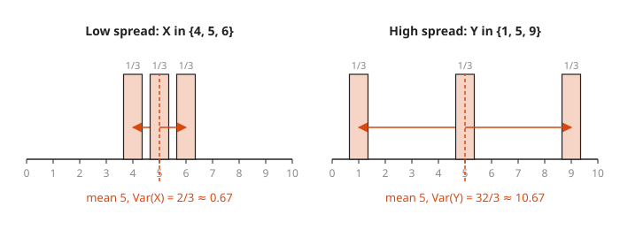
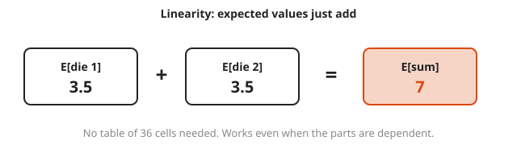
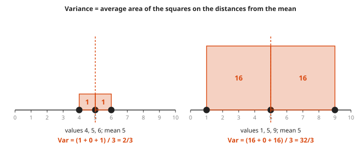
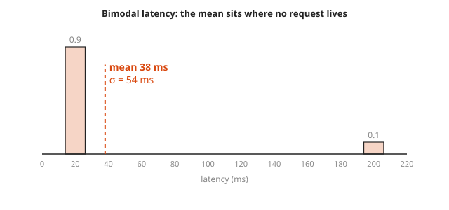

# Random Variables, Expectation and Variance

**Level:** 501 · **Unit:** 2, Probability · **Time:** 60 minutes
**Prerequisites:** [Conditional Probability and Bayes](../05-conditional-probability-and-bayes/README.md) · Next: [Common Distributions](../07-common-distributions/README.md)

## The Big Idea

A **random variable** attaches a number to each outcome: the sum of two dice, the latency of a request, the count of failed hosts. Once outcomes are numbers, two summaries tell most of the story. The **expectation** (mean) is the balance point, the long-run average. The **variance** measures spread, how far values typically land from that balance point. An SRE already knows the practical version: the mean latency is one number, and the tail is a different story.

## Picture It

<!-- diagram: type=bar-chart x=2..12 heights=1,2,3,4,5,6,5,4,3,2,1 unit=1/36 fulcrum=7 caption="sum of two dice" -->
![Bar chart of the sum of two dice for values 2 through 12. Heights rise from 1/36 at 2 to 6/36 at 7 and fall back to 1/36 at 12. The bar at 7 is highlighted, and a triangle fulcrum under 7 marks the balance point E[X] = 7.](img/pmf-two-dice.svg)

Imagine each bar as a weight sitting on a plank. The expectation is the spot where a fulcrum balances the plank. For this symmetric shape, that is 7, right in the middle.

<!-- diagram: type=bar-chart-pair left=4,5,6 right=1,5,9 prob=1/3 mean=5 caption="same mean, different spread" -->


Both charts balance at 5. The right one has its weight far from the center. Variance captures that difference and the mean cannot.

## Step by Step

1. **Random variable.** A function $X : S \to \mathbb{R}$ from outcomes to numbers (a function in the sense of [Sets and Functions](../02-sets-and-functions/README.md)). For two dice, $X(a, b) = a + b$.
2. **Probability mass function (PMF).** $p(x) = P(X = x)$ for each value $x$. The bars in the picture are the PMF. All bars add to 1.
3. **Expectation.** The probability-weighted average:

   $$E[X] = \sum_x x \, p(x)$$

4. **Linearity of expectation.** For any random variables, independent or not:

   $$E[aX + b] = a\,E[X] + b, \qquad E[X + Y] = E[X] + E[Y]$$

   This is the most useful fact in probability. The expected sum of two dice is $3.5 + 3.5 = 7$ with no table at all.

<!-- diagram: type=equation-boxes items="E[die1]=3.5,+,E[die2]=3.5,=,E[sum]=7" caption="linearity of expectation" -->


5. **Variance.** The expected squared distance from the mean $\mu = E[X]$:

   $$\operatorname{Var}(X) = E[(X - \mu)^2] = E[X^2] - \mu^2$$

   The second form is usually faster to compute. Why squares? Distances below the mean are negative and distances above are positive. Plain distances cancel to zero every time. Squares do not cancel.

<!-- diagram: type=number-line-squares sets="4,5,6;1,5,9" mean=5 caption="variance as average square area" -->


   Read variance literally: draw a square on each distance from the mean, then average the square areas.
6. **Standard deviation.** $\sigma = \sqrt{\operatorname{Var}(X)}$. It has the same units as $X$ (milliseconds, not milliseconds squared). Read it as `typical distance from the mean`.
7. **Variance rules.** $\operatorname{Var}(aX + b) = a^2 \operatorname{Var}(X)$: shifting does not change spread, and scaling by $a$ scales spread by $|a|$. For **independent** $X$ and $Y$, $\operatorname{Var}(X + Y) = \operatorname{Var}(X) + \operatorname{Var}(Y)$.

### Why It Is True: the Shortcut Formula

Expand the square and use linearity. $\mu$ is a constant:

```txt
E[(X - μ)^2] = E[X^2 - 2μX + μ^2]       expand the square
             = E[X^2] - 2μ E[X] + μ^2   linearity; constants come out
             = E[X^2] - 2μ^2 + μ^2      E[X] = μ
             = E[X^2] - μ^2             combine
```

## Worked Examples

### Example 1: One Fair Die

```txt
E[X]   = (1 + 2 + 3 + 4 + 5 + 6) / 6          each face has probability 1/6
       = 21 / 6 = 3.5
E[X^2] = (1 + 4 + 9 + 16 + 25 + 36) / 6        square each value first
       = 91 / 6
Var(X) = 91/6 - 3.5^2                          shortcut formula
       = 91/6 - 49/4 = 182/12 - 147/12
       = 35/12 ≈ 2.917
σ      = sqrt(35/12) ≈ 1.708
```

For the sum of two independent dice: $E = 3.5 + 3.5 = 7$ and $\operatorname{Var} = 35/12 + 35/12 = 35/6 \approx 5.83$.

### Example 2: The Two Spread Pictures

```txt
X in {4, 5, 6}, each 1/3:
Var(X) = ((4-5)^2 + (5-5)^2 + (6-5)^2) / 3   distances from the mean 5
       = (1 + 0 + 1) / 3 = 2/3
Y in {1, 5, 9}, each 1/3:
Var(Y) = ((1-5)^2 + 0 + (9-5)^2) / 3
       = (16 + 0 + 16) / 3 = 32/3 ≈ 10.67     sixteen times the spread of X
```

### Example 3: Bimodal Latency

90% of requests take 20 ms (cache hit) and 10% take 200 ms (cache miss).

```txt
E[L]   = 0.9 x 20 + 0.1 x 200 = 18 + 20 = 38 ms     the mean
E[L^2] = 0.9 x 400 + 0.1 x 40000 = 360 + 4000 = 4360
Var(L) = 4360 - 38^2 = 4360 - 1444 = 2916
σ      = sqrt(2916) = 54 ms                         bigger than the mean itself
```

<!-- diagram: type=bar-chart x=20,200 heights=0.9,0.1 mean=38 caption="bimodal latency" -->


No single request takes 38 ms. The mean is a balance point, not a typical value. A standard deviation larger than the mean is a hint to look at percentiles instead.

## See It Step by Step


[The Mean as a Fair Share: open the step-by-step walkthrough](https://caseyaedwards.github.io/math_training/diagrams/mean-fair-share/)

Watch the extra from the tall bars fill the short ones until every bar sits at the mean.


[Mean and Median: open the step-by-step walkthrough](https://caseyaedwards.github.io/math_training/diagrams/mean-median-balance/)

Watch a far-out value pull the balance point while the median stays put.


[Standard Deviation: open the step-by-step walkthrough](https://caseyaedwards.github.io/math_training/diagrams/standard-deviation/)

Watch each distance from the mean get squared, averaged and square-rooted back to the original units.


[Histograms: open the step-by-step walkthrough](https://caseyaedwards.github.io/math_training/diagrams/histogram/)

Watch the raw values drop into equal bins and the bar outline reveal the shape of the data.


[Box Plots: open the step-by-step walkthrough](https://caseyaedwards.github.io/math_training/diagrams/box-plot/)

Watch the quartiles split the sorted data and the box cover the middle half.

## Common Mistakes

* Computing $E[X^2]$ as $(E[X])^2$: they differ, and the difference is exactly the variance.
* Adding variances of dependent quantities: $\operatorname{Var}(X + Y) = \operatorname{Var}(X) + \operatorname{Var}(Y)$ needs independence. Expectation adds always.
* Forgetting to square the scale: $\operatorname{Var}(3X) = 9 \operatorname{Var}(X)$, not $3 \operatorname{Var}(X)$.
* Reading the mean as the most likely value: in Example 3 the mean, 38 ms, never occurs.

## Try It

1. A game pays \$10 with probability 0.1 and costs \$2 otherwise. What is the expected gain per play?
2. $X$ is 1 with probability 0.3 and 0 otherwise. Find $E[X]$ and $\operatorname{Var}(X)$.
3. $E[X] = 4$ and $\operatorname{Var}(X) = 2$. Find $E[3X + 2]$ and $\operatorname{Var}(3X + 2)$.
4. What is the expected number of heads in 10 fair coin flips? Use linearity.
5. A retry loop makes one attempt, then a second attempt only if the first fails. Each attempt fails with probability 0.2. What is the expected number of attempts?
6. $X$ takes values 0, 1, 2 with probabilities 0.5, 0.3, 0.2. Find $E[X]$ and $\operatorname{Var}(X)$.
7. Two independent request stages have latency standard deviations 3 ms and 4 ms. What is the standard deviation of the total?

<details>
<summary>Answers</summary>

1. $0.1 \times 10 + 0.9 \times (-2) = 1 - 1.8 = -0.8$. You lose 80 cents per play on average.
2. $E[X] = 0.3$. $E[X^2] = 0.3$. $\operatorname{Var}(X) = 0.3 - 0.09 = 0.21 = 0.3 \times 0.7$.
3. $E = 3 \times 4 + 2 = 14$. $\operatorname{Var} = 9 \times 2 = 18$.
4. Each flip contributes $E = 0.5$. Ten flips: $5$.
5. One attempt always, plus a second with probability 0.2: $1 + 0.2 = 1.2$.
6. $E[X] = 0 + 0.3 + 0.4 = 0.7$. $E[X^2] = 0 + 0.3 + 0.8 = 1.1$. $\operatorname{Var} = 1.1 - 0.49 = 0.61$.
7. Variances add: $9 + 16 = 25$. Standard deviation $5$ ms. Standard deviations themselves do not add.

</details>

## Code Corner

One function computes the mean and the variance for any list of (value, probability) pairs, with exact fractions. The full program is [code/main.go](code/main.go). Run it from the `code` folder with `go run .`.

```go
func meanVar(pmf []outcome) (*big.Rat, *big.Rat) {
	mu, sq := new(big.Rat), new(big.Rat)
	for _, o := range pmf {
		x := new(big.Rat).SetInt64(o.value)
		mu.Add(mu, new(big.Rat).Mul(x, o.prob))
		sq.Add(sq, new(big.Rat).Mul(new(big.Rat).Mul(x, x), o.prob))
	}
	variance := new(big.Rat).Sub(sq, new(big.Rat).Mul(mu, mu)) // E[X^2] - mu^2
	return mu, variance
}
```

Output:

```txt
one die    mean 7/2  variance 35/12 sd 1.708
{4,5,6}    mean 5    variance 2/3   sd 0.816
{1,5,9}    mean 5    variance 32/3  sd 3.266
latency ms mean 38   variance 2916  sd 54.000
```

## Go Deeper

* [Khan Academy: Random Variables](https://www.khanacademy.org/math/statistics-probability/random-variables-stats-library): expectation and variance with practice.
* [Math Is Fun: Standard Deviation and Variance](https://www.mathsisfun.com/data/standard-deviation.html): a gentle picture-first explanation.
* [Statistics Track](../../../tracks/statistics/README.md): more practice in this repository.
