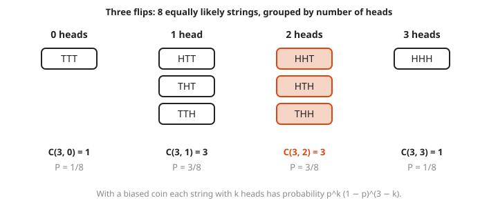
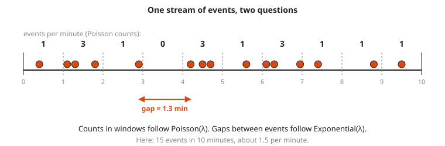
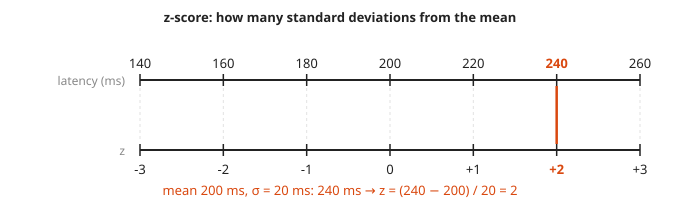
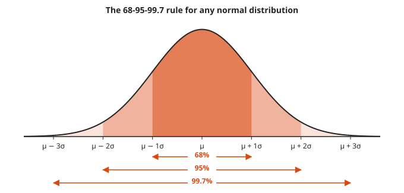

# Common Distributions: Binomial, Poisson, Normal, Exponential

**Level:** 501 · **Unit:** 2, Probability · **Time:** 75 minutes
**Prerequisites:** [Random Variables, Expectation and Variance](../06-random-variables-expectation-variance/README.md), [Counting](../03-counting/README.md) · Helpful: [Course 401: Calculus](../../401/README.md) for areas under curves

## The Big Idea

A handful of shapes describe most random quantities in the wild. Each one comes from a simple story. Count successes in a fixed number of independent tries: **binomial**. Count events that arrive at a steady average rate: **Poisson**. Add up many small independent effects: **normal**. Wait for the next event at a steady rate: **exponential**. Learn the story, and you know which formula to reach for.

## Picture It

<!-- diagram: type=small-multiples panels="binomial n=10 p=0.3; poisson lambda=3; normal mu=0 sigma=1 shade=-1..1; exponential lambda=1 shade=2..inf" caption="four common distributions" -->


The top two are **discrete**: bars at whole numbers, and each bar height is a probability. The bottom two are **continuous**: smooth curves called **densities**, and probability is the area under the curve over an interval. A single point has zero area, which means zero probability.

## Step by Step

1. **Bernoulli trial.** One try with success probability $p$. Mean $p$, variance $p(1-p)$.
2. **Binomial$(n, p)$.** The number of successes in $n$ independent Bernoulli trials:

   $$P(X = k) = \binom{n}{k} p^k (1-p)^{n-k}, \qquad E[X] = np, \qquad \operatorname{Var}(X) = np(1-p)$$

   The $\binom{n}{k}$ from [Counting](../03-counting/README.md) counts which $k$ of the $n$ tries succeed. Each such pattern has probability $p^k (1-p)^{n-k}$.

<!-- diagram: type=grouped-outcomes n=3 group-by=heads counts=1,3,3,1 caption="binomial from coin strings" -->


3. **Poisson$(\lambda)$.** The number of events in a fixed window when events arrive independently at average rate $\lambda$ per window (requests per second, pages per week):

   $$P(X = k) = \frac{e^{-\lambda} \lambda^k}{k!}, \qquad E[X] = \operatorname{Var}(X) = \lambda$$

   It is the limit of Binomial$(n, p)$ when $n$ is large, $p$ is small, and $np = \lambda$.

<!-- diagram: type=timeline span=0..10 events=15 windows=1 gap=2.9..4.2 caption="Poisson counts and exponential gaps" -->


   One stream of events, two questions. How many land in each window? Poisson. How long between them? Exponential (step 5).
4. **Normal$(\mu, \sigma)$.** The bell curve, centered at $\mu$ with spread $\sigma$. The **central limit theorem** says sums and averages of many independent pieces look normal, whatever the pieces look like. To compare any normal value to the standard bell, compute the **z-score**:

   $$z = \frac{x - \mu}{\sigma}$$

   Then apply the 68-95-99.7 rule below.

<!-- diagram: type=dual-number-line top=140..260 step=20 bottom=-3..3 mark=240 caption="z-scores" -->


   A z-score converts any unit into `standard deviations`. It is the common currency of the normal curve.

<!-- diagram: type=normal-bands bands=1,2,3 labels=68%,95%,99.7% caption="68-95-99.7 rule" -->


5. **Exponential$(\lambda)$.** The waiting time until the next event in a Poisson stream with rate $\lambda$:

   $$f(t) = \lambda e^{-\lambda t} \ (t \ge 0), \qquad P(T > t) = e^{-\lambda t}, \qquad E[T] = 1/\lambda$$

   It is **memoryless**: $P(T > s + t \mid T > s) = P(T > t)$. Having waited 3 minutes tells you nothing about the remaining wait.

### Why It Is True: the Exponential Tail

No event by time $t$ means a Poisson count of zero on the window $[0, t]$. That window has average count $\lambda t$. Plug $k = 0$ into the Poisson formula: $P(T > t) = e^{-\lambda t} (\lambda t)^0 / 0! = e^{-\lambda t}$. The two distributions describe the same stream from two angles: Poisson counts events, exponential times the gaps.

## Worked Examples

### Example 1: Binomial

Each of 10 independent canary checks fails with probability 0.3. What is $P(\text{exactly 3 fail})$?

```txt
P(X = 3) = C(10, 3) x 0.3^3 x 0.7^7     binomial formula
         = 120 x 0.027 x 0.0823543      C(10,3) = 120
         ≈ 0.2668                       the tallest bar in the picture
E[X]     = 10 x 0.3 = 3                 mean
Var(X)   = 10 x 0.3 x 0.7 = 2.1         variance
```

### Example 2: Poisson

A service averages 3 pages per week. What is the chance of a quiet week, and of exactly 5 pages?

```txt
P(X = 0) = e^-3 x 3^0 / 0!       = e^-3 ≈ 0.0498      about 1 week in 20
P(X ≥ 1) = 1 - 0.0498            ≈ 0.9502              complement
P(X = 5) = e^-3 x 3^5 / 5!
         = 0.049787 x 243 / 120  ≈ 0.1008
```

### Example 3: Normal

Latency is roughly normal with mean 200 ms and standard deviation 20 ms. About what fraction of requests exceed 240 ms?

```txt
z = (240 - 200) / 20 = 2         two standard deviations above the mean
P(|Z| < 2) ≈ 0.95                the 95% band
P(Z > 2)   ≈ 0.05 / 2 = 0.025    the remaining 5% splits evenly between two tails
exact value from tables: 0.0228
```

Real latency is rarely normal: it has a long right tail. Use this example as practice with z-scores, not as a model of production.

### Example 4: Exponential

Requests arrive at rate 1 per minute. What is the chance of a gap longer than 2 minutes?

```txt
P(T > 2) = e^(-1 x 2)   tail formula
         = e^-2 ≈ 0.135  the shaded tail in the picture
E[T]     = 1 / 1 = 1     mean gap: 1 minute
```

## Common Mistakes

* Using binomial when trials are not independent or $p$ changes: pulling from a shrinking pool without replacement breaks the model.
* Reading a density height as a probability: for continuous distributions, only areas are probabilities. A density can exceed 1.
* Applying the 68-95-99.7 rule to skewed data: it holds for normal shapes only.
* Mixing up the rate and the mean: for the exponential, mean wait is $1/\lambda$. A rate of 4 per hour means a mean gap of 15 minutes.

## Try It

1. Flip a fair coin 5 times. What is $P(\text{exactly 2 heads})$?
2. 100 independent jobs each fail with probability 0.02. Find the mean and variance of the number of failures.
3. Errors arrive as a Poisson stream with $\lambda = 2$ per hour. Find $P(0 \text{ errors in an hour})$ and $P(\text{at most } 1)$.
4. A quantity is normal with mean 100 and standard deviation 15. About what fraction lies between 85 and 115? Above 130?
5. Latency has mean 200 ms and standard deviation 20 ms. What is the z-score of 260 ms?
6. Time between deploys is exponential with mean 5 minutes. What is $P(\text{gap} > 10 \text{ min})$?
7. Continuing question 6: no deploy has happened for 3 minutes. What is the chance the wait lasts at least 2 more minutes?
8. 500 disks each fail this month with probability 0.01, independently. Compare $P(\text{no failures})$ from the binomial and from the Poisson approximation.

<details>
<summary>Answers</summary>

1. $\binom{5}{2} / 2^5 = 10/32 = 0.3125$.
2. Binomial$(100, 0.02)$: mean $2$, variance $100 \times 0.02 \times 0.98 = 1.96$.
3. $e^{-2} \approx 0.135$. $P(\le 1) = e^{-2}(1 + 2) = 3e^{-2} \approx 0.406$.
4. 85 to 115 is within one standard deviation: about 68%. 130 is $z = 2$: about 2.5% above.
5. $z = (260 - 200)/20 = 3$.
6. $\lambda = 1/5$. $P = e^{-10/5} = e^{-2} \approx 0.135$.
7. Memoryless: same as a fresh wait of 2 minutes, $e^{-2/5} \approx 0.670$.
8. Binomial: $0.99^{500} \approx 0.00657$. Poisson with $\lambda = 5$: $e^{-5} \approx 0.00674$. Very close.

</details>

## Code Corner

Go's `math` package has everything needed: `Pow`, `Exp`, and `Erfc` (the complementary error function, which gives normal tail areas). The full program is [code/main.go](code/main.go). Run it from the `code` folder with `go run .`.

```go
func poisson(k int, lambda float64) float64 {
	fact := 1.0
	for i := 2; i <= k; i++ {
		fact *= float64(i)
	}
	return math.Exp(-lambda) * math.Pow(lambda, float64(k)) / fact
}

// normalAbove returns P(X > x) for a normal with mean mu and sd sigma.
func normalAbove(x, mu, sigma float64) float64 {
	z := (x - mu) / sigma
	return 0.5 * math.Erfc(z/math.Sqrt2)
}
```

Output:

```txt
Binomial(10, 0.3): P(X=3) = 0.2668
Poisson(3):        P(X=0) = 0.0498  P(X=5) = 0.1008
Normal(200, 20):   P(X>240) = 0.0228
Exponential(1):    P(T>2) = 0.1353
500 disks at 1%:   binomial P(0) = 0.00657  Poisson P(0) = 0.00674
```

## Go Deeper

* [Wolfram MathWorld: Binomial Distribution](https://mathworld.wolfram.com/BinomialDistribution.html) and [Poisson Distribution](https://mathworld.wolfram.com/PoissonDistribution.html): formulas and properties in one place.
* [Math Is Fun: Normal Distribution](https://www.mathsisfun.com/data/standard-normal-distribution.html): the bell curve and z-scores with pictures.
* [OpenStax: Introductory Statistics](https://openstax.org/details/books/introductory-statistics): a free textbook with full chapters on each distribution.
* [Workshop: Statistics for Monitoring and Anomaly Detection](../../../workshops/statistics-for-monitoring-and-anomaly-detection/README.md): these distributions applied to metrics.
