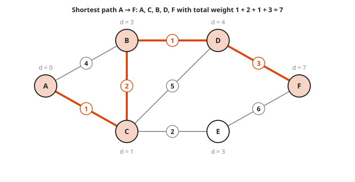
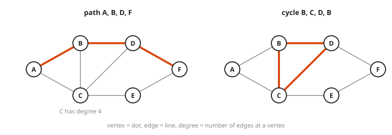
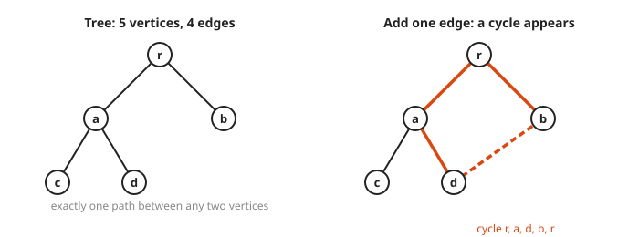
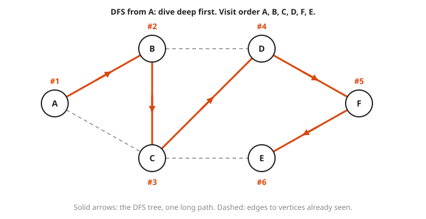
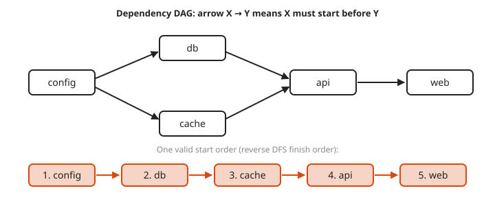

# Graph Theory Basics: Paths, Trees, BFS, DFS and Shortest Paths

**Level:** 501 · **Unit:** 1, Discrete Math · **Time:** 75 minutes
**Prerequisites:** [Sets and Functions](../02-sets-and-functions/README.md), [Counting](../03-counting/README.md)

## The Big Idea

A **graph** is a set of dots (**vertices**) joined by lines (**edges**). It is the natural shape of a network, a service dependency map, a call graph, or a road map. Most graph questions are about **paths**: can I get from here to there, how many hops does it take, and what is the cheapest route? Two ways of walking a graph, breadth-first and depth-first, answer the first two. Dijkstra's algorithm answers the third.

## Picture It

<!-- diagram: type=graph nodes=A,B,C,D,E,F edges=AB,AC,BC,BD,CD,CE,DF,EF layout=bfs-levels root=A tree=AB,AC,BD,CE,DF caption="BFS from A" -->


Breadth-first search (BFS) explores in rings, like ripples from a stone dropped at A. Level 1 is everything one hop away, level 2 is two hops away, and each vertex is reached first by a fewest-hop route. The solid edges record how each vertex was first discovered. They form a **tree**.

<!-- diagram: type=weighted-graph nodes=A,B,C,D,E,F weights=AB4,AC1,BC2,BD1,CD5,CE2,DF3,EF6 path=A,C,B,D,F caption="shortest path A to F" -->


Now give each edge a cost, such as latency in milliseconds. The cheapest route from A to F has four hops, A, C, B, D, F, for a cost of 7. The fewest-hop routes cost more: A, B, D, F costs 8 and A, C, E, F costs 9. Fewest hops and lowest cost are different questions.

## Step by Step

1. **Vocabulary.** A graph is $G = (V, E)$. The **degree** of a vertex is its edge count. A **path** is a sequence of vertices joined by edges. A **cycle** is a path that returns to its start without reusing an edge. A graph is **connected** when every pair of vertices has a path between them. In a **directed** graph edges have arrows, as in `service A calls service B`.

<!-- diagram: type=graph-pair highlight="path A,B,D,F; cycle B,C,D" caption="path and cycle" -->


2. **Handshake lemma.** Every edge has two ends, which means $\sum \deg(v) = 2|E|$. In the picture: $2 + 3 + 4 + 3 + 2 + 2 = 16 = 2 \times 8$.
3. **Trees.** A **tree** is a connected graph with no cycles. A tree with $n$ vertices has exactly $n - 1$ edges, and there is exactly one path between any two vertices. File systems, BFS results and spanning trees in network switches are all trees.

<!-- diagram: type=tree-pair n=5 extra-edge=d-b caption="tree, then one more edge" -->


4. **BFS (breadth-first search).** Use a **queue** (first in, first out):

   ```txt
   put start in queue, mark it seen
   while queue not empty:
       take v from the front
       for each neighbor w of v not yet seen:
           mark w seen, record parent[w] = v, add w to the back
   ```

   BFS finds fewest-hop paths in an unweighted graph.
5. **DFS (depth-first search).** Use a **stack** (or recursion): go as deep as possible, then back up. DFS is the tool for cycle detection, topological ordering of build or deploy dependencies, and finding connected pieces.

<!-- diagram: type=graph nodes=A,B,C,D,E,F traversal=dfs root=A order=A,B,C,D,F,E caption="DFS from A" -->


   Compare with the BFS picture: BFS makes a short, wide tree. DFS makes a tall, thin one.

   A **DAG** (directed acyclic graph) is a directed graph with no cycles. Dependency maps need to be DAGs. A cycle in one is an outage waiting for a cold start.

<!-- diagram: type=dag nodes=config,db,cache,api,web edges="config>db,config>cache,db>api,cache>api,api>web" order=config,db,cache,api,web caption="topological order" -->


   A **topological order** lists the vertices with every arrow pointing forward. Run DFS, note when each vertex finishes, and reverse that list. From config, with neighbors in alphabetical order, DFS finishes web, api, cache, db, config. Reversed: config, db, cache, api, web.
6. **Dijkstra's algorithm.** For non-negative edge weights. Keep a tentative distance for each vertex (start at 0, others $\infty$). Repeatedly take the unfinished vertex with the smallest distance, mark it finished, and **relax** its edges: if going through it gives a neighbor a shorter distance, update that distance. A priority queue (min-heap) does the `smallest distance` step fast.

### Why It Is True: A Tree Has n - 1 Edges

Build a connected graph by adding edges one at a time, starting from $n$ separate vertices. An edge that joins two separate pieces reduces the number of pieces by one. To get from $n$ pieces to one piece takes exactly $n - 1$ such edges. Any further edge joins two vertices already connected, and that closes a cycle. A tree uses only joining edges, which gives $n - 1$.

## Worked Examples

### Example 1: BFS Order From A

Visit neighbors in alphabetical order.

```txt
queue [A]          visit A    add B, C           level 1: B, C
queue [B, C]       visit B    add D (C seen)     level 2: D
queue [C, D]       visit C    add E (A, B, D seen)
queue [D, E]       visit D    add F              level 3: F
queue [E, F]       visit E    nothing new
queue [F]          visit F    nothing new
order: A, B, C, D, E, F
```

### Example 2: DFS Order From A

```txt
at A: first unvisited neighbor B       go deep
at B: first unvisited neighbor C       (A seen)
at C: first unvisited neighbor D       (A, B seen)
at D: first unvisited neighbor F       (B, C seen)
at F: first unvisited neighbor E       (D seen)
at E: all neighbors seen, back up all the way
order: A, B, C, D, F, E
```

DFS dives along one long path before it looks sideways. BFS sweeps level by level.

### Example 3: Dijkstra From A

```txt
step  finish  A  B  C  D  E  F    reason
0     -       0  ∞  ∞  ∞  ∞  ∞    start
1     A       0  4  1  ∞  ∞  ∞    relax A-B (4), A-C (1)
2     C       0  3  1  6  3  ∞    via C: B = 1+2 = 3 beats 4; D = 1+5; E = 1+2
3     B       0  3  1  4  3  ∞    via B: D = 3+1 = 4 beats 6
4     E       0  3  1  4  3  9    via E: F = 3+6 = 9
5     D       0  3  1  4  3  7    via D: F = 4+3 = 7 beats 9
6     F       0  3  1  4  3  7    done
path: F <- D <- B <- C <- A, cost 7
```

## Common Mistakes

* Using BFS for weighted shortest paths: BFS counts hops and ignores weights. Use Dijkstra.
* Using Dijkstra with negative weights: a later negative edge can undercut a vertex already marked finished. Use Bellman-Ford instead.
* Forgetting to mark vertices as seen: on a graph with cycles, BFS and DFS then loop forever.
* Assuming a dependency graph is a tree: shared dependencies make it a DAG (directed graph with no cycles), and a node can have several parents.

## Try It

1. A graph has 10 edges. What is the sum of all vertex degrees?
2. Can a graph have three vertices each of degree 3 and no others? Why or why not?
3. How many edges does a tree with 12 vertices have?
4. Run BFS from D on the pictured graph. List the vertices in each level.
5. What is the fewest number of hops from A to F? Name one such path.
6. Using the weights in the second picture, what is the cheapest cost from A to E?
7. A connected graph has 5 vertices and 5 edges. Must it contain a cycle?
8. You need the order to start services so that each starts after everything it depends on. Which traversal helps, BFS or DFS?

<details>
<summary>Answers</summary>

1. $2 \times 10 = 20$ by the handshake lemma.
2. No. The degree sum is 9, an odd number. Every degree sum equals $2|E|$, an even number. (Three vertices allow at most degree 2 each anyway.)
3. $12 - 1 = 11$.
4. Level 0: D. Level 1: B, C, F. Level 2: A, E.
5. 3 hops, for example A, B, D, F (also A, C, D, F or A, C, E, F).
6. 3, along A, C, E (1 + 2).
7. Yes. A connected graph with no cycle is a tree, and a 5-vertex tree has exactly 4 edges. The fifth edge closes a cycle.
8. DFS. Listing vertices in reverse order of finishing gives a topological order.

</details>

## Code Corner

BFS uses a slice as a queue. DFS uses recursion. Dijkstra uses `container/heap` as a priority queue. The full program is [code/main.go](code/main.go). Run it from the `code` folder with `go run .`.

```go
func bfs(start string) []string {
	seen := map[string]bool{start: true}
	queue, order := []string{start}, []string{}
	for len(queue) > 0 {
		v := queue[0]
		queue = queue[1:]
		order = append(order, v)
		for _, w := range neighbors(v) {
			if !seen[w] {
				seen[w] = true
				queue = append(queue, w)
			}
		}
	}
	return order
}
```

Output:

```txt
BFS from A: [A B C D E F]
DFS from A: [A B C D F E]
distances: map[A:0 B:3 C:1 D:4 E:3 F:7]
cheapest A->F: [A C B D F] cost 7
```

## Go Deeper

* [MacTutor: Leonhard Euler](https://mathshistory.st-andrews.ac.uk/Biographies/Euler/): the bridges of Konigsberg started graph theory.
* [Wolfram MathWorld: Dijkstra's Algorithm](https://mathworld.wolfram.com/DijkstrasAlgorithm.html): a compact reference.
* [MIT OCW 6.042J Mathematics for Computer Science](https://ocw.mit.edu/courses/6-042j-mathematics-for-computer-science-fall-2010/): free notes with full chapters on graphs.
* [Workshop: Graph Theory for Networks and Dependencies](../../../workshops/graph-theory-for-networks-and-dependencies/README.md) and the [Graph Theory Track](../../../tracks/graph-theory/README.md).
