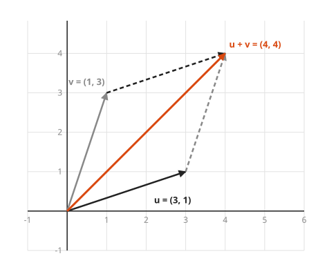
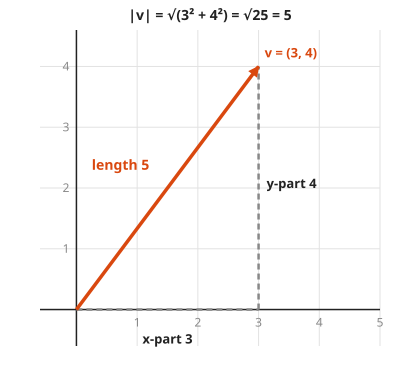
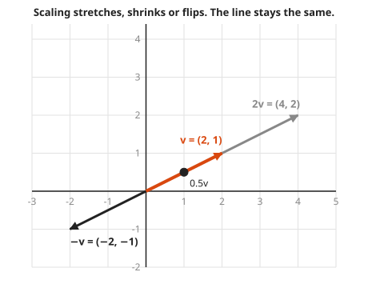
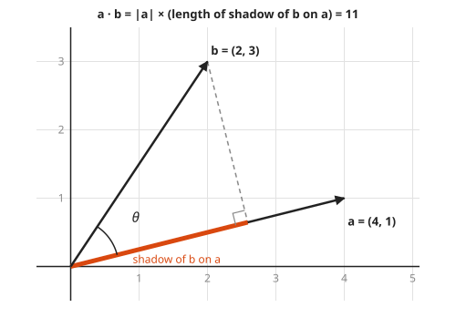
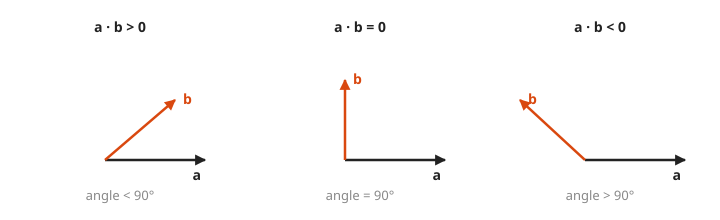

# Vectors and the Dot Product

**Level:** 501 · **Unit:** 3, Linear Algebra · **Time:** 60 minutes
**Prerequisites:** [Course 201: Algebra I and Geometry](../../201/README.md) (coordinate plane, Pythagoras) · Next: [Matrices as Transformations](../10-matrices-as-transformations/README.md)

## The Big Idea

A **vector** is an arrow: it has a length and a direction, and it does not care where it starts. In coordinates, a vector is just a list of numbers, such as $(3, 4)$: go 3 right and 4 up. You can add vectors, stretch them, and measure them. The **dot product** multiplies two vectors into one number that answers a geometric question: how much do these two arrows point the same way? That one number powers projections, angles, and the cosine similarity used to compare log lines or embeddings.

## Picture It

<!-- diagram: type=vector-grid vectors="u=(3,1),v=(1,3),u+v=(4,4)" style=tip-to-tail caption="vector addition" -->


To add two arrows, put the tail of the second at the tip of the first. The new arrow from the start to the final tip is the sum. Doing it in the other order gives the same tip, which closes a parallelogram. In numbers it is plain bookkeeping: $(3, 1) + (1, 3) = (3 + 1, 1 + 3) = (4, 4)$.

## Step by Step

1. **Components.** A 2D vector $v = (v_1, v_2)$ means `go $v_1$ along x, then $v_2$ along y`. A 3D vector has three numbers. A vector of 100 numbers works the same way. You cannot draw it, but the arithmetic does not care.
2. **Length.** The arrow is the long side of a right triangle with legs $v_1$ and $v_2$. Pythagoras gives

   $$|v| = \sqrt{v_1^2 + v_2^2}$$

<!-- diagram: type=vector-grid vectors="v=(3,4)" legs=dashed caption="length by Pythagoras" -->


3. **Addition and subtraction.** Add or subtract matching components. $b - a$ is the arrow from the tip of $a$ to the tip of $b$.
4. **Scalar multiplication.** A plain number is called a **scalar**. Multiplying by a scalar $k$ stretches the arrow by $k$. A negative $k$ flips it around. $k\,(v_1, v_2) = (k v_1, k v_2)$.

<!-- diagram: type=vector-grid vectors="v=(2,1),2v,0.5v,-v" caption="scalar multiples" -->


5. **Unit vector.** Divide a vector by its length to get length 1 with the same direction: $\hat{v} = v / |v|$. It keeps only the `which way` part.
6. **Dot product, the number recipe.** Multiply matching components and add:

   $$a \cdot b = a_1 b_1 + a_2 b_2 \quad (+ \, a_3 b_3 + \dots)$$

7. **Dot product, the picture.** The same number equals

   $$a \cdot b = |a|\,|b| \cos\theta$$

   where $\theta$ is the angle between the arrows. The **cosine** of an angle is a number from $-1$ to $1$: 1 when the arrows point the same way, 0 at a right angle, $-1$ when they point in opposite directions. In shadow terms: $a \cdot b$ is the length of $a$ times the length of the shadow that $b$ casts onto $a$.

<!-- diagram: type=projection a=(4,1) b=(2,3) caption="dot product as a shadow" -->


8. **The sign tells the angle.** Positive: less than 90 degrees apart. Zero: exactly perpendicular (also called **orthogonal**). Negative: more than 90 degrees apart.

<!-- diagram: type=vector-panels cases="acute,right,obtuse" caption="sign of the dot product" -->


9. **Angle and projection formulas.** Rearrange step 7:

   $$\cos\theta = \frac{a \cdot b}{|a|\,|b|}, \qquad \text{shadow length} = \frac{a \cdot b}{|a|}, \qquad \text{shadow vector} = \frac{a \cdot b}{a \cdot a}\, a$$

   The first one is **cosine similarity**. Search engines and anomaly detectors use it to ask `do these two count vectors point the same way?` without caring about their sizes.

### Why It Is True: the Two Dot Products Agree

Take the triangle with sides $a$, $b$ and $b - a$. Expand the squared length of the third side with the number recipe:

```txt
|b - a|^2 = (b - a) · (b - a)                    length squared is a vector dotted with itself
          = b·b - 2 a·b + a·a                    multiply out, like (x - y)^2
          = |b|^2 + |a|^2 - 2 a·b
```

The law of cosines from trigonometry says the same side has $|b - a|^2 = |a|^2 + |b|^2 - 2|a||b|\cos\theta$. Compare the two lines: $a \cdot b = |a||b|\cos\theta$. If you have not met the law of cosines, check the special case: at 90 degrees it is Pythagoras, and the dot product is 0.

## Worked Examples

### Example 1: Add, Scale, Measure

```txt
u + v   = (3, 1) + (1, 3) = (4, 4)        add matching components
2v      = 2 (1, 3) = (2, 6)               multiply each component
|(3,4)| = sqrt(9 + 16) = sqrt(25) = 5     Pythagoras
unit    = (3, 4) / 5 = (0.6, 0.8)         divide by the length
```

### Example 2: Angle Between Two Vectors

$a = (4, 1)$ and $b = (2, 3)$.

```txt
a · b    = 4·2 + 1·3 = 11                  number recipe
|a|      = sqrt(16 + 1) = sqrt(17)
|b|      = sqrt(4 + 9)  = sqrt(13)
cos θ    = 11 / sqrt(221) ≈ 0.740          divide by the lengths
θ        ≈ 42.3 degrees                    inverse cosine on a calculator
```

### Example 3: Shadow of b on a

```txt
shadow length = (a · b) / |a| = 11 / sqrt(17) ≈ 2.668
shadow vector = (11/17) (4, 1) ≈ (2.588, 0.647)
check: b - shadow = (-0.588, 2.353)
       a · (b - shadow) = -2.353 + 2.353 = 0      the leftover is perpendicular to a
```

### Example 4: Perpendicular Test

```txt
(2, 3) · (-3, 2) = -6 + 6 = 0         zero: the vectors are perpendicular
```

Swap the components and flip one sign: that turns any 2D vector by 90 degrees. It is a trick worth keeping.

## Common Mistakes

* Adding lengths instead of vectors: $|u + v|$ is usually less than $|u| + |v|$. The two are equal only when the arrows point the same way.
* Thinking the dot product gives a vector: it gives one number. (The cross product gives a vector, and it lives in 3D only.)
* Forgetting the square root in the length: $|(3, 4)| = 5$, not 25.
* Reading a zero dot product as `one vector is zero`: it usually means perpendicular.

## Try It

1. Compute $(2, -1) + (-3, 4)$.
2. Compute $3 \cdot (1, -2)$.
3. Find the length of $(5, 12)$.
4. Compute $(1, 2) \cdot (3, 4)$.
5. Are $(2, 3)$ and $(-3, 2)$ perpendicular?
6. Find the angle between $(1, 0)$ and $(1, 1)$.
7. Find the unit vector in the direction of $(3, 4)$.
8. Compute $(1, 2, 3) \cdot (4, -5, 6)$.
9. What is the length of the shadow of $(3, 4)$ on the x-axis direction $(1, 0)$?

<details>
<summary>Answers</summary>

1. $(-1, 3)$.
2. $(3, -6)$.
3. $\sqrt{25 + 144} = \sqrt{169} = 13$.
4. $3 + 8 = 11$.
5. Yes: $-6 + 6 = 0$.
6. $\cos\theta = 1 / (1 \cdot \sqrt{2}) \approx 0.707$, which gives $\theta = 45$ degrees.
7. $(0.6, 0.8)$. Check: $0.36 + 0.64 = 1$.
8. $4 - 10 + 18 = 12$.
9. $(3,4) \cdot (1,0) / 1 = 3$. The shadow on the x-axis is just the x component.

</details>

## Code Corner

A small `vec` type with methods covers the whole lesson. The full program is [code/main.go](code/main.go). Run it from the `code` folder with `go run .`.

```go
type vec struct{ x, y float64 }

func (a vec) add(b vec) vec       { return vec{a.x + b.x, a.y + b.y} }
func (a vec) scale(k float64) vec { return vec{k * a.x, k * a.y} }
func (a vec) dot(b vec) float64   { return a.x*b.x + a.y*b.y }
func (a vec) length() float64     { return math.Sqrt(a.dot(a)) }
```

Output:

```txt
u + v = {4 4}
2v    = {2 6}
|(3,4)| = 5
a . b = 11
angle  = 42.3 degrees
shadow of b on a: length 2.668, vector (2.588, 0.647)
(2,3) . (-3,2) = 0 -> perpendicular
```

Note that `length` is built from `dot`: the length of a vector is the square root of the vector dotted with itself.

## Go Deeper

* [Better Explained: Understanding the Dot Product](https://betterexplained.com/articles/vector-calculus-understanding-the-dot-product/): the shadow picture, explained without fuss.
* [Math Is Fun: Vectors](https://www.mathsisfun.com/algebra/vectors.html) and [Dot Product](https://www.mathsisfun.com/algebra/vectors-dot-product.html): gentle, picture-first pages.
* [Khan Academy: Linear Algebra](https://www.khanacademy.org/math/linear-algebra): free videos on vectors and spaces.
* [Workshop: Linear Algebra for Graphics and ML](../../../workshops/linear-algebra-for-graphics-and-ml/README.md) and the [Linear Algebra Track](../../../tracks/linear-algebra/README.md).
