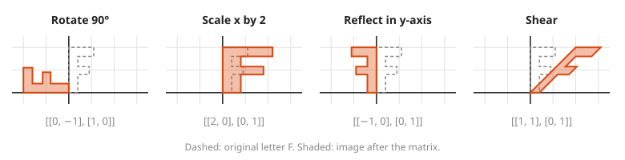

# Matrices as Transformations

**Level:** 501 · **Unit:** 3, Linear Algebra · **Time:** 60 to 75 minutes
**Prerequisites:** [Vectors and the Dot Product](../09-vectors-and-dot-product/README.md) · Next: [Solving Systems With Gaussian Elimination](../11-solving-systems-gaussian-elimination/README.md)

## The Big Idea

A **matrix** is a grid of numbers. The useful way to see one is as a machine that moves every point of the plane: it rotates, stretches, flips or slants the whole grid at once. The rule for reading one is short: **the columns of the matrix are where the two basic arrows land.** Know where $(1, 0)$ and $(0, 1)$ go, and you know where everything goes. Graphics engines, robot arms and neural networks all run on this one idea.

## Picture It

<!-- diagram: type=grid-transform matrix="[[2,1],[0,1]]" show=unit-square,basis caption="a matrix moves the whole grid" -->
![Left: the standard grid with the unit square shaded and basis arrows i = (1,0) and j = (0,1). Right: after the matrix [[2,1],[0,1]], i lands on (2,0), j lands on (1,1), the unit square becomes a slanted parallelogram, and the dashed grid lines follow.](img/transform-grid.svg)

On the left, the two basic arrows are $i = (1, 0)$ and $j = (0, 1)$. On the right, the matrix $\begin{pmatrix} 2 & 1 \\ 0 & 1 \end{pmatrix}$ sends $i$ to its first column $(2, 0)$ and $j$ to its second column $(1, 1)$. The grid lines stay straight, stay parallel, and stay evenly spaced. The origin does not move. Those three facts are what makes a transformation **linear**.

## Step by Step

1. **Notation.** A 2 by 2 matrix has two rows and two columns:

   $$A = \begin{pmatrix} a & b \\ c & d \end{pmatrix}$$

   Its first column is $(a, c)$. Its second column is $(b, d)$.
2. **Matrix times vector, the column way.** The input numbers say how much of each column to take:

   $$A \begin{pmatrix} x \\ y \end{pmatrix} = x \begin{pmatrix} a \\ c \end{pmatrix} + y \begin{pmatrix} b \\ d \end{pmatrix} = \begin{pmatrix} ax + by \\ cx + dy \end{pmatrix}$$

<!-- diagram: type=vector-grid vectors="3*col1=(6,0),2*col2 from (6,0),result=(8,2)" caption="matrix times vector as a mix of columns" -->
![On a grid: 3 times column (2,0) reaches (6,0). From there, 2 times column (1,1) reaches (8,2), which is the product of [[2,1],[0,1]] with (3,2).](img/matrix-times-vector.svg)

3. **Matrix times vector, the row way.** Each output entry is a row dotted with the input: first entry = (row 1) $\cdot$ $(x, y)$. This is the same arithmetic as step 2, grouped differently. Use the rows to compute. Use the columns to picture.
4. **Why columns land where they do.** Plug in $(1, 0)$: you get $1 \cdot$ column 1 $+ \, 0 \cdot$ column 2 = column 1. Same for $(0, 1)$.
5. **A gallery.** Write down where $i$ and $j$ go, and the matrix writes itself:

   | Move | $i$ goes to | $j$ goes to | Matrix |
   |---|---|---|---|
   | rotate 90 degrees counterclockwise | $(0, 1)$ | $(-1, 0)$ | $\begin{pmatrix} 0 & -1 \\ 1 & 0 \end{pmatrix}$ |
   | stretch x by 2 | $(2, 0)$ | $(0, 1)$ | $\begin{pmatrix} 2 & 0 \\ 0 & 1 \end{pmatrix}$ |
   | reflect in the y-axis | $(-1, 0)$ | $(0, 1)$ | $\begin{pmatrix} -1 & 0 \\ 0 & 1 \end{pmatrix}$ |
   | shear right | $(1, 0)$ | $(1, 1)$ | $\begin{pmatrix} 1 & 1 \\ 0 & 1 \end{pmatrix}$ |
   | rotate by angle $\theta$ | $(\cos\theta, \sin\theta)$ | $(-\sin\theta, \cos\theta)$ | $\begin{pmatrix} \cos\theta & -\sin\theta \\ \sin\theta & \cos\theta \end{pmatrix}$ |

<!-- diagram: type=shape-transform shape=letter-F matrices="rotate90,scale-x2,reflect-y,shear" caption="gallery of transformations" -->


   The letter F is a good test shape: it has no symmetry, which means a flip or a turn is easy to spot.
6. **Composition is multiplication.** Doing $B$ first and then $A$ is the single matrix $AB$. Read right to left, like $g(f(x))$ in [Sets and Functions](../02-sets-and-functions/README.md). Entry $(r, c)$ of $AB$ is row $r$ of $A$ dotted with column $c$ of $B$.
7. **Order matters.** In general $AB \neq BA$. Rotate-then-stretch is not stretch-then-rotate.

<!-- diagram: type=shape-transform shape=letter-F compose="S*R vs R*S" caption="order of composition" -->
![Two panels. Left: the F rotated 90 degrees then stretched in x gives a wide shape, matrix S·R = [[0,-2],[1,0]]. Right: the F stretched then rotated gives a tall shape, matrix R·S = [[0,-1],[2,0]].](img/composition-order.svg)

8. **Linear means two rules.** $A(u + v) = Au + Av$ and $A(kv) = k\,Av$. Lines map to lines and the origin stays put. A shift such as $(x, y) \mapsto (x + 1, y)$ is not linear: it moves the origin.

### Why It Is True: Columns Decide Everything

Every vector is a mix of the two basic arrows: $(x, y) = x\,i + y\,j$. A linear map respects mixing (step 8), which gives $A(x, y) = x\,A(i) + y\,A(j)$. Once $A(i)$ and $A(j)$ are known, every output is fixed. Those two arrows are the columns. A matrix is nothing more than a record of where $i$ and $j$ go.

## Worked Examples

### Example 1: Apply a Matrix

$A = \begin{pmatrix} 2 & 1 \\ 0 & 1 \end{pmatrix}$, input $(3, 2)$.

```txt
column way:  3 (2, 0) + 2 (1, 1)        take 3 of column 1 and 2 of column 2
           = (6, 0) + (2, 2)
           = (8, 2)
row way:     row 1 · (3, 2) = 2·3 + 1·2 = 8
             row 2 · (3, 2) = 0·3 + 1·2 = 2     same answer
```

### Example 2: Build a Matrix From a Description

Find the matrix that reflects across the line $y = x$.

```txt
i = (1, 0) reflects to (0, 1)        swap x and y
j = (0, 1) reflects to (1, 0)
matrix = [[0, 1], [1, 0]]            those landing spots are the columns
check: (3, 5) -> (0·3 + 1·5, 1·3 + 0·5) = (5, 3)
```

### Example 3: Order of Composition

$R$ = rotate 90 degrees $= \begin{pmatrix} 0 & -1 \\ 1 & 0 \end{pmatrix}$, $S$ = stretch x by 2 $= \begin{pmatrix} 2 & 0 \\ 0 & 1 \end{pmatrix}$.

```txt
S R : row 1 of S · columns of R = (2·0 + 0·1, 2·(-1) + 0·0) = (0, -2)
      row 2 of S · columns of R = (0·0 + 1·1, 0·(-1) + 1·0) = (1, 0)
      S R = [[0, -2], [1, 0]]           rotate first, then stretch
R S = [[0, -1], [2, 0]]                 stretch first, then rotate
S R ≠ R S                               the picture above shows the difference
```

## See It Step by Step


[Matrix as a Linear Transformation: open the step-by-step walkthrough](https://caseyaedwards.github.io/math_training/diagrams/matrix-transformation/)

Watch the two basis vectors land on the columns of the matrix and the whole grid follow along.


[Rotation Matrix: open the step-by-step walkthrough](https://caseyaedwards.github.io/math_training/diagrams/rotation-matrix/)

Watch e1 and e2 move around the unit circle, and read their landing points as the matrix columns.


[Composing Transformations: open the step-by-step walkthrough](https://caseyaedwards.github.io/math_training/diagrams/transformation-composition/)

Watch shear then rotate and rotate then shear land in different places, so order matters.


[Matrix Multiplication: Row Times Column: open the step-by-step walkthrough](https://caseyaedwards.github.io/math_training/diagrams/matrix-multiplication/)

Watch one row of the left matrix pair with one column of the right matrix to fill each entry.


[Matrix Multiplication: Column Picture: open the step-by-step walkthrough](https://caseyaedwards.github.io/math_training/diagrams/matrix-multiplication-columns/)

Watch each column of the product build up as a mix of the columns of A.

## Common Mistakes

* Putting the landing spots in rows instead of columns: $i$'s destination is the first column.
* Reading $AB$ left to right: $AB$ applies $B$ first.
* Assuming $AB = BA$: it fails for most pairs, as Example 3 shows.
* Calling any function on vectors a matrix: only linear maps (origin fixed, grid lines straight and evenly spaced) have matrices.

## Try It

1. Compute $\begin{pmatrix} 1 & 2 \\ 3 & 4 \end{pmatrix} \begin{pmatrix} 1 \\ 1 \end{pmatrix}$.
2. Which matrix sends $i$ to $(0, 1)$ and $j$ to $(-1, 0)$? Describe it in words.
3. Write the matrix that scales everything by 3.
4. Where does the shear $\begin{pmatrix} 1 & 1 \\ 0 & 1 \end{pmatrix}$ send $(0, 2)$?
5. Compute $\begin{pmatrix} 1 & 1 \\ 0 & 1 \end{pmatrix} \begin{pmatrix} 1 & 0 \\ 1 & 1 \end{pmatrix}$.
6. Apply the 90-degree rotation twice. Which single matrix do you get, and what does it do?
7. Is $f(x, y) = (x + 1, y)$ linear? Why or why not?
8. A sprite is rotated 90 degrees and then reflected in the y-axis. Which single matrix does both?

<details>
<summary>Answers</summary>

1. $(1 + 2, 3 + 4) = (3, 7)$.
2. $\begin{pmatrix} 0 & -1 \\ 1 & 0 \end{pmatrix}$, a rotation by 90 degrees counterclockwise.
3. $\begin{pmatrix} 3 & 0 \\ 0 & 3 \end{pmatrix}$.
4. $0 \cdot (1, 0) + 2 \cdot (1, 1) = (2, 2)$.
5. Row 1: $(1 \cdot 1 + 1 \cdot 1, \; 1 \cdot 0 + 1 \cdot 1) = (2, 1)$. Row 2: $(0 + 1, 0 + 1) = (1, 1)$. Result $\begin{pmatrix} 2 & 1 \\ 1 & 1 \end{pmatrix}$.
6. $\begin{pmatrix} -1 & 0 \\ 0 & -1 \end{pmatrix}$, a rotation by 180 degrees: every vector points the opposite way.
7. No. It sends the origin to $(1, 0)$. A linear map keeps the origin fixed.
8. Reflect after rotate is $FR$ with $F = \begin{pmatrix} -1 & 0 \\ 0 & 1 \end{pmatrix}$: $FR = \begin{pmatrix} 0 & 1 \\ 1 & 0 \end{pmatrix}$, the reflection across $y = x$. Check: $i \to (0, 1) \to (0, 1)$ and $j \to (-1, 0) \to (1, 0)$.

</details>

## Code Corner

Two methods: `apply` for matrix times vector, `mul` for composition. The full program is [code/main.go](code/main.go). Run it from the `code` folder with `go run .`.

```go
// apply computes M v as x*(column 1) + y*(column 2).
func (m mat) apply(v vec) vec {
	return vec{m[0][0]*v[0] + m[0][1]*v[1], m[1][0]*v[0] + m[1][1]*v[1]}
}

// mul returns m*n, which means: apply n first, then m.
func (m mat) mul(n mat) mat {
	var out mat
	for i := 0; i < 2; i++ {
		for j := 0; j < 2; j++ {
			out[i][j] = m[i][0]*n[0][j] + m[i][1]*n[1][j]
		}
	}
	return out
}
```

Output:

```txt
A i       = [2 0] (column 1)
A j       = [1 1] (column 2)
A (3, 2)  = [8 2]
S*R       = [[0 -2] [1 0]] (rotate, then stretch)
R*S       = [[0 -1] [2 0]] (stretch, then rotate)
R*R       = [[-1 0] [0 -1]] (rotate 180)
```

Go prints a matrix row by row: `[[0 -2] [1 0]]` means first row (0, -2) and second row (1, 0).

## Go Deeper

* [3Blue1Brown: Essence of Linear Algebra](https://www.3blue1brown.com/topics/linear-algebra): animated grids, the best visual companion to this lesson.
* [MIT OCW 18.06 Linear Algebra](https://ocw.mit.edu/courses/18-06-linear-algebra-spring-2010/): Gilbert Strang's classic course, free.
* [Paul's Online Math Notes: Linear Algebra](https://tutorial.math.lamar.edu/Classes/LinAlg/LinAlg.aspx): clear written notes with worked examples.
* [Workshop: Linear Algebra for Graphics and ML](../../../workshops/linear-algebra-for-graphics-and-ml/README.md): transforms in rendering and models.
