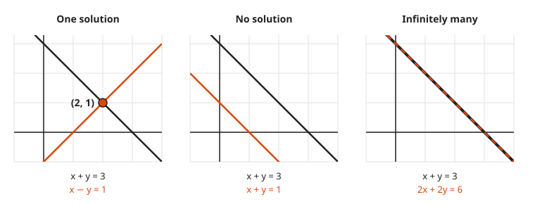
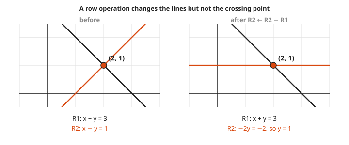
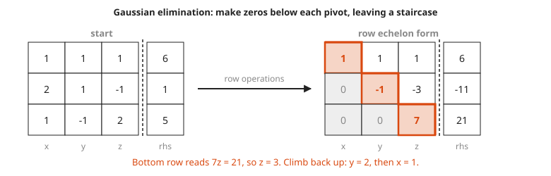

# Solving Systems With Gaussian Elimination

**Level:** 501 · **Unit:** 3, Linear Algebra · **Time:** 75 minutes
**Prerequisites:** [Matrices as Transformations](../10-matrices-as-transformations/README.md), [Course 201: linear equations](../../201/README.md) · Next: [Determinants as Area Scaling](../12-determinants-as-area-scaling/README.md)

## The Big Idea

A **system of linear equations** is several straight-line conditions that must all hold at once. Each equation is a line (in 2D) or a flat plane (in 3D), and a solution is a point that sits on all of them. **Gaussian elimination** is the mechanical recipe for finding it: combine equations to knock out one unknown at a time until the last equation has a single unknown, then work back up. It is a loop a computer runs without thinking, and it is the workhorse behind almost every numerical solver.

## Picture It

<!-- diagram: type=line-panels cases="one: x+y=3,x-y=1; none: x+y=3,x+y=1; infinite: x+y=3,2x+2y=6" caption="three possible outcomes" -->


Two lines in a plane can meet in exactly three ways. They cross once (one solution). They run parallel and never meet (no solution). They lie on top of each other (every point on the line is a solution). There is no fourth option. Two distinct straight lines cannot cross twice.

## Step by Step

1. **Write the system as an augmented matrix.** Keep only the numbers. The bar separates the left side from the right side:

   $$\begin{aligned} x + y + z &= 6 \\ 2x + y - z &= 1 \\ x - y + 2z &= 5 \end{aligned} \qquad \longrightarrow \qquad \left(\begin{array}{ccc|c} 1 & 1 & 1 & 6 \\ 2 & 1 & -1 & 1 \\ 1 & -1 & 2 & 5 \end{array}\right)$$

   The left block is the matrix $A$ of [Matrices as Transformations](../10-matrices-as-transformations/README.md). The system asks: which input $x$ does $A$ send to the right-hand side $b$? In symbols, $Ax = b$.
2. **Three legal row operations.** None of them changes the solution set:

   * Swap two rows.
   * Multiply a row by a nonzero number.
   * Add a multiple of one row to another row.

3. **Why the moves are legal.** If a point satisfies two equations, it satisfies their sum too, and the step can be undone. The lines change. The crossing point does not.

<!-- diagram: type=line-panels cases="before: x+y=3,x-y=1; after R2-R1: x+y=3,-2y=-2" caption="row operation keeps the solution" -->


4. **Forward elimination.** Work column by column. Pick a **pivot** (a nonzero entry on the diagonal). Use it to make every entry below it zero. Move one step right and one step down. Repeat.
5. **Row echelon form.** When forward elimination ends, the nonzero entries form a staircase. The bottom row has the fewest unknowns.

<!-- diagram: type=matrix-before-after pivots=diagonal zeros=below caption="row echelon staircase" -->


6. **Back substitution.** Solve the bottom row. Plug that value into the row above. Climb to the top.
7. **Read the outcome.** A row $0 \; 0 \; 0 \mid c$ with $c \neq 0$ says $0 = c$: no solution. A row of all zeros $0 \; 0 \; 0 \mid 0$ says nothing new: an unknown is left free, and there are infinitely many solutions. Otherwise there is exactly one.

### Why It Is True: Elimination Always Finishes

Each pass of step 4 makes one more column zero below its pivot, and never disturbs the zeros already made: the rows used to make them start with zeros in those columns. With $n$ columns, at most $n$ passes are needed. If a column has no nonzero entry left to use as a pivot, skip it. That skipped column is a free unknown.

## Worked Examples

### Example 1: Two Equations

```txt
 x + y = 3                    R1
 x - y = 1                    R2
-2y    = -2                   R2 <- R2 - R1      eliminate x from the second row
   y   = 1                    divide by -2
 x + 1 = 3                    back-substitute into R1
   x   = 2                    solution (2, 1), the crossing point in the picture
```

### Example 2: Three Equations

```txt
[ 1  1  1 |  6 ]
[ 2  1 -1 |  1 ]
[ 1 -1  2 |  5 ]

[ 1  1  1 |  6 ]
[ 0 -1 -3 | -11]              R2 <- R2 - 2 R1
[ 0 -2  1 | -1 ]              R3 <- R3 - R1

[ 1  1  1 |  6 ]
[ 0 -1 -3 | -11]
[ 0  0  7 |  21]              R3 <- R3 - 2 R2      staircase done

7z = 21          ->  z = 3                          bottom row
-y - 3(3) = -11  ->  -y = -2  ->  y = 2             middle row
x + 2 + 3 = 6    ->  x = 1                          top row
check row 2: 2(1) + 2 - 3 = 1                       matches
```

### Example 3: Capacity Planning

Instance type A gives 2 CPUs and 4 GB of memory. Type B gives 4 CPUs and 4 GB. You need exactly 20 CPUs and 28 GB. How many of each?

```txt
2a + 4b = 20                  CPU equation
4a + 4b = 28                  memory equation
2a      = 8                   R2 <- R2 - R1     the b terms cancel
 a      = 4
2(4) + 4b = 20  ->  4b = 12  ->  b = 3          back-substitute
```

Four of type A and three of type B. Check: $8 + 12 = 20$ CPUs and $16 + 12 = 28$ GB.

### Example 4: No Solution

```txt
 x + 2y = 4
2x + 4y = 9
 0 +  0 = 1                   R2 <- R2 - 2 R1   says 0 = 1: impossible
```

The two lines are parallel. Elimination does not fail here. It reports the truth.

## See It Step by Step


[Solving a System by Graphing: open the step-by-step walkthrough](https://caseyaedwards.github.io/math_training/diagrams/system-of-equations/)

Watch the two lines cross at the one point that satisfies both equations.


[Elimination in the Row Picture: open the step-by-step walkthrough](https://caseyaedwards.github.io/math_training/diagrams/elimination-row-picture/)

Watch each row operation swap a line for a new one through the same crossing point.


[Gaussian Elimination: open the step-by-step walkthrough](https://caseyaedwards.github.io/math_training/diagrams/gaussian-elimination/)

Watch the entries below each pivot clear out, leaving a staircase that solves from the bottom up.


[Solving Ax = b: Row and Column Pictures: open the step-by-step walkthrough](https://caseyaedwards.github.io/math_training/diagrams/column-row-picture/)

Watch the row picture and the column picture reach the same answer from two different directions.

## Common Mistakes

* Changing one side of a row and not the other: a row operation acts on the whole row, including the number after the bar.
* Multiplying a row by 0: that throws the equation away. Only nonzero multipliers are legal.
* Stopping at the staircase: back substitution is half the job.
* Reading a zero row as `no solution`: $0 = 0$ is true. It means a free unknown and infinitely many solutions.

## Try It

1. Solve $2x + y = 7$ and $x - y = 2$.
2. Solve $x + 2y = 4$ and $2x + 4y = 8$. Describe all solutions.
3. Solve $3x + 2y = 12$ and $x + 2y = 8$.
4. Solve the system $x + 2y + z = 1$, $2x + y + z = 4$, $x + y + 2z = 3$.
5. Which row operation is not allowed: swapping rows, multiplying a row by 0, or adding 3 times row 1 to row 2?
6. After elimination, the last row reads $0 \; 0 \; 0 \mid 5$. What does that mean?
7. Two job types use servers and storage. Job X needs 1 server and 3 TB. Job Y needs 2 servers and 1 TB. You have 8 servers and 9 TB and want to use all of both. How many of each job?

<details>
<summary>Answers</summary>

1. Add the equations: $3x = 9$, which gives $x = 3$, then $y = 1$.
2. $R_2 - 2R_1$ gives $0 = 0$. Infinitely many solutions: $y = t$ for any $t$, and $x = 4 - 2t$.
3. Subtract: $2x = 4$, which gives $x = 2$, then $2y = 6$, $y = 3$.
4. $x = 2$, $y = -1$, $z = 1$. Check: $2 - 2 + 1 = 1$, $4 - 1 + 1 = 4$, $2 - 1 + 2 = 3$.
5. Multiplying a row by 0.
6. It says $0 = 5$. The system has no solution.
7. $x + 2y = 8$ and $3x + y = 9$. $R_2 - 3R_1$: $-5y = -15$, which gives $y = 3$ and $x = 2$. Two X jobs and three Y jobs.

</details>

## Code Corner

`math/big.Rat` keeps every entry an exact fraction, which avoids rounding errors in this small example. The full program is [code/main.go](code/main.go). Run it from the `code` folder with `go run .`.

```go
for col := 0; col < n; col++ {
	p := col
	for m[p][col].Sign() == 0 { // find a row with a nonzero pivot
		p++
	}
	m[col], m[p] = m[p], m[col]
	for r := col + 1; r < n; r++ {
		f := new(big.Rat).Quo(m[r][col], m[col][col])
		for c := col; c <= n; c++ {
			m[r][c].Sub(m[r][c], new(big.Rat).Mul(f, m[col][c]))
		}
	}
}
```

Output:

```txt
     1     1     1 |     6
     2     1    -1 |     1
     1    -1     2 |     5

     1     1     1 |     6
     0    -1    -3 |   -11
     0     0     7 |    21

x, y, z = [1 2 3]
     2     4 |    20
     0    -4 |   -12

capacity a, b = [4 3]
```

The program uses the subtraction $R_2 - 2R_1$ in the capacity system, which is why its middle step differs from Example 3. Different legal moves, same answer.

## Go Deeper

* [Wolfram MathWorld: Gaussian Elimination](https://mathworld.wolfram.com/GaussianElimination.html): a compact reference.
* [Paul's Online Math Notes: Linear Algebra](https://tutorial.math.lamar.edu/Classes/LinAlg/LinAlg.aspx): systems of equations and row reduction, step by step.
* [MacTutor: Carl Friedrich Gauss](https://mathshistory.st-andrews.ac.uk/Biographies/Gauss/): the method carries his name, though Chinese mathematicians used it about 2,000 years earlier.
* [Linear Algebra Track](../../../tracks/linear-algebra/README.md): more practice in this repository.
