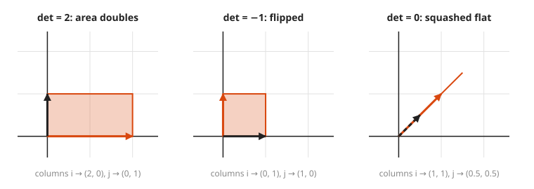
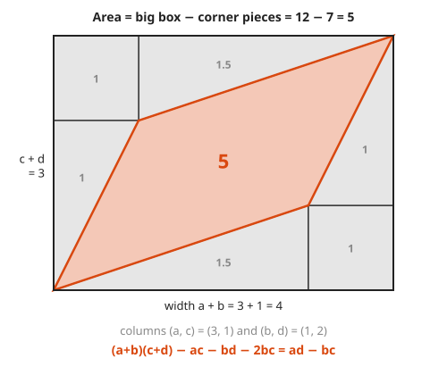

# Determinants as Area Scaling

**Level:** 501 · **Unit:** 3, Linear Algebra · **Time:** 60 minutes
**Prerequisites:** [Matrices as Transformations](../10-matrices-as-transformations/README.md), [Solving Systems With Gaussian Elimination](../11-solving-systems-gaussian-elimination/README.md) · Next: [Eigenvalues and Eigenvectors](../13-eigenvalues-and-eigenvectors/README.md)

## The Big Idea

A matrix stretches and squashes the plane. The **determinant** is one number that says by how much: every area gets multiplied by it. A determinant of 5 means every shape comes out five times bigger. A negative determinant means the plane was also flipped over, like a page turned face down. A determinant of 0 means the plane was crushed flat onto a line, and no matrix can undo a crush. That last fact is the one you use most.

## Picture It

<!-- diagram: type=parallelogram cols=(3,1),(1,2) unit-square=true caption="determinant as area" -->
![The unit square, area 1, and the parallelogram spanned by the columns (3,1) and (1,2), which has area 5. The title reads det [[3,1],[1,2]] = 3·2 - 1·1 = 5.](img/det-area.svg)

The matrix $\begin{pmatrix} 3 & 1 \\ 1 & 2 \end{pmatrix}$ sends the unit square (the one with corners at $(0,0)$ and $(1,1)$) to the parallelogram built on its two columns. That parallelogram has area 5. The determinant is 5.

## Step by Step

1. **The 2 by 2 formula.**

   $$\det \begin{pmatrix} a & b \\ c & d \end{pmatrix} = ad - bc$$

   Down-right diagonal product, minus up-right diagonal product.
2. **What the number means.** $|\det A|$ is the area of the image of the unit square. Since every shape is built from tiny squares, every area scales by the same factor.

<!-- diagram: type=shape-transform shapes=circle,square,triangle matrix="[[3,1],[1,2]]" caption="all areas scale by det" -->
![Left: a small circle, square and triangle. Right: their images after the matrix [[3,1],[1,2]]: an ellipse, a parallelogram and a larger triangle, each with 5 times the original area.](img/det-any-shape.svg)

3. **The sign means orientation.** Positive: the image keeps its handedness (counterclockwise stays counterclockwise). Negative: it is mirrored.
4. **Zero means collapse.** If $\det A = 0$, the two columns lie on one line, and the whole plane is squashed onto that line (or onto a point). Different inputs land on the same output, and nothing can undo that. The matrix has no **inverse** (no undo matrix). In system terms from the previous lesson: $Ax = b$ has either no solution or infinitely many.

<!-- diagram: type=parallelogram-panels cases="det 2,det -1,det 0" caption="three kinds of determinant" -->


5. **Product rule.** $\det(AB) = \det(A)\,\det(B)$. Scaling areas by 3 and then by 2 scales them by 6. This also shows a rotation has determinant 1: it moves shapes without resizing them.
6. **3 by 3 determinants.** In 3D the determinant is the **volume** scaling factor: the volume of the slanted box built on the three columns. Compute it by expanding along the top row (a **cofactor expansion**), where each $2 \times 2$ piece comes from crossing out that entry's row and column:

   $$\det \begin{pmatrix} a & b & c \\ d & e & f \\ g & h & i \end{pmatrix} = a(ei - fh) - b(di - fg) + c(dh - eg)$$

   Note the alternating signs $+, -, +$.
7. **Shortcuts.** A triangular matrix (all zeros below the diagonal, or all above) has determinant equal to the product of its diagonal. Elimination produces exactly that shape. Swapping two rows flips the sign. Adding a multiple of one row to another leaves the determinant unchanged.

### Why It Is True: ad - bc Is an Area

Take the parallelogram with columns $(a, c) = (3, 1)$ and $(b, d) = (1, 2)$. Draw the box around it, then remove the corners.

<!-- diagram: type=area-proof box=4x3 pieces="1.5,1,1,1.5,1,1" caption="ad - bc from the bounding box" -->


```txt
box            = (a + b)(c + d) = ac + ad + bc + bd     width times height
two triangles  = 2 · (ac / 2) = ac                      long thin corners
two triangles  = 2 · (bd / 2) = bd                      the other pair of corner triangles
two rectangles = 2 · bc                                 the small square corners
area = box - ac - bd - 2bc
     = ad + bc - 2bc
     = ad - bc                                          the formula
with the numbers: 12 - 3 - 2 - 2 = 5
```

## Worked Examples

### Example 1: Compute and Interpret

```txt
det [[3, 1], [1, 2]] = 3·2 - 1·1 = 5       areas grow 5 times
det [[1, 2], [3, 4]] = 1·4 - 2·3 = -2      areas double, and the plane flips
det [[2, 4], [1, 2]] = 2·2 - 4·1 = 0       columns (2,1) and (4,2) are parallel: collapse
```

### Example 2: Find the Value That Breaks a Matrix

For which $k$ is $\begin{pmatrix} k & 2 \\ 3 & 6 \end{pmatrix}$ not invertible?

```txt
det = 6k - 2·3 = 6k - 6        formula
6k - 6 = 0                     not invertible exactly when det = 0
k = 1                          then the columns (1, 3) and (2, 6) are parallel
```

### Example 3: A 3 by 3 Determinant

```txt
det [[1, 2, 3],
     [0, 1, 4],
     [5, 6, 0]]
= 1·(1·0 - 4·6) - 2·(0·0 - 4·5) + 3·(0·6 - 1·5)      expand along the top row
= 1·(-24) - 2·(-20) + 3·(-5)
= -24 + 40 - 15
= 1                                                   volume is preserved
```

## See It Step by Step


[Determinant as Area Scale Factor: open the step-by-step walkthrough](https://caseyaedwards.github.io/math_training/diagrams/determinant-area/)

Watch the unit square stretch into a parallelogram whose area equals the determinant.


[Why the Determinant Is ad − bc: open the step-by-step walkthrough](https://caseyaedwards.github.io/math_training/diagrams/determinant-formula/)

Watch the corner pieces of the box come away to leave a parallelogram of area ad - bc.

## Common Mistakes

* Using $ad + bc$: the formula is a difference.
* Reading a negative determinant as a negative area: the area factor is $|\det A|$. The sign reports a flip.
* Forgetting the alternating signs in a 3 by 3 expansion: $+, -, +$.
* Thinking $\det(A + B) = \det A + \det B$: it is false. Only products behave well.

## Try It

1. Compute $\det \begin{pmatrix} 2 & 0 \\ 0 & 3 \end{pmatrix}$ and describe what the matrix does.
2. Compute $\det \begin{pmatrix} 1 & 2 \\ 3 & 4 \end{pmatrix}$.
3. Compute $\det \begin{pmatrix} 2 & 4 \\ 1 & 2 \end{pmatrix}$. What does the answer tell you?
4. Show that a rotation matrix $\begin{pmatrix} \cos\theta & -\sin\theta \\ \sin\theta & \cos\theta \end{pmatrix}$ has determinant 1. (Use $\cos^2\theta + \sin^2\theta = 1$.)
5. $\det A = 3$ and $\det B = -2$. Find $\det(AB)$. By what factor does $AB$ scale areas?
6. A triangle of area 4 goes through a matrix with determinant 5. What is the new area?
7. Find $\det$ of the diagonal matrix with entries 2, 3, 4. What does it mean in 3D?
8. For which $k$ is $\begin{pmatrix} 2 & k \\ 4 & 6 \end{pmatrix}$ singular (not invertible)?

<details>
<summary>Answers</summary>

1. $6$. It stretches x by 2 and y by 3, which multiplies areas by 6.
2. $4 - 6 = -2$.
3. $4 - 4 = 0$. The columns are parallel. The plane collapses onto a line and the matrix has no inverse.
4. $\cos\theta \cdot \cos\theta - (-\sin\theta)\sin\theta = \cos^2\theta + \sin^2\theta = 1$.
5. $\det(AB) = 3 \cdot (-2) = -6$. Areas scale by 6, with a flip.
6. $4 \times 5 = 20$.
7. $2 \cdot 3 \cdot 4 = 24$. Volumes grow 24 times: a unit cube becomes a 2 by 3 by 4 box.
8. $12 - 4k = 0$, which gives $k = 3$.

</details>

## Code Corner

A 2 by 2 determinant is one line. A 3 by 3 determinant reuses it three times. The full program is [code/main.go](code/main.go). Run it from the `code` folder with `go run .`.

```go
func det2(m [2][2]int) int { return m[0][0]*m[1][1] - m[0][1]*m[1][0] }

// det3 expands along the top row (cofactor expansion).
func det3(m [3][3]int) int {
	// ... minor(col) is defined here: it crosses out row 0 and column col.
	return m[0][0]*det2(minor(0)) - m[0][1]*det2(minor(1)) + m[0][2]*det2(minor(2))
}
```

Output:

```txt
det [[3,1],[1,2]] = 5
det [[1,2],[3,4]] = -2
det [[2,4],[1,2]] = 0 (columns on one line)
det [[0,1],[1,0]] = -1 (a flip)
det of 3x3 example = 1
det(AB) = -10  det(A)*det(B) = -10
```

## Go Deeper

* [Wolfram MathWorld: Determinant](https://mathworld.wolfram.com/Determinant.html): definitions and properties in one page.
* [3Blue1Brown: Essence of Linear Algebra](https://www.3blue1brown.com/topics/linear-algebra): the determinant chapter animates exactly the picture above.
* [Paul's Online Math Notes: Linear Algebra](https://tutorial.math.lamar.edu/Classes/LinAlg/LinAlg.aspx): determinant rules with worked examples.
* [Linear Algebra Track](../../../tracks/linear-algebra/README.md): more practice in this repository.
