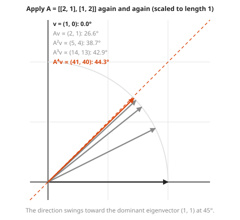
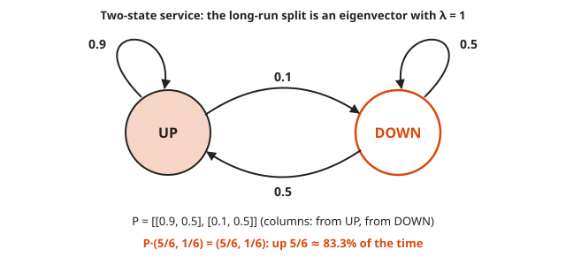

# Eigenvalues and Eigenvectors

**Level:** 501 · **Unit:** 3, Linear Algebra · **Time:** 75 minutes
**Prerequisites:** [Determinants as Area Scaling](../12-determinants-as-area-scaling/README.md), [Matrices as Transformations](../10-matrices-as-transformations/README.md) · Next: [Checkpoint](../checkpoint.md)

## The Big Idea

A matrix turns most arrows. A few special directions do not turn: arrows along them only get longer, shorter, or flipped. Those directions are the **eigenvectors**, and the stretch factor along each one is its **eigenvalue**. (Eigen is German for `own`: the matrix's own directions.) Find them, and a confusing matrix becomes simple: along its own directions it just multiplies. That is why eigenvectors explain long-run behavior: repeated steps of a Markov chain, the ranking in PageRank, the main axes in principal component analysis.

## Picture It

<!-- diagram: type=vector-grid matrix="[[2,1],[1,2]]" vectors="(1,1)->(3,3),(1,-1)->(1,-1),(1,0)->(2,1)" eigenlines=dashed caption="directions that do not turn" -->
![Grid with two dashed lines through the origin, y = x and y = -x. The matrix [[2,1],[1,2]] sends (1,1) to (3,3), along the same dashed line, stretched 3 times. It sends (1,-1) to itself. It sends (1,0) to (2,1), which is off the original line: that arrow turned.](img/eigen-directions.svg)

The matrix $A = \begin{pmatrix} 2 & 1 \\ 1 & 2 \end{pmatrix}$ sends $(1, 1)$ to $(3, 3)$: same direction, three times longer. It sends $(1, -1)$ to $(1, -1)$: same direction, same length. It sends $(1, 0)$ to $(2, 1)$: that arrow turned. The two dashed lines are the eigen-directions. Their eigenvalues are 3 and 1.

## Step by Step

1. **Definition.** A nonzero vector $v$ is an eigenvector of $A$ with eigenvalue $\lambda$ (the Greek letter lambda) when

   $$A v = \lambda v$$

   In words: applying $A$ does the same thing as multiplying by a plain number.
2. **What $\lambda$ says.** $\lambda > 1$: stretch. $0 < \lambda < 1$: shrink. $\lambda = 1$: no change. $\lambda < 0$: flip to the opposite direction (still on the same line). $\lambda = 0$: crushed to zero, which happens exactly when $\det A = 0$.
3. **Rewrite as a collapse question.** Move everything to one side: $(A - \lambda I)v = 0$, where $I = \begin{pmatrix} 1 & 0 \\ 0 & 1 \end{pmatrix}$ is the **identity** matrix (the do-nothing matrix). A nonzero $v$ goes to zero only if $A - \lambda I$ crushes the plane. From [Determinants as Area Scaling](../12-determinants-as-area-scaling/README.md), that means

   $$\det(A - \lambda I) = 0$$

   This is the **characteristic equation**. For a 2 by 2 matrix it is a quadratic in $\lambda$.
4. **The 2 by 2 shortcut.** For $A = \begin{pmatrix} a & b \\ c & d \end{pmatrix}$:

   $$\lambda^2 - (a + d)\lambda + (ad - bc) = 0$$

   The sum $a + d$ is the **trace** (the diagonal sum). The constant is the determinant. Two built-in checks follow: the eigenvalues add up to the trace and multiply to the determinant.

<!-- diagram: type=function-plot f="l^2-4l+3" roots=1,3 caption="characteristic polynomial" -->
![Parabola lambda squared minus 4 lambda plus 3, crossing zero at lambda = 1 and lambda = 3, the two eigenvalues of [[2,1],[1,2]].](img/char-poly.svg)

5. **Find each eigenvector.** Plug each $\lambda$ back into $(A - \lambda I)v = 0$. Both rows of $A - \lambda I$ describe the same line, which gives the direction of $v$. Any nonzero multiple of an eigenvector is also an eigenvector: it is a direction, not a single arrow.
6. **The circle test.** Apply the matrix to the unit circle. A symmetric matrix (one equal to its mirror image across the diagonal, as here) turns the circle into an ellipse whose axes lie exactly along the eigenvectors, with half-lengths equal to the eigenvalues.

<!-- diagram: type=circle-to-ellipse matrix="[[2,1],[1,2]]" axes=eigenvectors caption="circle to ellipse" -->
![The dashed unit circle and its image under [[2,1],[1,2]]: a tilted ellipse. Its long axis, stretched 3 times, lies along (1,1). Its short axis, stretched 1 time, lies along (1,-1).](img/circle-ellipse.svg)

7. **Repeated application.** Write a vector as a mix of eigenvectors. Applying $A$ $n$ times multiplies each part by $\lambda^n$. The part with the largest $|\lambda|$ grows fastest and takes over. This is **power iteration**, and it is how PageRank and many large solvers find the dominant eigenvector.

<!-- diagram: type=unit-arrows matrix="[[2,1],[1,2]]" start=(1,0) steps=4 caption="power iteration" -->


8. **Some matrices have no real eigenvectors.** A 90-degree rotation turns every arrow, which leaves no direction unturned. Its characteristic equation $\lambda^2 + 1 = 0$ has no real solution.
9. **Markov chains.** A **Markov chain** moves between states with fixed probabilities, as in `up` and `down` for a service. Put the probabilities in a matrix $P$ whose columns add to 1. A long-run split that no longer changes is a vector $s$ with $Ps = s$: an eigenvector with $\lambda = 1$.

<!-- diagram: type=state-diagram states=UP,DOWN p="UP>UP 0.9, UP>DOWN 0.1, DOWN>UP 0.5, DOWN>DOWN 0.5" caption="two-state Markov chain" -->


### Why It Is True: Power Iteration Finds the Big Direction

Take $v = (1, 0) = \tfrac{1}{2}(1, 1) + \tfrac{1}{2}(1, -1)$, a mix of the two eigenvectors. Then

$$A^n v = \tfrac{1}{2} \cdot 3^n (1, 1) + \tfrac{1}{2} \cdot 1^n (1, -1)$$

The first part grows like $3^n$. The second stays the same size. After a few steps the first part dwarfs the second, and the direction is almost exactly $(1, 1)$. The picture above shows this happening in four steps.

## Worked Examples

### Example 1: Eigenvalues and Eigenvectors of [[2, 1], [1, 2]]

```txt
trace = 2 + 2 = 4,  det = 2·2 - 1·1 = 3
λ^2 - 4λ + 3 = 0                         characteristic equation
(λ - 3)(λ - 1) = 0                       factor
λ = 3 or λ = 1
check: 3 + 1 = 4 = trace,  3 · 1 = 3 = det

λ = 3:  A - 3I = [[-1, 1], [1, -1]]      row 1 says -x + y = 0: y = x
        v = (1, 1)
λ = 1:  A - I  = [[1, 1], [1, 1]]        row 1 says x + y = 0: y = -x
        v = (1, -1)
```

### Example 2: A Non-Symmetric Matrix

$A = \begin{pmatrix} 4 & 1 \\ 2 & 3 \end{pmatrix}$.

```txt
trace = 7, det = 12 - 2 = 10
λ^2 - 7λ + 10 = 0  ->  (λ - 5)(λ - 2) = 0  ->  λ = 5, 2
λ = 5:  A - 5I = [[-1, 1], [2, -2]]   ->  y = x      ->  v = (1, 1)
λ = 2:  A - 2I = [[2, 1], [2, 1]]     ->  y = -2x    ->  v = (1, -2)
check:  A (1, -2) = (4 - 2, 2 - 6) = (2, -4) = 2 (1, -2)
```

### Example 3: Service Availability as a Steady State

From the state diagram, with columns `from UP` and `from DOWN`: $P = \begin{pmatrix} 0.9 & 0.5 \\ 0.1 & 0.5 \end{pmatrix}$.

```txt
P s = s  with  s = (u, d)                  steady state
0.9u + 0.5d = u                            row 1
-0.1u + 0.5d = 0  ->  u = 5d               rearrange
u + d = 1  ->  6d = 1                      probabilities add to 1
d = 1/6, u = 5/6 ≈ 0.833                   up about 83.3% of the time
```

The service fails rarely (10% chance per step) but recovers slowly (50% per step). The eigenvector puts a number on that trade.

## Common Mistakes

* Counting the zero vector as an eigenvector: $A \cdot 0 = \lambda \cdot 0$ for every $\lambda$, which tells you nothing. Eigenvectors are nonzero by definition.
* Expecting one specific arrow: eigenvectors come as whole lines. $(1, 1)$, $(2, 2)$ and $(-5, -5)$ are the same answer.
* Forgetting to subtract $\lambda$ from both diagonal entries: $A - \lambda I$ changes the diagonal only.
* Skipping the trace and determinant check: it catches most arithmetic slips for free.

## Try It

1. Find the eigenvalues and eigenvectors of $\begin{pmatrix} 2 & 0 \\ 0 & 5 \end{pmatrix}$.
2. What are the eigenvectors of $\begin{pmatrix} 3 & 0 \\ 0 & 3 \end{pmatrix}$?
3. Find the eigenvalues and eigenvectors of $\begin{pmatrix} 5 & 4 \\ 1 & 2 \end{pmatrix}$.
4. Check that $(1, 2)$ is an eigenvector of $\begin{pmatrix} 1 & 2 \\ 2 & 4 \end{pmatrix}$. What is its eigenvalue? What is the other eigenvalue?
5. Why does the 90-degree rotation have no real eigenvectors?
6. With $A = \begin{pmatrix} 2 & 1 \\ 1 & 2 \end{pmatrix}$, compute $A^{10}(1, 1)$ without multiplying matrices.
7. With the same $A$, compute $A^5 (1, 0)$. Use $(1, 0) = \tfrac{1}{2}(1, 1) + \tfrac{1}{2}(1, -1)$.
8. Find the steady state of $P = \begin{pmatrix} 0.8 & 0.4 \\ 0.2 & 0.6 \end{pmatrix}$.

<details>
<summary>Answers</summary>

1. $\lambda = 2$ with $v = (1, 0)$, and $\lambda = 5$ with $v = (0, 1)$. A diagonal matrix stretches along the axes.
2. Every nonzero vector, with $\lambda = 3$. Scaling everything by 3 turns nothing.
3. Trace 7, det 6: $\lambda^2 - 7\lambda + 6 = 0$, $\lambda = 6$ or $1$. For 6: $-x + 4y = 0$, $v = (4, 1)$. For 1: $4x + 4y = 0$, $v = (1, -1)$.
4. $A(1, 2) = (1 + 4, 2 + 8) = (5, 10) = 5(1, 2)$, which gives $\lambda = 5$. Trace 5 means the other is $0$ (and $\det = 0$ agrees).
5. It turns every arrow by 90 degrees, which leaves no direction unturned. Algebra agrees: $\lambda^2 + 1 = 0$ has no real root.
6. $(1, 1)$ has eigenvalue 3: $3^{10}(1, 1) = (59049, 59049)$.
7. $\tfrac{1}{2} \cdot 243 (1, 1) + \tfrac{1}{2}(1, -1) = (122, 121)$.
8. $-0.2u + 0.4d = 0$, which gives $u = 2d$. With $u + d = 1$: $u = 2/3$, $d = 1/3$.

</details>

## Code Corner

Eigenvalues from the trace and determinant, power iteration, and a Markov chain run until it settles. The full program is [code/main.go](code/main.go). Run it from the `code` folder with `go run .`.

```go
// eigenvalues solves l^2 - (trace) l + det = 0 with the quadratic formula.
func eigenvalues(m mat) (float64, float64) {
	tr := m[0][0] + m[1][1]
	det := m[0][0]*m[1][1] - m[0][1]*m[1][0]
	disc := tr*tr - 4*det
	if disc < 0 {
		return math.NaN(), math.NaN() // no real eigenvalues: every vector turns
	}
	return (tr + math.Sqrt(disc)) / 2, (tr - math.Sqrt(disc)) / 2
}
```

Output:

```txt
eigenvalues of [[2,1],[1,2]]: 3 1
A(1,1)  = [3 3]  A(1,-1) = [1 -1]
eigenvalues of [[4,1],[2,3]]: 5 2
rotation by 90 degrees: NaN
step 0: direction 0.0 degrees
step 1: direction 26.6 degrees
step 2: direction 38.7 degrees
step 3: direction 42.9 degrees
step 4: direction 44.3 degrees
steady state: up 0.8333, down 0.1667
```

`NaN` (not a number) is how the program reports `no real answer`. The rotation is not broken. It simply has no direction it leaves alone.

## Go Deeper

* [3Blue1Brown: Essence of Linear Algebra](https://www.3blue1brown.com/topics/linear-algebra): the eigenvector chapter shows the unturned directions in motion.
* [Paul's Online Math Notes: Eigenvalues and Eigenvectors](https://tutorial.math.lamar.edu/Classes/DE/LA_Eigen.aspx): a clean written walk-through with examples.
* [MIT OCW 18.06 Linear Algebra](https://ocw.mit.edu/courses/18-06-linear-algebra-spring-2010/): Strang's lectures on eigenvalues and Markov matrices.
* [Workshop: Linear Algebra for Graphics and ML](../../../workshops/linear-algebra-for-graphics-and-ml/README.md) and [Workshop: Graph Theory for Networks and Dependencies](../../../workshops/graph-theory-for-networks-and-dependencies/README.md): eigenvectors in PCA and PageRank.
