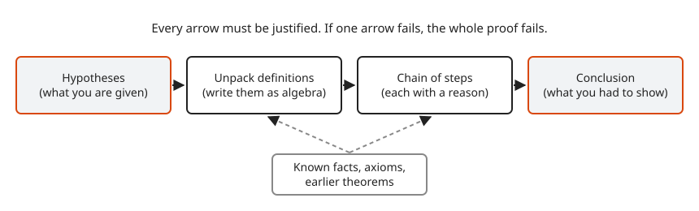
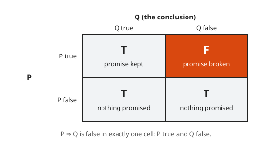
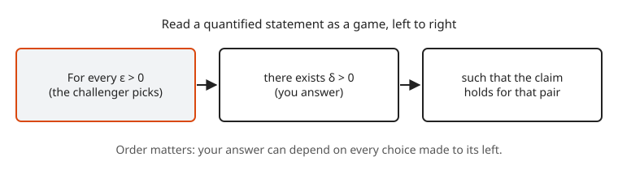
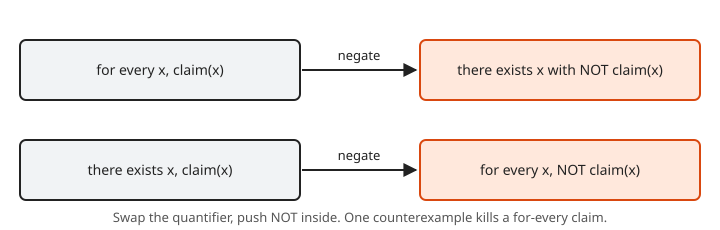
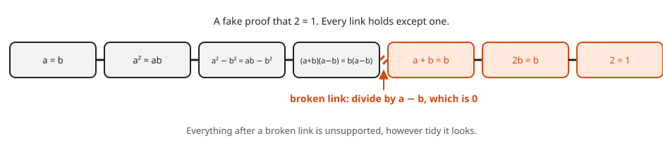

# Reading and Writing Proofs

**Level:** 601 · **Unit:** 1 · **Time:** 60 to 90 minutes
**Prerequisites:** [501 Logic and Discrete Math](../../501/README.md)

## The Big Idea

A **proof** is a chain of statements. The first links are things you are given. The last link is the thing you want. Every link in between follows from earlier links by a definition, a known fact or a rule of logic. If one link is missing, the chain does not hold, no matter how many examples agree with the conclusion.

Think of a proof as a deploy pipeline where every stage must pass. A thousand green test runs (examples) do not prove a function correct. One clear argument that covers every input does.

## Picture It

<!-- diagram: type=flow nodes="Hypotheses,Unpack definitions,Chain of steps,Conclusion" side="Known facts" caption="Anatomy of a proof" -->


You start at the left box with what the statement hands you. You rewrite each term by its definition, because definitions turn words into algebra you can push around. You chain steps together. Known facts plug in from below. The last box must match the claim word for word.

## Step by Step

### 1. Statements and Implication

A **statement** is a sentence that is either true or false. "7 is prime" is a statement. "$x > 3$" is not, until you know $x$.

Most theorems have the shape **if P, then Q**, written $P \Rightarrow Q$. P is the **hypothesis**. Q is the **conclusion**. The implication is false in exactly one situation: P is true and Q is false.

```txt
  P   Q   P => Q
  T   T     T
  T   F     F       the only way to break a promise
  F   T     T
  F   F     T       nothing was promised
```

<!-- diagram: type=grid rows="P true,P false" cols="Q true,Q false" accent="P true,Q false" caption="The four cases of an implication" -->


The last two rows surprise people. Read $P \Rightarrow Q$ as a promise: "if the alert fires, someone gets paged." If the alert never fires, the promise is not broken, whatever happens with the pager.

### 2. Quantifiers

Two words do most of the heavy lifting:

* **For every** ($\forall$): the claim holds for each object in the collection. "$\forall n \in \mathbb{N},\ n + 0 = n$."
* **There exists** ($\exists$): at least one object makes the claim true. "$\exists n \in \mathbb{N},\ n^2 = 49$."

<!-- diagram: type=flow nodes="For every epsilon,there exists delta,claim holds" caption="Quantifiers as a game" -->


Read a statement with several quantifiers as a game played left to right. A challenger picks every object behind a "for every". You pick every object behind a "there exists". You win when the final claim holds. Your choice can depend on everything chosen to its left, never on anything to its right. That is why the order of quantifiers matters:

* $\forall x\ \exists y,\ y > x$: every number has a bigger number. True. Pick $y = x + 1$.
* $\exists y\ \forall x,\ y > x$: one number is bigger than every number. False.

### 3. Negation

To disprove a claim, prove its negation. The rules:

* Swap $\forall$ and $\exists$.
* Negate the inner claim.
* The negation of $P \Rightarrow Q$ is "$P$ and not $Q$".

<!-- diagram: type=flow pairs="for every->there exists not,there exists->for every not" caption="Negating quantified statements" -->


```txt
  claim:     for every server s, latency(s) < 200 ms
  negation:  there exists a server s with latency(s) >= 200 ms
```

One counterexample is enough to kill a "for every" claim.

### 4. How to Read a Proof

1. Read the statement. Name the hypothesis and the conclusion.
2. Write down the definition of every term in the statement.
3. Try two or three small examples. See the claim hold before you read why.
4. Read the proof one line at a time. For each line, ask: which earlier line, definition or fact gives me this?
5. Find the line where the hypothesis does real work. That line is the heart of the proof.

### 5. How to Write a Proof

1. State the claim in full.
2. Begin with **Proof.** Name what you assume: "Let $n$ be an odd integer."
3. Unpack every definition into algebra.
4. Push the algebra toward the goal. Write one idea per sentence.
5. End by stating the conclusion in the words of the claim, then mark the end with $\blacksquare$.

Write in sentences, not in a cloud of symbols. "Hence", "therefore" and "because" carry the logic. Each one must point at a real reason.

## Worked Examples

### Example 1: Name the Parts

Claim: "If an integer $n$ is divisible by 6, then $n$ is even."

```txt
  hypothesis:   n is divisible by 6           given
  conclusion:   n is even                     to show
  unpack:       n = 6k for some integer k     definition of divisible
  goal form:    n = 2m for some integer m     definition of even
  bridge:       n = 6k = 2(3k)                factor out 2
                m = 3k is an integer          product of integers
  done:         n is even                     matches the goal form
```

### Example 2: Negate a Statement With Two Quantifiers

Claim: "For every request, there exists a replica that answers it."

```txt
  original:   for every request r, there exists a replica p, p answers r
  step 1:     there exists r, NOT (there exists p, p answers r)      negate the outer for every
  step 2:     there exists r, for every p, NOT (p answers r)         negate the inner there exists
  plain:      some request gets no answer from any replica
```

### Example 3: Find the Broken Link

Here is a famous fake proof that $2 = 1$. Let $a = b$ with $a, b$ nonzero.

```txt
  a = b                          given
  a^2 = ab                       multiply both sides by a
  a^2 - b^2 = ab - b^2           subtract b^2 from both sides
  (a + b)(a - b) = b(a - b)      factor both sides
  a + b = b                      divide both sides by (a - b)    <-- broken
  2b = b                         substitute a = b
  2 = 1                          divide by b
```

<!-- diagram: type=chain steps=7 broken=4 caption="A proof chain with one broken link" -->


The broken link is the division by $a - b$. Because $a = b$, the number $a - b$ is $0$, and division by $0$ is not a valid step. Every other line is fine. One bad link ruins the chain.

### Example 4: Disprove With a Counterexample

Claim: "For every positive integer $n$, the number $n^2 + n + 41$ is prime."

```txt
  n = 1:   43                      prime
  n = 2:   47                      prime
  ...                              prime for n = 1 to 39
  n = 40:  1600 + 40 + 41 = 1681   compute
           1681 = 41 * 41          not prime
```

Thirty-nine true cases prove nothing. The single case $n = 40$ disproves the claim.

## See It Step by Step


[Flowchart Proof: Vertical Angles Are Equal: open the step-by-step walkthrough](https://caseyaedwards.github.io/math_training/diagrams/proof-flowchart/)

Watch each statement and its reason feed the next box until the arrows reach the conclusion.


[Truth Tables: open the step-by-step walkthrough](https://caseyaedwards.github.io/math_training/diagrams/truth-tables/)

Watch the conditional come out false in exactly one row, where p is true and q is false.

## Common Mistakes

* Proof by example: checking a few cases of a "for every" claim. Fix: write the argument for an arbitrary object, "let $n$ be any integer".
* Assuming the conclusion: starting from what you want and working toward something true. Fix: start from the hypothesis. Use scratch work backward if it helps, then write the proof forward.
* Swapping quantifier order: $\forall\exists$ and $\exists\forall$ are different claims. Fix: play the game in the written order.
* Using the same letter for two things: "$a = 2k$ and $b = 2k$" forces $a = b$. Fix: use new letters, $a = 2k$ and $b = 2m$.

## Try It

1. Write the hypothesis and the conclusion of: "The square of an odd integer is odd."
2. Negate: "Every log line contains a timestamp."
3. Negate: "There exists a port that every service listens on."
4. Is "$\forall x \in \mathbb{R}\ \exists y \in \mathbb{R},\ x + y = 0$" true? Is "$\exists y \in \mathbb{R}\ \forall x \in \mathbb{R},\ x + y = 0$" true?
5. Fill in the truth value of $P \Rightarrow Q$ when P is "$2 + 2 = 5$" and Q is "the moon is cheese".
6. Find a counterexample: "Every odd number greater than 1 is prime."
7. Find the broken link: "$x^2 = 4$, hence $x = 2$."
8. Rewrite "$n$ is a multiple of 5" as algebra with a quantifier.

<details>
<summary>Answers</summary>

1. Hypothesis: $n$ is an odd integer. Conclusion: $n^2$ is odd.
2. There exists a log line that contains no timestamp.
3. For every port, there exists a service that does not listen on it.
4. The first is true: given $x$, pick $y = -x$. The second is false: no single $y$ works for both $x = 0$ and $x = 1$.
5. True. A false hypothesis makes the implication true.
6. $9 = 3 \cdot 3$ is odd, greater than 1, and not prime.
7. The step drops a case. $x^2 = 4$ gives $x = 2$ or $x = -2$.
8. There exists an integer $k$ with $n = 5k$.

</details>

## Code Corner

The program hunts for counterexamples to three tempting claims. A hit disproves a "for every" claim. No hit proves nothing. The program lives in [code/main.go](code/main.go). Run it with `go run main.go` inside the `code` folder.

```go
// Hunt for counterexamples. A hit disproves a "for every" claim. No hit proves nothing.
package main

import "fmt"

func isPrime(n int) bool {
	if n < 2 {
		return false
	}
	for d := 2; d*d <= n; d++ {
		if n%d == 0 {
			return false
		}
	}
	return true
}

func main() {
	// Claim: n*n + n + 41 is prime for every n >= 1.
	for n := 1; n < 100; n++ {
		v := n*n + n + 41
		if !isPrime(v) {
			fmt.Printf("n*n + n + 41: first counterexample n = %d, value %d = %d * %d\n", n, v, 41, v/41)
			break
		}
	}

	// Claim: every odd number greater than 1 is prime.
	for n := 3; ; n += 2 {
		if !isPrime(n) {
			fmt.Printf("odd numbers are prime: first counterexample %d\n", n)
			break
		}
	}

	// Claim: 2^n - 1 is prime whenever n is prime.
	for n := 2; n < 40; n++ {
		if isPrime(n) && !isPrime(1<<n-1) {
			fmt.Printf("2^n - 1 for prime n: first counterexample n = %d, value %d\n", n, 1<<n-1)
			break
		}
	}
}
```

Output:

```txt
n*n + n + 41: first counterexample n = 40, value 1681 = 41 * 41
odd numbers are prime: first counterexample 9
2^n - 1 for prime n: first counterexample n = 11, value 2047
```

## Go Deeper

* [Book of Proof by Richard Hammack](https://www.people.vcu.edu/~rhammack/BookOfProof/): a free, plain and patient textbook on exactly this material.
* [Wolfram MathWorld: Proof](https://mathworld.wolfram.com/Proof.html): short reference entry with links to each proof technique.

Flashcards for this lesson: [cards.tsv](cards.tsv) (Anki import: front, back, tags, separated by tabs).

Next: [Direct Proof](../02-direct-proof/README.md)
