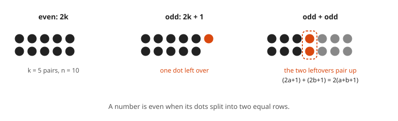
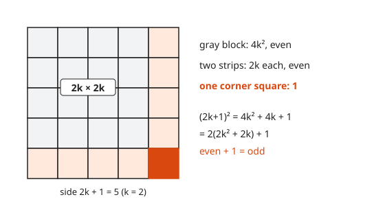
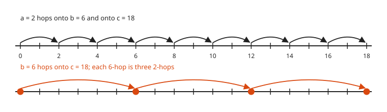
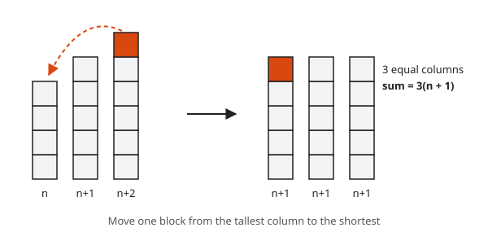

# Direct Proof

**Level:** 601 · **Unit:** 2 · **Time:** 45 to 60 minutes
**Prerequisites:** [Reading and Writing Proofs](../01-reading-and-writing-proofs/README.md)

## The Big Idea

A **direct proof** of $P \Rightarrow Q$ assumes P and walks forward to Q. The recipe has three moves: unpack the definitions in P into algebra, rearrange the algebra, and repack it into the definition that Q needs. Most proofs you ever write are direct proofs.

## Picture It

<!-- diagram: type=dots panels="even 2k,odd 2k+1,odd+odd" caption="Even and odd numbers as rows of dots" -->


An **even** number is a pile of dots that splits into two equal rows. An **odd** number has one dot left over. Put two odd piles side by side and the two leftovers stack into a new column. The rows come out equal. That picture is the whole proof that odd plus odd is even. The algebra below just writes the picture down.

## Step by Step

### 1. The Definitions

Precise definitions are the raw material of every proof in this lesson. All letters are integers.

* $n$ is **even** when $n = 2k$ for some integer $k$.
* $n$ is **odd** when $n = 2k + 1$ for some integer $k$.
* $a$ **divides** $b$, written $a \mid b$, when $b = ak$ for some integer $k$.

Every integer is either even or odd, never both. You prove this fact with the division algorithm in [lesson 07](../07-divisibility-gcd-and-euclid/README.md). Use it freely here.

### 2. The Recipe

1. Write "Let ... be ..." for each object in the hypothesis.
2. Replace each hypothesis with its definition. Give every unknown integer its own letter.
3. Write the target form. For example, "I need $n = 2(\text{integer})$."
4. Do algebra until the expression matches the target form.
5. Check that the thing inside the brackets is an integer.
6. State the conclusion.

### 3. Why Step 5 Matters

$7 = 2 \cdot 3.5$, yet $7$ is not even. The definition demands an *integer* $k$. Sums, differences and products of integers are integers. Quotients are not. Avoid division unless you can prove the result is an integer.

## Worked Examples

### Example 1: Odd Plus Odd Is Even

**Claim.** If $a$ and $b$ are odd, then $a + b$ is even.

```txt
  a = 2k + 1 for some integer k          a is odd (definition)
  b = 2m + 1 for some integer m          b is odd (definition), new letter
  a + b = (2k + 1) + (2m + 1)            substitute
        = 2k + 2m + 2                    collect terms
        = 2(k + m + 1)                   factor out 2
  k + m + 1 is an integer                sum of integers
  a + b is even                          definition of even
```

$\blacksquare$

### Example 2: The Square of an Odd Number Is Odd

**Claim.** If $n$ is odd, then $n^2$ is odd.

```txt
  n = 2k + 1 for some integer k          n is odd
  n^2 = (2k + 1)^2                       square both sides
      = 4k^2 + 4k + 1                    expand
      = 2(2k^2 + 2k) + 1                 factor 2 out of the first two terms
  2k^2 + 2k is an integer                products and sums of integers
  n^2 is odd                             definition of odd
```

$\blacksquare$

<!-- diagram: type=grid size=5 split="4x4,strips,corner" caption="An odd square is an even part plus one corner" -->


Picture: a $(2k+1) \times (2k+1)$ square of dots is a $2k \times 2k$ block (even), two $2k \times 1$ strips (even), and one corner dot. The corner dot is the leftover.

### Example 3: Divisibility Is Transitive

**Claim.** If $a \mid b$ and $b \mid c$, then $a \mid c$.

```txt
  b = a k for some integer k             a divides b
  c = b m for some integer m             b divides c
  c = (a k) m                            substitute b
    = a (k m)                            regroup (associativity)
  k m is an integer                      product of integers
  a divides c                            definition of divides
```

$\blacksquare$

<!-- diagram: type=number-line hops="2 to 18; 6 to 18" caption="If 2 divides 6 and 6 divides 18 then 2 divides 18" -->


SRE picture: if every shard count divides the node count, and the node count divides the rack slot count, then the shard count divides the rack slot count.

### Example 4: Three Consecutive Integers

<!-- diagram: type=columns heights=n,n+1,n+2 caption="Three consecutive integers level out to three equal columns" -->


**Claim.** The sum of any three consecutive integers is divisible by 3.

```txt
  let the integers be n, n + 1, n + 2    any three consecutive integers
  sum = n + (n + 1) + (n + 2)            add them
      = 3n + 3                           collect terms
      = 3(n + 1)                         factor out 3
  n + 1 is an integer                    sum of integers
  3 divides the sum                      definition of divides
```

$\blacksquare$

### Example 5: A Divisor of Two Numbers Divides Their Combination

**Claim.** If $d \mid a$ and $d \mid b$, then $d \mid (ax + by)$ for all integers $x, y$.

```txt
  a = d k,  b = d m                      d divides a and b
  ax + by = d k x + d m y                substitute
          = d (k x + m y)                factor out d
  kx + my is an integer                  integers are closed under + and *
  d divides ax + by                      definition of divides
```

$\blacksquare$

You use this fact again and again in [lesson 07](../07-divisibility-gcd-and-euclid/README.md). It is the reason the Euclidean algorithm works.

## See It Step by Step


[Flowchart Proof: Vertical Angles Are Equal: open the step-by-step walkthrough](https://caseyaedwards.github.io/math_training/diagrams/proof-flowchart/)

Watch each statement and its reason feed the next box until the arrows reach the conclusion.

## Common Mistakes

* Reusing a letter: writing $a = 2k + 1$ and $b = 2k + 1$ proves the claim only for $a = b$. Fix: a new letter for each new unknown.
* Stopping at $2(\dots)$ without checking the inside is an integer. Fix: always write the "is an integer" line.
* Proving the converse by accident: showing "if $a + b$ is even, then $a$ and $b$ are odd" is a different (and false) claim. Fix: start from the hypothesis, end at the conclusion.
* Working from both ends and meeting in the middle with an "if and only if" step that is only one way. Fix: write the final proof forward only.

## Try It

1. Prove: the sum of two even integers is even.
2. Prove: the product of two odd integers is odd.
3. Prove: if $n$ is even, then $n^2$ is divisible by 4.
4. Prove: if $a \mid b$, then $a \mid bc$ for every integer $c$.
5. Prove: the sum of an even integer and an odd integer is odd.
6. Prove: the sum of five consecutive integers is divisible by 5.
7. Prove: if $n$ is odd, then $8 \mid (n^2 - 1)$. Hint: $k(k+1)$ is even, a fact you prove in [lesson 04](../04-contrapositive-and-cases/README.md).

<details>
<summary>Answers</summary>

1. $a = 2k$, $b = 2m$. Then $a + b = 2(k + m)$ and $k + m$ is an integer.
2. $a = 2k + 1$, $b = 2m + 1$. Then $ab = 4km + 2k + 2m + 1 = 2(2km + k + m) + 1$.
3. $n = 2k$. Then $n^2 = 4k^2$ and $k^2$ is an integer.
4. $b = ak$. Then $bc = a(kc)$ and $kc$ is an integer.
5. $a = 2k$, $b = 2m + 1$. Then $a + b = 2(k + m) + 1$.
6. $n + (n+1) + (n+2) + (n+3) + (n+4) = 5n + 10 = 5(n + 2)$.
7. $n = 2k + 1$. Then $n^2 - 1 = 4k^2 + 4k = 4k(k + 1)$. Because $k(k+1)$ is even, write $k(k+1) = 2j$. Then $n^2 - 1 = 8j$.

</details>

## Code Corner

A brute-force check is a smoke test for a claim, not a proof. Run it before you invest in a proof. If it finds a counterexample, you just saved an evening. The program lives in [code/main.go](code/main.go). Run it with `go run main.go` inside the `code` folder.

```go
// Smoke tests for claims before you prove them. Passing is evidence, not proof.
package main

import "fmt"

func main() {
	// Claim: 8 divides n^2 - 1 for every odd n.
	bad := 0
	for n := 1; n <= 10001; n += 2 {
		if (n*n-1)%8 != 0 {
			bad++
		}
	}
	fmt.Println("odd n up to 10001 with 8 not dividing n^2 - 1:", bad)

	// Claim: odd + odd is even, for a grid of values including negatives.
	bad = 0
	for a := -99; a <= 99; a += 2 {
		for b := -99; b <= 99; b += 2 {
			if (a+b)%2 != 0 {
				bad++
			}
		}
	}
	fmt.Println("odd pairs in [-99, 99] with an odd sum:", bad)

	// Claim: the sum of three consecutive integers is 3(n + 1).
	for _, n := range []int{-5, 0, 7, 100} {
		fmt.Printf("n = %4d  sum = %4d  3(n+1) = %4d\n", n, n+(n+1)+(n+2), 3*(n+1))
	}
}
```

Output:

```txt
odd n up to 10001 with 8 not dividing n^2 - 1: 0
odd pairs in [-99, 99] with an odd sum: 0
n =   -5  sum =  -12  3(n+1) =  -12
n =    0  sum =    3  3(n+1) =    3
n =    7  sum =   24  3(n+1) =   24
n =  100  sum =  303  3(n+1) =  303
```

## Go Deeper

* [Book of Proof, Chapter 4: Direct Proof](https://www.people.vcu.edu/~rhammack/BookOfProof/): many more short exercises with the same definitions.
* [Math Is Fun: Even and Odd Numbers](https://www.mathsisfun.com/numbers/even-odd.html): gentle refresher on the dot picture.

Flashcards for this lesson: [cards.tsv](cards.tsv) (Anki import: front, back, tags, separated by tabs).

Next: [Proof by Contradiction](../03-proof-by-contradiction/README.md)
