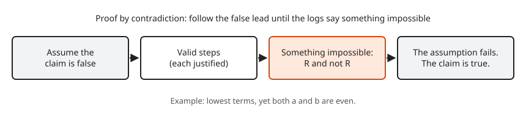
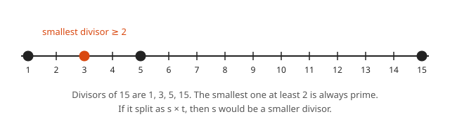
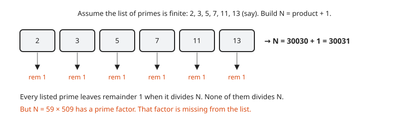
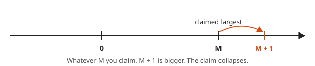

# Proof by Contradiction

**Level:** 601 · **Unit:** 3 · **Time:** 60 to 75 minutes
**Prerequisites:** [Direct Proof](../02-direct-proof/README.md)

## The Big Idea

To prove a statement by **contradiction**, assume it is false and follow the logic until something impossible falls out, such as $1 = 0$ or "this fraction is and is not in lowest terms". A true assumption never leads to an impossibility. Hence the assumption was false, and the statement is true.

This is the debugging move you already know: "suppose the cache is not the problem". You chase the consequences until the logs say something impossible. That rules the assumption out.

## Picture It

<!-- diagram: type=square side=1 diagonal=accent caption="The diagonal of a unit square has length root 2" -->


The Greeks drew a square with side 1 and asked: how long is the diagonal? Pythagoras says $d^2 = 1^2 + 1^2 = 2$. They expected $d$ to be a ratio of whole numbers. It is not. The proof below shows that any attempt to write $d$ as a fraction in lowest terms produces a fraction that is not in lowest terms. That is the contradiction.

## Step by Step

### 1. The Template

<!-- diagram: type=flow nodes="Assume false,Valid steps,Impossible,Claim true" caption="Shape of a proof by contradiction" -->


```txt
  Claim: S.
  Proof. Suppose, for contradiction, that S is false.
         ... valid steps ...
         This gives R and not R.
         Hence S is true.  []
```

### 2. When to Reach for Contradiction

* The claim is a negative: "is irrational", "has no solution", "there is no largest".
* The claim is about infinity: "there are infinitely many". Assume finitely many and get a handle on the finite list.
* A direct approach gives you nothing to grab. Assuming the opposite hands you an object to work with.

### 3. A Lemma You Need

**Lemma.** If $a^2$ is even, then $a$ is even.

Proof sketch here, full proof in [lesson 04](../04-contrapositive-and-cases/README.md): if $a$ is odd, then $a^2$ is odd by [lesson 02](../02-direct-proof/README.md). That contradicts $a^2$ even.

### 4. A Second Lemma

<!-- diagram: type=number-line range=1..15 marks=1,3,5,15 accent=3 caption="The smallest divisor at least 2 is prime" -->


**Lemma.** Every integer $n \geq 2$ has a prime factor.

Proof. Among all divisors of $n$ that are at least 2, pick the smallest, $p$. The set is not empty, because $n$ itself is in it. If $p$ were not prime, then $p = st$ with $2 \leq s < p$. Then $s \mid p$ and $p \mid n$, hence $s \mid n$. That makes $s$ a smaller divisor of $n$ that is at least 2, which contradicts the choice of $p$. Hence $p$ is prime. $\blacksquare$

## Worked Examples

### Example 1: The Square Root of 2 Is Irrational

**Claim.** There are no integers $a, b$ with $b \neq 0$ and $\sqrt{2} = a/b$.

```txt
  suppose sqrt(2) = a/b                       assume the opposite
  reduce a/b to lowest terms                  any fraction reduces
  (a and b have no common factor > 1)
  2 = a^2 / b^2                               square both sides
  a^2 = 2 b^2                                 multiply by b^2
  a^2 is even                                 2 times an integer
  a is even, a = 2k                           lemma in step 3
  (2k)^2 = 2 b^2                              substitute
  4k^2 = 2 b^2                                expand
  b^2 = 2k^2                                  divide by 2
  b^2 is even, hence b is even                lemma in step 3
  2 divides a and 2 divides b                 both even
  contradiction with lowest terms             2 is a common factor > 1
```

Hence $\sqrt{2}$ is irrational. $\blacksquare$

### Example 2: There Are Infinitely Many Primes

<!-- diagram: type=boxes items=2,3,5,7,11,13 result="N=30031=59*509" caption="Euclid product plus one argument" -->


The picture shows the trick. Multiply every prime on your list and add 1. Every prime on the list leaves remainder 1, hence divides nothing. The new number still has a prime factor. That prime is off the list.

**Claim (Euclid, about 300 BC).** There are infinitely many primes.

```txt
  suppose the primes are exactly p1, ..., pn       assume finitely many
  N = p1 * p2 * ... * pn + 1                       build a new number
  N >= 2                                           product >= 2, plus 1
  N has a prime factor q                           lemma in step 4
  q is one of p1, ..., pn                          the list has every prime
  q divides p1 * ... * pn                          q is a factor of the product
  q divides N - p1*...*pn = 1                      q divides both, hence their difference
  q divides 1, but q >= 2                          impossible
```

Hence the list is not complete, and no finite list holds every prime. $\blacksquare$

Warning: $N$ itself need not be prime. $2 \cdot 3 \cdot 5 \cdot 7 \cdot 11 \cdot 13 + 1 = 30031 = 59 \cdot 509$. The proof only claims that some prime factor of $N$ is missing from the list.

### Example 3: There Is No Largest Integer

<!-- diagram: type=number-line marks=0,M,M+1 caption="No largest integer" -->


```txt
  suppose M is the largest integer             assume the opposite
  M + 1 is an integer                          integers are closed under +
  M + 1 > M                                    1 > 0
  contradiction with M largest                 found a larger integer
```

$\blacksquare$

### Example 4: Rational Plus Irrational Is Irrational

**Claim.** If $r$ is rational and $x$ is irrational, then $r + x$ is irrational.

```txt
  suppose r + x = q, with q rational           assume the opposite
  x = q - r                                    subtract r
  q - r is rational                            difference of fractions is a fraction
  x is rational                                equal to a rational
  contradiction with x irrational              x was irrational by hypothesis
```

$\blacksquare$

## Common Mistakes

* Forgetting to state the assumption. Fix: write "Suppose, for contradiction, that ..." as the first line.
* Negating the claim wrongly. The negation of "infinitely many primes" is "finitely many primes", not "no primes". Fix: use the negation rules from [lesson 01](../01-reading-and-writing-proofs/README.md).
* Reaching a contradiction through an invalid step. A broken step can "prove" anything. Fix: check every line as carefully as in a direct proof.
* Using contradiction when a direct proof is shorter. If the "contradiction" is just "Q and not Q" at the very last line, rewrite it as a direct proof or a contrapositive.

## Try It

1. Prove that $\sqrt{3}$ is irrational. You can use: if $3 \mid a^2$, then $3 \mid a$.
2. Prove that there is no smallest positive rational number.
3. Prove that $\log_2 3$ is irrational. Hint: if $\log_2 3 = p/q$, then $2^p = 3^q$.
4. Prove that if $x$ is irrational, then $1/x$ is irrational.
5. Prove that no integer is both even and odd.
6. Compute $2 \cdot 3 \cdot 5 \cdot 7 + 1$. Is it prime?
7. Where does the $\sqrt{2}$ proof break if you try it on $\sqrt{4}$?

<details>
<summary>Answers</summary>

1. Suppose $\sqrt{3} = a/b$ in lowest terms. Then $a^2 = 3b^2$. Hence $3 \mid a^2$ and $3 \mid a$. Write $a = 3k$. Then $9k^2 = 3b^2$, $b^2 = 3k^2$, hence $3 \mid b$. Both are divisible by 3, a contradiction.
2. Suppose $r > 0$ is the smallest positive rational. Then $r/2$ is rational, positive and smaller than $r$. Contradiction.
3. Suppose $\log_2 3 = p/q$ with positive integers $p, q$ (it is positive because $3 > 1$). Then $2^{p/q} = 3$, hence $2^p = 3^q$. The left side is even and the right side is odd. Contradiction.
4. Suppose $1/x = q$ is rational. Then $q \neq 0$ and $x = 1/q$ is rational. Contradiction.
5. Suppose $n = 2k$ and $n = 2m + 1$. Then $2(k - m) = 1$, hence $k - m = 1/2$, which is not an integer. Contradiction.
6. $211$. It is prime: no prime up to $\sqrt{211} \approx 14.5$ divides it.
7. $a^2 = 4b^2$ gives $a = 2b$, which is fine, for example $a = 2$, $b = 1$. The step "$a^2 = 2b^2$ forces both even" has no analogue. No contradiction appears.

</details>

## Code Corner

Euclid numbers: multiply the first few primes and add 1. Some results are prime, some are not. Every one of them has a prime factor missing from the list, which is all the proof needs. The program lives in [code/main.go](code/main.go). Run it with `go run main.go` inside the `code` folder.

```go
// Euclid numbers: (product of the first primes) + 1, and their smallest prime factor.
package main

import "fmt"

func smallestFactor(n int) int {
	for d := 2; d*d <= n; d++ {
		if n%d == 0 {
			return d
		}
	}
	return n
}

func main() {
	product := 1
	for _, p := range []int{2, 3, 5, 7, 11, 13, 17} {
		product *= p
		n := product + 1
		q := smallestFactor(n)
		note := "prime"
		if q != n {
			note = fmt.Sprintf("= %d * %d", q, n/q)
		}
		fmt.Printf("up to %2d: N = %7d  %s\n", p, n, note)
	}
}
```

Output:

```txt
up to  2: N =       3  prime
up to  3: N =       7  prime
up to  5: N =      31  prime
up to  7: N =     211  prime
up to 11: N =    2311  prime
up to 13: N =   30031  = 59 * 509
up to 17: N =  510511  = 19 * 26869
```

## Go Deeper

* [MacTutor: Euclid of Alexandria](https://mathshistory.st-andrews.ac.uk/Biographies/Euclid/): the history behind the primes proof.
* [Euclid's Elements, Book IX, Proposition 20](https://aleph0.clarku.edu/~djoyce/elements/bookIX/propIX20.html): the original proof, with commentary.

Flashcards for this lesson: [cards.tsv](cards.tsv) (Anki import: front, back, tags, separated by tabs).

Next: [Contrapositive and Cases](../04-contrapositive-and-cases/README.md)
