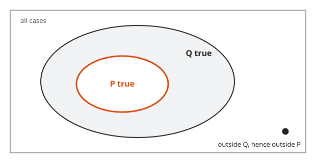
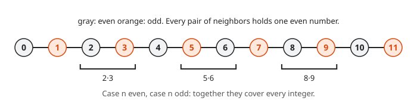
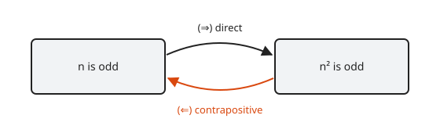
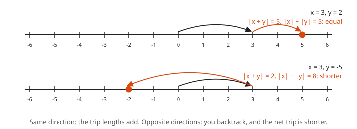

# Contrapositive and Cases

**Level:** 601 · **Unit:** 4 · **Time:** 60 minutes
**Prerequisites:** [Direct Proof](../02-direct-proof/README.md)

## The Big Idea

The statement "if P, then Q" says exactly the same thing as "if not Q, then not P". The second form is the **contrapositive**. When the hypothesis P gives you little to work with but "not Q" gives you plenty, prove the contrapositive instead. This lesson also covers two companions: splitting a proof into **cases**, and proving **if and only if**.

## Picture It

<!-- diagram: type=venn outer=Q inner=P point=outside caption="P inside Q: P implies Q, and not Q implies not P" -->


Picture every possible situation as a point in the rectangle. "P implies Q" means the P region sits entirely inside the Q region. Now pick a point outside Q. It cannot be in P, because P is inside Q. That is "not Q implies not P". The two statements describe the same picture.

The picture also shows what does **not** follow. A point inside Q can sit outside P. Hence "Q implies P", the **converse**, is a different claim.

## Step by Step

### 1. Four Related Statements

| Name | Form | Same as the original? |
|------|------|------|
| Original | $P \Rightarrow Q$ | yes |
| Contrapositive | $\lnot Q \Rightarrow \lnot P$ | yes, always |
| Converse | $Q \Rightarrow P$ | not in general |
| Inverse | $\lnot P \Rightarrow \lnot Q$ | not in general (same as the converse) |

Check with the truth table. The two columns agree in every row:

```txt
  P   Q   P => Q   not Q   not P   not Q => not P
  T   T     T        F       F           T
  T   F     F        T       F           F
  F   T     T        F       T           T
  F   F     T        T       T           T
```

### 2. Proof by Contrapositive Template

```txt
  Claim: if P, then Q.
  Proof. We prove the contrapositive: if not Q, then not P.
         Suppose not Q.
         ... direct steps ...
         Hence not P.  []
```

### 3. Proof by Cases

<!-- diagram: type=number-line range=0..11 color=parity pairs="2-3,5-6,8-9" caption="Neighbors on the number line always include an even number" -->


When the hypothesis splits naturally, prove the claim in each piece. The pieces must cover every possibility. Common splits: even or odd, positive or zero or negative, remainder 0, 1 or 2 on division by 3.

### 4. If and Only If

<!-- diagram: type=two-arrows left="n is odd" right="n squared is odd" caption="If and only if is two arrows" -->


"P if and only if Q", written $P \Leftrightarrow Q$, is two claims: $P \Rightarrow Q$ and $Q \Rightarrow P$. Prove each one separately. Label the two directions ($\Rightarrow$) and ($\Leftarrow$).

## Worked Examples

### Example 1: If $n^2$ Is Even, Then $n$ Is Even

The direct approach starts from $n^2 = 2k$ and gets stuck: $n = \sqrt{2k}$ tells you nothing. The contrapositive gives you a formula for $n$.

```txt
  contrapositive: if n is odd, then n^2 is odd        rewrite the claim
  suppose n is odd: n = 2k + 1                        definition of odd
  n^2 = 4k^2 + 4k + 1                                 expand
      = 2(2k^2 + 2k) + 1                              factor
  n^2 is odd                                          definition of odd
```

$\blacksquare$ This is the lemma that the $\sqrt{2}$ proof in [lesson 03](../03-proof-by-contradiction/README.md) relies on.

### Example 2: If $xy$ Is Irrational, Then $x$ or $y$ Is Irrational

```txt
  contrapositive: if x and y are rational,             not (x or y irrational)
                  then xy is rational                  = x and y both rational
  x = a/b, y = c/d with b, d nonzero                   definition of rational
  xy = (ac)/(bd)                                       multiply fractions
  bd is nonzero, ac and bd are integers                product of integers
  xy is rational                                       definition of rational
```

$\blacksquare$

### Example 3: The Product of Two Consecutive Integers Is Even (Cases)

**Claim.** For every integer $n$, the number $n(n+1)$ is even.

```txt
  case 1: n is even, n = 2k
    n(n+1) = 2k(2k + 1) = 2[k(2k + 1)]                 factor out 2
    even                                               definition
  case 2: n is odd, n = 2k + 1
    n(n+1) = (2k + 1)(2k + 2) = 2[(2k + 1)(k + 1)]     factor 2 from 2k + 2
    even                                               definition
  every integer is even or odd                         the cases cover all n
```

$\blacksquare$ Picture: of any two neighbors on the number line, one is even.

### Example 4: Squares Leave Remainder 0 or 1 on Division by 4 (Cases)

```txt
  case 1: n = 2k
    n^2 = 4k^2                                         remainder 0
  case 2: n = 2k + 1
    n^2 = 4k^2 + 4k + 1 = 4(k^2 + k) + 1               remainder 1
```

$\blacksquare$ Consequence: no integer of the form $4m + 3$, such as $7$, $11$ or $1{,}000{,}003$, is a perfect square.

### Example 5: The Triangle Inequality

**Claim.** For all real $x, y$: $|x + y| \leq |x| + |y|$.

You use this in every epsilon proof of [lesson 09](../09-epsilon-delta-limits/README.md).

```txt
  -|x| <= x <= |x|                       true in both cases x >= 0 and x < 0
  -|y| <= y <= |y|                       same for y
  -(|x| + |y|) <= x + y <= |x| + |y|     add the two chains
  |x + y| <= |x| + |y|                   |t| <= c  is the same as  -c <= t <= c
```

<!-- diagram: type=number-line trips="3+2; 3+(-5)" caption="The triangle inequality on the number line" -->


$\blacksquare$ Picture: the straight trip from $0$ to $x + y$ is never longer than the trip to $x$ and then a further step of length $|y|$.

### Example 6: An If and Only If

**Claim.** An integer $n$ is odd if and only if $n^2$ is odd.

```txt
  (=>) n odd implies n^2 odd               lesson 02, example 2
  (<=) n^2 odd implies n odd               contrapositive: n even implies n^2 even
       n = 2k, n^2 = 2(2k^2)               even
```

$\blacksquare$

## Common Mistakes

* Proving the converse instead of the contrapositive. "If not P, then not Q" is the inverse, and it is not equivalent. Fix: in the contrapositive, Q and P swap places *and* both get negated.
* Cases that leave a gap. "Case $x > 0$, case $x < 0$" misses $x = 0$. Fix: list the cases and check they cover everything.
* Proving only one direction of an "if and only if". Fix: label ($\Rightarrow$) and ($\Leftarrow$) and do both.
* Negating "x or y" as "not x or not y". The negation of "x or y" is "not x and not y".

## Try It

1. Write the contrapositive and the converse of: "If a service is healthy, then it answers on port 443."
2. Prove by contrapositive: if $3n + 2$ is odd, then $n$ is odd.
3. Prove by contrapositive: if $n^2$ is divisible by 3, then $n$ is divisible by 3. Hint: cases $n = 3k + 1$ and $n = 3k + 2$.
4. Prove by cases: $n^3 - n$ is divisible by 3 for every integer $n$.
5. Prove by cases: for every integer $n$, $n^2 + n + 1$ is odd.
6. Prove: $n$ is even if and only if $n + 1$ is odd.
7. Prove: $|xy| = |x||y|$ for all real $x, y$ by cases on signs.
8. Is the converse of "if $n$ is divisible by 4, then $n$ is even" true?

<details>
<summary>Answers</summary>

1. Contrapositive: if it does not answer on port 443, then it is not healthy. Converse: if it answers on port 443, then it is healthy.
2. Suppose $n$ even, $n = 2k$. Then $3n + 2 = 6k + 2 = 2(3k + 1)$ is even.
3. Suppose $3 \nmid n$. If $n = 3k + 1$, then $n^2 = 3(3k^2 + 2k) + 1$. If $n = 3k + 2$, then $n^2 = 3(3k^2 + 4k + 1) + 1$. In both cases $3 \nmid n^2$.
4. $n = 3k$: $n^3 - n = 3(9k^3 - k)$. $n = 3k + 1$: $n^3 - n = n(n-1)(n+1)$ and $n - 1 = 3k$. $n = 3k + 2$: $n + 1 = 3(k + 1)$. In each case one factor of $(n-1)n(n+1)$ is a multiple of 3.
5. $n^2 + n + 1 = n(n + 1) + 1$. Example 3 shows $n(n+1)$ is even. Even plus 1 is odd.
6. ($\Rightarrow$) $n = 2k$ gives $n + 1 = 2k + 1$. ($\Leftarrow$) $n + 1 = 2k + 1$ gives $n = 2k$.
7. Cases: both $\geq 0$, both $< 0$, one of each. In each case both sides equal the product of the sizes. For example $x < 0 \leq y$: $|xy| = -xy = (-x)y = |x||y|$.
8. No. $6$ is even and not divisible by 4.

</details>

## Code Corner

The program prints the truth table for the original, the contrapositive and the converse, then checks the cases claim about $n^2 \bmod 4$. The program lives in [code/main.go](code/main.go). Run it with `go run main.go` inside the `code` folder.

```go
// Truth tables: the contrapositive always agrees with the original; the converse does not.
package main

import "fmt"

func implies(p, q bool) bool { return !p || q }

func tf(b bool) string {
	if b {
		return "T"
	}
	return "F"
}

func main() {
	fmt.Println("P Q | P=>Q  notQ=>notP  Q=>P")
	for _, p := range []bool{true, false} {
		for _, q := range []bool{true, false} {
			fmt.Printf("%s %s |   %s        %s          %s\n",
				tf(p), tf(q), tf(implies(p, q)), tf(implies(!q, !p)), tf(implies(q, p)))
		}
	}

	// Cases check: n^2 mod 4 is always 0 or 1.
	seen := map[int]bool{}
	for n := -1000; n <= 1000; n++ {
		r := (n * n) % 4
		seen[r] = true
	}
	fmt.Println("remainders of n^2 mod 4 for n in [-1000, 1000]:", seen)
}
```

Output:

```txt
P Q | P=>Q  notQ=>notP  Q=>P
T T |   T        T          T
T F |   F        F          T
F T |   T        T          F
F F |   T        T          T
remainders of n^2 mod 4 for n in [-1000, 1000]: map[0:true 1:true]
```

## Go Deeper

* [Book of Proof, Chapter 5: Contrapositive Proof](https://www.people.vcu.edu/~rhammack/BookOfProof/): more exercises in the same style.
* [Math Is Fun: Converse, Inverse, Contrapositive](https://www.mathsisfun.com/algebra/converse-inverse-contrapositive.html): a short table-based refresher.

Flashcards for this lesson: [cards.tsv](cards.tsv) (Anki import: front, back, tags, separated by tabs).

Next: [Induction](../05-induction/README.md)
