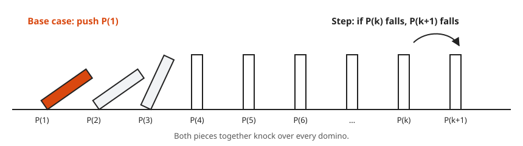
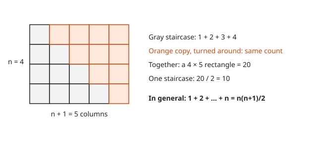
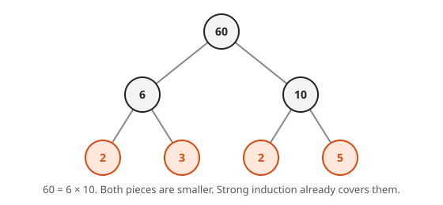
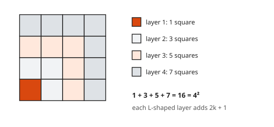
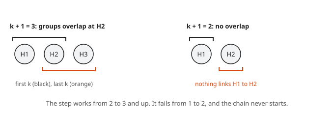

# Induction

**Level:** 601 · **Unit:** 5 · **Time:** 75 to 90 minutes
**Prerequisites:** [Proof by Contradiction](../03-proof-by-contradiction/README.md), [Contrapositive and Cases](../04-contrapositive-and-cases/README.md)

## The Big Idea

**Mathematical induction** proves a claim $P(n)$ for every natural number $n$ with just two finite checks. First, show $P(1)$. Second, show that whenever $P(k)$ holds, $P(k+1)$ holds too. Together these knock over every case, one after another, like a row of dominoes.

If you have ever proved a loop correct with a **loop invariant**, you have done induction. The invariant holds before the first pass (base case). Each pass keeps it true (inductive step). Hence it holds when the loop exits.

## Picture It

<!-- diagram: type=dominoes count=9 labels="P(1)..P(k+1)" caption="Induction as falling dominoes" -->


You need both pieces. A push with no chain reaction tips only the first domino. A perfect chain reaction with no push tips nothing. Push the first domino and guarantee that each domino tips the next, and every domino falls.

<!-- diagram: type=staircase n=4 caption="Two staircases make a rectangle" -->


The staircase picture tells you *what* to prove: $1 + 2 + \dots + n = \frac{n(n+1)}{2}$. Induction proves it for every $n$ at once, not only for the $n = 4$ in the picture.

## Step by Step

### 1. The Principle

Let $P(n)$ be a statement about the natural number $n$. Suppose:

1. **Base case:** $P(1)$ is true.
2. **Inductive step:** for every $k \geq 1$, if $P(k)$ is true, then $P(k+1)$ is true.

Then $P(n)$ is true for every $n \geq 1$.

Why it holds: suppose some $P(n)$ fails. Among the failures, pick the smallest $n$ (every nonempty set of natural numbers has a smallest element). It is not $1$, by the base case. Hence $n - 1 \geq 1$ and $P(n - 1)$ holds, because $n$ was the smallest failure. The inductive step then gives $P(n)$, a contradiction.

### 2. The Template

```txt
  Claim: P(n) for all n >= 1.
  Base case:      check P(1) directly.
  Inductive step: let k >= 1 and assume P(k).        (inductive hypothesis)
                  write P(k+1).
                  find P(k) inside it.
                  use the hypothesis, finish the algebra.
  Conclusion:     by induction, P(n) holds for all n >= 1.  []
```

The key move is "find $P(k)$ inside $P(k+1)$". For sums, peel off the last term.

### 3. Strong Induction

<!-- diagram: type=tree root=60 caption="A factor tree for 60 used in strong induction" -->


Sometimes $P(k+1)$ needs more than $P(k)$. It needs some earlier case. **Strong induction** lets you assume $P(1), P(2), \dots, P(k)$ all at once, then prove $P(k+1)$. The dominoes picture still works: by the time domino $k+1$ needs to fall, every earlier domino has already fallen.

### 4. The Base Case Can Start Elsewhere

A claim can start at $n = 0$ or $n = 4$. Prove the base case at the starting value, and the step for every $k$ at or above it.

## Worked Examples

### Example 1: The Staircase Sum

**Claim.** For every $n \geq 1$: $1 + 2 + \dots + n = \dfrac{n(n+1)}{2}$.

```txt
  base case n = 1:
    left  = 1                                       one term
    right = 1 * 2 / 2 = 1                           formula
    equal                                           P(1) holds
  inductive step: assume 1 + ... + k = k(k+1)/2     inductive hypothesis
    1 + ... + k + (k+1)                             left side of P(k+1)
      = k(k+1)/2 + (k+1)                            use the hypothesis on the first k terms
      = k(k+1)/2 + 2(k+1)/2                         common denominator
      = (k+1)(k + 2)/2                              factor out (k+1)
      = (k+1)((k+1) + 1)/2                          the right side of P(k+1)
```

By induction, the formula holds for every $n \geq 1$. $\blacksquare$

### Example 2: The Sum of the First $n$ Odd Numbers Is $n^2$

<!-- diagram: type=grid size=4 layers=L caption="Odd numbers as L-shaped layers of a square" -->


Picture: each odd number is an L-shaped layer around a square. $1$, then $3$ around it, then $5$, and each layer turns a $k \times k$ square into a $(k+1) \times (k+1)$ square.

```txt
  claim: 1 + 3 + ... + (2n - 1) = n^2
  base case n = 1:   1 = 1^2                        true
  step: assume 1 + 3 + ... + (2k - 1) = k^2         hypothesis
    1 + ... + (2k - 1) + (2k + 1)                   next odd number is 2(k+1) - 1
      = k^2 + 2k + 1                                use the hypothesis
      = (k + 1)^2                                   perfect square
```

$\blacksquare$

### Example 3: A Divisibility Claim

**Claim.** For every $n \geq 0$, $3 \mid (4^n - 1)$.

```txt
  base case n = 0:   4^0 - 1 = 0 = 3 * 0            divisible by 3
  step: assume 4^k - 1 = 3m for an integer m        hypothesis
    4^(k+1) - 1 = 4 * 4^k - 1                       split off one factor of 4
                = 4 (3m + 1) - 1                    4^k = 3m + 1 by the hypothesis
                = 12m + 3                           expand
                = 3 (4m + 1)                        factor out 3
```

$\blacksquare$

### Example 4: An Inequality With a Late Start

**Claim.** For every $n \geq 4$: $2^n < n!$.

```txt
  base case n = 4:   2^4 = 16,  4! = 24             16 < 24
  step: let k >= 4 and assume 2^k < k!              hypothesis
    2^(k+1) = 2 * 2^k                               definition of a power
            < 2 * k!                                hypothesis
            < (k + 1) * k!                          2 < k + 1 because k >= 4
            = (k + 1)!                              definition of factorial
```

$\blacksquare$ The claim is false for $n = 1, 2, 3$. The base case matters.

### Example 5: Strong Induction and Prime Factorizations

**Claim.** Every integer $n \geq 2$ is a product of primes (a single prime counts).

```txt
  base case n = 2:   2 is prime                      product of one prime
  step: let k >= 2, assume every m with 2 <= m <= k  strong hypothesis
        is a product of primes
    case k + 1 is prime:                             done, one prime
    case k + 1 is not prime:
      k + 1 = a b with 2 <= a, b <= k                definition of composite
      a and b are products of primes                 strong hypothesis
      k + 1 = a b is a product of primes             join the two lists
```

$\blacksquare$ Ordinary induction fails here: knowing about $k$ says nothing about $k + 1 = a \cdot b$.

### Example 6: A Broken Induction

"All horses are the same color." The step argues: in a group of $k + 1$ horses, the first $k$ match, and the last $k$ match, and they overlap. Hence all $k + 1$ match.

```txt
  k + 1 = 2:  horses {H1, H2}
  first k:    {H1}                         one horse, one color
  last k:     {H2}                         one horse, one color
  overlap:    empty                        the step needs a shared horse
```

<!-- diagram: type=groups cases="3 horses overlap; 2 horses no overlap" caption="Where the all horses are the same color argument breaks" -->


The step fails from $k = 1$ to $k = 2$. One broken link stops the chain at the second domino.

## See It Step by Step


[Proof by Induction: Falling Dominoes: open the step-by-step walkthrough](https://caseyaedwards.github.io/math_training/diagrams/proof-by-induction/)

Watch the base case knock over the first domino and the inductive step carry the fall through every number.


[Gauss's Trick: Two Staircases Make a Rectangle: open the step-by-step walkthrough](https://caseyaedwards.github.io/math_training/diagrams/gauss-sum/)

Watch two staircases fit together into a rectangle, so one staircase holds half its area.

## Common Mistakes

* Skipping the base case. The step alone proves nothing. "If $n > n + 1$ then $n + 1 > n + 2$" has a valid step and is never true.
* Assuming $P(k+1)$ in the step. You assume $P(k)$ and *derive* $P(k+1)$.
* Not using the hypothesis. If the step never uses $P(k)$, either the claim has a direct proof or the step is wrong.
* A step that silently needs $k$ to be large, as in the horses. Fix: check that the step holds for the smallest $k$ you use.

## Try It

1. Prove: $1 + 2 + 4 + \dots + 2^{n-1} = 2^n - 1$ for $n \geq 1$.
2. Prove: $1^2 + 2^2 + \dots + n^2 = \dfrac{n(n+1)(2n+1)}{6}$.
3. Prove: $6 \mid (n^3 - n)$ for every $n \geq 0$.
4. Prove: $n < 2^n$ for every $n \geq 1$.
5. Prove: $5 \mid (6^n - 1)$ for every $n \geq 0$.
6. The Fibonacci numbers are $F_1 = F_2 = 1$ and $F_{n+1} = F_n + F_{n-1}$. Prove with strong induction that $F_n < 2^n$.
7. Find the first $n$ for which $n^2 < 2^n$ holds from then on, and prove it.
8. Explain what goes wrong with: "Claim: $n = n + 1$. Step: if $k = k + 1$, add 1 to both sides to get $k + 1 = k + 2$."

<details>
<summary>Answers</summary>

1. Base: $1 = 2 - 1$. Step: $(2^k - 1) + 2^k = 2^{k+1} - 1$.
2. Base: $1 = 1 \cdot 2 \cdot 3 / 6$. Step: $\frac{k(k+1)(2k+1)}{6} + (k+1)^2 = \frac{(k+1)(2k^2 + 7k + 6)}{6} = \frac{(k+1)(k+2)(2k+3)}{6}$.
3. Base: $0$. Step: $(k+1)^3 - (k+1) = (k^3 - k) + 3k^2 + 3k = (k^3 - k) + 3k(k+1)$. The first part is divisible by 6 by hypothesis. $k(k+1)$ is even, hence $3k(k+1)$ is divisible by 6.
4. Base: $1 < 2$. Step: $k + 1 < 2^k + 1 \leq 2^k + 2^k = 2^{k+1}$.
5. Base: $0$. Step: $6^{k+1} - 1 = 6(6^k - 1) + 5$. Both terms are divisible by 5.
6. Base: $F_1 = 1 < 2$, $F_2 = 1 < 4$. Step for $k + 1 \geq 3$: $F_{k+1} = F_k + F_{k-1} < 2^k + 2^{k-1} < 2^k + 2^k = 2^{k+1}$.
7. $n = 5$: $25 < 32$ (and $n = 4$ gives $16 = 16$, not less). Step for $k \geq 5$: $(k+1)^2 = k^2 + 2k + 1 < k^2 + k^2 = 2k^2$ when $k^2 > 2k + 1$, true for $k \geq 3$. Hence $(k+1)^2 < 2k^2 < 2 \cdot 2^k$.
8. The step is valid, but there is no base case. $P(1)$ says $1 = 2$, which is false. No domino ever gets pushed.

</details>

## Code Corner

Recursive code has the same shape as an induction proof: a base case and a step that reuses the smaller answer. The program also shows where $2^n < n!$ starts to hold. The program lives in [code/main.go](code/main.go). Run it with `go run main.go` inside the `code` folder.

```go
// Recursion has the shape of an induction proof: a base case and a step.
package main

import "fmt"

// stair returns 1 + 2 + ... + n.
func stair(n int) int {
	if n == 1 { // base case
		return 1
	}
	return stair(n-1) + n // step: reuse the answer for n - 1
}

func main() {
	ok := true
	for n := 1; n < 500; n++ {
		if stair(n) != n*(n+1)/2 {
			ok = false
		}
	}
	fmt.Println("stair(n) == n(n+1)/2 for n = 1..499:", ok)

	// 2^n < n! starts at n = 4.
	pow, fact := 1, 1
	for n := 1; n <= 7; n++ {
		pow *= 2
		fact *= n
		fmt.Printf("n = %d  2^n = %3d  n! = %4d  2^n < n!: %v\n", n, pow, fact, pow < fact)
	}
}
```

Output:

```txt
stair(n) == n(n+1)/2 for n = 1..499: true
n = 1  2^n =   2  n! =    1  2^n < n!: false
n = 2  2^n =   4  n! =    2  2^n < n!: false
n = 3  2^n =   8  n! =    6  2^n < n!: false
n = 4  2^n =  16  n! =   24  2^n < n!: true
n = 5  2^n =  32  n! =  120  2^n < n!: true
n = 6  2^n =  64  n! =  720  2^n < n!: true
n = 7  2^n = 128  n! = 5040  2^n < n!: true
```

## Go Deeper

* [Book of Proof, Chapter 10: Mathematical Induction](https://www.people.vcu.edu/~rhammack/BookOfProof/): dozens of exercises with hints.
* [Math Is Fun: Mathematical Induction](https://www.mathsisfun.com/algebra/mathematical-induction.html): the dominoes picture with gentle examples.

Flashcards for this lesson: [cards.tsv](cards.tsv) (Anki import: front, back, tags, separated by tabs).

Next: [Sets and Cardinality](../06-sets-and-cardinality/README.md)
