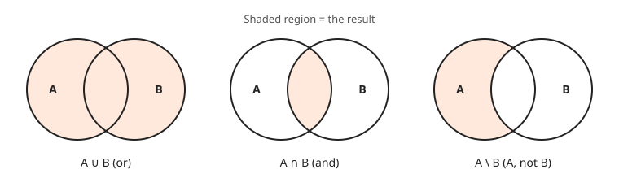
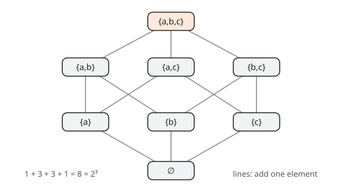
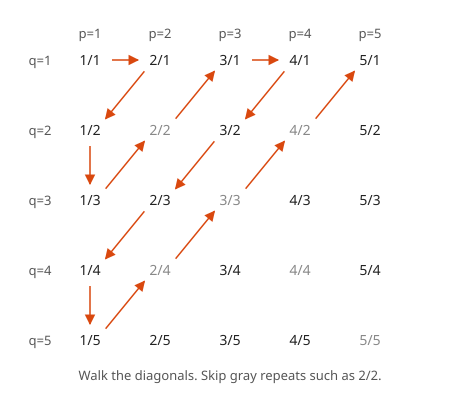
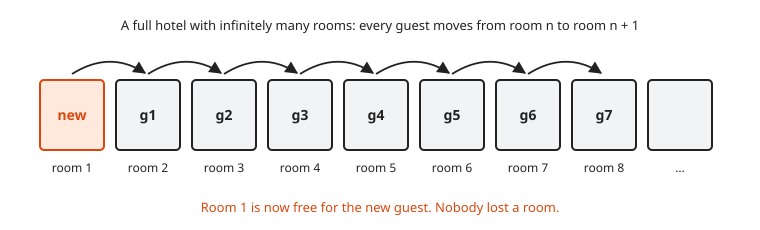
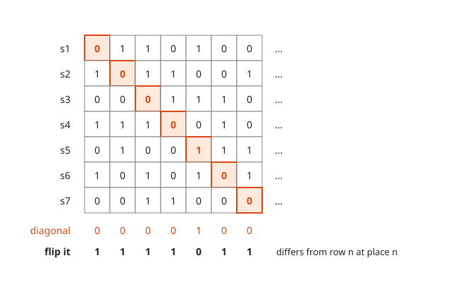

# Sets and Cardinality

**Level:** 601 · **Unit:** 6 · **Time:** 75 to 90 minutes
**Prerequisites:** [Induction](../05-induction/README.md), [501 Logic and Sets](../../501/README.md)

## The Big Idea

Two sets have the **same size** when you can pair their elements off one to one with nothing left over on either side. For finite sets, that matches counting. For infinite sets, it produces surprises: the even numbers, the integers and the fractions are all the same size as $\{0, 1, 2, \dots\}$. The real numbers are strictly bigger. Georg Cantor proved this in the 1870s and 1890s with one of the cleanest pictures in mathematics.

## Picture It

<!-- diagram: type=bijection top=N bottom=Z rule="even n -> n/2, odd n -> -(n+1)/2" caption="A bijection from the naturals to the integers" -->


You might expect $\mathbb{Z}$ to be twice as big as $\mathbb{N}$, because it has a negative copy. The picture says no. Send even naturals to the right and odd naturals to the left. Every integer gets exactly one partner. This is the same trick as round-robin load balancing across two pools: alternate, and nothing is skipped.

## Step by Step

### 1. Set Vocabulary

<!-- diagram: type=venn panels="union,intersection,difference" caption="Union, intersection and difference of two sets" -->


* $x \in A$: $x$ is an element of $A$.
* $A \subseteq B$: every element of $A$ is in $B$.
* $A \cup B$: elements in $A$ or $B$. $A \cap B$: elements in both. $A \setminus B$: in $A$ and not in $B$.
* $\mathcal{P}(A)$: the **power set**, the set of all subsets of $A$. If $A$ has $n$ elements, $\mathcal{P}(A)$ has $2^n$.
* To prove $A = B$, prove $A \subseteq B$ and $B \subseteq A$.

<!-- diagram: type=hasse set="{a,b,c}" caption="The eight subsets of a three element set" -->


### 2. Functions That Pair Things Off

<!-- diagram: type=mappings panels="injective,surjective,bijective" caption="Injective, surjective and bijective functions" -->


A function $f: A \to B$ is:

* **injective** (one to one) when different inputs give different outputs: $f(x) = f(y) \Rightarrow x = y$. No collisions, like a perfect hash.
* **surjective** (onto) when every $b \in B$ is $f(a)$ for some $a$. No unused slots.
* **bijective** when it is both. A bijection is a perfect pairing.

### 3. Size Through Bijections

* $|A| = |B|$ when a bijection $A \to B$ exists.
* $|A| \leq |B|$ when an injection $A \to B$ exists.
* A set is **countable** when it is finite or has the same size as $\mathbb{N} = \{0, 1, 2, \dots\}$. Countable means "you can list it": first, second, third, and every element appears at some finite position.
* A set that is not countable is **uncountable**.

### 4. Three Countable Sets

* $\mathbb{Z}$: the bijection in the picture.
* $\mathbb{N} \times \mathbb{N}$, the grid of pairs: walk the diagonals.
* $\mathbb{Q}$: the same diagonal walk on fractions.

<!-- diagram: type=grid rows=q cols=p walk=diagonal caption="Listing the positive rationals by diagonals" -->


A row-by-row walk fails: it never finishes row one. The diagonal walk visits each diagonal, and each diagonal is finite. Hence every fraction $p/q$ appears, at a position no later than the end of diagonal $p + q$.

## Worked Examples

### Example 1: Prove the Picture Is a Bijection

Define $f: \mathbb{N} \to \mathbb{Z}$ by $f(n) = n/2$ for even $n$ and $f(n) = -(n+1)/2$ for odd $n$.

```txt
  outputs: even n give 0, 1, 2, ...           n/2 for n = 0, 2, 4, ...
           odd n give -1, -2, -3, ...         -(n+1)/2 for n = 1, 3, 5, ...
  injective:
    two even inputs: n/2 = m/2 gives n = m                 multiply by 2
    two odd inputs: -(n+1)/2 = -(m+1)/2 gives n = m        solve
    one even, one odd: outputs >= 0 versus < 0             cannot collide
  surjective:
    z >= 0 is hit by n = 2z                                even input
    z < 0  is hit by n = -2z - 1                           odd input, check: -(n+1)/2 = z
```

$f$ is a bijection, hence $|\mathbb{N}| = |\mathbb{Z}|$. $\blacksquare$

### Example 2: The Even Numbers Are as Big as All Naturals

```txt
  g(n) = 2n from N to E = {0, 2, 4, ...}         candidate pairing
  injective: 2n = 2m gives n = m                 divide by 2
  surjective: each even e = 2k is g(k)           definition of even
```

$\blacksquare$ A set can be the same size as one of its proper subsets. That is a defining feature of infinite sets.

<!-- diagram: type=rooms count=8 shift=+1 caption="Hilbert hotel makes room for one more guest" -->


### Example 3: Cantor's Diagonal Argument

**Claim.** The interval $(0, 1)$ is uncountable.

<!-- diagram: type=diagonal rows=7 cols=7 caption="Cantor diagonal argument" -->


The picture shows the trick on a list of digit strings. Read the diagonal, then change every digit. The new string differs from row 1 in place 1, from row 2 in place 2, and so on. It is not anywhere in the list. Here is the proof with decimal digits.

```txt
  suppose (0, 1) is countable: x1, x2, x3, ...       assume a complete list
  write each xn as a decimal 0.d_n1 d_n2 d_n3 ...    use the expansion that does
                                                      not end in repeating 9s
  build y = 0.e1 e2 e3 ... with                       the diagonal trick
     e_n = 5 if d_nn != 5
     e_n = 4 if d_nn  = 5
  y is in (0, 1)                                     digits are 4s and 5s
  y has one decimal expansion                        no 0s or 9s, no 0.0999... = 0.1 issue
  y differs from xn in digit n                       by construction, e_n != d_nn
  y is not equal to any xn                           differs from every row
  contradiction: the list was complete               y is missing
```

Hence $(0, 1)$ is uncountable. $\blacksquare$ The choice of 4 and 5 avoids the one subtle trap: $0.0999\ldots$ and $0.1000\ldots$ are the same number.

### Example 4: Cantor's Theorem

**Claim.** For every set $A$, there is no surjection $f: A \to \mathcal{P}(A)$. Hence $|A| < |\mathcal{P}(A)|$.

```txt
  suppose f: A -> P(A) is onto                       assume the opposite
  D = { x in A : x is not in f(x) }                  the diagonal set
  D is a subset of A, hence D = f(d) for some d       f is onto
  case d in D:     d passes the test for D            assumption of the case
                   hence d is not in f(d) = D         definition of D, contradiction
  case d not in D: d is not in f(d)                  f(d) = D
                   hence d passes the test for D      definition of D
                   hence d is in D                    contradiction
  both cases fail                                    no such f
```

$\blacksquare$ The set $D$ plays the role of the flipped diagonal: it disagrees with $f(x)$ about the element $x$, for every $x$. An injection $A \to \mathcal{P}(A)$ does exist, $x \mapsto \{x\}$, hence $|A| \leq |\mathcal{P}(A)|$ with strict inequality.

Consequence: there is no largest infinity. $\mathbb{N}$, $\mathcal{P}(\mathbb{N})$, $\mathcal{P}(\mathcal{P}(\mathbb{N}))$, and so on, keep getting bigger.

## Common Mistakes

* "Infinite sets are all the same size." False: $\mathbb{N}$ and $\mathbb{R}$ differ.
* "A proper subset is smaller." True for finite sets only.
* Showing a list of reals that misses one number, and concluding uncountable. Fix: the diagonal argument beats *every* list, not one particular list.
* Proving injective and forgetting surjective, or the reverse. A bijection needs both.

## Try It

1. List $\mathcal{P}(\{a, b, c\})$. How many elements does it have?
2. Prove $A \cap (B \cup C) = (A \cap B) \cup (A \cap C)$ by showing both inclusions.
3. Is $f: \mathbb{Z} \to \mathbb{Z}$, $f(n) = 3n + 1$ injective? Surjective?
4. Give a bijection from $\mathbb{N}$ to the odd natural numbers.
5. Give a bijection from $(0, 1)$ to $(0, 5)$.
6. Give a bijection from $\{1, 2, 3, \dots\}$ to $\{0, 1, 2, \dots\}$. What does Hilbert's hotel have to do with it?
7. Run the diagonal flip (0 to 1, 1 to 0) on the list 1010, 0110, 1111, 0001. Which string do you get, and is it on the list?
8. Explain why the diagonal argument does not show $\mathbb{Q}$ is uncountable.

<details>
<summary>Answers</summary>

1. $\varnothing, \{a\}, \{b\}, \{c\}, \{a,b\}, \{a,c\}, \{b,c\}, \{a,b,c\}$. Eight, which is $2^3$.
2. ($\subseteq$) If $x \in A$ and $x \in B \cup C$, then $x$ is in $B$ or in $C$, hence in $A \cap B$ or in $A \cap C$. ($\supseteq$) If $x \in A \cap B$, then $x \in A$ and $x \in B \cup C$. The same for $A \cap C$.
3. Injective: $3n + 1 = 3m + 1$ gives $n = m$. Not surjective: $0$ is not $3n + 1$ for any integer $n$.
4. $f(n) = 2n + 1$.
5. $f(x) = 5x$.
6. $f(n) = n - 1$. A full hotel with rooms $1, 2, 3, \dots$ fits a new guest by moving everyone from room $n$ to room $n + 1$.
7. Diagonal digits: 1, 1, 1, 1. Flipped: 0000. It differs from row $n$ in place $n$, hence it is not on the list.
8. The flipped decimal is a real number, but nothing forces it to be rational. The argument finds a missing *real*, not a missing *fraction*. $\mathbb{Q}$ is countable by the diagonal walk.

</details>

## Code Corner

The program lists the positive rationals by diagonals, skipping repeats, then runs the diagonal flip on the list from the picture. The program lives in [code/main.go](code/main.go). Run it with `go run main.go` inside the `code` folder.

```go
// List the positive rationals by diagonals, then beat a list of strings with the diagonal flip.
package main

import "fmt"

func gcd(a, b int) int {
	for b != 0 {
		a, b = b, a%b
	}
	return a
}

func main() {
	var out []string
	for s := 2; len(out) < 15; s++ { // s = p + q, one diagonal at a time
		for p := 1; p < s && len(out) < 15; p++ {
			q := s - p
			if gcd(p, q) == 1 { // skip repeats like 2/4
				out = append(out, fmt.Sprintf("%d/%d", p, q))
			}
		}
	}
	fmt.Println("first 15 rationals:", out)

	rows := []string{"0110100", "1011001", "0001110", "1110010", "0100111", "1010101", "0011000"}
	flip := make([]byte, len(rows))
	for i, r := range rows {
		if r[i] == '0' {
			flip[i] = '1'
		} else {
			flip[i] = '0'
		}
	}
	fmt.Println("flipped diagonal:", string(flip))
	for i, r := range rows {
		fmt.Printf("  differs from row %d at place %d: %c vs %c\n", i+1, i+1, flip[i], r[i])
	}
}
```

Output:

```txt
first 15 rationals: [1/1 1/2 2/1 1/3 3/1 1/4 2/3 3/2 4/1 1/5 5/1 1/6 2/5 3/4 4/3]
flipped diagonal: 1111011
  differs from row 1 at place 1: 1 vs 0
  differs from row 2 at place 2: 1 vs 0
  differs from row 3 at place 3: 1 vs 0
  differs from row 4 at place 4: 1 vs 0
  differs from row 5 at place 5: 0 vs 1
  differs from row 6 at place 6: 1 vs 0
  differs from row 7 at place 7: 1 vs 0
```

## Go Deeper

* [MacTutor: Georg Cantor](https://mathshistory.st-andrews.ac.uk/Biographies/Cantor/): the man, the controversy and the theorems.
* [Wolfram MathWorld: Cantor Diagonal Method](https://mathworld.wolfram.com/CantorDiagonalMethod.html): a compact reference.
* [Logic and Set Theory Track](../../../tracks/logic-and-set-theory/README.md): axioms and larger infinities.

Flashcards for this lesson: [cards.tsv](cards.tsv) (Anki import: front, back, tags, separated by tabs).

Next: [Divisibility, GCD and Euclid](../07-divisibility-gcd-and-euclid/README.md)
