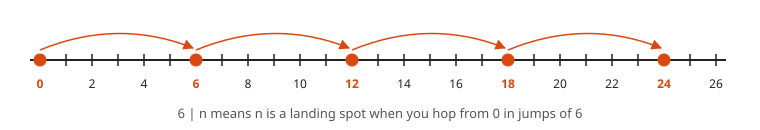
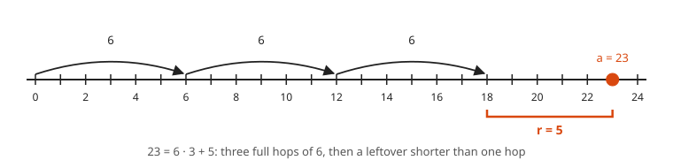
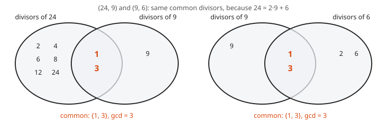
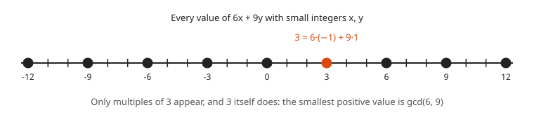
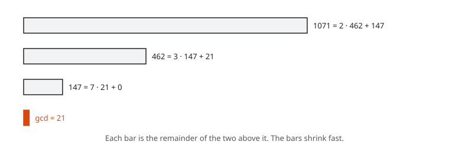

# Divisibility, GCD and Euclid

**Level:** 601 · **Unit:** 7 · **Time:** 75 to 90 minutes
**Prerequisites:** [Induction](../05-induction/README.md), [Direct Proof](../02-direct-proof/README.md)

## The Big Idea

**Number theory** studies the whole numbers and how they divide each other. Its oldest algorithm, from Euclid around 300 BC, finds the greatest common divisor of two numbers without factoring either one. It runs in a handful of steps even on numbers hundreds of digits long. It also hands you integers $x, y$ with $ax + by = \gcd(a, b)$, which is the key that unlocks modular inverses, RSA and the uniqueness of prime factorization.

## Picture It

<!-- diagram: type=multiples step=6 range=0..26 caption="Multiples of 6 as hops on a number line" -->


$6 \mid n$ means: hop from $0$ in jumps of $6$ and you land on $n$. The numbers between the landing spots leave a **remainder**, the distance back to the last landing spot.

<!-- diagram: type=euclid-tiling a=24 b=9 caption="Euclid algorithm as tiling a rectangle with squares" -->


This is the Euclidean algorithm drawn as a floor plan. Cut the biggest squares you can from a $24 \times 9$ rectangle. A $6 \times 9$ strip remains. Cut the biggest squares from that. Keep going until no strip remains. The last square size, $3$, tiles the whole floor exactly. It is the largest square that does: $\gcd(24, 9) = 3$.

## Step by Step

### 1. The Division Algorithm

<!-- diagram: type=number-line range=0..24 hops=6x3 remainder=5 caption="The division algorithm as hops plus a remainder" -->


**Theorem.** For integers $a$ and $b > 0$, there are unique integers $q$ (quotient) and $r$ (remainder) with

$$a = bq + r, \qquad 0 \leq r < b.$$

Why it holds: walk along the multiples of $b$ (the hops in the picture). Let $bq$ be the largest multiple of $b$ that is at most $a$. Set $r = a - bq$. Then $r \geq 0$, and $r < b$, because $r \geq b$ makes $b(q+1) \leq a$, which contradicts the choice of $q$. Uniqueness: if $bq + r = bq' + r'$ with both remainders in $[0, b)$, then $b \mid (r - r')$ and $|r - r'| < b$, which forces $r = r'$ and then $q = q'$.

In Go, `a / b` and `a % b` give $q$ and $r$ when $a \geq 0$. For negative $a$, Go rounds toward zero and hands back a negative remainder, which breaks the rule $0 \leq r < b$. Mathematicians and Go disagree here, and the compiler does not care who is right.

### 2. The Greatest Common Divisor

$\gcd(a, b)$ is the largest integer that divides both $a$ and $b$ (not both zero). If $\gcd(a, b) = 1$, the numbers are **coprime**.

### 3. The Key Lemma

<!-- diagram: type=venn pairs="24,9;9,6" caption="The pairs 24, 9 and 9, 6 share the same common divisors" -->


**Lemma.** If $a = bq + r$, then $\gcd(a, b) = \gcd(b, r)$.

```txt
  let d divide a and b                       common divisor of a, b
  r = a - bq                                 rearrange
  d divides r                                d divides a combination of a and b (lesson 02, example 5)
  d is a common divisor of b and r           shown
  let e divide b and r                       common divisor of b, r
  a = bq + r                                 given
  e divides a                                combination of b and r
  e is a common divisor of a and b           shown
  same set of common divisors                both directions
  same greatest element                      the gcds agree
```

$\blacksquare$

### 4. The Euclidean Algorithm

Replace $(a, b)$ by $(b, a \bmod b)$ until the second number is $0$. The first number is then the gcd. The lemma says the gcd never changes along the way. The remainders strictly decrease and stay $\geq 0$, hence the loop terminates.

### 5. Bezout's Identity

<!-- diagram: type=number-line range=-12..12 values="6x+9y" caption="Values of 6x plus 9y are exactly the multiples of 3" -->


**Theorem.** For integers $a, b$ not both zero, there are integers $x, y$ with $ax + by = \gcd(a, b)$.

Run the Euclidean algorithm and then run it backward, substituting each remainder. Example 2 shows how.

### 6. Euclid's Lemma

**Theorem.** If $p$ is prime and $p \mid ab$, then $p \mid a$ or $p \mid b$.

```txt
  suppose p does not divide a                  else done
  gcd(p, a) = 1                                the only divisors of p are 1 and p
  p x + a y = 1 for some integers x, y         Bezout
  p b x + a b y = b                            multiply by b
  p divides p b x and p divides a b y          p divides ab by hypothesis
  p divides b                                  p divides the sum
```

$\blacksquare$ This lemma is the engine behind the **uniqueness** of prime factorization: two factorizations of the same number must use the same primes. [Lesson 05](../05-induction/README.md) proved existence.

## Worked Examples

### Example 1: The Euclidean Algorithm on 1071 and 462

<!-- diagram: type=bars values=1071,462,147,21 caption="Euclidean algorithm remainders as shrinking bars" -->


```txt
  1071 = 2 * 462 + 147          divide 1071 by 462
   462 = 3 * 147 +  21          divide 462 by 147
   147 = 7 *  21 +   0          divide 147 by 21, remainder 0
  gcd(1071, 462) = 21           last nonzero remainder
```

Check: $1071 = 21 \cdot 51$ and $462 = 21 \cdot 22$, and $\gcd(51, 22) = 1$.

### Example 2: Bezout Coefficients for 1071 and 462

Work backward from the line that produced $21$.

```txt
  21 = 462 - 3 * 147                       second line, solved for 21
  147 = 1071 - 2 * 462                     first line, solved for 147
  21 = 462 - 3 * (1071 - 2 * 462)          substitute 147
     = 462 - 3 * 1071 + 6 * 462            expand
     = 7 * 462 - 3 * 1071                  collect 462 terms
  check: 3234 - 3213 = 21                  arithmetic
```

Hence $x = -3$, $y = 7$: $1071 \cdot (-3) + 462 \cdot 7 = 21$.

### Example 3: GCD and Bezout for 252 and 198

```txt
  252 = 1 * 198 + 54
  198 = 3 *  54 + 36
   54 = 1 *  36 + 18
   36 = 2 *  18 +  0           gcd = 18
  18 = 54 - 36                 third line
     = 54 - (198 - 3*54)       second line
     = 4*54 - 198              collect
     = 4*(252 - 198) - 198     first line
     = 4*252 - 5*198           collect
  check: 1008 - 990 = 18
```

### Example 4: Consecutive Integers Are Coprime

**Claim.** Consecutive integers are coprime: $\gcd(n, n + 1) = 1$.

```txt
  let d divide n and n + 1                  common divisor
  d divides (n + 1) - n = 1                 difference of multiples of d
  d = 1 (taking d positive)                 the only positive divisor of 1
```

$\blacksquare$ Euclid's primes proof in [lesson 03](../03-proof-by-contradiction/README.md) uses the same move.

## See It Step by Step


[Euclidean Algorithm with Squares: open the step-by-step walkthrough](https://caseyaedwards.github.io/math_training/diagrams/euclidean-algorithm/)

Watch the largest squares come off the rectangle until the last square fits exactly, and its side is the GCD.


[Factor Tree: open the step-by-step walkthrough](https://caseyaedwards.github.io/math_training/diagrams/factor-tree/)

Watch each branch split until only primes remain, and notice the same primes appear no matter how the tree starts.


[GCD and LCM with a Venn Diagram: open the step-by-step walkthrough](https://caseyaedwards.github.io/math_training/diagrams/gcd-lcm-venn/)

Watch the overlap of prime factors multiply to the GCD and the whole diagram multiply to the LCM.

## Common Mistakes

* Stopping one line too late: the gcd is the last **nonzero** remainder, not the $0$.
* Mixing up the order: $(a, b) \to (b, a \bmod b)$. Writing $(a \bmod b, b)$ gives the right gcd eventually but wrecks the back-substitution.
* Assuming $p \mid ab \Rightarrow p \mid a$ or $p \mid b$ for non-primes. $6 \mid 4 \cdot 9$, yet $6 \nmid 4$ and $6 \nmid 9$.
* Treating Bezout coefficients as unique. $x = -3 + 22t$, $y = 7 - 51t$ works for every integer $t$.

## Try It

1. Find $q$ and $r$ for $a = 100$, $b = 7$, and for $a = -100$, $b = 7$.
2. Compute $\gcd(30, 21)$ and find $x, y$ with $30x + 21y = \gcd(30, 21)$.
3. Compute $\gcd(161, 28)$ and find Bezout coefficients.
4. Run the Euclidean algorithm on $89$ and $55$. How many divisions does it take? What is special about these numbers?
5. Prove: if $a \mid c$, $b \mid c$ and $\gcd(a, b) = 1$, then $ab \mid c$.
6. Prove: if $\gcd(a, b) = d$, then $\gcd(a/d, b/d) = 1$.
7. Draw the square tiling for a $15 \times 6$ rectangle. What is the gcd?
8. Explain why $6x + 9y = 1$ has no integer solution.

<details>
<summary>Answers</summary>

1. $100 = 7 \cdot 14 + 2$. $-100 = 7 \cdot (-15) + 5$. The remainder must be in $[0, 7)$.
2. $30 = 1 \cdot 21 + 9$, $21 = 2 \cdot 9 + 3$, $9 = 3 \cdot 3$. gcd $= 3$. $3 = 21 - 2 \cdot 9 = 21 - 2(30 - 21) = 3 \cdot 21 - 2 \cdot 30$. Hence $x = -2$, $y = 3$.
3. $161 = 5 \cdot 28 + 21$, $28 = 1 \cdot 21 + 7$, $21 = 3 \cdot 7$. gcd $= 7$. $7 = 28 - 21 = 28 - (161 - 5 \cdot 28) = 6 \cdot 28 - 161$. Hence $x = -1$, $y = 6$.
4. Nine divisions, every quotient is 1 except the last, gcd $= 1$. They are consecutive Fibonacci numbers, the slowest case for Euclid (Lame's theorem).
5. Bezout: $ax + by = 1$. Multiply by $c$: $c = acx + bcy$. $ab \mid ac \cdot x$ because $b \mid c$. $ab \mid bc \cdot y$ because $a \mid c$. Hence $ab \mid c$.
6. $ax + by = d$. Divide by $d$: $(a/d)x + (b/d)y = 1$. Any common divisor of $a/d$ and $b/d$ divides $1$.
7. Two $6 \times 6$ squares, then a $3 \times 6$ strip holds two $3 \times 3$ squares. gcd $= 3$.
8. $3 \mid 6x + 9y$ for all integers $x, y$, and $3 \nmid 1$.

</details>

## Code Corner

The extended Euclidean algorithm returns the gcd and the Bezout coefficients. The recursion is the back-substitution from Example 2, done by the machine. The program lives in [code/main.go](code/main.go). Run it with `go run main.go` inside the `code` folder.

```go
// The extended Euclidean algorithm: gcd plus Bezout coefficients.
package main

import "fmt"

// egcd returns (g, x, y) with a*x + b*y == g == gcd(a, b).
func egcd(a, b int) (int, int, int) {
	if b == 0 {
		return a, 1, 0
	}
	g, x, y := egcd(b, a%b)  // solve the smaller pair first
	return g, y, x - (a/b)*y // back-substitute one line
}

func main() {
	for _, p := range [][2]int{{1071, 462}, {252, 198}, {161, 28}, {89, 55}} {
		a, b := p[0], p[1]
		g, x, y := egcd(a, b)
		fmt.Printf("gcd(%d, %d) = %d = %d*(%d) + %d*(%d)\n", a, b, g, a, x, b, y)
	}

	// Count the division steps on consecutive Fibonacci numbers, the slow case.
	a, b, steps := 89, 55, 0
	for b != 0 {
		a, b = b, a%b
		steps++
	}
	fmt.Println("division steps for (89, 55):", steps)
}
```

Output:

```txt
gcd(1071, 462) = 21 = 1071*(-3) + 462*(7)
gcd(252, 198) = 18 = 252*(4) + 198*(-5)
gcd(161, 28) = 7 = 161*(-1) + 28*(6)
gcd(89, 55) = 1 = 89*(-21) + 55*(34)
division steps for (89, 55): 9
```

## Go Deeper

* [Euclid's Elements, Book VII, Proposition 2](https://aleph0.clarku.edu/~djoyce/elements/bookVII/propVII2.html): the original algorithm, stated with line segments.
* [Wolfram MathWorld: Euclidean Algorithm](https://mathworld.wolfram.com/EuclideanAlgorithm.html): variants and running time.
* [Number Theory Track](../../../tracks/number-theory/README.md): primes, congruences and more.

Flashcards for this lesson: [cards.tsv](cards.tsv) (Anki import: front, back, tags, separated by tabs).

Next: [Modular Arithmetic and Fermat](../08-modular-arithmetic-and-fermat/README.md)
