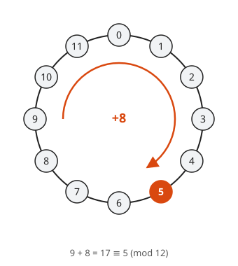
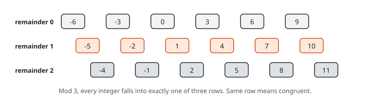
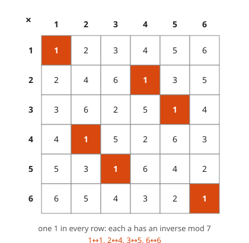
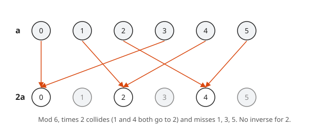
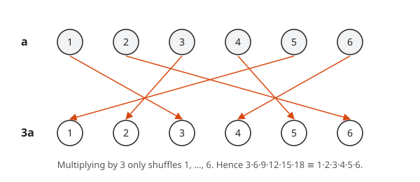
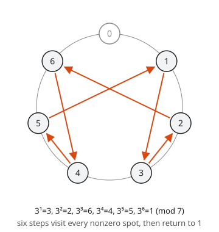

# Modular Arithmetic and Fermat

**Level:** 601 · **Unit:** 8 · **Time:** 75 to 90 minutes
**Prerequisites:** [Divisibility, GCD and Euclid](../07-divisibility-gcd-and-euclid/README.md)

## The Big Idea

**Modular arithmetic** is arithmetic on a clock. With a 12-hour clock, 8 hours after 9 o'clock is 5 o'clock, not 17. You keep only the remainder. You already use it every day: `hash(key) % num_shards`, ring buffers, cron schedules and day-of-week math. This lesson makes it rigorous and proves one beautiful fact, **Fermat's little theorem**: for a prime $p$ and any $a$ not divisible by $p$, $a^{p-1}$ leaves remainder 1 on division by $p$. That fact sits underneath RSA.

## Picture It

<!-- diagram: type=clock modulus=12 start=9 add=8 caption="Clock arithmetic mod 12" -->


Numbers mod 12 live on a circle with 12 positions. Adding means walking clockwise. Every integer lands on exactly one position: its remainder on division by 12. Two integers that land on the same position are **congruent**.

## Step by Step

### 1. Congruence

<!-- diagram: type=rows modulus=3 range=-6..11 caption="Integers sorted into three rows by remainder mod 3" -->


For an integer $n \geq 2$, write

$$a \equiv b \pmod{n} \quad \text{when} \quad n \mid (a - b).$$

Equivalently, $a$ and $b$ leave the same remainder on division by $n$. Examples: $17 \equiv 5 \pmod{12}$, $-1 \equiv 6 \pmod 7$, $100 \equiv 0 \pmod{10}$.

The set of positions $\{0, 1, \dots, n-1\}$ with clock arithmetic is written $\mathbb{Z}_n$ (or $\mathbb{Z}/n\mathbb{Z}$).

### 2. Congruence Respects + and ×

**Theorem.** If $a \equiv a'$ and $b \equiv b' \pmod n$, then $a + b \equiv a' + b'$ and $ab \equiv a'b' \pmod n$.

```txt
  a' = a + n s,  b' = b + n t                  definition of congruence
  a' + b' = (a + b) + n (s + t)                add
  a' b'   = ab + n (a t + b s + n s t)         expand and factor n
  both differ from a + b and ab by multiples of n
```

$\blacksquare$ This is why you can reduce at every step. To find the last digit of $7^{100}$, you never write down the full 85-digit number.

### 3. Inverses

<!-- diagram: type=mult-table modulus=7 highlight=1 caption="Multiplication table mod 7 with inverses highlighted" -->


An **inverse** of $a$ mod $n$ is a number $x$ with $ax \equiv 1 \pmod n$.

**Theorem.** $a$ has an inverse mod $n$ if and only if $\gcd(a, n) = 1$.

```txt
  (<=) gcd(a, n) = 1                        hypothesis
       a x + n y = 1 for some x, y          Bezout (lesson 07)
       a x = 1 - n y                        rearrange
       a x is congruent to 1 mod n          n divides a x - 1
  (=>) a x = 1 + n k for some k             a x congruent to 1
       a x - n k = 1                        rearrange
       any common divisor of a, n divides 1 lesson 02, example 5
       gcd(a, n) = 1
```

$\blacksquare$ For a prime $p$, every $a$ from $1$ to $p - 1$ is coprime to $p$. Hence every nonzero element of $\mathbb{Z}_p$ has an inverse. You can divide mod a prime.

### 4. Cancellation

<!-- diagram: type=permutation modulus=6 multiplier=2 caption="Multiplication by 2 mod 6 is not a shuffle" -->


If $ac \equiv bc \pmod n$ and $\gcd(c, n) = 1$, then $a \equiv b \pmod n$. Proof: multiply both sides by the inverse of $c$. Without the gcd condition, cancellation fails: $2 \cdot 3 \equiv 4 \cdot 3 \pmod 6$, yet $2 \not\equiv 4$.

### 5. Fermat's Little Theorem

<!-- diagram: type=permutation modulus=7 multiplier=3 caption="Multiplication by 3 permutes the nonzero residues mod 7" -->


Multiply each of $1, 2, \dots, 6$ by $3$ and reduce mod 7. You get $3, 6, 2, 5, 1, 4$: the same six numbers, shuffled. Multiply each row together. The products must be equal mod 7. The top row gives $6!$. The bottom row gives $3^6 \cdot 6!$. Cancel $6!$ and you get $3^6 \equiv 1 \pmod 7$. The proof below does this for every prime.

**Theorem (Fermat, 1640).** If $p$ is prime and $p \nmid a$, then $a^{p-1} \equiv 1 \pmod p$.

```txt
  consider a, 2a, 3a, ..., (p-1)a mod p             the bottom row
  none is 0 mod p:                                  
    p | ia forces p | i or p | a                    Euclid's lemma
    but 1 <= i <= p-1 and p does not divide a       hence impossible
  no two are equal mod p:
    ia = ja mod p gives i = j mod p                 cancel a, gcd(a, p) = 1
    1 <= i, j <= p-1 forces i = j                   both are in range
  p - 1 distinct nonzero values among 1..p-1        counted
  they are 1, 2, ..., p-1 in some order             pigeonhole: no room left
  a * 2a * ... * (p-1)a = 1 * 2 * ... * (p-1)       multiply each row, mod p
  a^(p-1) (p-1)! = (p-1)!  mod p                    regroup
  gcd((p-1)!, p) = 1                                p divides none of 1..p-1
  a^(p-1) = 1  mod p                                cancel (p-1)!
```

$\blacksquare$

A common restatement without the coprime condition: $a^p \equiv a \pmod p$ for every integer $a$.

<!-- diagram: type=clock modulus=7 path="powers of 3" caption="Powers of 3 mod 7 cycle back to 1 after 6 steps" -->


The powers of 3 tour every nonzero spot on the mod 7 clock and come home to 1 after exactly $6 = 7 - 1$ steps. Fermat says no base can take longer than $p - 1$ steps to get home, and the trip length always divides $p - 1$.

## Worked Examples

### Example 1: Reduce Before You Compute

Find $2^{100} \bmod 7$.

```txt
  2^6 = 1 mod 7                     Fermat with p = 7
  100 = 6 * 16 + 4                  divide the exponent by 6
  2^100 = (2^6)^16 * 2^4            exponent rules
        = 1^16 * 16 mod 7           Fermat
        = 16 mod 7 = 2              reduce
```

Sanity check with a short cycle: $2^3 = 8 \equiv 1$, and $100 = 3 \cdot 33 + 1$, hence $2^{100} \equiv 2$. Both routes agree.

### Example 2: A Bigger Exponent

Find $7^{222} \bmod 11$.

```txt
  7^10 = 1 mod 11                   Fermat with p = 11
  222 = 10 * 22 + 2                 divide the exponent by 10
  7^222 = (7^10)^22 * 7^2           exponent rules
        = 49 mod 11                 Fermat
        = 5                         49 = 4 * 11 + 5
```

### Example 3: Find an Inverse

Find the inverse of $7$ mod $26$.

```txt
  26 = 3 * 7 + 5
   7 = 1 * 5 + 2
   5 = 2 * 2 + 1                    gcd = 1, inverse exists
  1 = 5 - 2*2
    = 5 - 2*(7 - 5) = 3*5 - 2*7
    = 3*(26 - 3*7) - 2*7 = 3*26 - 11*7
  -11 * 7 = 1 mod 26                drop the multiple of 26
  -11 = 15 mod 26                   add 26
  check: 7 * 15 = 105 = 4*26 + 1    remainder 1
```

### Example 4: Solve a Linear Congruence

Solve $3x \equiv 4 \pmod 7$.

```txt
  3 * 5 = 15 = 1 mod 7              inverse of 3 is 5
  x = 5 * 4 mod 7                   multiply both sides by 5
    = 20 mod 7 = 6                  reduce
  check: 3 * 6 = 18 = 2*7 + 4       correct
```

### Example 5: Fermat as a Prime Test, and Its Limits

If $a^{n-1} \not\equiv 1 \pmod n$ for some $a$ coprime to $n$, then $n$ is **not** prime. That is a cheap, certain "no". A "yes" is only a hint: $561 = 3 \cdot 11 \cdot 17$ is composite, yet $a^{560} \equiv 1 \pmod{561}$ for every $a$ coprime to 561. Numbers like 561 are **Carmichael numbers**. Real primality tests such as Miller-Rabin patch this hole.

## Common Mistakes

* Reducing the exponent mod $p$ instead of mod $p - 1$. $2^{100} \bmod 7$ uses $100 \bmod 6$, not $100 \bmod 7$.
* Dividing mod $n$ when $\gcd$ is not 1. $2x \equiv 2 \pmod 6$ has solutions $x = 1$ and $x = 4$.
* Applying Fermat to a composite modulus. $2^{8} \bmod 9 = 4$, not 1. (Euler's theorem handles composites with $\varphi(n)$ in place of $p - 1$.)
* Negative remainders: in math, $-1 \bmod 7 = 6$. In Go, `-1 % 7` is `-1`. In Python, `-1 % 7` is `6`.

## Try It

1. Compute $3^{100} \bmod 13$.
2. Compute $2^{1000} \bmod 13$.
3. Find the inverse of $5$ mod $12$.
4. Solve $4x \equiv 3 \pmod 9$.
5. What day of the week is it 1,000 days after a Monday?
6. Prove: $n^2 \equiv 0$ or $1 \pmod 4$ for every integer $n$. (Compare with [lesson 04](../04-contrapositive-and-cases/README.md).)
7. Prove: if $p$ is an odd prime and $p \nmid a$, then $a^{(p-1)/2} \equiv \pm 1 \pmod p$. Hint: $x^2 \equiv 1$ means $p \mid (x - 1)(x + 1)$.
8. Show that 15 is not prime with a Fermat test, base 2.

<details>
<summary>Answers</summary>

1. $3^{12} \equiv 1$. $100 = 12 \cdot 8 + 4$. $3^4 = 81 = 6 \cdot 13 + 3$. Answer: $3$.
2. $2^{12} \equiv 1$. $1000 = 12 \cdot 83 + 4$. $2^4 = 16 \equiv 3$. Answer: $3$.
3. $5 \cdot 5 = 25 = 2 \cdot 12 + 1$. The inverse is $5$.
4. The inverse of $4$ mod $9$ is $7$, because $28 = 3 \cdot 9 + 1$. $x \equiv 7 \cdot 3 = 21 \equiv 3$. Check: $12 = 9 + 3$.
5. $1000 = 7 \cdot 142 + 6$. Six days after Monday: Sunday.
6. Every $n$ is $0, 1, 2$ or $3$ mod 4. Squares: $0, 1, 4 \equiv 0, 9 \equiv 1$.
7. Let $x = a^{(p-1)/2}$. Then $x^2 = a^{p-1} \equiv 1$. Hence $p \mid (x-1)(x+1)$, and Euclid's lemma gives $x \equiv 1$ or $x \equiv -1$.
8. $2^{14} = 16384 = 15 \cdot 1092 + 4$. $4 \neq 1$, hence 15 is composite.

</details>

## Code Corner

Fast modular exponentiation by repeated squaring, a check of Fermat's theorem, the inverse from Example 3, and a Carmichael number that fools the test. Note the last line: Go's `%` keeps the sign of the left operand. The program lives in [code/main.go](code/main.go). Run it with `go run main.go` inside the `code` folder.

```go
// Fast modular powers, Fermat checks, an inverse, and a Carmichael number.
package main

import "fmt"

// powMod computes b^e mod m by repeated squaring.
func powMod(b, e, m int) int {
	result := 1
	b %= m
	for e > 0 {
		if e&1 == 1 {
			result = result * b % m
		}
		b = b * b % m
		e >>= 1
	}
	return result
}

func gcd(a, b int) int {
	for b != 0 {
		a, b = b, a%b
	}
	return a
}

// fermatAll reports whether a^(n-1) = 1 mod n for every a coprime to n.
func fermatAll(n int) bool {
	for a := 2; a < n; a++ {
		if gcd(a, n) == 1 && powMod(a, n-1, n) != 1 {
			return false
		}
	}
	return true
}

func main() {
	fmt.Println("2^100 mod 7  =", powMod(2, 100, 7))
	fmt.Println("7^222 mod 11 =", powMod(7, 222, 11))
	fmt.Println("3^100 mod 13 =", powMod(3, 100, 13))
	for x := 1; x < 26; x++ {
		if 7*x%26 == 1 {
			fmt.Println("inverse of 7 mod 26 =", x)
		}
	}
	fmt.Println("Fermat holds for all bases, n = 13: ", fermatAll(13))
	fmt.Println("Fermat holds for all bases, n = 15: ", fermatAll(15))
	fmt.Println("Fermat holds for all bases, n = 561:", fermatAll(561), " (561 = 3 * 11 * 17)")
	fmt.Println("Go remainder of -1 % 7 =", -1%7, "(math says 6)")
}
```

Output:

```txt
2^100 mod 7  = 2
7^222 mod 11 = 5
3^100 mod 13 = 3
inverse of 7 mod 26 = 15
Fermat holds for all bases, n = 13:  true
Fermat holds for all bases, n = 15:  false
Fermat holds for all bases, n = 561: true  (561 = 3 * 11 * 17)
Go remainder of -1 % 7 = -1 (math says 6)
```

## Go Deeper

* [MacTutor: Pierre de Fermat](https://mathshistory.st-andrews.ac.uk/Biographies/Fermat/): the lawyer who did number theory in the margins.
* [Wolfram MathWorld: Fermat's Little Theorem](https://mathworld.wolfram.com/FermatsLittleTheorem.html): statements, history and generalizations.
* [Number Theory for Cryptography Workshop](../../../workshops/number-theory-for-cryptography/README.md): RSA built from exactly these pieces.

Flashcards for this lesson: [cards.tsv](cards.tsv) (Anki import: front, back, tags, separated by tabs).

Next: [Epsilon-Delta Limits](../09-epsilon-delta-limits/README.md)
