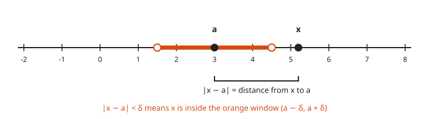
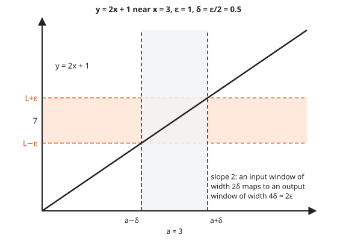
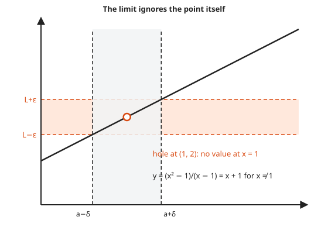

# Epsilon-Delta Limits

**Level:** 601 · **Unit:** 9 · **Time:** 90 minutes
**Prerequisites:** [Contrapositive and Cases](../04-contrapositive-and-cases/README.md), [401 Calculus](../../401/README.md)

## The Big Idea

In calculus, "$f(x)$ approaches $L$ as $x$ approaches $a$" was a feeling. **Real analysis** turns it into a checkable contract. You name any output tolerance $\varepsilon$ (epsilon), however tiny. I must answer with an input tolerance $\delta$ (delta) so that every $x$ within $\delta$ of $a$ gives $f(x)$ within $\varepsilon$ of $L$. If I can always answer, the limit is $L$.

If calculus is rusty, start here: a **limit** asks which value $f(x)$ heads toward as $x$ gets close to $a$. It ignores what happens exactly at $a$. Think of it as the reading a gauge settles on, not the reading at one glitchy instant.

It reads exactly like an SLO negotiation. "Keep p99 latency within $\varepsilon$ of target." "Then keep request size within $\delta$ of normal." The limit exists when every SLO, however strict, has some input budget that meets it.

## Picture It

<!-- diagram: type=function-bands f=x^2 a=1 L=1 eps=0.5 delta=0.2 caption="Epsilon band and delta band for y equals x squared near 1" -->


The orange horizontal band is the challenge: outputs must land between $L - \varepsilon$ and $L + \varepsilon$. The gray vertical band is your answer: inputs between $a - \delta$ and $a + \delta$. You win when the part of the graph above the gray band sits completely inside the orange band. A narrower orange band (smaller $\varepsilon$) forces a narrower gray band (smaller $\delta$). The limit exists when you can win for every $\varepsilon > 0$.

## Step by Step

### 1. The Definition

<!-- diagram: type=number-line points=a,x window="a-delta,a+delta" caption="Absolute value as distance on the number line" -->


Read $|x - a|$ as the distance between $x$ and $a$. Then $|x - a| < \delta$ says $x$ sits inside a window of half-width $\delta$ around $a$. Every inequality in this lesson is a window statement in disguise.

$$\lim_{x \to a} f(x) = L$$

means

$$\forall \varepsilon > 0\ \ \exists \delta > 0\ \ \forall x:\quad 0 < |x - a| < \delta \ \Rightarrow\ |f(x) - L| < \varepsilon.$$

Read it as the game from [lesson 01](../01-reading-and-writing-proofs/README.md): the challenger picks $\varepsilon$, you pick $\delta$ (it can depend on $\varepsilon$), then the challenger picks any $x$ in the gray band, and you win if $f(x)$ is in the orange band.

The condition $0 < |x - a|$ excludes $x = a$ itself. The limit cares about the approach, not the value at $a$. The function need not even be defined at $a$.

### 2. The Two-Stage Method

Every epsilon-delta proof has scratch work and a clean proof.

1. **Scratch work (backward):** start from $|f(x) - L| < \varepsilon$. Rewrite $|f(x) - L|$ as something times $|x - a|$. Bound the "something". Read off a $\delta$ that works.
2. **Proof (forward):** "Let $\varepsilon > 0$. Choose $\delta = \dots$. Suppose $0 < |x - a| < \delta$. Then ... $< \varepsilon$."

### 3. The Taming Trick

When the "something" depends on $x$, first insist $\delta \leq 1$. That pins $x$ to a known interval and bounds the "something" by a number. Then take $\delta = \min(1, \dots)$.

### 4. Continuity

$f$ is **continuous at $a$** when $\lim_{x \to a} f(x) = f(a)$. In the picture: no jump, no hole, and the value at $a$ is the value the graph is heading toward.

### 5. Negation: How a Limit Fails

Negate with the rules from [lesson 01](../01-reading-and-writing-proofs/README.md): $\lim_{x \to a} f(x) \neq L$ means

$$\exists \varepsilon > 0\ \ \forall \delta > 0\ \ \exists x:\quad 0 < |x - a| < \delta \ \text{ and } \ |f(x) - L| \geq \varepsilon.$$

One fixed band is too strict, and every gray band, however thin, contains a point that escapes it.

## Worked Examples

### Example 1: A Line

**Claim.** $\lim_{x \to 3} (2x + 1) = 7$.

Scratch: $|(2x + 1) - 7| = |2x - 6| = 2|x - 3|$. To make this less than $\varepsilon$, need $|x - 3| < \varepsilon / 2$.

```txt
  let eps > 0                               challenger's move
  choose delta = eps / 2                    your answer, from the scratch work
  suppose 0 < |x - 3| < delta               any x in the gray band
  |(2x + 1) - 7| = |2x - 6|                 simplify
                 = 2 |x - 3|                factor
                 < 2 * delta                hypothesis on x
                 = 2 * (eps / 2) = eps      choice of delta
```

<!-- diagram: type=function-bands f=2x+1 a=3 L=7 eps=1 delta=0.5 caption="y = 2x + 1 near x = 3" -->


$\blacksquare$ Picture: the line has slope 2. It stretches the input band by 2. Hence an input band half as wide as the output band fits.

### Example 2: A Parabola, With the Taming Trick

**Claim.** $\lim_{x \to 2} x^2 = 4$.

Scratch: $|x^2 - 4| = |x - 2| \cdot |x + 2|$. The factor $|x + 2|$ depends on $x$. If $|x - 2| < 1$, then $1 < x < 3$ and $|x + 2| < 5$. Then $|x^2 - 4| < 5|x - 2|$, which is less than $\varepsilon$ when $|x - 2| < \varepsilon / 5$.

```txt
  let eps > 0                                 challenger's move
  choose delta = min(1, eps/5)                both restrictions at once
  suppose 0 < |x - 2| < delta                 any x in the gray band
  |x - 2| < 1, hence 1 < x < 3                delta <= 1
  3 < x + 2 < 5, hence |x + 2| < 5            add 2
  |x^2 - 4| = |x - 2| |x + 2|                 difference of squares
            < (eps / 5) * 5                   delta <= eps/5 and |x + 2| < 5
            = eps                             simplify
```

$\blacksquare$ The picture shows why the trick is needed: a parabola gets steeper as you move right. A $\delta$ must account for the steepest part of the gray band. Capping $\delta$ at 1 caps the steepness at slope 5.

### Example 3: A Hole in the Graph

<!-- diagram: type=function-bands f=x+1 hole=1,2 caption="The limit ignores the point itself" -->


**Claim.** $\lim_{x \to 1} \dfrac{x^2 - 1}{x - 1} = 2$, even though the function is undefined at $x = 1$.

```txt
  let eps > 0, choose delta = eps
  suppose 0 < |x - 1| < delta                 x is not 1
  (x^2 - 1)/(x - 1) = x + 1                   cancel x - 1, allowed since x is not 1
  |(x + 1) - 2| = |x - 1| < delta = eps       simplify
```

$\blacksquare$ This is exactly why the definition says $0 < |x - a|$.

### Example 4: A Jump Has No Limit

<!-- diagram: type=step f=sgn caption="The sign function has no limit at 0" -->


Let $\operatorname{sgn}(x) = 1$ for $x > 0$ and $-1$ for $x < 0$. **Claim.** $\lim_{x \to 0} \operatorname{sgn}(x)$ does not exist.

```txt
  suppose the limit is L                      for contradiction
  take eps = 1                                one fixed band
  there is delta > 0 that works               definition of limit
  x = delta/2:   |1 - L| < 1                  x > 0, inside the gray band
  x = -delta/2:  |-1 - L| < 1                 x < 0, inside the gray band
  2 = |1 - (-1)|                              arithmetic
    = |(1 - L) + (L + 1)|                     add and subtract L
    <= |1 - L| + |L + 1|                      triangle inequality (lesson 04)
    < 1 + 1 = 2                               the two bounds above
  2 < 2                                       contradiction
```

$\blacksquare$ Picture: any orange band narrower than 2 cannot hold both the level $1$ and the level $-1$, and every gray band around $0$ contains points from both sides.

## See It Step by Step


[Limits: The Epsilon-Delta Picture: open the step-by-step walkthrough](https://caseyaedwards.github.io/math_training/diagrams/epsilon-delta/)

Watch the window around c shrink to keep the graph inside each thinner band around L.

## Common Mistakes

* Choosing $\delta$ that depends on $x$. The order is $\forall \varepsilon\ \exists \delta\ \forall x$. $\delta$ can use $\varepsilon$ and $a$, never $x$.
* Presenting the scratch work as the proof. The scratch work goes backward. The proof goes forward from $|x - a| < \delta$.
* Forgetting the $\min$. If you used $\delta \leq 1$ to bound a factor, the final $\delta$ must include that cap.
* Thinking a smaller $\varepsilon$ means a different limit. $\varepsilon$ is a test tolerance, not part of the answer.

## Try It

1. Prove $\lim_{x \to 1} (5x - 2) = 3$.
2. In Example 1, the challenger picks $\varepsilon = 0.01$. Which $\delta$ works?
3. Prove $\lim_{x \to 3} x^2 = 9$.
4. Prove $\lim_{x \to a} c = c$ for a constant $c$. Which $\delta$ works?
5. Prove $\lim_{x \to 4} \sqrt{x} = 2$. Hint: $\sqrt{x} - 2 = \dfrac{x - 4}{\sqrt{x} + 2}$.
6. Prove $\lim_{x \to 1} \dfrac{1}{x} = 1$.
7. Write the negation of "$f$ is continuous at $a$" in full.
8. Explain, with the picture, why $\lim_{x \to 0} \sin(1/x)$ does not exist.

<details>
<summary>Answers</summary>

1. $|5x - 2 - 3| = 5|x - 1|$. Choose $\delta = \varepsilon / 5$.
2. $\delta = 0.005$ (or anything smaller).
3. $|x^2 - 9| = |x - 3||x + 3|$. If $|x - 3| < 1$, then $|x + 3| < 7$. Choose $\delta = \min(1, \varepsilon / 7)$.
4. $|c - c| = 0 < \varepsilon$ for every $x$. Any $\delta > 0$ works, for example $\delta = 1$.
5. For $x \geq 0$: $|\sqrt{x} - 2| = \frac{|x - 4|}{\sqrt{x} + 2} \leq \frac{|x - 4|}{2}$. Choose $\delta = \min(4, 2\varepsilon)$. The cap 4 keeps $x > 0$, where $\sqrt{x}$ is defined.
6. $\left|\frac1x - 1\right| = \frac{|x - 1|}{|x|}$. If $|x - 1| < \frac12$, then $x > \frac12$ and $\frac{1}{|x|} < 2$. Choose $\delta = \min(\frac12, \frac{\varepsilon}{2})$.
7. There exists $\varepsilon > 0$ such that for every $\delta > 0$ there exists $x$ with $|x - a| < \delta$ and $|f(x) - f(a)| \geq \varepsilon$.
8. $\sin(1/x) = 1$ at $x = \frac{1}{\pi/2 + 2\pi k}$ and $-1$ at $x = \frac{1}{3\pi/2 + 2\pi k}$. Both kinds of points occur in every gray band around $0$. With $\varepsilon = 1$, the argument of Example 4 gives a contradiction for any proposed $L$.

</details>

## Code Corner

The program spot-checks two proposed $\delta$ rules for $\lim_{x \to 2} x^2 = 4$ on a fine grid of inputs. The rule from Example 2 passes. The tempting rule $\delta = \varepsilon / 2$ fails, because the parabola has slope near 4 at $x = 2$, not 2. Sampling is evidence, not proof, but it catches a wrong $\delta$ fast. The program lives in [code/main.go](code/main.go). Run it with `go run main.go` inside the `code` folder.

```go
// Spot-check a proposed delta on a fine grid of inputs. Evidence, not proof.
package main

import "fmt"

// check samples x in (a - d, a + d) and reports the worst output error.
func check(f func(float64) float64, a, L, d float64) float64 {
	worst := 0.0
	const steps = 200000
	for i := 1; i < steps; i++ {
		x := a - d + 2*d*float64(i)/steps
		if x == a {
			continue
		}
		e := f(x) - L
		if e < 0 {
			e = -e
		}
		if e > worst {
			worst = e
		}
	}
	return worst
}

func main() {
	sq := func(x float64) float64 { return x * x }
	good := func(eps float64) float64 { return min(1, eps/5) }
	naive := func(eps float64) float64 { return eps / 2 }
	for _, eps := range []float64{4, 1, 0.1, 0.001} {
		g, n := good(eps), naive(eps)
		fmt.Printf("eps = %-6g delta=min(1,eps/5)=%-7g worst=%.6f ok=%-5v | delta=eps/2=%-7g worst=%.6f ok=%v\n",
			eps, g, check(sq, 2, 4, g), check(sq, 2, 4, g) < eps,
			n, check(sq, 2, 4, n), check(sq, 2, 4, n) < eps)
	}
}
```

Output:

```txt
eps = 4      delta=min(1,eps/5)=0.8     worst=3.839955 ok=true  | delta=eps/2=2       worst=11.999840 ok=false
eps = 1      delta=min(1,eps/5)=0.2     worst=0.839991 ok=true  | delta=eps/2=0.5     worst=2.249975 ok=false
eps = 0.1    delta=min(1,eps/5)=0.02    worst=0.080399 ok=true  | delta=eps/2=0.05    worst=0.202498 ok=false
eps = 0.001  delta=min(1,eps/5)=0.0002  worst=0.000800 ok=true  | delta=eps/2=0.0005  worst=0.002000 ok=false
```

## Go Deeper

* [Paul's Online Math Notes: The Definition of the Limit](https://tutorial.math.lamar.edu/Classes/CalcI/DefnOfLimit.aspx): many worked epsilon-delta examples, step by step.
* [Wolfram MathWorld: Epsilon-Delta Definition](https://mathworld.wolfram.com/Epsilon-DeltaDefinition.html): a compact reference.
* [Real Analysis Track](../../../tracks/real-analysis/README.md): continuity, uniform continuity and derivatives done rigorously.

Flashcards for this lesson: [cards.tsv](cards.tsv) (Anki import: front, back, tags, separated by tabs).

Next: [Completeness and Sequences](../10-completeness-and-sequences/README.md)
