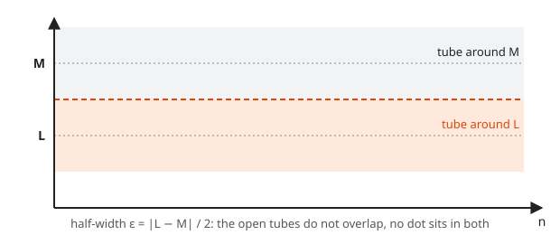
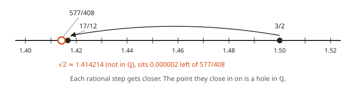
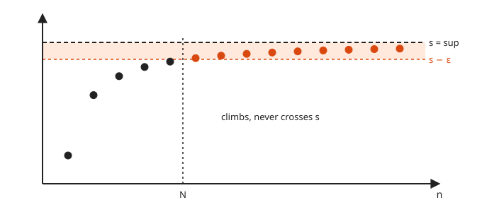
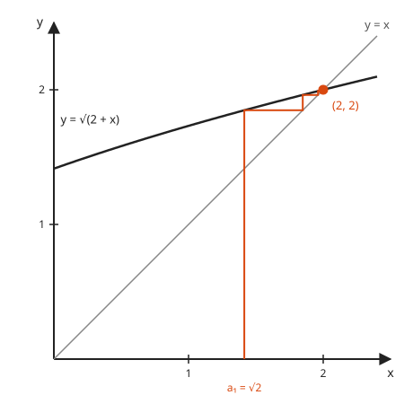

# Completeness and Sequences

**Level:** 601 · **Unit:** 10 · **Time:** 90 minutes
**Prerequisites:** [Epsilon-Delta Limits](../09-epsilon-delta-limits/README.md), [Induction](../05-induction/README.md)

## The Big Idea

A **sequence** is an endless list of numbers $a_1, a_2, a_3, \dots$, like a metric sampled once per second forever. It **converges** to $L$ when the values eventually stay as close to $L$ as anyone demands. This lesson makes that precise and then asks a deeper question: why does an increasing sequence with a ceiling always settle on a limit? The answer is a property of the real numbers called **completeness**: the number line has no holes. The rational numbers have holes, and $\sqrt{2}$ sits in one of them.

## Picture It

<!-- diagram: type=sequence-tube a(n)="1+(-1)^n/n" L=1 eps=0.25 N=4 caption="A sequence entering and staying in an epsilon tube" -->


The orange tube has half-width $\varepsilon$ around the target $L$. The first few terms do whatever they like. That is allowed. What matters is that after some index $N$, every term is in the tube, and none ever leaves again. Shrink the tube and $N$ moves right, but some $N$ always exists. That is convergence.

## Step by Step

### 1. Convergence of a Sequence

$a_n \to L$ means

$$\forall \varepsilon > 0\ \ \exists N\ \ \forall n > N:\quad |a_n - L| < \varepsilon.$$

It is the same game as [lesson 09](../09-epsilon-delta-limits/README.md). The challenger picks the tube width $\varepsilon$. You answer with a cutoff index $N$. Every term after $N$ must sit in the tube.

The absolute value $|a_n - L|$ is just the distance between $a_n$ and $L$ on the number line.

### 2. The Archimedean Property

**Fact.** For every real number $x$, some integer $n$ is bigger than $x$.

It sounds obvious, and it is the engine of the first examples. It means $1/n$ gets below any positive $\varepsilon$: pick $n > 1/\varepsilon$.

### 3. Limits Are Unique

<!-- diagram: type=two-bands L=0.8 M=1.6 eps="|L-M|/2" caption="Two limits need two separate tubes" -->


**Theorem.** A sequence has at most one limit.

```txt
  suppose a(n) -> L and a(n) -> M with L != M     assume two limits
  eps = |L - M| / 2 > 0                           tubes that do not touch
  for n > N1: |a(n) - L| < eps                    first limit
  for n > N2: |a(n) - M| < eps                    second limit
  take n > max(N1, N2)                            both hold at once
  |L - M| <= |L - a(n)| + |a(n) - M|              triangle inequality (lesson 04)
          < eps + eps = |L - M|                   the two bounds
  |L - M| < |L - M|                               contradiction
```

$\blacksquare$ One dot cannot live in two separate tubes. The picture is the proof.

### 4. Upper Bounds and the Supremum

An **upper bound** of a set $S$ is a number $u$ with $s \leq u$ for every $s \in S$. The **least upper bound**, or **supremum**, $\sup S$, is the smallest of all the upper bounds.

<!-- diagram: type=number-line set="[0,sqrt2)" upper-bounds="[sqrt2,inf)" caption="Least upper bound of a set" -->


### 5. The Completeness Axiom

**Axiom.** Every nonempty set of real numbers that has an upper bound has a least upper bound in $\mathbb{R}$.

This is the one property that separates $\mathbb{R}$ from $\mathbb{Q}$. Both add, multiply and order numbers the same way. Only $\mathbb{R}$ is complete.

<!-- diagram: type=number-line points="3/2,17/12,577/408" hole=sqrt2 caption="Rationals closing in on a hole" -->


Why $\mathbb{Q}$ fails: take $S = \{x \in \mathbb{Q} : x \geq 0,\ x^2 < 2\}$. In $\mathbb{R}$, $\sup S = \sqrt{2}$. In $\mathbb{Q}$, every upper bound can be beaten by a smaller rational upper bound, such as the Newton steps $3/2,\ 17/12,\ 577/408, \dots$ in the picture. The candidate least upper bound is not in $\mathbb{Q}$. The rational line has a hole exactly there.

### 6. The Approximation Lemma

**Lemma.** If $s = \sup S$, then for every $\varepsilon > 0$ some element $x \in S$ has $x > s - \varepsilon$.

Proof: otherwise $s - \varepsilon$ is an upper bound smaller than $s$, which contradicts "least". $\blacksquare$

In words: you can get as close to the supremum as you like from inside the set.

### 7. The Monotone Convergence Theorem

<!-- diagram: type=monotone-sequence ceiling=sup caption="An increasing sequence under a ceiling" -->


A sequence is **increasing** when $a_1 \leq a_2 \leq a_3 \leq \dots$. It is **bounded above** when one number $u$ sits above every term.

**Theorem.** An increasing sequence that is bounded above converges, and its limit is $\sup\{a_n\}$.

```txt
  S = { a(1), a(2), ... }                         the set of terms
  S is nonempty and bounded above                 hypothesis
  s = sup S exists                                completeness axiom
  let eps > 0                                     challenger's move
  some a(N) > s - eps                             approximation lemma
  for n > N: a(n) >= a(N) > s - eps               the sequence increases
  for every n: a(n) <= s                          s is an upper bound
  for n > N: s - eps < a(n) <= s                  combine
  for n > N: |a(n) - s| < eps                     distance to s is under eps
```

$\blacksquare$ The picture shows it. The dots climb, the ceiling stops them, and the supremum is the only place they can pile up. Without completeness, the ceiling can have a hole exactly where the dots are heading.

## Worked Examples

### Example 1: $1/n \to 0$

```txt
  let eps > 0                                 challenger's move
  choose an integer N > 1/eps                 Archimedean property
  let n > N                                   any later term
  |1/n - 0| = 1/n                             1/n is positive
            < 1/N                             n > N
            < eps                             N > 1/eps
```

$\blacksquare$

### Example 2: $\dfrac{n}{n+1} \to 1$

```txt
  |n/(n+1) - 1| = |(n - (n+1)) / (n+1)|       common denominator
                = 1/(n+1)                     simplify
                < 1/n                         n + 1 > n
  let eps > 0, choose N > 1/eps               Archimedean property
  for n > N: |n/(n+1) - 1| < 1/n < eps        as in Example 1
```

$\blacksquare$ The Code Corner plays this game for three tube widths.

### Example 3: $(-1)^n$ Diverges

The terms go $-1, 1, -1, 1, \dots$. Suppose they converge to $L$. Take $\varepsilon = 1$. After some $N$, both a $1$ and a $-1$ sit within distance $1$ of $L$. Then $2 = |1 - (-1)| \leq |1 - L| + |L + 1| < 2$, a contradiction. It is the jump argument from [lesson 09](../09-epsilon-delta-limits/README.md), example 4, in sequence form. $\blacksquare$

### Example 4: $\sqrt{2 + \sqrt{2 + \sqrt{2 + \cdots}}}$

Let $a_1 = \sqrt{2}$ and $a_{n+1} = \sqrt{2 + a_n}$. **Claim.** $a_n \to 2$.

<!-- diagram: type=cobweb f="sqrt(2+x)" x0=sqrt2 caption="Cobweb picture of the iteration" -->


The cobweb picture: go up to the curve, across to the line $y = x$, up to the curve again. Each bounce is one step of the sequence. The steps climb toward the crossing at $(2, 2)$. Now prove it.

```txt
  bounded: claim a(n) < 2 for all n                 induction (lesson 05)
    base: a(1) = sqrt(2) < 2                        1.414 < 2
    step: a(k) < 2 gives 2 + a(k) < 4               add 2
          a(k+1) = sqrt(2 + a(k)) < sqrt(4) = 2     square root keeps order
  increasing: a(n+1)^2 - a(n)^2                     compare squares
            = 2 + a(n) - a(n)^2                     definition of a(n+1)
            = (2 - a(n))(1 + a(n))                  factor
            > 0                                     both factors positive
    hence a(n+1) > a(n)                             both are positive
  converges: a(n) -> L for some L                   monotone convergence theorem
  find L: a(n+1)^2 = 2 + a(n)                        square the rule
          L^2 = 2 + L                               take limits on both sides
          (L - 2)(L + 1) = 0                        factor
          L = 2                                     L >= sqrt(2) > 0 rules out -1
```

$\blacksquare$ The induction proves the ceiling, the algebra proves the climb, and completeness does the rest. The Code Corner shows the gap to 2 shrinking by a factor of about 4 each step.

## See It Step by Step


[Zooming In on a Decimal: open the step-by-step walkthrough](https://caseyaedwards.github.io/math_training/diagrams/decimal-zoom/)

Watch each digit pick one tenth of the current interval, so every new digit zooms in by a factor of ten.


[Geometric Series: Halfway Hops: open the step-by-step walkthrough](https://caseyaedwards.github.io/math_training/diagrams/geometric-series-number-line/)

Watch each hop cover half the remaining distance, so the total closes in on 1 without passing it.

## Common Mistakes

* Letting $N$ depend on $n$. The order is $\forall \varepsilon\ \exists N\ \forall n > N$.
* Assuming a limit exists and then "finding" it. In Example 4, the step $L^2 = 2 + L$ is only valid after you prove convergence. The sequence $a_{n+1} = 2a_n$ with $a_1 = 1$ "solves" to $L = 0$ by the same trick, and it runs off to infinity.
* Confusing bounded with convergent. $(-1)^n$ is bounded and diverges. Bounded plus increasing converges.
* Thinking the supremum must be in the set. $\sup\{x : x < 1\} = 1$, and $1$ is not in the set.

## Try It

1. Prove $\dfrac{1}{n^2} \to 0$.
2. Prove $\dfrac{3n + 1}{n} \to 3$.
3. Find $\sup$ and check whether it belongs to the set: $\{1 - 1/n : n \geq 1\}$, $\{x : x^2 \leq 9\}$, $\{(-1)^n : n \geq 1\}$.
4. Prove that a convergent sequence is bounded. Hint: use $\varepsilon = 1$, then handle the first $N$ terms by hand.
5. Let $a_1 = 1$ and $a_{n+1} = \frac{1}{2}(a_n + 4)$. Show it is increasing and bounded by $4$, then find the limit.
6. Explain why the partial sums $1 + \frac12 + \frac14 + \dots + \frac{1}{2^n}$ converge, using only the monotone convergence theorem.
7. Use the picture of the tube to explain why changing the first million terms of a sequence does not change its limit.
8. Where in the proof of the monotone convergence theorem does completeness get used? What goes wrong in $\mathbb{Q}$?

<details>
<summary>Answers</summary>

1. $1/n^2 \leq 1/n$. Choose $N > 1/\varepsilon$ as in Example 1.
2. $\left|\frac{3n + 1}{n} - 3\right| = \frac1n$. Same $N$ as Example 1.
3. $\sup = 1$, not in the set. $\sup = 3$, in the set. $\sup = 1$, in the set (at even $n$).
4. With $\varepsilon = 1$, for $n > N$ every $|a_n| < |L| + 1$. A bound for all terms is $\max(|a_1|, \dots, |a_N|, |L| + 1)$.
5. Bounded: if $a_k < 4$, then $a_{k+1} < \frac12(4 + 4) = 4$. Increasing: $a_{n+1} - a_n = \frac12(4 - a_n) > 0$. Limit: $L = \frac12(L + 4)$ gives $L = 4$.
6. Each partial sum adds a positive term, hence the sums increase. Each sum equals $2 - \frac{1}{2^n} < 2$, hence they are bounded. Monotone convergence gives a limit (it is 2).
7. Convergence only cares about terms after some $N$. Move $N$ past the millionth term, and the old early terms are irrelevant.
8. In the line "$s = \sup S$ exists". In $\mathbb{Q}$, the Newton fractions for $\sqrt{2}$ decrease and are bounded below, yet no rational number is their limit.

</details>

## Code Corner

The program in [code/main.go](code/main.go) runs the $\sqrt{2 + a_n}$ sequence, runs Newton's method for $\sqrt{2}$ in exact fractions with `math/big`, and plays the $\varepsilon$-$N$ game for $n/(n+1)$. Run it with `go run main.go` inside the `code` folder.

```go
a := math.Sqrt(2)
for n := 1; n <= 8; n++ {
	fmt.Printf("  a(%d) = %.10f   gap to 2 = %.2e\n", n, a, 2-a)
	a = math.Sqrt(2 + a)
}
```

Output:

```txt
a(n+1) = sqrt(2 + a(n))
  a(1) = 1.4142135624   gap to 2 = 5.86e-01
  a(2) = 1.8477590650   gap to 2 = 1.52e-01
  a(3) = 1.9615705608   gap to 2 = 3.84e-02
  a(4) = 1.9903694533   gap to 2 = 9.63e-03
  a(5) = 1.9975909124   gap to 2 = 2.41e-03
  a(6) = 1.9993976374   gap to 2 = 6.02e-04
  a(7) = 1.9998494037   gap to 2 = 1.51e-04
  a(8) = 1.9999623506   gap to 2 = 3.76e-05
Newton steps for sqrt(2), exact fractions
  x = 3/2                    x^2 - 2 = 2.500e-01
  x = 17/12                  x^2 - 2 = 6.944e-03
  x = 577/408                x^2 - 2 = 6.007e-06
  x = 665857/470832          x^2 - 2 = 4.511e-12
n/(n+1) -> 1: the N that answers each eps
  eps = 0.1    N = 10    first term after N: |a - 1| = 0.083333
  eps = 0.01   N = 100   first term after N: |a - 1| = 0.009804
  eps = 0.001  N = 1000  first term after N: |a - 1| = 0.000998
```

Every Newton fraction is rational, and every one squares to slightly more than 2. They close in on a point that $\mathbb{Q}$ does not contain.

## Go Deeper

* [Paul's Online Math Notes: Sequences](https://tutorial.math.lamar.edu/Classes/CalcII/Sequences.aspx): convergence with many worked examples.
* [Wolfram MathWorld: Supremum](https://mathworld.wolfram.com/Supremum.html): a short reference.
* [Real Analysis Track](../../../tracks/real-analysis/README.md): Cauchy sequences, Bolzano-Weierstrass and series.

Flashcards for this lesson: [cards.tsv](cards.tsv) (Anki import: front, back, tags, separated by tabs).

Next: [Groups, Rings and Fields](../11-groups-rings-and-fields/README.md)
