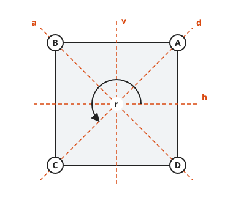
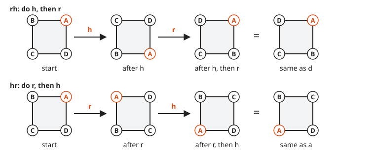
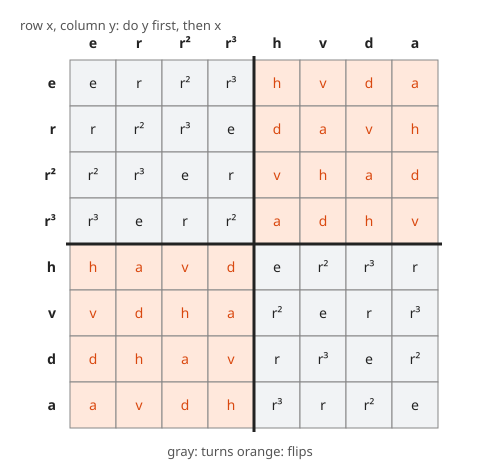
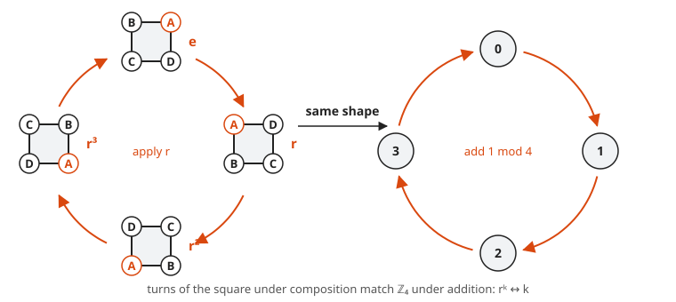
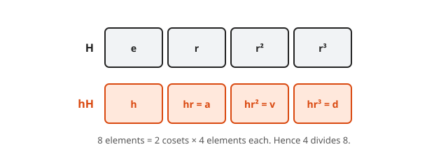
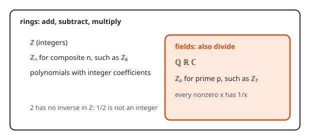
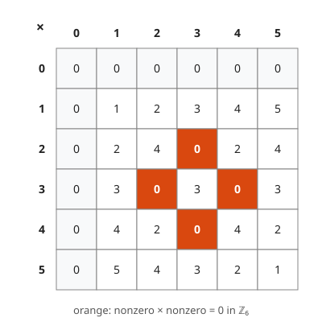

# Groups, Rings and Fields

**Level:** 601 · **Unit:** 11 · **Time:** 90 minutes
**Prerequisites:** [Sets and Cardinality](../06-sets-and-cardinality/README.md), [Modular Arithmetic and Fermat](../08-modular-arithmetic-and-fermat/README.md)

## The Big Idea

**Abstract algebra** studies the rules of combining things, without caring what the things are. Rotating a square, adding hours on a clock and multiplying nonzero numbers mod 7 all obey the same four rules. Any system that obeys them is a **group**. Prove a theorem once for groups, and it holds for all of them at the same time. It is the mathematical version of writing code against an interface instead of a concrete type.

## Picture It

<!-- diagram: type=square-symmetries count=8 caption="The eight symmetries of a square" -->


Cut a square out of cardboard, label its corners, and trace its outline on the table. A **symmetry** is any way to pick the square up and put it back into the same outline. There are exactly eight. Four are turns. Four are flips. Track corner A (orange) to tell them apart.

<!-- diagram: type=square-axes mirrors=h,v,d,a rotation=r caption="Square with its four mirror lines and rotation" -->


Why exactly eight: corner A can land on any of the four corners. Once A is placed, its neighbor B has two choices (clockwise or counterclockwise next door). After that, everything is forced. $4 \times 2 = 8$.

## Step by Step

### 1. Composition

To **compose** two symmetries, do one and then the other. The result is again a symmetry, because the square still fits its outline. Write $xy$ for "do $y$ first, then $x$". This matches function notation $x(y(\text{square}))$.

<!-- diagram: type=composition steps="h then r; r then h" caption="Order matters: rh is d but hr is a" -->


The picture shows a surprise. Flip then turn ($rh$) gives $d$. Turn then flip ($hr$) gives $a$. Order matters. Symmetries do not **commute**, like `chmod` and `chown` run against different paths, except less forgiving.

### 2. The Cayley Table

A **Cayley table** lists every composition. Row $x$, column $y$ holds $xy$ (do $y$ first). The [code](code/main.go) builds this table by tracking corners.

| $xy$ | $e$ | $r$ | $r^2$ | $r^3$ | $h$ | $v$ | $d$ | $a$ |
|---|---|---|---|---|---|---|---|---|
| $e$ | $e$ | $r$ | $r^2$ | $r^3$ | $h$ | $v$ | $d$ | $a$ |
| $r$ | $r$ | $r^2$ | $r^3$ | $e$ | $d$ | $a$ | $v$ | $h$ |
| $r^2$ | $r^2$ | $r^3$ | $e$ | $r$ | $v$ | $h$ | $a$ | $d$ |
| $r^3$ | $r^3$ | $e$ | $r$ | $r^2$ | $a$ | $d$ | $h$ | $v$ |
| $h$ | $h$ | $a$ | $v$ | $d$ | $e$ | $r^2$ | $r^3$ | $r$ |
| $v$ | $v$ | $d$ | $h$ | $a$ | $r^2$ | $e$ | $r$ | $r^3$ |
| $d$ | $d$ | $h$ | $a$ | $v$ | $r$ | $r^3$ | $e$ | $r^2$ |
| $a$ | $a$ | $v$ | $d$ | $h$ | $r^3$ | $r$ | $r^2$ | $e$ |

<!-- diagram: type=cayley-blocks group=D4 caption="Turns and flips form a two-by-two block pattern" -->


Read the colors, not the letters. Turn after turn is a turn. A flip anywhere in the pair gives a flip. Two flips cancel into a turn, like two mirrors in a barber shop. Every row and every column holds each symmetry exactly once, like a Sudoku.

### 3. The Group Axioms

A **group** is a set $G$ with an operation $\cdot$ such that:

1. **Closure:** $x \cdot y \in G$ for all $x, y \in G$.
2. **Associativity:** $(x \cdot y) \cdot z = x \cdot (y \cdot z)$.
3. **Identity:** some $e \in G$ has $e \cdot x = x \cdot e = x$ for all $x$.
4. **Inverses:** each $x$ has some $x^{-1}$ with $x \cdot x^{-1} = x^{-1} \cdot x = e$.

The symmetries of the square pass all four. Closure: the table has no entries outside the eight. Associativity: composing functions is always associative. Identity: $e$. Inverses: each turn is undone by the opposite turn ($r^{-1} = r^3$), and each flip undoes itself. This group is called $D_4$, the **dihedral group** of the square.

### 4. More Groups You Already Know

<!-- diagram: type=cycle elements=e,r,r2,r3 caption="The turns alone form a smaller group" -->


* $\mathbb{Z}$ under $+$. Identity $0$, inverse of $n$ is $-n$.
* $\mathbb{Z}_n$ under $+$ mod $n$: clock arithmetic from [lesson 08](../08-modular-arithmetic-and-fermat/README.md). The four turns of the square behave exactly like $\mathbb{Z}_4$: $r^k$ matches $k$, and composing turns matches adding mod 4. Two groups with the same table up to renaming are **isomorphic**.
* $\{1, 2, \dots, p-1\}$ under $\times$ mod $p$, for a prime $p$. Inverses exist by [lesson 08](../08-modular-arithmetic-and-fermat/README.md).
* Not a group: $\mathbb{Z}$ under $\times$. The number 2 has no integer inverse.

### 5. Subgroups and Lagrange's Theorem

A **subgroup** is a subset that is a group by itself under the same operation. The four turns $\{e, r, r^2, r^3\}$ form a subgroup of $D_4$.

<!-- diagram: type=cosets group=D4 subgroup=rotations caption="Two cosets of the rotation subgroup tile the group" -->


**Lagrange's theorem.** In a finite group, the size of any subgroup divides the size of the group.

Picture: multiply the subgroup $H$ by any element $g$ to get a **coset** $gH$. Every coset has the same size as $H$ (multiplying by $g$ is undone by multiplying by $g^{-1}$, hence it is a bijection, [lesson 06](../06-sets-and-cardinality/README.md)). Two cosets either coincide or do not overlap. The cosets tile the group like equal floor tiles. Hence $|G| = (\text{number of cosets}) \times |H|$. For $D_4$: $8 = 2 \times 4$.

Payoff: the nonzero residues mod $p$ form a group of size $p - 1$. The powers of $a$ form a subgroup of some size $k$, with $a^k = 1$. Lagrange says $k \mid p - 1$, hence $a^{p-1} = (a^k)^{(p-1)/k} = 1$. That is Fermat's little theorem again, proved from a different direction.

### 6. Rings and Fields: a Taster

<!-- diagram: type=nested-sets items="Z ring; Q,R,C fields; Z_n ring; Z_p field" caption="Rings and fields among familiar number systems" -->


* A **ring** has $+$ and $\times$. Under $+$ it is a commutative group. $\times$ is associative and distributes over $+$. Examples: $\mathbb{Z}$, $\mathbb{Z}_n$, polynomials.
* A **field** is a ring where $\times$ is commutative and every nonzero element has a multiplicative inverse. You can divide. Examples: $\mathbb{Q}$, $\mathbb{R}$, $\mathbb{C}$, and $\mathbb{Z}_p$ for a prime $p$.

<!-- diagram: type=mult-table modulus=6 highlight=zero caption="Zero divisors in Z6" -->


$\mathbb{Z}_6$ is a ring but not a field: $2 \cdot 3 = 0$, with neither factor zero. Such numbers are **zero divisors**. A zero divisor never has an inverse. If $2x = 1$ in $\mathbb{Z}_6$, then $3 = 3 \cdot 2x = 0 \cdot x = 0$, which is false.

## Worked Examples

### Example 1: Read a Composition Off the Corners

Compute $rh$ (do $h$, then $r$) by tracking corner A at $(1, 1)$.

```txt
  A = (1, 1)                             start
  h: (x, y) -> (x, -y)                   flip top-bottom
  A -> (1, -1)                           A lands at D's spot
  r: (x, y) -> (-y, x)                   turn 90 degrees counterclockwise
  (1, -1) -> (1, 1)                      A is back at A's spot
  A fixed, and the map is a flip         an odd number of flips
  the flip that fixes A is d             d fixes A and C
```

Hence $rh = d$. The same tracking gives $hr = a$.

### Example 2: The Identity Is Unique

**Claim.** A group has exactly one identity.

```txt
  suppose e and f are both identities        assume two
  e f = f                                    e is an identity
  e f = e                                    f is an identity
  e = f                                      both equal e f
```

$\blacksquare$

### Example 3: Inverses Are Unique

```txt
  suppose y and z are both inverses of x     assume two
  y = y e                                    identity
    = y (x z)                                z is an inverse
    = (y x) z                                associativity
    = e z                                    y is an inverse
    = z                                      identity
```

$\blacksquare$ Every axiom shows up once. That is a good sign in a short proof.

### Example 4: Socks and Shoes

**Claim.** $(xy)^{-1} = y^{-1}x^{-1}$.

```txt
  (x y)(y^-1 x^-1) = x (y y^-1) x^-1         associativity
                   = x e x^-1                inverse
                   = x x^-1 = e              identity, inverse
```

$\blacksquare$ You put on socks, then shoes. To undo it, you take off shoes first. Check on the square: $(rh)^{-1} = d^{-1} = d$, and $h^{-1} r^{-1} = h r^3 = d$ from the table.

## Common Mistakes

* Assuming $xy = yx$. True in $\mathbb{Z}_n$, false in $D_4$. Always check the order convention of the table.
* Forgetting closure. The odd integers under $+$ fail: $1 + 1 = 2$.
* Calling $\mathbb{Z}_n$ a field for every $n$. Only prime $n$ works.
* Reading $xy$ as "x first". This course uses "y first", like function composition. Some books use the other order, and their tables are transposed.

## Try It

1. Use the table to compute $r^2 h$ and $h r^2$. Do they commute?
2. Find every element $x$ of $D_4$ with $x^2 = e$.
3. Write out the Cayley table of $\mathbb{Z}_4$ under addition. Match it with the turns $e, r, r^2, r^3$.
4. Is $\{e, h\}$ a subgroup of $D_4$? Is $\{e, h, v\}$? Why or why not?
5. Is $\{1, 2, 3, 4\}$ under multiplication mod 5 a group? Find each inverse.
6. Is $\{1, 2, 3, 4, 5\}$ under multiplication mod 6 a group?
7. Prove: in any group, if $xy = xz$, then $y = z$.
8. An equilateral triangle has how many symmetries? Which sizes can its subgroups have?

<details>
<summary>Answers</summary>

1. Row $r^2$, column $h$: $v$. Row $h$, column $r^2$: $v$. They commute. The half turn commutes with everything.
2. $e, r^2, h, v, d, a$. Six elements.
3. Row $i$, column $j$ holds $(i + j) \bmod 4$. Replace $k$ with $r^k$ and you get the turn block of the $D_4$ table.
4. $\{e, h\}$: yes, closed since $hh = e$. $\{e, h, v\}$: no, $hv = r^2$ is missing. Also size 3 does not divide 8.
5. Yes. $1^{-1} = 1$, $2^{-1} = 3$, $3^{-1} = 2$, $4^{-1} = 4$.
6. No. $2 \cdot 3 = 0$, which is not in the set. Closure fails.
7. Multiply on the left by $x^{-1}$: $x^{-1}xy = x^{-1}xz$, hence $ey = ez$ and $y = z$.
8. Six: three turns ($0°, 120°, 240°$) and three flips. Subgroup sizes divide 6: 1, 2, 3 or 6.

</details>

## Code Corner

The program in [code/main.go](code/main.go) models each symmetry as a function on corner coordinates, composes them, identifies each result by where the corners land, prints the Cayley table, checks associativity on all $8^3 = 512$ triples, finds inverses and lists zero divisors in $\mathbb{Z}_6$.

```go
// compose returns the name of "do g first, then f".
func compose(f, g string) string {
	h := func(x, y int) (int, int) { return syms[f](syms[g](x, y)) }
	fp := fingerprint(h)
	for _, n := range names {
		if fingerprint(syms[n]) == fp {
			return n
		}
	}
	panic("not a symmetry: closure fails")
}
```

Output of `go run main.go`:

```txt
Cayley table: row then column means do the column first, then the row
     |   e   r  r2  r3   h   v   d   a
-----+--------------------------------
   e |   e   r  r2  r3   h   v   d   a
   r |   r  r2  r3   e   d   a   v   h
  r2 |  r2  r3   e   r   v   h   a   d
  r3 |  r3   e   r  r2   a   d   h   v
   h |   h   a   v   d   e  r2  r3   r
   v |   v   d   h   a  r2   e   r  r3
   d |   d   h   a   v   r  r3   e  r2
   a |   a   v   d   h  r3   r  r2   e
associative on all 512 triples: true
inverse of e  is e
inverse of r  is r3
inverse of r2 is r2
inverse of r3 is r
inverse of h  is h
inverse of v  is v
inverse of d  is d
inverse of a  is a
r h = d   but  h r = a
pairs in Z6 with a*b = 0 and a, b nonzero: 2x3 3x4
```

## Go Deeper

* [Wolfram MathWorld: Dihedral Group D4](https://mathworld.wolfram.com/DihedralGroupD4.html): the same group with its subgroups listed.
* [MacTutor: Evariste Galois](https://mathshistory.st-andrews.ac.uk/Biographies/Galois/): the 20-year-old who started group theory.
* [Abstract Algebra Track](../../../tracks/abstract-algebra/README.md): homomorphisms, quotient groups, polynomial rings and finite fields.

Flashcards for this lesson: [cards.tsv](cards.tsv) (Anki import: front, back, tags, separated by tabs).

Next: [Topology Taster](../12-topology-taster/README.md)
