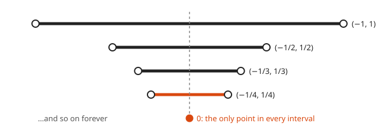
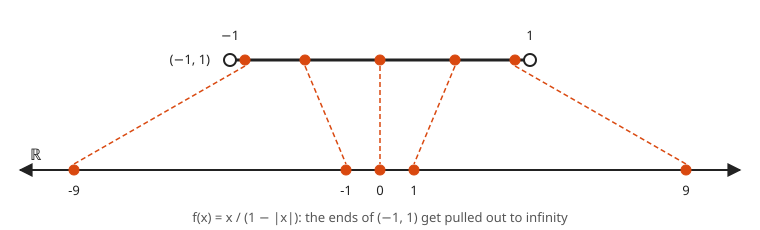
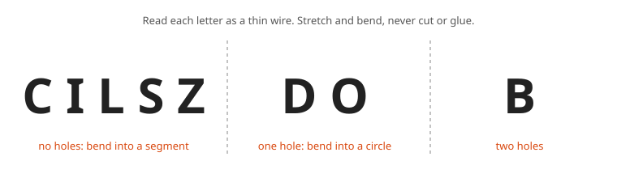
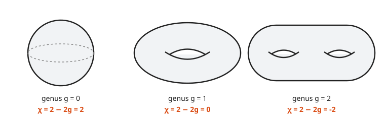

# Topology Taster

**Level:** 601 · **Unit:** 12 · **Time:** 75 to 90 minutes
**Prerequisites:** [Completeness and Sequences](../10-completeness-and-sequences/README.md), [Sets and Cardinality](../06-sets-and-cardinality/README.md)

## The Big Idea

**Topology** is geometry with the ruler thrown away. Distances and angles stop mattering. What survives is closeness: which points are near which, what is connected to what, and how many holes a shape has. A topologist cannot tell a coffee mug from a donut, because one deforms into the other without tearing. The joke writes itself, and topologists have been telling it for a century.

The tool that makes "closeness without distance" precise is the **open set**. Continuity, which took $\varepsilon$ and $\delta$ in [lesson 09](../09-epsilon-delta-limits/README.md), becomes a one-line statement about open sets.

## Picture It

<!-- diagram: type=deformation stages=mug,squash,handle,torus caption="A coffee mug deforms into a donut" -->


The rules of the game: stretch, squash, bend and twist as much as you like. Do not cut, and do not glue. The mug's handle hole is the one feature you cannot destroy. Under those rules, a mug and a donut are the same shape. A ball is different: making a hole needs a cut.

## Step by Step

### 1. Open Sets on the Line

<!-- diagram: type=intervals open="(a,b)" closed="[a,b]" caption="An open interval versus a closed interval" -->


A set $U \subseteq \mathbb{R}$ is **open** when every point of $U$ has some breathing room inside $U$:

$$\forall x \in U\ \ \exists r > 0:\ (x - r,\, x + r) \subseteq U.$$

The open interval $(a, b)$ is open: for $x$ inside, take $r$ smaller than the distance from $x$ to the nearer end. The closed interval $[a, b]$ is not: the endpoint $b$ has no breathing room, because every small interval around $b$ spills past it.

Plain version: an open set has no edge points. You can always wiggle a little and stay inside.

### 2. Unions and Intersections

<!-- diagram: type=nested-intervals sets="(-1,1),(-1/2,1/2),(-1/3,1/3),(-1/4,1/4)" caption="Open intervals shrinking down to a single point" -->


**Theorem.** Any union of open sets is open. A finite intersection of open sets is open.

```txt
  union: let x be in the union of the U_i       some U_j holds x
         some (x - r, x + r) lies in U_j        U_j is open
         that interval lies in the union        U_j is part of the union
  finite intersection of U_1 .. U_n:
         x is in every U_i                      definition of intersection
         pick r_i with (x - r_i, x + r_i) in U_i    each U_i is open
         r = min(r_1, ..., r_n) > 0             a finite list has a positive minimum
         (x - r, x + r) lies in every U_i       r <= r_i
```

$\blacksquare$ The word "finite" is load-bearing. The picture shows why: the intervals $(-\frac1n, \frac1n)$ are all open, but their intersection over all $n$ is $\{0\}$, a single point with no breathing room. An infinite list of radii can have no positive minimum.

### 3. Continuity With Open Sets

<!-- diagram: type=preimage f=continuous-vs-jump caption="Pull an open window back through the function" -->


The **preimage** $f^{-1}(V)$ is the set of inputs whose outputs land in $V$.

**Theorem.** $f: \mathbb{R} \to \mathbb{R}$ is continuous (in the $\varepsilon$-$\delta$ sense, at every point) if and only if the preimage of every open set is open.

Sketch of ($\Rightarrow$): let $V$ be open and $x \in f^{-1}(V)$. Then $f(x) \in V$, and $V$ holds a band $(f(x) - \varepsilon, f(x) + \varepsilon)$. Continuity gives $\delta$ with every point of $(x - \delta, x + \delta)$ mapping into that band, hence into $V$. That interval is breathing room for $x$ inside $f^{-1}(V)$. ($\Leftarrow$) runs the same argument backward with $V = (f(x) - \varepsilon, f(x) + \varepsilon)$.

The picture shows the jump failing: a small open window around the upper level pulls back to a stretch that includes its edge point, the jump location. The new definition never mentions distance. That is what lets topology work on shapes where "distance" makes no sense.

### 4. Homeomorphisms

A **homeomorphism** is a bijection $f$ such that $f$ and its inverse are both continuous. Two shapes are **homeomorphic**, the same to a topologist, when a homeomorphism connects them. It is the "stretch and bend, never cut or glue" rule in symbols. Bijection means no gluing (two points never merge). Continuity both ways means no tearing.

<!-- diagram: type=stretch-map from="(-1,1)" to="R" f="x/(1-|x|)" caption="Stretching a short open interval onto the whole line" -->


Surprise: the short interval $(-1, 1)$ is homeomorphic to the entire real line. The map $f(x) = \dfrac{x}{1 - |x|}$ stretches points near the ends out toward infinity. Its inverse $g(y) = \dfrac{y}{1 + |y|}$ squeezes them back. Both are continuous. Length is not a topological property. Neither is boundedness.

<!-- diagram: type=letter-classes groups="C I L S Z; D O; B" caption="Letters sorted by holes" -->


Not every pair is homeomorphic. An **invariant** is a number or property that homeomorphisms preserve. If two shapes differ in an invariant, they are not homeomorphic. Hole count is the classic one, and the next idea turns it into arithmetic.

### 5. The Euler Characteristic

<!-- diagram: type=polyhedra items=tetrahedron,cube,torus-grid caption="Euler characteristic of a tetrahedron, cube and torus" -->


Draw a mesh of vertices, edges and faces on a surface. Count them. The **Euler characteristic** is

$$\chi = V - E + F.$$

The surprise: $\chi$ does not depend on which mesh you draw. Every mesh on a sphere-like surface gives $2$. Every mesh on a torus gives $0$. That makes $\chi$ a topological invariant.

Why the count does not change, in one picture each:

* Add a vertex in the middle of an edge: $V$ goes up by 1, $E$ goes up by 1. $\chi$ unchanged.
* Add an edge across a face, between two existing vertices: $E$ up by 1, $F$ up by 1. $\chi$ unchanged.

Any two meshes on the same surface share a common refinement built from these moves. Hence they share the same $\chi$.

<!-- diagram: type=genus shapes=sphere,torus,double-torus caption="Euler characteristic drops by 2 for each hole" -->


For a closed surface with $g$ holes (the **genus**), $\chi = 2 - 2g$. The sphere has $\chi = 2$. The torus has $\chi = 0$. A double torus has $\chi = -2$. The coffee mug has one hole, hence $\chi = 0$, the same as the donut.

## Worked Examples

### Example 1: Prove $(0, \infty)$ Is Open

```txt
  let x > 0                                  any point of the set
  choose r = x / 2 > 0                       half the distance to 0
  (x - r, x + r) = (x/2, 3x/2)               compute
  x/2 > 0                                    x > 0
  (x/2, 3x/2) lies in (0, infinity)          every point is positive
```

$\blacksquare$

### Example 2: A Single Point Is Not Open

```txt
  U = {5}                                    one point
  suppose (5 - r, 5 + r) lies in U, r > 0    breathing room
  5 + r/2 is in that interval                r/2 < r
  5 + r/2 is not 5                           r > 0
  contradiction                              5 + r/2 is not in U
```

$\blacksquare$

### Example 3: Euler's Formula on the Cube, Two Ways

```txt
  plain cube:     V = 8, E = 12, F = 6       count corners, edges, faces
                  8 - 12 + 6 = 2
  add a diagonal on the top face:            split one square into two triangles
                  V = 8, E = 13, F = 7       one new edge, one new face
                  8 - 13 + 7 = 2             unchanged
  add a vertex on that diagonal:             split one edge into two
                  V = 9, E = 14, F = 7
                  9 - 14 + 7 = 2             unchanged
```

### Example 4: The Torus Grid

Take a $3 \times 3$ grid of squares. Glue the top edge to the bottom edge (a tube), then the left end to the right end (a donut). Count after gluing.

```txt
  vertices: a 3 x 3 grid of corners          the glued edges repeat the rest
            V = 9
  edges: 3 horizontal per row, 3 rows        9 horizontal
         3 vertical per column, 3 columns    9 vertical
         E = 18
  faces: F = 9                               the 9 small squares
  chi = 9 - 18 + 9 = 0                       torus
```

The Code Corner confirms it with a $5 \times 5$ grid: still $0$.

## Common Mistakes

* Thinking "open" means "not closed". Sets can be both ($\mathbb{R}$ itself, and $\varnothing$) or neither ($[0, 1)$).
* Forgetting the inverse must be continuous. Wrapping $[0, 2\pi)$ around a circle is a continuous bijection, but its inverse tears the circle open at one point. They are not homeomorphic.
* Counting the glued edges twice on a torus grid. After gluing, the top row of edges is the bottom row.
* Treating $\chi = 2$ as a fact about all solids. A picture frame (a solid with a hole) has $\chi = 0$.

## Try It

1. Prove that $(2, 5) \cup (7, 9)$ is open.
2. Is $\{x : x^2 < 4\}$ open? Is $[0, \infty)$ open?
3. Is the intersection of $(0, 1 + \frac1n)$ over all $n \geq 1$ open?
4. Count $V$, $E$, $F$ for a triangular prism. Compute $\chi$.
5. An icosahedron has 12 vertices and 20 triangular faces. How many edges does it have? Hint: each face has 3 edges, and each edge sits on 2 faces.
6. Sort these letters into homeomorphism classes, treating them as thin curves: C, O, L, B, P, I.
7. Which is $\chi$ for a surface with three holes?
8. Give a homeomorphism from $(0, 1)$ to $(3, 8)$.

<details>
<summary>Answers</summary>

1. Each interval is open. A union of open sets is open.
2. $\{x : x^2 < 4\} = (-2, 2)$, open. $[0, \infty)$ is not open: $0$ has no breathing room.
3. The intersection is $(0, 1]$. It is not open: $1$ has no breathing room. An infinite intersection of open sets need not be open.
4. $V = 6$, $E = 9$, $F = 5$. $\chi = 2$.
5. $E = 20 \cdot 3 / 2 = 30$. Check: $12 - 30 + 20 = 2$.
6. Arcs with no loop: C, L, I. One loop: O. A loop with a tail: P. Two loops: B. (P and O differ: removing one point from O leaves it connected, while removing the junction point of P splits it into pieces.)
7. $\chi = 2 - 2 \cdot 3 = -4$.
8. $f(x) = 3 + 5x$. Its inverse $(y - 3)/5$ is also continuous.

</details>

## Code Corner

The program in [code/main.go](code/main.go) computes $V - E + F$ from a list of faces (each face is a cycle of vertex ids, and shared edges get counted once), builds glued torus grids, and checks that $f(x) = x / (1 - |x|)$ and $g(y) = y / (1 + |y|)$ undo each other.

```go
func chi(faces [][]int) (v, e, f int) {
	verts := map[int]bool{}
	edges := map[[2]int]bool{}
	for _, face := range faces {
		for i, a := range face {
			b := face[(i+1)%len(face)]
			verts[a] = true
			if a > b {
				a, b = b, a
			}
			edges[[2]int{a, b}] = true
		}
	}
	return len(verts), len(edges), len(faces)
}
```

Output of `go run main.go`:

```txt
tetrahedron     V= 4 E= 6 F= 4  V-E+F = 2
cube            V= 8 E=12 F= 6  V-E+F = 2
octahedron      V= 6 E=12 F= 8  V-E+F = 2
square pyramid  V= 5 E= 8 F= 5  V-E+F = 2
torus 3x3 grid  V= 9 E=18 F= 9  V-E+F = 0
torus 5x5 grid  V=25 E=50 F=25  V-E+F = 0
x = -0.990  f(x) =   -99.000  g(f(x)) = -0.990
x = -0.500  f(x) =    -1.000  g(f(x)) = -0.500
x =  0.000  f(x) =     0.000  g(f(x)) =  0.000
x =  0.500  f(x) =     1.000  g(f(x)) =  0.500
x =  0.900  f(x) =     9.000  g(f(x)) =  0.900
x =  0.999  f(x) =   999.000  g(f(x)) =  0.999
```

## Go Deeper

* [Wolfram MathWorld: Euler Characteristic](https://mathworld.wolfram.com/EulerCharacteristic.html): values for many surfaces.
* [MacTutor: Leonhard Euler](https://mathshistory.st-andrews.ac.uk/Biographies/Euler/): the man behind $V - E + F$ and much else.
* [Topology Track](../../../tracks/topology/README.md): metric spaces, compactness, connectedness and the fundamental group.

Flashcards for this lesson: [cards.tsv](cards.tsv) (Anki import: front, back, tags, separated by tabs).

Back to the [course overview](../README.md), then take the [Checkpoint](../checkpoint.md).
