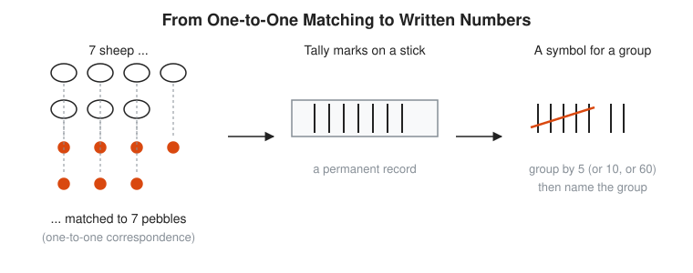
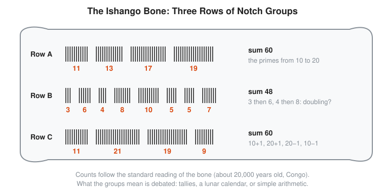
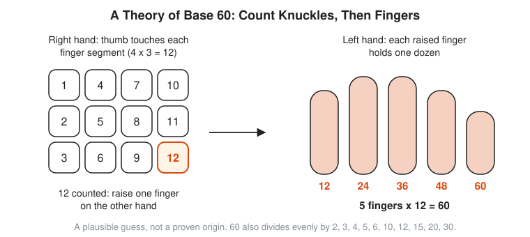

# 01 Prehistory and Counting

**Era:** about 40,000 BCE to 3000 BCE · **Reading time:** about 15 minutes · **Previous:** [History of Math](../README.md) · **Next:** [02 Mesopotamia and Egypt](../02-mesopotamia-and-egypt/README.md)

## The Big Idea

Counting starts before numbers have names. People first match things one to one: one pebble for one sheep, one notch for one day. Over tens of thousands of years that habit turns into tally marks, then grouped tallies, then clay tokens, and finally written numerals on clay tablets in Uruk around 3200 BCE.

## The World at That Time

For most of this period people live as hunters and gatherers. They move with the seasons, follow herds, and watch the moon. Nobody writes anything down. The evidence that survives is small and hard: bones and stones with cuts in them. Archaeologists find the objects. They do not find instructions. Every reading of a notched bone is an inference, and some inferences are better than others.

Around 10,000 BCE people in the Near East start to farm. Farming changes the questions. A herder needs to know whether every goat came home. A village needs to know how much grain sits in storage, who owes what, and when to plant. Debts and stores outlive memory. That is the pressure that pushes counting from a habit into a record.

By about 3500 BCE cities grow in southern Mesopotamia, the land between the Tigris and Euphrates rivers in what is now Iraq. Temples collect grain, oil, and animals and pay them out again. The temple is, in modern terms, a warehouse with a priesthood. Warehouses need inventory. Inventory needs numbers.

```txt
  When            What people do                  What they need to count
  ------------    ----------------------------    ---------------------------------
  c. 42,000 BCE   hunt, gather, follow seasons    days, moons, kills (perhaps)
  c. 18,000 BCE   same, near Lake Edward, Congo   something in groups on a bone
  c. 8000 BCE     first farming villages          grain, sheep, oil, debts
  c. 3500 BCE     temple towns in Mesopotamia     stores going in and out
  c. 3200 BCE     city of Uruk                    accounts: the first written numbers
```

## Key People

| Person | Dates | One-Line Contribution |
|---|---|---|
| Unknown carver of the Lebombo bone | about 44,000 years ago | Cuts 29 notches into a baboon leg bone in southern Africa |
| Unknown carver of the Ishango bone | c. 18,000 BCE | Cuts three rows of notch groups whose sums and patterns still puzzle people |
| Jean de Heinzelin de Braucourt | 1920 to 1998 | Belgian geologist who finds the Ishango bone in 1950 |
| Alexander Marshack | 1918 to 2004 | Argues that some notched bones track the phases of the moon |
| Early farmers of the Near East | c. 8000 BCE onward | Use small clay tokens to stand for goods |
| Scribes of Uruk | c. 3200 BCE | Press the first written numbers into clay tablets |
| Denise Schmandt-Besserat | born 1933 | Archaeologist who proposes that clay tokens lead to writing |

## Key Ideas

### One-to-One Correspondence

You can know that two piles are the same size without knowing how big either pile is. Pair one item from the first pile with one item from the second. Repeat. If both piles run out together, they match. This pairing is called **one-to-one correspondence**: every item on one side has exactly one partner on the other side, and nobody is left over.

A shepherd with no number words can still guard a flock this way. In the morning each sheep that leaves the pen earns one pebble in a bag. At dusk each sheep that returns takes one pebble out. An empty bag means the flock is whole. A pebble left in the bag means a sheep is missing. Nobody says "seven". The pebbles do the remembering.

<!-- diagram: type=historical-method ref=counting-stages caption="From one-to-one matching to written numbers: pebbles, tally marks, grouped tally" -->


Read the picture left to right. On the left, seven sheep sit above seven pebbles, each pair joined by a dashed line. That is the matching. In the middle, the same seven become seven strokes on a stick: a permanent record that does not spill out of a bag. On the right, five strokes get a slash across them and become one unit, a group, with two loose strokes beside it. The three panels are the whole chapter in miniature.

Why it works: matching never needs the size of the set. It only needs a rule that pairs items and a check for leftovers. Mathematicians still use this exact test. In 1891 [Georg Cantor](../biographies/cantor.md) uses one-to-one correspondence to compare the sizes of infinite sets, where counting out loud is not an option.

SREs use it too. Reconciliation is pebble-matching: compare the list of hosts in the inventory with the list of hosts that answer a health check. Pair them by name. The leftovers on either side are the interesting part.

```txt
  Morning: 7 sheep leave           bag gets 1 pebble per sheep: 7 pebbles
  Dusk:    sheep 1 returns         remove 1 pebble: 6 left
           sheep 2 returns         remove 1 pebble: 5 left
           ...                     same step for each returning sheep
           sheep 6 returns         remove 1 pebble: 1 left
           no more sheep           the gate is quiet
  Result:  1 pebble in the bag     one sheep is missing; no number word needed
```

### Tallies and Grouping

A **tally** is one mark per thing counted, cut or drawn where it stays. A pebble bag spills. A notch does not. The oldest known candidate is the **Lebombo bone**, a baboon leg bone found in Border Cave in the Lebombo Mountains, on the border of South Africa and Eswatini. It is about 43,000 to 44,000 years old and carries 29 notches. A count of 29 is close to the number of days from one new moon to the next, and some writers read it as a lunar count. The bone is broken, the original count is unknown, and the notches might simply give a better grip. Treat the moon reading as a possibility, not a finding.

Long rows of single strokes are hard to read. Try to see 23 strokes at a glance and you lose your place. Humans see up to about four objects instantly without counting. This is called **subitizing**. Past four, the eye needs help. The help is **grouping**: bundle the strokes into fives (or tens) and count the bundles. A wolf bone found in 1937 at Dolní Věstonice in what is now the Czech Republic, about 30,000 years old, carries 55 notches, reportedly cut in groups of five.

The most famous notched bone comes later. Jean de Heinzelin de Braucourt finds the **Ishango bone** in 1950 at Ishango, near Lake Edward, in what is now the Democratic Republic of the Congo. It is a baboon bone about 20,000 years old (c. 18,000 BCE) with a sliver of quartz fixed in one end. Three rows of notches run along its length, and the notches in each row sit in clusters.

<!-- diagram: type=historical-method ref=ishango-bone caption="The Ishango bone: three rows of notch groups" -->


The diagram labels the rows A, B, and C and writes the number of notches in each cluster. Row A holds 11, 13, 17, and 19: every prime number between 10 and 20, summing to 60. Row B holds 3, 6, 4, 8, 10, 5, 5, 7, summing to 48, and its first pairs look like doubling: 3 then 6, 4 then 8. Row C holds 11, 21, 19, and 9, which read as 10 + 1, 20 + 1, 20 − 1, and 10 − 1, also summing to 60. The note at the bottom says what matters most: the meaning is debated. Readings include a tally of something, a six-month lunar calendar (Alexander Marshack), and deliberate arithmetic.

A dry warning applies here. Human brains find patterns in clouds, tea leaves, and dashboards. Four primes in a row is striking, but a carver who knows nothing about primes still has a fair chance of cutting odd-sized groups. The safe conclusion: someone about 20,000 years ago groups marks with care, and the groups are not random scratches.

```txt
  Row C of the Ishango bone, read as "near ten, near twenty"
  11 = 10 + 1          one more than ten
  21 = 20 + 1          one more than twenty
  19 = 20 - 1          one less than twenty
   9 = 10 - 1          one less than ten
  sum = 60             the +1 and -1 cancel: 10 + 20 + 20 + 10 = 60
```

```txt
  Tally of 23, grouped by five
  ||||/  ||||/  ||||/  ||||/  |||
  5      10     15     20     23     each slashed group adds 5; then 3 loose strokes
  23 = 4 x 5 + 3                     four full groups and a remainder of 3
```

### Bases From Bodies

Once you group, the group size matters. The group size is called the **base**. Base 10 means you bundle by tens, then bundle ten tens into a hundred, and the pattern repeats. Each bundle level is a **place**. Nearly every base in history comes from the human body.

- Base 5: one hand. Roman numerals still show it: V is five, X is ten.
- Base 10: two hands. The English word **digit** means both a numeral and a finger, from the Latin *digitus*.
- Base 20: fingers and toes. French says 80 as *quatre-vingts*, four twenties. English keeps the old word **score**, as in "four score and seven years". The Maya of Central America also count in twenties.
- Base 12: the dozen, and possibly the finger joints.
- Base 60: the Sumerians of Mesopotamia, from before 3000 BCE. It survives today in every clock and every compass.

Nobody knows for sure why the Sumerians pick 60. One plausible theory uses the thumb as a pointer.

<!-- diagram: type=historical-method ref=knuckle-counting-60 caption="A theory of base 60: count knuckles, then fingers" -->


On the right hand, the thumb touches each segment of the other four fingers. Four fingers times three segments gives 12 positions, numbered 1 to 12 in the picture. When the thumb reaches 12, one finger goes up on the left hand to hold that dozen. Five raised fingers hold 12, 24, 36, 48, and 60. Five times twelve is 60. The note at the bottom marks this as a plausible guess, not a proven origin. It also gives a practical reason that holds whatever the origin: 60 divides evenly by 2, 3, 4, 5, 6, 10, 12, 15, 20, and 30. Splitting 60 loaves among three, four, or five people never needs a fraction. Splitting ten loaves among three people does.

Why bases work: any whole number breaks into bundles of the base, bundles of bundles, and a remainder. The remainders, read from the biggest bundle down, are the digits. This is the same divide-and-keep-the-remainder loop that turns a decimal number into binary or hex.

```txt
  47 sheep in four bases
  base 10:  47 = 4 x 10 + 7            four tens, seven ones: digits 4, 7
  base 5:   47 = 1 x 25 + 4 x 5 + 2    one twenty-five, four fives, two ones: 1, 4, 2
  base 20:  47 = 2 x 20 + 7            two scores and seven: digits 2, 7
  base 60:  47 = 0 x 60 + 47           less than one sixty: a single digit, 47
```

The table below shows how a hand-counter and the knuckle method name the same amount.

```txt
  Amount   Fingers (base 10)        Knuckles (base 60 theory)
  ------   ----------------------   --------------------------------------
  12       1 ten and 2 ones         1 finger raised, thumb back at segment 0
  30       3 tens                   2 fingers raised (24), thumb at segment 6
  41       4 tens and 1 one         3 fingers raised (36), thumb at segment 5
  60       6 tens                   all 5 fingers raised
```

### From Clay Tokens to Writing

The last step happens in the Near East, and the best account of it comes from Denise Schmandt-Besserat. Her theory is well supported by thousands of finds, though scholars still argue about details.

From about 8000 BCE farmers use small shaped tokens of clay: cones, spheres, discs, cylinders. Each shape stands for a kind of good. A cone might mean a small measure of grain. An ovoid might mean a jar of oil. To record three jars of oil, you keep three ovoid tokens. This is still one-to-one correspondence. The tokens are pebbles with a meaning.

Around 3500 BCE accountants seal tokens inside hollow clay balls called **envelopes** (archaeologists also call them **bullae**). The seal stops anyone from adding or removing tokens. A sealed envelope has a flaw: you cannot see inside without breaking it. The fix is to press each token into the soft outside before sealing. The outside now shows what the inside holds. It is a manifest on the crate, or a checksum on the file.

Then someone notices that the marks on the outside carry all the information. The tokens inside become redundant. By about 3200 BCE scribes in the city of Uruk press marks straight onto flat clay tablets, with no tokens at all. These are among the earliest written records in the world, and most of them are accounts. Writing begins as bookkeeping.

```txt
  STAGE 1: tokens (c. 8000 BCE)      STAGE 2: envelope (c. 3500 BCE)     STAGE 3: tablet (c. 3200 BCE)

    ()  ()  ()    3 ovoids              .----------------------.            +--------------------+
                  = 3 jars of oil      /  ()   ()   ()          \           |                    |
    /\  /\        2 cones              |   /\   /\              |           |   ()  ()  ()       |
                  = 2 grain measures   |   marks pressed on the |           |   /\  /\           |
                                        \  outside, tokens       /          |                    |
    loose, can be lost or swapped        '---sealed inside-----'            +--------------------+
                                        tamper-evident, but opaque           marks only: no tokens
```

The sketch shows three stages. On the left, loose tokens: easy to lose, easy to fake. In the middle, the sealed envelope with the token shapes pressed into its skin. On the right, a flat tablet that keeps only the marks.

One more step finishes the story. Early Uruk tablets still repeat a sign once per item, much like tokens. Later scribes write a number sign next to a sign for the good: "3" beside "oil" instead of oil, oil, oil. Number is now separate from the thing counted. That separation is **abstract number**: three is three, whether it counts jars, sheep, or days. Schmandt-Besserat places this step around 3100 BCE. Scholars also note that early Uruk scribes use several different counting systems for different goods, one for grain and another for animals, before a single system wins. Abstraction takes a while. It usually does.

<!-- diagram: type=historical-method ref=counting-stages caption="The third stage: a symbol for a group, named once and reused" -->


Look again at the right panel of the stage diagram. The slashed group of five is a symbol for a group. Tokens and tablet signs work the same way: one shape stands for a bundle, and a scribe writes the bundle instead of every item. The Sumerian number signs that grow out of this have separate shapes for 1, 10, 60, 600, and 3,600. [Chapter 02](../02-mesopotamia-and-egypt/README.md) shows how they become a true place-value system.

```txt
  Reading a (made-up) envelope
  outside marks: () () () /\ /\        five impressions on the skin
  rule: () = 1 jar of oil              shapes carry meaning by agreement
        /\ = 1 measure of grain
  claim: 3 jars of oil, 2 grain        read the marks, no need to break the clay
  audit: break it, find 3 ovoids       inside matches outside: the record is honest
         and 2 cones
```

## What It Unlocked Next

- Grouping by a base leads to place value in Mesopotamia and Egypt: [Chapter 02](../02-mesopotamia-and-egypt/README.md).
- Base 60 passes from the Sumerians to the Babylonians, then to Greek astronomers, and finally to the hours, minutes, seconds, and degrees in [Chapter 03](../03-ancient-greece/README.md).
- Writing, born from accounting, gives later mathematicians a way to record methods, not just totals.
- The idea that numbers stand apart from things prepares the ground for the zero and decimal digits of [Chapter 04](../04-india-and-china/README.md).
- One-to-one correspondence returns in the 1800s as the tool Cantor uses to measure infinity: [Chapter 08](../08-18th-and-19th-century-rigor/README.md).

## Connects To

- [Course 101: Foundations](../../course/101/README.md): place value and the four operations, the modern version of grouping by tens.
- [Arithmetic and number sense track](../../tracks/arithmetic-and-number-sense/README.md): bases, place value, and mental counting.
- [Number theory track](../../tracks/number-theory/README.md): the primes that appear in row A of the Ishango bone.
- [Logic and set theory track](../../tracks/logic-and-set-theory/README.md): one-to-one correspondence, called a bijection, is how set theory compares sizes.
- [Discrete math track](../../tracks/discrete-math/README.md): binary and hexadecimal are bases, built the same way as base 5 or base 60.
- [The story of zero](../story-of-an-idea/zero.md): grouping eventually needs a sign for an empty place.
- [The story of infinity](../story-of-an-idea/infinity.md): pebble-matching scaled up to infinite sets.
- [The story of notation](../story-of-an-idea/notation.md): from tokens to symbols that stand for ideas.
- [Georg Cantor](../biographies/cantor.md): the mathematician who turns sheep-and-pebble matching into a theory of infinite sizes.

## Try It

1. Draw 37 as a grouped tally with slashed groups of five. How many full groups and how many loose strokes?
2. Twelve goats leave the pen and you drop one pebble in a bag for each. At dusk you remove one pebble per returning goat and three pebbles remain. How many goats are missing, and did you need to know the number twelve?
3. Add the groups of row C of the Ishango bone (11, 21, 19, 9) by pairing each group with its partner around 10 or 20.
4. French says 93 as *quatre-vingt-treize*. Write it as an expression with 20 and check it.
5. On the knuckle method, how do the two hands show 41?
6. List every whole number that divides 60 evenly. Then do the same for 10. Which base splits more ways?
7. Write 23 in base 5. Then check the answer against the grouped tally of 23 in the Tallies and Grouping section.
8. An envelope shows these marks on its outside: four ovoids and one cone, with the rule from the made-up envelope example. What does it claim, and how many tokens sit inside if the record is honest?

<details>
<summary>Answers</summary>

1. Seven full groups and two loose strokes: 37 = 7 x 5 + 2.
2. Three goats are missing; matching needs no number, only one pebble per goat.
3. 60: 11 + 9 = 20 and 21 + 19 = 40, then 20 + 40 = 60.
4. 93 = 4 x 20 + 13: four twenties make 80, plus 13.
5. Three fingers raised on the left hand (36) and the thumb on the fifth segment of the right hand (5): 36 + 5 = 41.
6. 60: 1, 2, 3, 4, 5, 6, 10, 12, 15, 20, 30, 60 (twelve divisors). 10: 1, 2, 5, 10 (four divisors). Base 60 splits three times as many ways.
7. 43 in base 5: 23 = 4 x 5 + 3, which matches four slashed groups and three loose strokes.
8. It claims four jars of oil and one measure of grain; five tokens sit inside (four ovoids, one cone).

</details>

## Code Corner

The program sums the three Ishango rows and flags the primes, runs the shepherd pebble check for three evenings, writes 47 in bases 5, 10, 20, and 60, and draws a grouped tally of 23. The pebble function never counts the flock. It only removes one pebble per returning sheep and reports leftovers on each side, which is reconciliation in about ten lines. The full program is in [code/main.go](code/main.go). The two key functions:

```go
// digits writes n in the given base, most significant digit first.
func digits(n, base int) []int {
	if n == 0 {
		return []int{0}
	}
	var out []int
	for n > 0 {
		out = append([]int{n % base}, out...)
		n /= base
	}
	return out
}

// match pairs each returning sheep with one pebble from the bag.
// It never counts: it only removes one pebble per sheep.
func match(pebbles, sheepBack int) (left, extra int) {
	for ; sheepBack > 0; sheepBack-- {
		if pebbles == 0 {
			extra++
			continue
		}
		pebbles--
	}
	return pebbles, extra
}
```

Run it:

```txt
cd code && go run main.go
```

Output:

```txt
Ishango bone rows:
  Row A: [11 13 17 19] sum 60, primes: 11 13 17 19
  Row B: [3 6 4 8 10 5 5 7] sum 48, primes: 3 5 5 7
  Row C: [11 21 19 9] sum 60, primes: 11 19

Shepherd at dusk (7 pebbles in the bag):
  7 sheep return: pebbles left 0, unmatched sheep 0
  6 sheep return: pebbles left 1, unmatched sheep 0
  8 sheep return: pebbles left 0, unmatched sheep 1

47 sheep written in different bases (digits, biggest place first):
  base  5: [1 4 2]
  base 10: [4 7]
  base 20: [2 7]
  base 60: [47]

Tally of 23 in groups of five:
  ||||/ ||||/ ||||/ ||||/ |||
```

The eight-sheep evening is the interesting one: a stray from a neighbor joins the flock, and the bag runs dry with one sheep unmatched. The pebbles catch an extra as easily as a missing one.

## Flashcards

Anki deck in [cards.tsv](cards.tsv) (tab-separated: front, back, tags).

## Go Deeper

- [MacTutor: an overview of the history of mathematics](https://mathshistory.st-andrews.ac.uk/HistTopics/History_overview/): where mathematics starts and how the story is pieced together.
- [MacTutor: Babylonian numerals](https://mathshistory.st-andrews.ac.uk/HistTopics/Babylonian_numerals/): the Sumerian roots of base 60 and theories of its origin.
- [MacTutor: an overview of Babylonian mathematics](https://mathshistory.st-andrews.ac.uk/HistTopics/Babylonian_mathematics/): what the clay tablets after Uruk contain.
- [MacTutor: Egyptian numerals](https://mathshistory.st-andrews.ac.uk/HistTopics/Egyptian_numerals/): a base 10 system that still writes numbers as grouped tallies.
- [Chapter 02: Mesopotamia and Egypt](../02-mesopotamia-and-egypt/README.md): the next step, place value and the first algorithms.
