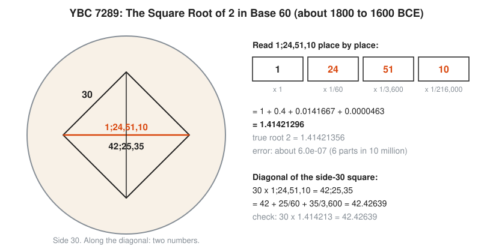
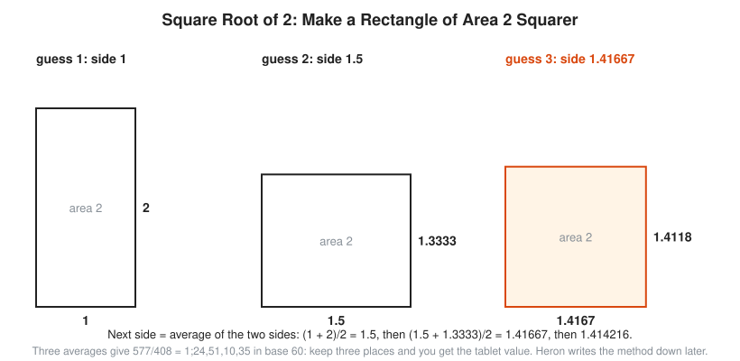
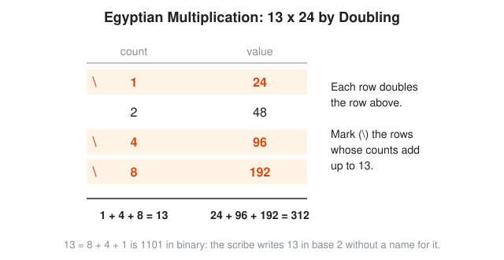
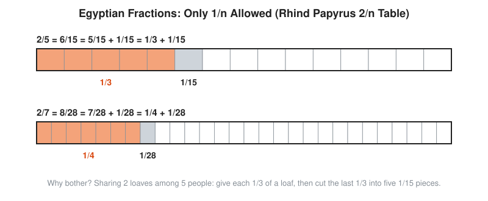

# 02 Mesopotamia and Egypt

**Era:** about 3200 BCE to 300 BCE · **Reading time:** about 20 minutes · **Previous:** [01 Prehistory and Counting](../01-prehistory-and-counting/README.md) · **Next:** [03 Ancient Greece](../03-ancient-greece/README.md)

## The Big Idea

Two river civilizations turn counting into calculation. Babylonian scribes in Mesopotamia write numbers in base 60 with place value and compute the square root of 2 to about six decimal places. Egyptian scribes multiply by doubling and split everything into unit fractions. Both write down methods as recipes: step-by-step procedures, checked by worked examples, without proofs.

## The World at That Time

Mesopotamia is the flat land between the Tigris and Euphrates rivers, in what is now Iraq. Its cities depend on irrigation canals, and canals need digging crews, rations, and someone to compute both. The Sumerians write first, around 3200 BCE in Uruk. Later rulers change: Akkadians, then the Old Babylonian kingdom (about 2000 to 1600 BCE), whose best-known king, Hammurabi, rules about 1792 to 1750 BCE. Through all of it, scribes write on wet clay with a cut reed. The reed leaves wedge-shaped marks, called **cuneiform** (Latin *cuneus*, wedge). Baked or dried clay lasts. Hundreds of thousands of tablets survive, and many are school exercises.

Egypt lives on the Nile. Every summer the river floods, covers the fields with fresh mud, and erases the boundary markers. Every autumn surveyors measure the fields again, and the state taxes the harvest by area. Egypt also builds on a huge scale: the Great Pyramid of Giza goes up around 2560 BCE. Feeding thousands of workers is a ration problem. Cutting stone at the right slope is a geometry problem. Egyptian scribes write in ink on **papyrus**, a paper made from reeds. Papyrus rots in damp ground. Only a handful of mathematical papyri survive, preserved by the dry desert.

The two cultures want the same things from math: fair shares, correct taxes, honest weights, workable calendars, and buildings that stand.

```txt
  Need                 Mesopotamia                         Egypt
  -----------------    --------------------------------    ------------------------------
  write a number       base 60, place value, clay          base 10, no place value, ink
  multiply             tables of products, reciprocals     doubling and adding
  divide               multiply by a reciprocal            unit fractions, 2/n table
  land and buildings   areas, canal volumes, diagonals     field areas, granaries, pyramids
  sky and calendar     detailed astronomy (later)          365-day civil year, 24 hours
```

## Key People

| Person | Dates | One-Line Contribution |
|---|---|---|
| Sumerian and Babylonian scribes | c. 3200 BCE to 300 BCE | Build base 60 place value, multiplication tables, and reciprocal tables |
| The writer of YBC 7289 | c. 1800 to 1600 BCE | Records the square root of 2 in base 60, correct to about six decimal places |
| The writer of Plimpton 322 | c. 1800 BCE | Tabulates whole-number right triangles centuries before Pythagoras |
| Ahmes | c. 1550 BCE | Egyptian scribe who copies the Rhind papyrus from an older text |
| Alexander Henry Rhind | 1833 to 1863 | Scottish collector who buys the papyrus in Luxor in 1858 |
| Otto Neugebauer | 1899 to 1990 | Historian who decodes Babylonian mathematics and publishes YBC 7289 and Plimpton 322 (1945, with Abraham Sachs) |
| Heron of Alexandria | c. 10 to c. 75 CE | Greek engineer who writes down the averaging method for square roots |

## Key Ideas

### Base 60 With Place Value

The Babylonians need only two signs. A vertical wedge means 1. A corner wedge, pressed with the edge of the reed, means 10. Any number from 1 to 59 is a pile of these: up to five tens and up to nine ones. That pile is one **digit** in base 60.

Then comes the big idea: **place value**. The position of a digit tells you its size. In our base 10, the 4 in 47 means four tens because it sits in the tens place. In Babylonian base 60, each place is worth 60 times the place to its right. The places to the right of the ones are worth 1/60, 1/3,600, and onward, just like our tenths and hundredths.

<!-- diagram: type=historical-method ref=babylonian-numerals caption="Babylonian numerals: two wedges, base 60, place value" -->


The top row of the picture shows the two wedges. The next row builds 7 (seven unit wedges), 24 (two corner wedges and four unit wedges), and 51 (five corner wedges and one unit wedge). The middle row writes the number from tablet YBC 7289 place by place: 1 in the ones place, 24 in the sixtieths, 51 in the 3,600ths, 10 in the 216,000ths. Added up, that is about 1.414213. The bottom note is the catch. Old Babylonian scribes write no zero and no point. The same marks for 1 and 30 can mean 1 x 60 + 30 = 90, or 1 + 30/60 = 1.5. The reader decides from context. Later scribes, around 300 BCE, add a gap sign for an empty place inside a number.

Modern writers use a semicolon for the missing point and commas between places. 1;24,51,10 means 1 plus 24/60 plus 51/3,600 plus 10/216,000.

For a programmer, Old Babylonian numbers are floating-point numbers with the exponent left out. The scribe writes the significant digits and trusts the reader to know the scale. Inside a calculation that is convenient. In a ledger it is a bug waiting to happen.

```txt
  Read 1;24,51,10
  1          x 1          =  1                  ones place
  24         x 1/60       =  0.4                first place after the semicolon
  51         x 1/3,600    =  0.0141667          second place: 60 x 60 = 3,600
  10         x 1/216,000  =  0.0000463          third place: 60 x 60 x 60 = 216,000
  total                   =  1.4142130          add the four places (rounded to 7 digits)
```

Babylonians divide by multiplying with a **reciprocal**, that is, 1 divided by the number. Clay tables list them: the reciprocal of 2 is 0;30, of 3 is 0;20, of 8 is 0;7,30. Numbers whose only prime factors are 2, 3, and 5 have reciprocals that end. The scribes call the others, like 7, irregular and avoid them where they can.

```txt
  1/8 in base 60
  1/8 x 60       = 7.5          multiply by 60: first digit 7, remainder 0.5
  0.5 x 60       = 30           multiply the remainder by 60: second digit 30
  1/8            = 0;7,30       check: 7/60 + 30/3,600 = 0.1167 + 0.0083 = 0.125
```

**Why base 60 survives.** Greek astronomers, from Hipparchus (about 150 BCE) to Ptolemy (about 150 CE), take over Babylonian star tables and keep their base 60 fractions for angles. A circle gets 360 degrees. Medieval Latin splits a degree into *partes minutae primae*, the first small parts, and *partes minutae secundae*, the second small parts. Those names shrink to **minute** and **second**. Hours come from Egypt, which splits day and night into twelve hours each. A modern clock is an Egyptian 24 with a Babylonian 60 bolted on.

```txt
  3,661 seconds in Babylonian style
  3,661 / 60  = 61 remainder 1     1 second left over
     61 / 60  =  1 remainder 1     1 minute left over
      1                            1 hour
  3,661 s     = 1,1,1              1 hour, 1 minute, 1 second: three base-60 places
```

The base still earns its keep. A cron job with `*/15` in the minutes field fires every 15 minutes, evenly, because 15 divides 60. Try `*/7`: it fires at minutes 0, 7, ..., 56, then again at 0, four minutes later. The Sumerians do not approve.

### The Square Root of 2 on YBC 7289

YBC 7289 is a small round tablet in the Yale Babylonian Collection, from about 1800 to 1600 BCE. Its size and shape suggest a school exercise, the kind a student holds in one hand. It holds the most famous number in Babylonian mathematics.

<!-- diagram: type=historical-method ref=ybc-7289 caption="Tablet YBC 7289 with base-60 numbers" -->


The drawing shows a square with side 30 and both diagonals. Along one diagonal the scribe writes 1;24,51,10. Below it sits 42;25,35. The panel on the right decodes the first number to 1.41421296. The true square root of 2 is 1.41421356. The error is about 6 parts in 10 million. The bottom panel shows why the second number is there: 30 x 1;24,51,10 = 42;25,35, which is 42.42639, the length of the diagonal.

The tablet tells you two things. First, the scribe knows that the diagonal of any square is its side times the square root of 2. That is the **Pythagorean theorem** for a square: in a right triangle, the square on the long side (the **hypotenuse**) equals the sum of the squares on the other two sides. Here both short sides are 30, and $d^2 = 30^2 + 30^2 = 2 \times 30^2$, which gives $d = 30\sqrt{2}$. The scribe knows this more than 1,000 years before Pythagoras (c. 530 BCE). Second, the scribe has a way to compute $\sqrt{2}$ very accurately. The tablet does not show the method. One likely candidate is below.

```txt
  Check 30 x 1;24,51,10 = 42;25,35
  30 x 1          = 30                          ones place
  30 x 24/60      = 720/60 = 12                 whole units: 12
  30 x 51/3,600   = 1,530/3,600                 1,530 = 25 x 60 + 30
                  = 25/60 + 30/3,600            25 sixtieths and 30 left over
  30 x 10/216,000 = 300/216,000 = 5/3,600       300 = 5 x 60
  add             = 42 + 25/60 + 35/3,600       30 + 12 = 42; 30 + 5 = 35
  result          = 42;25,35                    the number on the tablet
```

**Making a rectangle squarer.** You want a square of area 2. Its side is $\sqrt{2}$. Start with a rectangle of area 2 that is easy to draw: 1 by 2. It is too long and too thin. Make a new rectangle whose side is the average of the old two sides. Keep the area at 2 by setting the other side to 2 divided by the new side. Each new rectangle is closer to a square.

<!-- diagram: type=historical-method ref=sqrt2-rectangles caption="Making a rectangle of area 2 squarer to find the square root of 2" -->


The picture shows three rectangles, each of area 2. The first is 1 by 2. Average the sides: (1 + 2)/2 = 1.5, and the other side becomes 2/1.5 = 1.3333. Average again: (1.5 + 1.3333)/2 = 1.41667, and the other side becomes 1.4118. The two sides are now almost equal. One more average gives 1.414216, which is exactly 577/408, or 1;24,51,10,35 in base 60. Cut it off after three places and you get the tablet value, 1;24,51,10. Heron of Alexandria writes this method down in the first century CE. Nobody knows for certain that the Babylonians use it, but it fits their numbers well.

```txt
  Averaging toward sqrt(2)
  side 1          other 2/1 = 2                start with a 1 by 2 rectangle
  side 1.5        other 2/1.5 = 1.33333        average: (1 + 2)/2
  side 1.41667    other 2/1.41667 = 1.41176    average: (1.5 + 1.33333)/2
  side 1.414216   other 1.414211               average: (1.41667 + 1.41176)/2
  1.414216 = 577/408 = 1;24,51,10,35           convert to base 60
  keep 3 places: 1;24,51,10                    the YBC 7289 value
```

Why it works: if one side is too big, the other side (2 divided by it) is too small by about the same amount. Their average lands between them, much closer to the truth. The number of correct digits roughly doubles each round. Calculus calls this **Newton's method**, and it still runs inside the square-root routines of computers.

**Plimpton 322.** Another Old Babylonian tablet, from about 1800 BCE, now at Columbia University, holds a table of 15 rows. Each row lists numbers related to a right triangle with whole-number sides, a **Pythagorean triple**. The first row gives a short side of 119 and a diagonal of 169. The missing side is 120, and $119^2 + 120^2 = 14,161 + 14,400 = 28,561 = 169^2$. Why the table exists is debated: a teacher's source of problems built from reciprocal pairs, a trigonometric table, or something else. The arithmetic is not debated. It is correct apart from a few copying slips.

### Egyptian Multiplication by Doubling

Egyptian numbers are base 10 without place value. A stroke means 1, a hobble for cattle means 10, a coil of rope means 100, a lotus flower means 1,000, and further signs cover 10,000, 100,000, and 1,000,000. To write 312 you draw three coils, one hobble, and two strokes. Adding is easy: pile the signs and swap ten of one kind for one of the next. Multiplying is harder. The Egyptian answer: only ever double, then add.

<!-- diagram: type=historical-method ref=egyptian-doubling caption="Egyptian multiplication: 13 x 24 by doubling" -->


The table has two columns. The left column starts at 1, the right column at 24. Each row doubles both. Stop before the left column passes 13. Now pick rows whose left numbers add up to 13: 8 + 4 + 1. The scribe marks those rows with a backslash. Add their right numbers: 192 + 96 + 24 = 312. The note at the bottom points out the hidden structure: 13 = 8 + 4 + 1 is 1101 in binary. The scribe writes 13 in base 2 without a name for it.

```txt
  13 x 24 by doubling
  \  1    24          start: 1 times 24
     2    48          double both columns
  \  4    96          double again
  \  8   192          double again; the next row (16) passes 13, stop
  1 + 4 + 8 = 13      pick the rows that sum to 13 (mark them \)
  24 + 96 + 192 = 312 add the marked right-hand values
```

Why it works: every whole number is a sum of distinct powers of two (1, 2, 4, 8, ...), which is exactly what binary says. Multiplication spreads over addition: 13 x 24 = (8 + 4 + 1) x 24 = 8 x 24 + 4 x 24 + 1 x 24. The doubling column supplies each piece. A CPU without a multiply instruction does the same thing with shifts and adds. In some places the method survives as **Russian peasant multiplication**.

### Egyptian Fractions

Egyptian scribes write fractions with a mark meaning "part" over a number. The mark over 5 means 1/5. These are **unit fractions**: one on top. Apart from a special sign for 2/3, every fraction gets written as a sum of different unit fractions. Ahmes copies the **Rhind papyrus** around 1550 BCE (dates for the copy range from about 1650 to 1550 BCE) from an older text written in the reign of Amenemhat III, in the 1800s BCE. It is a scroll several meters long with more than 80 worked problems, and it opens with a table that splits 2/n into unit fractions for every odd n from 5 to 101.

<!-- diagram: type=historical-method ref=egyptian-fractions caption="Egyptian unit fractions from the Rhind 2/n table" -->


The picture shows two entries of the table as bars. The first bar is 2/5, cut into 1/3 and 1/15. The text above it shows the reason: 2/5 = 6/15 = 5/15 + 1/15 = 1/3 + 1/15. The second bar does the same for 2/7 = 8/28 = 7/28 + 1/28 = 1/4 + 1/28. The note at the bottom answers the obvious question, why bother. Unit fractions describe how to cut real things.

```txt
  Share 2 loaves among 5 workers
  2/5 = 1/3 + 1/15                    the Rhind table entry
  cut each loaf into 3 pieces         2 loaves give 6 thirds
  hand 1 third to each worker         5 thirds used, 1 third left
  cut the last third into 5 pieces    each piece is 1/3 x 1/5 = 1/15
  each worker: 1/3 + 1/15 = 6/15      check: 6/15 = 2/5
```

Every worker gets the same pieces, not just the same amount. Fairness you can see on the table is worth something when the table is a bread ration.

A simple rule finds a split: take the largest unit fraction that fits, subtract, and repeat. This is the **greedy method**. Fibonacci describes it in 1202. For 2/5 it gives 1/3 + 1/15 and for 2/7 it gives 1/4 + 1/28, matching the papyrus. The scribes do not always pick greedy. For 2/13 greedy gives 1/7 + 1/91, while the Rhind table gives 1/8 + 1/52 + 1/104. The scribes seem to prefer even denominators and pieces that are easy to compute with.

```txt
  2/7 by the greedy method
  2/7 = 0.2857           1/3 = 0.333 is too big; 1/4 = 0.25 fits
  2/7 - 1/4 = 8/28 - 7/28 = 1/28     subtract, using 28 as the common bottom
  2/7 = 1/4 + 1/28       the remainder is already a unit fraction: stop
```

### Recipes for Circles and Pyramids

Egyptian geometry serves surveyors and builders. It gives rules, not proofs, and the rules are good.

**Area of a circle.** Problem 50 of the Rhind papyrus finds the area of a round field with diameter 9. The rule: take away 1/9 of the diameter and square what is left. 9 minus 1 is 8, and 8 squared is 64. In modern terms the area is $\left(\tfrac{8}{9}d\right)^2$. A true circle of diameter 9 has area $\pi \times 4.5^2 \approx 63.6$. The rule matches a value of $\pi$ equal to $256/81 \approx 3.1605$, less than 1% too big.

One theory for where the rule comes from uses a drawing in Problem 48 of the papyrus: an eight-sided shape inside a square.

```txt
  +---+---+---+
  | / |   | \ |      9 by 9 square, each side cut into thirds (3 units)
  +---+---+---+      cut off the four corner triangles
  |   |   |   |      octagon area = 81 - 4 x (3 x 3 / 2) = 81 - 18 = 63
  +---+---+---+      the octagon hugs the circle of diameter 9
  | \ |   | / |      63 is close to 64 = 8 x 8: a square of side 8
  +---+---+---+
```

```txt
  Rhind Problem 50: field of diameter 9
  9 / 9 = 1               one ninth of the diameter
  9 - 1 = 8               take it away
  8 x 8 = 64              square what is left: the area
  pi x 4.5^2 = 63.62      the true area, for comparison
  64 = pi_E x 4.5^2  ->  pi_E = 64 / 20.25 = 256/81 = 3.1605     the implied pi
```

**Volume of a cut-off pyramid.** The **Moscow papyrus**, from about 1850 BCE, holds 25 problems. Problem 14 finds the volume of a **frustum**: a square pyramid with its top sliced off flat. Bottom side 4, top side 2, height 6. The scribe computes the answer as 56, which is correct.

```txt
         +-----+            top square: side b = 2
        /       \
       /         \          height h = 6
      /           \
     +-------------+        bottom square: side a = 4
```

```txt
  Moscow Problem 14
  a^2 = 4 x 4 = 16        square the bottom side
  a x b = 4 x 2 = 8       multiply bottom by top
  b^2 = 2 x 2 = 4         square the top side
  16 + 8 + 4 = 28         add the three
  6 / 3 = 2               one third of the height
  2 x 28 = 56             multiply: the volume
```

The steps match the modern formula $V = \tfrac{h}{3}\left(a^2 + ab + b^2\right)$, which calculus proves thousands of years later. How the Egyptians found it remains a mystery. They leave no derivation, only the recipe and the right answer.

## What It Unlocked Next

- Greek mathematicians inherit Babylonian astronomy and Egyptian geometry, then ask why the recipes work. Proof is born in [Chapter 03](../03-ancient-greece/README.md).
- Base 60 fractions become the standard for astronomy and angles through Ptolemy, and survive in degrees, minutes, and seconds.
- The Babylonian gap sign is an early step toward zero. The full zero, a number in its own right, arrives in India: [Chapter 04](../04-india-and-china/README.md).
- Unit fractions persist in Greek and medieval work. Fibonacci still teaches them in 1202: [Chapter 06](../06-medieval-and-renaissance-europe/README.md).
- The averaging method for square roots grows into Newton's method: [Chapter 07](../07-scientific-revolution-and-calculus/README.md).

## Connects To

- [Course 101: Foundations](../../course/101/README.md): place value, fractions, and division, the same problems the scribes solve.
- [Course 201: Algebra I and Geometry](../../course/201/README.md): the Pythagorean theorem, circle area, and volume of pyramids.
- [Arithmetic and number sense track](../../tracks/arithmetic-and-number-sense/README.md): bases, multiplication by doubling, and mental arithmetic.
- [Geometry track](../../tracks/geometry/README.md): diagonals of squares, circles, and frustums with proofs.
- [Number theory track](../../tracks/number-theory/README.md): Pythagorean triples and unit fractions.
- [Calculus track](../../tracks/calculus/README.md): Newton's method, the grown-up form of averaging, and the frustum formula by integration.
- [The story of zero](../story-of-an-idea/zero.md): the Babylonian gap sign and why place value needs zero.
- [The story of pi](../story-of-an-idea/pi.md): from 256/81 in Egypt to modern digits.
- [The story of proof](../story-of-an-idea/proof.md): why recipes that work are not yet proofs.
- [Archimedes](../biographies/archimedes.md): pins pi between two bounds around 250 BCE, a sharp improvement on 256/81.
- [Fibonacci](../biographies/fibonacci.md): teaches unit fractions and the greedy method in *Liber Abaci* (1202).
- [Isaac Newton](../biographies/newton.md): turns the averaging trick into a general method for solving equations.

## Try It

1. Babylonian marks show 2 and 30 side by side. Give two different values they can mean.
2. Write 75 in base 60, then write 3,725 seconds as hours, minutes, and seconds.
3. Multiply 11 x 17 by doubling. Which rows do you mark?
4. Multiply 25 x 14 by doubling.
5. Split 2/9 into two unit fractions with the greedy method. The Rhind table gives 1/6 + 1/18 instead. Check that both are correct.
6. Use the averaging method to approximate $\sqrt{3}$. Start with a 1 by 3 rectangle and do three rounds.
7. Use the Rhind rule to find the area of a circular field with diameter 18. Compare with $\pi r^2$.
8. Use the Moscow recipe for a frustum with bottom side 6, top side 3, and height 9.

<details>
<summary>Answers</summary>

1. 2 x 60 + 30 = 150, or 2 + 30/60 = 2.5 (or any other scale: the marks alone do not say).
2. 75 = 1,15 (one sixty and 15); 3,725 s = 1,2,5: 1 hour, 2 minutes, 5 seconds, because 3,725 = 3,600 + 120 + 5.
3. Rows 1, 2, and 8 (since 11 = 8 + 2 + 1): 17 + 34 + 136 = 187.
4. 25 = 16 + 8 + 1, and 14 + 112 + 224 = 350.
5. Greedy: 1/5 fits (1/4 is too big), and 2/9 - 1/5 = 1/45, giving 1/5 + 1/45. Check: 9/45 + 1/45 = 10/45 = 2/9, and 3/18 + 1/18 = 4/18 = 2/9.
6. (1 + 3)/2 = 2, then (2 + 1.5)/2 = 1.75, then (1.75 + 1.7143)/2 = 1.7321; the true value is 1.7321 to four places.
7. 18 - 2 = 16 and 16 x 16 = 256; the true area is $\pi \times 9^2 \approx 254.5$, the rule is about 0.6% high.
8. 36 + 18 + 9 = 63, and 9/3 = 3, giving 3 x 63 = 189.

</details>

## Code Corner

The program runs four small experiments. It applies the averaging method to $\sqrt{2}$ with exact fractions (Go `math/big`) and prints every step in base 60 and in decimal. It decodes the YBC 7289 number and checks the diagonal of the side-30 square. It multiplies 13 x 24 the Egyptian way and prints the scribe's table with the marked rows. It splits fractions into unit fractions with the greedy method. The full program is in [code/main.go](code/main.go). The base-60 printer is the heart of it:

```go
// sexagesimal writes a positive fraction in base 60 as "whole;d1,d2,...",
// keeping `places` digits after the semicolon (cut off, not rounded).
func sexagesimal(x *big.Rat, places int) string {
	num := new(big.Int).Set(x.Num())
	den := x.Denom()
	whole, rem := new(big.Int).QuoRem(num, den, new(big.Int))
	var parts []string
	sixty := big.NewInt(60)
	for i := 0; i < places; i++ {
		rem.Mul(rem, sixty)
		d := new(big.Int)
		d.QuoRem(rem, den, rem)
		parts = append(parts, d.String())
	}
	return whole.String() + ";" + strings.Join(parts, ",")
}
```

It is the same loop as the 1/8 example: multiply the remainder by 60, keep the whole part as the next digit, repeat. The averaging loop is three lines:

```go
other := new(big.Rat).Quo(two, side)
side = new(big.Rat).Add(side, other)
side.Quo(side, big.NewRat(2, 1))
```

Run it:

```txt
cd code && go run main.go
```

Output:

```txt
Square root of 2 by averaging (start with a 1 by 2 rectangle):
  step 1: 3/2            = 1;30,0,0,0        = 1.500000000
  step 2: 17/12          = 1;25,0,0,0        = 1.416666667
  step 3: 577/408        = 1;24,51,10,35     = 1.414215686
  step 4: 665857/470832  = 1;24,51,10,7      = 1.414213562

YBC 7289 value 1;24,51,10 = 1.414212963
its square                = 1.999998305
30 x 1;24,51,10           = 42;25,35,0

Egyptian multiplication 13 x 24:
  \    1     24
       2     48
  \    4     96
  \    8    192
  total = 312

Greedy unit fractions:
  2/5 = 1/3 + 1/15
  2/7 = 1/4 + 1/28
  2/13 = 1/7 + 1/91
  3/7 = 1/3 + 1/11 + 1/231
  5/6 = 1/2 + 1/3
```

Step 3 shows the tablet value hiding in plain sight: 1;24,51,10 followed by 35. Step 4 agrees with the true $\sqrt{2}$ in every base-60 place shown. The 2/13 line shows the greedy answer, which differs from the Rhind answer of 1/8 + 1/52 + 1/104. Both are correct. The scribes have their own taste.

## Flashcards

Anki deck in [cards.tsv](cards.tsv) (tab-separated: front, back, tags).

## Go Deeper

- [MacTutor: Babylonian numerals](https://mathshistory.st-andrews.ac.uk/HistTopics/Babylonian_numerals/): the wedges, base 60, and the missing zero.
- [MacTutor: Pythagoras's theorem in Babylonian mathematics](https://mathshistory.st-andrews.ac.uk/HistTopics/Babylonian_Pythagoras/): YBC 7289, Plimpton 322, and how to read them.
- [MacTutor: Egyptian mathematical papyri](https://mathshistory.st-andrews.ac.uk/HistTopics/Egyptian_papyri/): the Rhind and Moscow papyri problem by problem.
- [MacTutor: an overview of Egyptian mathematics](https://mathshistory.st-andrews.ac.uk/HistTopics/Egyptian_mathematics/): numerals, fractions, and geometry in one place.
- [MacTutor: Pi through the ages](https://mathshistory.st-andrews.ac.uk/HistTopics/Pi_through_the_ages/): where 256/81 sits in the long hunt for pi.
- [MacTutor biography of Heron](https://mathshistory.st-andrews.ac.uk/Biographies/Heron/): the engineer who writes down the averaging method.
