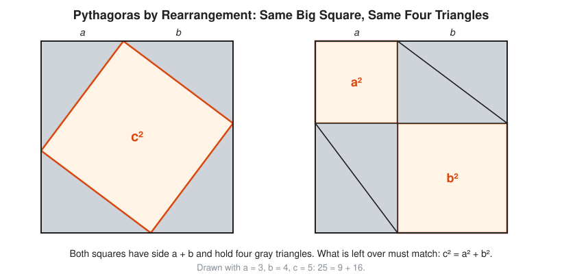
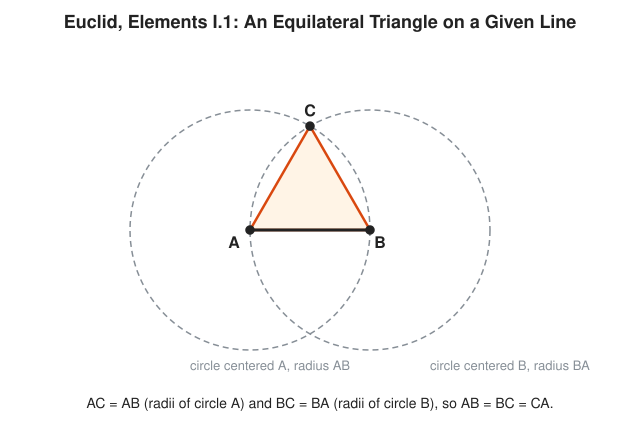

# 03 Ancient Greece

**Era:** about 600 BCE to 415 CE · **Reading time:** about 20 minutes · **Previous:** [02 Mesopotamia and Egypt](../02-mesopotamia-and-egypt/README.md) · **Next:** [04 India and China](../04-india-and-china/README.md)

## The Big Idea

Egypt and Babylon know how to compute. The Greeks ask why the computation is right. They invent the **proof**: a chain of small, checked steps that leads from statements everyone accepts to a statement nobody can doubt.

## The World at That Time

Greece is not one country. It is a scatter of city-states around the Mediterranean, linked by ships and trade. Merchants travel to Egypt and Babylon and bring back recipes for areas, volumes, and calendars. Greek citizens argue in courts and assemblies, and an argument that survives a hostile audience earns respect. That habit spills into mathematics: a rule is not accepted because a scribe wrote it down, but because someone shows it cannot fail.

After Alexander the Great dies in 323 BCE, his general Ptolemy rules Egypt. The Ptolemy kings fund the Museum and the Library of Alexandria, a research institute with salaried scholars and a giant collection of scrolls. For roughly 600 years Alexandria is the center of Greek mathematics. Euclid teaches there. Eratosthenes runs the Library. Archimedes, in Syracuse on Sicily, writes letters to colleagues in Alexandria.

The problems are practical and philosophical at once. Builders need right angles. Astronomers need the size of the Earth and the paths of planets. Engineers need levers, pulleys, and siege machines. Philosophers want to know what a number is and whether space is made of tiny pieces.

Under Roman rule the work slows but does not stop. Around 250 CE **Diophantus** writes the *Arithmetica*, a book of number puzzles solved in whole numbers and fractions. He uses a shorthand: one symbol for the unknown, others for its square and cube, and a sign for subtraction. Historians call this **syncopated algebra**: halfway between full sentences and modern symbols. Problems that ask for whole-number answers are still called **Diophantine equations** in his honor.

Around 400 CE **Hypatia**, daughter of the mathematician Theon, leads a school in Alexandria. She teaches mathematics, astronomy, and philosophy to students of every faith. She helps her father edit Ptolemy's astronomy and writes commentaries on Diophantus and Apollonius. None of her writings survive under her own name. In 415 a Christian mob, caught up in a political feud with the city governor, kills her. Most histories end the Greek era there.

```txt
  c. 585 BCE   Thales, by legend, predicts a solar eclipse
  c. 530 BCE   Pythagoras founds his school at Croton, southern Italy
  c. 400 BCE   irrational lengths are known (Theodorus, Theaetetus)
  c. 300 BCE   Euclid writes the Elements in Alexandria
  c. 250 BCE   Archimedes traps pi between 3 10/71 and 3 1/7
  c. 240 BCE   Eratosthenes measures the Earth
  c. 200 BCE   Apollonius writes the Conics
  c. 250 CE    Diophantus writes the Arithmetica
     415 CE    Hypatia is killed in Alexandria
```

## Key People

| Person | Dates | One-Line Contribution |
| --- | --- | --- |
| Thales of Miletus | c. 624 BCE to c. 546 BCE | Remembered as the first Greek to prove a geometry fact; the details are legend. |
| Pythagoras of Samos | c. 570 BCE to c. 495 BCE | Leads a school that treats number as the root of everything; the theorem with his name is older than he is. |
| Eudoxus of Cnidus | c. 408 BCE to c. 355 BCE | Invents the method of exhaustion and a theory of ratios that handles irrational lengths. |
| [Euclid of Alexandria](../biographies/euclid.md) | c. 325 BCE to c. 265 BCE | Writes the *Elements*: geometry and number theory built from a few axioms. |
| [Archimedes of Syracuse](../biographies/archimedes.md) | c. 287 BCE to 212 BCE | Bounds pi with 96-sided polygons and finds the volume of a sphere. |
| Eratosthenes of Cyrene | c. 276 BCE to c. 194 BCE | Measures the size of the Earth and gives a sieve for primes. |
| Apollonius of Perga | c. 240 BCE to c. 190 BCE | Writes the *Conics* and names the ellipse, parabola, and hyperbola. |
| Diophantus of Alexandria | about 200 CE to about 284 CE | Writes the *Arithmetica*, early algebra with symbols for unknowns. |
| [Hypatia of Alexandria](../biographies/hypatia.md) | c. 370 to 415 | Teaches, edits, and comments on Ptolemy, Diophantus, and Apollonius. |

## Key Ideas

### Pythagoras and a Length With No Ratio

Start with what is solid and what is not. **Thales** and **Pythagoras** left no writings. Everything about them comes from authors who lived centuries later and liked a good story. Thales is said to measure the height of a pyramid from its shadow and to predict an eclipse. Pythagoras is said to sacrifice an ox when he proves his theorem. Treat these as legends.

The **Pythagorean theorem** says: in a **right triangle** (a triangle with one square corner), the two short sides a and b and the long side c, called the **hypotenuse**, satisfy $a^2 + b^2 = c^2$. Babylonian scribes use this fact more than a thousand years before Pythagoras (see [Chapter 02](../02-mesopotamia-and-egypt/README.md)). What the Greeks add is a proof. Here is one of the oldest and simplest.

<!-- diagram: type=proof-by-rearrangement a=3 b=4 c=5 caption="Two squares of side a + b, each holding four copies of the same right triangle" -->


Both big squares have side a + b. Both hold the same four gray right triangles. On the left, the gaps form one tilted square with side c. On the right, the triangles pair up into two rectangles and the gaps form a square of side a and a square of side b. Equal totals minus equal triangles leave equal gaps. That is the whole proof.

```txt
  a = 3, b = 4
  big square:      (3 + 4)^2 = 49        side a + b
  four triangles:  4 x (3 x 4 / 2) = 24  each triangle is half a 3 by 4 rectangle
  left gap:        49 - 24 = 25          the tilted square c^2
  right gap:       9 + 16 = 25           a^2 + b^2
  c^2 = 25, c = 5                        both gaps match
```

Now the crisis. The Pythagoreans hold that everything is whole numbers and their ratios. A **ratio** is a comparison like 3 to 2, written 3/2. Take a square with side 1. Its diagonal d satisfies $d^2 = 1^2 + 1^2 = 2$. Is d a ratio of whole numbers?

```txt
  +--------+
  |      / |     side 1
  |    /   |     diagonal d
  |  /     |     d x d = 1 + 1 = 2
  |/       |     is d = p/q for whole numbers p and q?
  +--------+
```

The answer is no. The classic proof is a **proof by contradiction**: assume the opposite, follow the logic, and reach something impossible.

```txt
  assume d = p/q, with p/q in lowest terms     any fraction reduces to lowest terms
  p^2 / q^2 = 2                                square both sides
  p^2 = 2 q^2                                  multiply by q^2
  p^2 is even                                  it is 2 times something
  p is even                                    an odd number squared is odd
  p = 2k for some whole number k               definition of even
  4k^2 = 2 q^2                                 put 2k in place of p
  q^2 = 2k^2                                   divide by 2
  q is even                                    same argument as for p
  p and q are both even                        then 2 divides both
  contradiction: p/q was in lowest terms       the assumption fails
```

A length like this is called **irrational**: not a ratio of whole numbers. Legend says a Pythagorean named Hippasus leaks the secret and drowns at sea. The evidence for the drowning is thin. The evidence for the math is airtight. Plato reports that Theodorus later shows the square roots of 3, 5, 6, 7, and the other whole numbers up to 17 that are not perfect squares are irrational too. Near misses exist, for example $99^2 = 9{,}801$ and $2 \times 70^2 = 9{,}800$. Close is not equal. A checksum that matches on all but one bit still fails.

### Euclid: Axioms and Proof

About 300 BCE Euclid writes the *Elements*: thirteen books, roughly 465 **propositions** (proved statements). He starts from a few **definitions** (what a point, line, and circle are), five **postulates** (rules of construction), and five **common notions** (facts about equality, like "things equal to the same thing are equal to each other"). An **axiom** is any such starting statement, accepted without proof. Everything else follows by logic. This is the design of a good codebase: a small trusted core, and every new function built only from what already passed its tests.

The five postulates, in plain words:

```txt
  1   a straight line can join any two points
  2   a straight line can be extended as far as needed
  3   a circle can be drawn with any center and any radius
  4   all right angles are equal
  5   the parallel postulate: if two lines cross a third and the inner
      angles on one side add to less than two right angles, the two
      lines meet on that side
```

The fifth postulate looks less obvious than the others. Mathematicians try for two thousand years to prove it from the first four. They fail, and the failure opens new geometries ([Chapter 08](../08-18th-and-19th-century-rigor/README.md)).

The very first proposition shows the method.

<!-- diagram: type=construction ref=euclid-i-1 caption="Elements I.1: an equilateral triangle on segment AB from two circles" -->


Given a segment AB, draw a circle centered at A through B, and a circle centered at B through A. Call a crossing point C. Then AC is a radius of the first circle, equal to AB. BC is a radius of the second circle, equal to BA. Two things equal to the same thing are equal to each other. All three sides match. The triangle is **equilateral** (all sides equal).

```txt
  AC = AB          C lies on the circle centered A with radius AB
  BC = BA          C lies on the circle centered B with radius BA
  AC = BC          common notion 1: equal to the same thing
  AB = BC = CA     the triangle is equilateral
```

One honest footnote: Euclid never proves that the two circles actually cross. He takes it from the picture. David Hilbert patches gaps like this one in 1899 ([Chapter 09](../09-20th-century-foundations-and-computing/README.md)). The proof is still right. The foundation needs one more bolt.

The *Elements* also covers whole numbers. Book VII gives the **Euclidean algorithm** for the **greatest common divisor** (gcd), the largest number that divides two numbers evenly. Book IX, Proposition 20 proves that the **primes** (numbers greater than 1 divisible only by 1 and themselves) never run out. Take any finite list of primes. Multiply them and add 1. The result leaves remainder 1 when divided by every prime on the list. Its prime factors are therefore new primes. No finite list holds them all.

```txt
  list: 2, 3, 5, 7, 11, 13
  2 x 3 x 5 x 7 x 11 x 13 = 30,030       multiply the list
  30,030 + 1 = 30,031                    add 1
  30,031 / 13 leaves remainder 1         same for 2, 3, 5, 7, 11
  30,031 = 59 x 509                      factor it
  59 and 509 are not on the list         new primes, as promised
```

Note that 30,031 itself is not prime. Euclid does not claim it is. He only claims it has a prime factor missing from the list. Read the proof carefully. Students misquote it to this day.

### Archimedes: Squeezing Pi

A circle has no straight edges to measure. **Pi** (written $\pi$) is the ratio of a circle's circumference to its diameter, about 3.14159. The Greeks inherit rough values like 3 and $3\frac{1}{8}$. **Eudoxus** supplies a tool, later called the **method of exhaustion**: fill a curved shape with straight-edged pieces until the leftover is smaller than any amount you name. It is the ancestor of the limit in calculus.

About 250 BCE Archimedes applies it in *Measurement of a Circle*. He puts one regular polygon inside the circle and one outside. The circle's length sits between their perimeters. Then he doubles the number of sides, again and again.

<!-- diagram: type=historical-method ref=archimedes-pi caption="Inscribed and circumscribed hexagons around a radius-1 circle, the 12-gon dashed, and half-perimeters for 6 to 96 sides" -->


For a circle of radius 1, the circumference is $2\pi$. Half of it is $\pi$. That is why the table lists half-perimeters: each one is a direct estimate of pi. The inside hexagon gives 3. The outside hexagon gives 3.46410. The dashed 12-gon already hugs the circle closer. At 96 sides the gap shrinks to 3.14103 versus 3.14271. Archimedes works with fractions and states the bounds as $3\frac{10}{71} < \pi < 3\frac{1}{7}$, that is 3.14085 to 3.14286.

Why only square roots? The new side comes from the old side by Pythagoras, applied twice. Take a chord of length s in a circle of radius 1. Cut it in half at its midpoint M. The new side runs from one end of the chord to the point of the arc above M.

```txt
  center to M:        sqrt(1 - (s/2)^2)          Pythagoras, radius 1 is the hypotenuse
  M to the arc:       h = 1 - sqrt(1 - s^2/4)    what is left of the radius
  new side squared:   (s/2)^2 + h^2              Pythagoras again
                      = 2 - sqrt(4 - s^2)        expand and simplify
  new side:           sqrt(2 - sqrt(4 - s^2))
```

```txt
  hexagon inside:     s = 1                      side equals the radius
  half-perimeter:     6 x 1 / 2 = 3              lower bound for pi
  12-gon side:        sqrt(2 - sqrt(3)) = 0.51764
  half-perimeter:     12 x 0.51764 / 2 = 3.10583 better lower bound
```

Archimedes has no decimals and no calculator. He bounds $\sqrt{3}$ between the fractions $\frac{265}{153}$ and $\frac{1351}{780}$ and carries fractions through four doublings by hand. He always rounds in the safe direction: down for the inside polygon and up for the outside one. That is engineering discipline. An error budget that only errs on the safe side keeps the claim true.

The same method gives him the volume of a sphere: two thirds of the cylinder that wraps it. He asks for that figure on his tomb. The Roman orator Cicero finds the tomb about 137 years later, overgrown, by spotting the sphere and cylinder. Archimedes dies in 212 BCE when Rome takes Syracuse. The story that he says "do not disturb my circles" to the soldier is legend.

### Eratosthenes: Measuring the Earth and Sifting Primes

Eratosthenes runs the Library of Alexandria. About 240 BCE he hears that at Syene (modern Aswan), on a certain midsummer day, the noon Sun shines straight down a well. Vertical posts cast no shadow there. In Alexandria, on the same day at noon, a post does cast a short shadow.

<!-- diagram: type=historical-method ref=eratosthenes-earth caption="Parallel sunlight, a stick at Syene with no shadow, a stick at Alexandria with a 7.2 degree shadow angle; the same angle at the Earth's center" -->


The Sun is far away. Its rays arrive **parallel** (never meeting, like train tracks). The shadow angle at Alexandria is therefore the same as the angle between the two cities measured at the center of the Earth. The picture draws that angle much bigger than life to make it visible. The real angle is about the width of a pencil held at arm's length.

```txt
  shadow angle at Alexandria = 7.2 degrees         measured with a stick and its shadow
  7.2 / 360 = 1/50                                 fraction of a full circle
  Syene to Alexandria = 5,000 stadia               reported distance
  Earth around = 50 x 5,000 = 250,000 stadia       the 1/50 slice repeats 50 times
  stadion = 157.5 m to 185 m (unknown)             scholars disagree on the unit
  Earth around = 39,375 km to 46,250 km            250,000 times each length
  modern value: about 40,000 km
```

Later writers quote 252,000 stadia, a rounding that gives exactly 700 stadia per degree. Either way, the method is sound. The weak link is the unit, not the logic. Every SRE knows this bug: a correct calculation in the wrong units.

Eratosthenes also gives the **sieve**: a way to list primes without division. Write the numbers from 2 up. Circle 2, cross out every second number after it. Circle the next survivor, 3, and cross out every third number. Repeat. The circled numbers are the primes.

```txt
  2  3  x  5  x  7  x  x  x 11  x 13  x  x  x 17  x 19  x  x  x 23  x  x  x  x  x 29  x
  primes up to 30: 2, 3, 5, 7, 11, 13, 17, 19, 23, 29
  stop crossing out at 5: 7 x 7 = 49 is already past 30
```

A generation later **Apollonius of Perga** writes the *Conics*. Slice a cone with a flat plane and the edge of the cut is a curve. Tilt the plane a little: an **ellipse** (a stretched circle). Tilt it to match the slope of the cone: a **parabola**. Tilt further: a **hyperbola**. Apollonius names all three. Nobody needs them for 1,800 years. Then Kepler finds that planets move in ellipses ([Chapter 07](../07-scientific-revolution-and-calculus/README.md)). Patience is a mathematical virtue.

```txt
        /\              plane cuts across:        ellipse
       /  \             plane parallel to side:   parabola
      / -- \  <- cut    plane steeper than side:  hyperbola
     /      \
    /________\
```

## What It Unlocked Next

* The *Elements* travels to Baghdad, where scholars translate and extend it ([Chapter 05](../05-islamic-golden-age/README.md)).
* Ptolemy's astronomy, built on Greek chord tables, grows into trigonometry in India and the Islamic world ([Chapter 04](../04-india-and-china/README.md), [Chapter 05](../05-islamic-golden-age/README.md)).
* Latin translations of Euclid reach Europe in the 1100s and shape every school for centuries ([Chapter 06](../06-medieval-and-renaissance-europe/README.md)).
* The method of exhaustion becomes the calculus of Newton and Leibniz ([Chapter 07](../07-scientific-revolution-and-calculus/README.md)).
* Apollonius' conics become Kepler's orbits ([Chapter 07](../07-scientific-revolution-and-calculus/README.md)).
* Fermat scribbles his Last Theorem in the margin of Diophantus' *Arithmetica* ([Chapter 07](../07-scientific-revolution-and-calculus/README.md)).
* The doubtful fifth postulate leads to non-Euclidean geometry ([Chapter 08](../08-18th-and-19th-century-rigor/README.md)).
* The axiom-and-proof method becomes the foundations work of Hilbert and Gödel ([Chapter 09](../09-20th-century-foundations-and-computing/README.md)).

## Connects To

* [Course 201](../../course/201/README.md): geometry and the first proofs, built the way Euclid builds them.
* [Geometry track](../../tracks/geometry/README.md): triangles, circles, and constructions from the *Elements*.
* [Number theory track](../../tracks/number-theory/README.md): primes, the gcd, and the sieve.
* [Real analysis track](../../tracks/real-analysis/README.md): what an irrational number really is.
* [Calculus track](../../tracks/calculus/README.md): exhaustion grows up into limits and integrals.
* [Trigonometry track](../../tracks/trigonometry/README.md): angles and arcs, as in the Eratosthenes measurement.
* [Logic and set theory track](../../tracks/logic-and-set-theory/README.md): axioms and proof by contradiction.
* [Story of an Idea: Proof](../story-of-an-idea/proof.md): how the Greek proof grows into modern rigor.
* [Story of an Idea: Pi](../story-of-an-idea/pi.md): from Archimedes to computer records.
* [Story of an Idea: Infinity](../story-of-an-idea/infinity.md): infinitely many primes, and exhaustion.
* Biographies: [Euclid](../biographies/euclid.md), [Archimedes](../biographies/archimedes.md), [Hypatia](../biographies/hypatia.md).

## Try It

1. Draw a segment AB of 5 cm. Construct an equilateral triangle on it with a compass, as in Elements I.1. How long is AC?
2. Find gcd(252, 105) with the Euclidean algorithm. Show each division.
3. Run the sieve of Eratosthenes up to 50. How many primes do you get?
4. Euclid IX.20 with the list 2, 3, 5, 7: multiply, add 1. Is the result prime?
5. Use the rearrangement proof with a = 5 and b = 12. Compute the big square, the four triangles, and the leftover. What is c?
6. Start from the inside hexagon (side 1). Compute the side of the inside 12-gon with $\sqrt{2 - \sqrt{4 - s^2}}$, then its half-perimeter.
7. Suppose Eratosthenes measures a shadow angle of 7.5 degrees and the same 5,000 stadia. What circumference does he get?
8. A legend says the epitaph of Diophantus reads: his boyhood lasts 1/6 of his life, his youth 1/12 more, he marries after 1/7 more, a son is born 5 years later, the son lives half as long as his father, and the father dies 4 years after the son. How old is Diophantus at death?

<details>
<summary>Answers</summary>

1. 5 cm: AC is a radius of the circle centered at A, and that radius is AB.
2. 21: 252 = 2 x 105 + 42, 105 = 2 x 42 + 21, 42 = 2 x 21 + 0.
3. 15 primes: 2, 3, 5, 7, 11, 13, 17, 19, 23, 29, 31, 37, 41, 43, 47.
4. Yes: 2 x 3 x 5 x 7 + 1 = 211, and 211 has no factor up to 14 (its square root).
5. c = 13: (5 + 12)^2 = 289, four triangles 4 x 30 = 120, 289 - 120 = 169 = 13^2.
6. Side about 0.51764, half-perimeter 12 x 0.51764 / 2 = 3.10583.
7. 240,000 stadia: 360 / 7.5 = 48, and 48 x 5,000 = 240,000.
8. 84: x/6 + x/12 + x/7 + 5 + x/2 + 4 = x gives 9x/84 = 9, and x = 84.

</details>

## Code Corner

The program runs four Greek methods. It doubles polygon sides from 6 to 96 using only square roots (Archimedes). It runs the Euclidean algorithm and prints each division. It sieves primes up to 60 (Eratosthenes). It shows Euclid IX.20 at work, and it lists fractions that come close to the square root of 2 but never land on it. Full source: [code/main.go](code/main.go).

The heart of the Archimedes part:

```go
s, n := 1.0, 6 // a hexagon inside a radius-1 circle has side 1
for n <= 96 {
	t := s / math.Sqrt(1-s*s/4)
	fmt.Printf("%6d  %9.5f  %9.5f\n", n, float64(n)*s/2, float64(n)*t/2)
	s = math.Sqrt(2 - math.Sqrt(4-s*s))
	n *= 2
}
```

Here `t` is the side of the outside polygon: the inside side scaled up until it touches the circle instead of cutting it. The root 2 part uses the old rule that turns p/q into (p + 2q)/(p + q). Each step gives a better fraction, and $p^2 - 2q^2$ flips between 1 and -1. It never reaches 0, as the proof above promises.

Run it:

```txt
cd code && go run main.go
```

Output:

```txt
Archimedes: half-perimeters for a circle of radius 1
 sides     inside    outside
     6    3.00000    3.46410
    12    3.10583    3.21539
    24    3.13263    3.15966
    48    3.13935    3.14609
    96    3.14103    3.14271
his bounds: 3.14085 < pi < 3.14286

Euclid VII.2: gcd(1071, 462)
   1071 =   2 x  462 +  147
    462 =   3 x  147 +   21
    147 =   7 x   21 +    0
  gcd = 21

Eratosthenes: primes up to 60
  [2 3 5 7 11 13 17 19 23 29 31 37 41 43 47 53 59]

Euclid IX.20: multiply primes, add 1, find a new prime factor
  up to  2:     2 + 1 =     3, smallest prime factor 3
  up to  3:     6 + 1 =     7, smallest prime factor 7
  up to  5:    30 + 1 =    31, smallest prime factor 31
  up to  7:   210 + 1 =   211, smallest prime factor 211
  up to 11:  2310 + 1 =  2311, smallest prime factor 2311
  up to 13: 30030 + 1 = 30031, smallest prime factor 59

Root 2: fractions p/q that come close, but p*p - 2*q*q is never 0
     3/2    = 1.5000000  p*p - 2*q*q =  1
     7/5    = 1.4000000  p*p - 2*q*q = -1
    17/12   = 1.4166667  p*p - 2*q*q =  1
    41/29   = 1.4137931  p*p - 2*q*q = -1
    99/70   = 1.4142857  p*p - 2*q*q =  1
   239/169  = 1.4142012  p*p - 2*q*q = -1
   577/408  = 1.4142157  p*p - 2*q*q =  1
```

The last fraction, 577/408, shows up again in India in [Chapter 04](../04-india-and-china/README.md). Good approximations get discovered more than once.

## Flashcards

Anki deck in [cards.tsv](cards.tsv) (tab-separated: front, back, tags).

## Go Deeper

* [Euclid's Elements, Clark University edition](https://mathcs.clarku.edu/~djoyce/elements/): every proposition with interactive diagrams.
* [MacTutor biography of Archimedes](https://mathshistory.st-andrews.ac.uk/Biographies/Archimedes/): his life, works, and the legends sorted from the facts.
* [MacTutor: Pi through the ages](https://mathshistory.st-andrews.ac.uk/HistTopics/Pi_through_the_ages/): the Archimedes method in context.
* [MacTutor biography of Eratosthenes](https://mathshistory.st-andrews.ac.uk/Biographies/Eratosthenes/): the Earth measurement and the stadion problem.
* [MacTutor biography of Hypatia](https://mathshistory.st-andrews.ac.uk/Biographies/Hypatia/): what is known about her work and her death.
* [MacTutor biography of Diophantus](https://mathshistory.st-andrews.ac.uk/Biographies/Diophantus/): the *Arithmetica* and its long afterlife.
