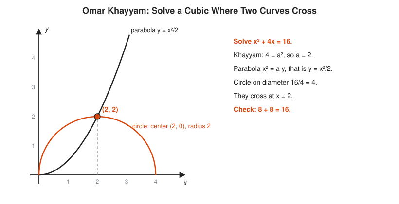

# 06 Medieval and Renaissance Europe

**Era:** about 1100 to 1600 · **Reading time:** about 18 minutes · **Previous:** [05 The Islamic Golden Age](../05-islamic-golden-age/README.md) · **Next:** [07 The Scientific Revolution and Calculus](../07-scientific-revolution-and-calculus/README.md)

## The Big Idea

Europe imports Greek and Arabic mathematics through translation, then merchants, not monks, put it to daily use. Hindu-Arabic digits win the counting house, algebra gets its symbols, and a public contest over the cubic equation forces mathematicians to accept square roots of negative numbers.

## The World at That Time

Around 1100, Latin Europe knows little Greek mathematics. Most of it survives in Arabic. That changes where Christian and Muslim lands meet. Toledo, in Spain, falls to Castile in 1085 and keeps its Arabic libraries. Sicily, under Norman kings, has scholars who read Greek, Arabic, and Latin. In the 12th century, translators work through the shelves:

* **Adelard of Bath** (c. 1080 to c. 1152) translates Euclid's *Elements* from Arabic into Latin and al-Khwarizmi's astronomical tables.
* **Robert of Chester** translates al-Khwarizmi's algebra in 1145.
* **Gerard of Cremona** (c. 1114 to 1187) works in Toledo for decades and puts dozens of works into Latin, including Ptolemy's *Almagest* (1175) and al-Khwarizmi's algebra.
* In Sicily, around 1160, a scholar translates the *Almagest* straight from Greek.

At the same time the first **universities** form: Bologna from about 1088, then Paris and Oxford around 1200. Students study the **quadrivium**, the four mathematical arts: arithmetic, geometry, music, and astronomy. University math is mostly reading Euclid and Boethius. The math that changes daily life happens elsewhere, in the cities of northern Italy.

Italian merchants trade across the Mediterranean. They deal in dozens of currencies, each city with its own coins, weights, and measures. Florence mints the gold florin from 1252, Venice the ducat from 1284. A merchant needs to convert prices, split profits among partners, charge interest, and keep books that a partner in another city can check. Banks appear, named for the *banco*, the bench where money-changers sit. Later in the period, two more customers arrive: navigators sailing out of sight of land, who need tables of the sun and stars, and gunners, who want to know where a cannonball lands.

The core merchant tool is the **rule of three**: three known numbers in proportion give the fourth.

```txt
  3 bales of wool cost 20 florins. What do 12 bales cost?
  3 : 20 = 12 : ?             same price per bale
  ? = 20 x 12 / 3             multiply the middle pair, divide by the first
  ? = 240 / 3 = 80 florins
  check: 80 / 12 = 20 / 3     6.67 florins a bale either way
```

## Key People

| Person | Dates | One-Line Contribution |
|---|---|---|
| Gerard of Cremona | c. 1114 to 1187 | Translates the *Almagest*, al-Khwarizmi, and dozens more from Arabic in Toledo |
| [Leonardo of Pisa (Fibonacci)](../biographies/fibonacci.md) | c. 1170 to c. 1250 | *Liber Abaci* (1202) teaches Hindu-Arabic digits and merchant arithmetic to Europe |
| Nicole Oresme | c. 1320 to 1382 | Draws graphs of changing quantities and proves the harmonic series diverges |
| Regiomontanus | 1436 to 1476 | Writes the first European book on trigonometry as its own subject (1464) |
| Johannes Widmann | c. 1462 to after 1498 | First prints the + and - signs, in a merchant arithmetic (1489) |
| Luca Pacioli | c. 1445 to 1517 | *Summa* (1494) prints double-entry bookkeeping and gathers the algebra of the day |
| Niccolò Tartaglia | c. 1500 to 1557 | Rediscovers the cubic formula in 1535 and studies cannon fire |
| [Gerolamo Cardano](../biographies/cardano.md) | 1501 to 1576 | Publishes the cubic and quartic solutions in *Ars Magna* (1545) |
| Lodovico Ferrari | 1522 to 1565 | Cardano's student, solves the quartic equation |
| Rafael Bombelli | 1526 to 1572 | *L'Algebra* (1572) gives rules for computing with complex numbers |
| Robert Recorde | c. 1512 to 1558 | Invents the equals sign (1557) |
| François Viète | 1540 to 1603 | Uses letters for known and unknown quantities (1591) |
| Simon Stevin | 1548 to 1620 | *De Thiende* (1585) argues for decimal fractions in daily use |

## Key Ideas

### Columns Beat Roman Numerals

Fibonacci, the son of a Pisan customs official, grows up partly in Bugia (now Béjaïa, in Algeria), where he learns the Indian digits from Arab teachers. In 1202 he publishes *Liber Abaci*, the Book of Calculation. Its first chapter introduces the nine digits and the sign 0. The rest is merchant math: conversions, partnerships, interest, barter, and puzzles.

The selling point is place value. In a **place-value system**, a digit is worth more by its position: the 2 in 1,202 is worth 1,000 times more in the left column than in the right. Roman numerals have no columns. Their symbols are added up wherever they sit.

<!-- diagram: type=historical-method ref=roman-vs-hindu-arabic caption="Columns versus Roman numerals: 1,202 + 349 = 1,551" -->


On the left, the digits line up by place. Add each column from the right, and carry when a column passes 9. On the right, the same sum in Roman numerals has no columns. You regroup symbols by hand, or move counters on a board and write down only the answer. The caption notes the resistance: in 1299 the Florence guild of money-changers bans the new digits in account books. A 0 turns into a 6 or a 9 with one stroke of the pen. Roman numerals stay in ledgers for another two centuries, a reminder that a better format needs more than being better.

```txt
    1 2 0 2          1,202 = MCCII
  +   3 4 9            349 = CCCXLIX
  ---------
          1          2 + 9 = 11: write 1, carry 1 to the tens
        5            0 + 4 + 1 (carry) = 5
      5              2 + 3 = 5
    1                1 + nothing = 1
    1 5 5 1          answer: 1,551 = MDLI
```

The new arithmetic spreads through **abacus schools** (scuole d'abaco) in Italian cities from the late 1200s. Despite the name, they teach pen-and-paper arithmetic with digits, not the bead frame. Boys of merchant families spend a couple of years learning to multiply, convert, and keep books.

Bookkeeping gets its own method. In **double-entry bookkeeping**, every transaction is written twice: once as a debit in one account and once as a credit in another. The two columns must total the same. If they do not, there is an error somewhere. It is a checksum for money, and it is older than any computer: surviving Italian ledgers use it by about 1300. In 1494, the friar Luca Pacioli prints the first full description in his *Summa*, and accountants still call him its father.

### Lattice Multiplication

Multiplying long numbers with digits needs a method that keeps every partial product in its place. One favorite of the period is **lattice multiplication**, called **gelosia** in Italian after the lattice screens on windows. It appears in Arabic and Indian texts, in the printed Treviso Arithmetic of 1478, and in Pacioli.

<!-- diagram: type=historical-method ref=lattice-multiplication caption="Lattice (gelosia) multiplication: 47 x 36 = 1,692" -->


Write 47 across the top and 36 down the right side. Each cell gets the product of its column digit and its row digit, split by a diagonal: tens above, units below. Then add along the diagonal lanes, starting at the bottom right, and carry to the next lane. Each lane collects one place value: units, tens, hundreds, and so on. The digits of the answer come out down the left side and along the bottom.

```txt
  4 x 3 = 12      top-left cell: 1 above the diagonal, 2 below
  7 x 3 = 21      top-right cell
  4 x 6 = 24      bottom-left cell
  7 x 6 = 42      bottom-right cell
  lane 1 (units):     2                  only the 2 of 42
  lane 2 (tens):      4 + 1 + 4 = 9      4 of 42, 1 of 21, 4 of 24
  lane 3 (hundreds):  2 + 2 + 2 = 6      2 of 12, 2 of 21, 2 of 24
  lane 4 (thousands): 1                  the 1 of 12
  read lanes from the top-left:  1 6 9 2 = 1,692
  check: 47 x 36 = 47 x 30 + 47 x 6 = 1,410 + 282 = 1,692
```

The grid separates multiplying from adding. You do all the one-digit products first, with no carrying, then one pass of addition. That is the same split a parallel computer makes: many independent multiplications, then a reduction.

### Fibonacci's Rabbits

Chapter 12 of *Liber Abaci* holds a puzzle that outlives everything else in the book. A man puts a pair of rabbits in a walled place. Each month, every pair old enough to breed produces one new pair. A new pair starts breeding in its second month. How many pairs are there after one year?

<!-- diagram: type=historical-method ref=fibonacci-rabbits caption="Fibonacci's rabbits: pairs by month, young and adult" -->


The tree follows the modern convention: it starts in month 1 with one young pair (white). In month 2 that pair is adult (orange). From then on, every adult pair stays adult and adds one young pair below it, and every young pair turns adult. Count the circles in each row: 1, 1, 2, 3, 5, 8. Each count is the sum of the two before it, because this month's pairs are last month's pairs (all still alive) plus one new pair for each adult, and the adults are exactly the pairs that existed two months ago.

```txt
  month   young   adult   total
  1       1       0       1          one young pair
  2       0       1       1          it grows up
  3       1       1       2          the adult breeds
  4       1       2       3          new young = old adults
  5       2       3       5          adults = last month's total
  6       3       5       8          total = 3 + 5 = 5 + 3
  rule: total(n) = total(n-1) + total(n-2)
```

Fibonacci himself starts with an adult pair. His counts run 1, 2, 3, 5, 8, 13, 21, 34, 55, 89, 144, 233, 377, and he answers 377 pairs at the end of the year. The modern habit of starting the sequence 1, 1, 2, 3, 5 (or 0, 1, 1, 2) only shifts the index. The name "Fibonacci sequence" comes from the French mathematician Édouard Lucas in the 1870s. Fibonacci treats it as one puzzle among hundreds.

The sequence has a hidden property. Divide each number by the one before it:

<!-- diagram: type=line-chart ref=fibonacci-ratio caption="Ratios of neighboring Fibonacci numbers settle on phi = 1.618..." -->


The points jump above and below the dashed line, each miss smaller than the last. They close in on the **golden ratio**, $\varphi = (1 + \sqrt{5})/2 = 1.6180\ldots$, the number Euclid uses to cut a line "in extreme and mean ratio". Fibonacci never mentions this. Johannes Kepler notices it around 1611, about 400 years later.

```txt
  8 / 5   = 1.6               below phi
  13 / 8  = 1.625             above phi
  21 / 13 = 1.61538...        below, closer
  34 / 21 = 1.61905...        above, closer
  phi     = 1.61803...        (1 + sqrt(5)) / 2
```

### The Cubic Equation Race

[Chapter 05](../05-islamic-golden-age/README.md) ends with Omar Khayyam solving cubics by drawing curves. A drawing gives a length, not a number you can compute. Here is his picture again, for the equation $x^3 + 4x = 16$:

<!-- diagram: type=historical-method ref=khayyam-cubic caption="Khayyam's geometric answer to x^3 + 4x = 16, the starting point for the Italians" -->


The parabola and the circle cross at $x = 2$. Pacioli, in 1494, writes that a general rule for the cubic is, for now, as impossible as squaring the circle. Within a generation, Italians find one. The story has secrets, contests, a broken oath, and a lifelong feud:

```txt
  c. 1515   Scipione del Ferro (Bologna) solves x^3 + px = q. Keeps it secret.
  1526      Del Ferro dies. His student Antonio Fior inherits the method.
  1535      Fior challenges Niccolò Tartaglia to a public contest of 30 problems.
            Tartaglia finds the method himself just before the deadline and wins.
  1539      Cardano coaxes the method from Tartaglia under an oath of secrecy.
  1543      Cardano and his student Ferrari see del Ferro's notes in Bologna.
  1545      Cardano publishes it in Ars Magna, crediting both men.
            Ferrari's solution of the quartic (x^4) appears in the same book.
  1548      Ferrari and Tartaglia hold a public debate in Milan. Tartaglia leaves.
```

Cardano argues that the oath covered Tartaglia's method, not del Ferro's earlier one. Tartaglia disagrees in print for the rest of his life. Mathematicians remember the formula as Cardano's, which supports Tartaglia's view of the world.

For a **depressed cubic** (one with no $x^2$ term) of the form $x^3 + px = q$, the formula is:

$$x = \sqrt[3]{\frac{q}{2} + \sqrt{\frac{q^2}{4} + \frac{p^3}{27}}} \;-\; \sqrt[3]{-\frac{q}{2} + \sqrt{\frac{q^2}{4} + \frac{p^3}{27}}}$$

Cardano's own first example is "a cube and six things equal twenty":

```txt
  x^3 + 6x = 20                     p = 6, q = 20
  q / 2         = 10                half the number
  q^2 / 4       = 100               square of the half
  p^3 / 27      = 216 / 27 = 8      cube of a third of p
  sqrt(100 + 8) = sqrt(108)         about 10.3923
  x = cbrt(sqrt(108) + 10) - cbrt(sqrt(108) - 10)
    = cbrt(20.3923) - cbrt(0.3923)
    = 2.7321 - 0.7321               the two cube roots
    = 2                             a messy formula, a clean answer
  check: 8 + 12 = 20
```

Then the formula breaks. Try $x^3 = 15x + 4$. The answer is plainly 4, because $64 = 60 + 4$. But the formula asks for $\sqrt{-121}$. Cardano calls such cases "sophistic" and moves on. In *L'Algebra* (1572), Rafael Bombelli does not. He simply computes with $\sqrt{-1}$ as if it were a number, and checks:

```txt
  x^3 = 15x + 4                     the formula gives cbrt(2 + sqrt(-121)) + cbrt(2 - sqrt(-121))
  sqrt(-121) = 11 sqrt(-1)          write i for sqrt(-1), with i^2 = -1
  (2 + i)^3 = 8 + 12i + 6i^2 + i^3  expand
            = 8 + 12i - 6 - i       i^2 = -1, i^3 = -i
            = 2 + 11i               the cube root of 2 + 11i is 2 + i
  (2 - i)^3 = 2 - 11i               same steps, sign flipped
  x = (2 + i) + (2 - i) = 4         the imaginary parts cancel
```

A real answer passes through unreal numbers on the way. This is the birth of the **complex numbers**: numbers of the form $a + bi$. For two more centuries people call them "imaginary". They end up at the core of electrical engineering, signal processing, and quantum mechanics.

### Symbols, Decimals, and Graphs

All of this algebra is still written in words. Notation arrives piece by piece, and only after the **printing press** (Gutenberg, Mainz, about 1450) makes the same symbol look the same in every copy:

```txt
  1489  Widmann (Leipzig)      +  and  -    first in print, for surplus and deficit in merchant problems
  1557  Recorde (England)      =            "bicause noe .2. thynges, can be moare equalle" than parallel lines
  1585  Stevin (Flanders)      decimals     De Thiende: tenths, hundredths, for daily use
  1591  Viète (France)         letters      vowels for unknowns, consonants for known quantities
```

Recorde draws his equals sign much longer than ours, two long parallel strokes. Viète makes the largest leap: with letters for the known numbers, one line covers every equation of a shape at once. Al-Khwarizmi needs a recipe in words for each of his six forms. Viète can write the form itself. In [Chapter 07](../07-scientific-revolution-and-calculus/README.md), Descartes swaps in the modern habit: $x, y, z$ for unknowns, $a, b, c$ for knowns.

Trigonometry moves north too. Regiomontanus writes *On Triangles of Every Kind* in 1464 (printed 1533), the first European treatment of trigonometry as a subject of its own, plus sine tables and astronomical almanacs that navigators carry on long voyages. On land, Tartaglia's *Nova Scientia* (1537) is a book on gunnery. He argues that a cannon aimed at 45 degrees reaches the farthest. The correct reason waits for Galileo and calculus.

Two centuries earlier, in Paris, Nicole Oresme has two ideas well ahead of their time. First, he pictures a changing quantity, such as the speed of a moving body, as a figure: time along a base line, the speed at each instant as a vertical line above it. The area of the figure is the distance covered.

```txt
  speed
    |            /|
    |          /  |          speed grows steadily from 0
    |        /    |          the area of the triangle = distance covered
    |      /      |          = (1/2) x time x final speed
    |    /        |
    |  /          |
    |/____________|_____ time
```

That is a graph, about 300 years before Descartes, and the area under it is an integral, about 300 years before Newton. Second, Oresme proves that the **harmonic series** $1 + \tfrac{1}{2} + \tfrac{1}{3} + \tfrac{1}{4} + \cdots$ grows without limit. The terms shrink toward zero, yet the sum passes every number. His proof groups the terms:

```txt
  1 + 1/2 + (1/3 + 1/4) + (1/5 + 1/6 + 1/7 + 1/8) + (1/9 + ... + 1/16) + ...
  1/3 + 1/4             > 1/4 + 1/4       = 1/2     two terms, each at least 1/4
  1/5 + ... + 1/8       > 4 x 1/8         = 1/2     four terms, each at least 1/8
  1/9 + ... + 1/16      > 8 x 1/16        = 1/2     eight terms, each at least 1/16
  each group adds more than 1/2, and the groups never run out
  the sum passes 1 + 1/2 + 1/2 + 1/2 + ... , which grows past any number
```

It grows very slowly. The first 1,000 terms add to only about 7.49. The first million add to about 14.39. Slow growth is still growth, as anyone who has watched a disk fill knows.

## What It Unlocked Next

* Symbols for unknowns and knowns, which make Descartes' coordinate geometry possible: see [07 The Scientific Revolution and Calculus](../07-scientific-revolution-and-calculus/README.md).
* Decimal fractions, which make logarithm tables (Napier, 1614) practical: see [07 The Scientific Revolution and Calculus](../07-scientific-revolution-and-calculus/README.md).
* Graphs of changing quantities and infinite sums, the raw material of calculus: see [07 The Scientific Revolution and Calculus](../07-scientific-revolution-and-calculus/README.md).
* Complex numbers, used reluctantly until Euler and Gauss give them full standing: see [08 The 18th and 19th Centuries: Rigor](../08-18th-and-19th-century-rigor/README.md).
* The search for a formula for the quintic ($x^5$), which ends with Galois proving none exists: see [08 The 18th and 19th Centuries: Rigor](../08-18th-and-19th-century-rigor/README.md).
* Double-entry bookkeeping, still the basis of every accounting system.

## Connects To

* [Course 101: Foundations](../../course/101/README.md): place value, column arithmetic, and ratios like the rule of three.
* [Course 301: Algebra II, Trig and Precalculus](../../course/301/README.md): polynomials, sequences and series, and complex numbers.
* [Arithmetic and number sense track](../../tracks/arithmetic-and-number-sense/README.md): why place value makes multiplication methods work.
* [Algebra track](../../tracks/algebra/README.md): cubic equations and the road to symbolic algebra.
* [Complex analysis track](../../tracks/complex-analysis/README.md): where Bombelli's strange numbers lead.
* [Discrete math track](../../tracks/discrete-math/README.md): recurrences like the Fibonacci rule.
* [Calculus track](../../tracks/calculus/README.md): Oresme's area under a graph and the harmonic series.
* [Story of notation](../story-of-an-idea/notation.md): +, -, =, and letters arrive in this chapter.
* [Story of infinity](../story-of-an-idea/infinity.md): Oresme's endless sum that never stops growing.
* [Biography of Fibonacci](../biographies/fibonacci.md): the merchant who brings the digits to Europe.
* [Biography of Cardano](../biographies/cardano.md): physician, gambler, and publisher of the cubic.

## Try It

1. Convert MCDXCIV and MDLVII to Hindu-Arabic digits. How many years separate them? Write the answer in Roman numerals.
2. Use a lattice to multiply 23 x 45. Show the four cells and the lane sums.
3. Use a lattice to multiply 123 x 45. (The grid is 3 cells wide and 2 tall.)
4. In the modern rabbit convention (one young pair in month 1), how many young pairs and how many adult pairs are there in month 9?
5. Compute 89/55 and 144/89 to five decimal places. Which is above $\varphi$ and which is below?
6. Use Oresme's grouping to show that $1 + \tfrac{1}{2} + \cdots + \tfrac{1}{16}$ is more than 3.
7. Use Cardano's formula on $x^3 + 3x = 14$. Simplify the answer and check it.
8. Repeat Bombelli's check for $(2 - i)^3$. Show each step.

<details>
<summary>Answers</summary>

1. MCDXCIV = 1,494 (Pacioli's *Summa*) and MDLVII = 1,557 (Recorde's equals sign). $1557 - 1494 = 63$ = LXIII.
2. Cells: $2 \times 4 = 08$, $3 \times 4 = 12$, $2 \times 5 = 10$, $3 \times 5 = 15$. Lanes from the bottom right: 5, then $1 + 2 + 0 = 3$, then $1 + 1 + 8 = 10$ (write 0, carry 1), then $0 + 1 = 1$. Answer 1,035.
3. 5,535: check $123 \times 45 = 123 \times 40 + 123 \times 5 = 4{,}920 + 615$.
4. 13 young and 21 adult, 34 in all: young pairs equal last month's adults, adults equal last month's total.
5. $89/55 = 1.61818$ (above) and $144/89 = 1.61798$ (below), with $\varphi = 1.61803$.
6. $1 + \tfrac{1}{2} + (\tfrac{1}{3} + \tfrac{1}{4}) + (\tfrac{1}{5} + \cdots + \tfrac{1}{8}) + (\tfrac{1}{9} + \cdots + \tfrac{1}{16}) > 1 + \tfrac{1}{2} + \tfrac{1}{2} + \tfrac{1}{2} + \tfrac{1}{2} = 3$. The true sum is about 3.38.
7. $q/2 = 7$, $p^3/27 = 1$, $\sqrt{49 + 1} = \sqrt{50}$. $x = \sqrt[3]{\sqrt{50} + 7} - \sqrt[3]{\sqrt{50} - 7} = 2.4142 - 0.4142 = 2$. Check: $8 + 6 = 14$.
8. $(2 - i)^3 = 8 - 12i + 6i^2 - i^3 = 8 - 12i - 6 + i = 2 - 11i$, using $i^2 = -1$ and $i^3 = -i$.

</details>

## Code Corner

The program at [code/main.go](code/main.go) does four things. It simulates the rabbits month by month, tracking young and adult pairs, in both the modern and the *Liber Abaci* conventions. It prints the ratios of neighboring Fibonacci numbers next to $\varphi$. It multiplies any two digit strings with the lattice method and checks the result against Go's `math/big`. Finally it runs Cardano's formula on $x^3 + 6x = 20$ and Bombelli's complex cube roots for $x^3 = 15x + 4$ with `math/cmplx`.

The lattice function is the heart of it. Each cell drops its units digit into one lane and its tens digit into the next lane up. One pass of carrying finishes the job:

```go
func lattice(a, b string) string {
	n, m := len(a), len(b)
	diag := make([]int, n+m) // diag[k] collects one place value
	for i := 0; i < n; i++ {
		for j := 0; j < m; j++ {
			p := int(a[i]-'0') * int(b[j]-'0')
			// place value of the units half of this cell
			k := (n - 1 - i) + (m - 1 - j)
			diag[k] += p % 10
			diag[k+1] += p / 10
		}
	}
	carry := 0
	digits := make([]byte, n+m)
	for k := 0; k < n+m; k++ {
		s := diag[k] + carry
		digits[n+m-1-k] = byte('0' + s%10)
		carry = s / 10
	}
	out := strings.TrimLeft(string(digits), "0")
	if out == "" {
		return "0"
	}
	return out
}
```

Run it:

```txt
cd code && go run main.go
```

Real output:

```txt
== Fibonacci's rabbits, modern start (one young pair) ==
  month  1:   1 young +   0 adult =   1 total
  month  2:   0 young +   1 adult =   1 total
  month  3:   1 young +   1 adult =   2 total
  month  4:   1 young +   2 adult =   3 total
  month  5:   2 young +   3 adult =   5 total
  month  6:   3 young +   5 adult =   8 total
  month  7:   5 young +   8 adult =  13 total
  month  8:   8 young +  13 adult =  21 total
== Liber Abaci start (one adult pair): start, then each month-end ==
  [1 2 3 5 8 13 21 34 55 89 144 233 377]
== Ratios of neighbors ==
    1/1   = 1.000000
    2/1   = 2.000000
    3/2   = 1.500000
    5/3   = 1.666667
    8/5   = 1.600000
   13/8   = 1.625000
   21/13  = 1.615385
   34/21  = 1.619048
   55/34  = 1.617647
   89/55  = 1.618182
  phi     = 1.618034
== Lattice multiplication ==
  47 x 36 = 1692 (check: true)
  1202 x 349 = 419498 (check: true)
  987654321 x 123456789 = 121932631112635269 (check: true)
== Cardano: x^3 + 6x = 20 ==
  sqrt(108) = 10.392305
  cbrt(20.392305) - cbrt(0.392305) = 2.000000000000
  check: x^3 + 6x = 20.000000000000
== Bombelli: x^3 = 15x + 4 ==
  cube root of 2+11i = (2.000000+1.000000i)
  sum of the two cube roots = (4.000000+0.000000i)
```

The lattice handles 18-digit products with no overflow, because it never holds more than a column sum in an `int`. Medieval clerks had the same advantage: paper does not overflow.

## Flashcards

Anki deck in [cards.tsv](cards.tsv) (tab-separated: front, back, tags).

## Go Deeper

* [MacTutor biography of Fibonacci](https://mathshistory.st-andrews.ac.uk/Biographies/Fibonacci/): his life, *Liber Abaci*, and the rabbit problem.
* [MacTutor: Tartaglia versus Cardan](https://mathshistory.st-andrews.ac.uk/HistTopics/Tartaglia_v_Cardan/): the full story of the cubic quarrel.
* [MacTutor: Quadratic, cubic and quartic equations](https://mathshistory.st-andrews.ac.uk/HistTopics/Quadratic_etc_equations/): from Babylon to Ferrari in one essay.
* [MacTutor biography of Oresme](https://mathshistory.st-andrews.ac.uk/Biographies/Oresme/): graphs and the harmonic series in the 1300s.
* [MacTutor biography of Bombelli](https://mathshistory.st-andrews.ac.uk/Biographies/Bombelli/): the first rules for complex numbers.
* [MacTutor biography of Pacioli](https://mathshistory.st-andrews.ac.uk/Biographies/Pacioli/): the *Summa* and double-entry bookkeeping.
