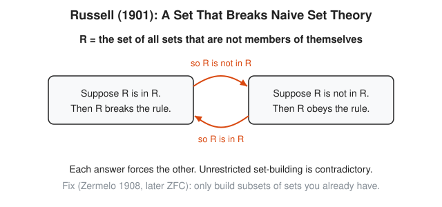
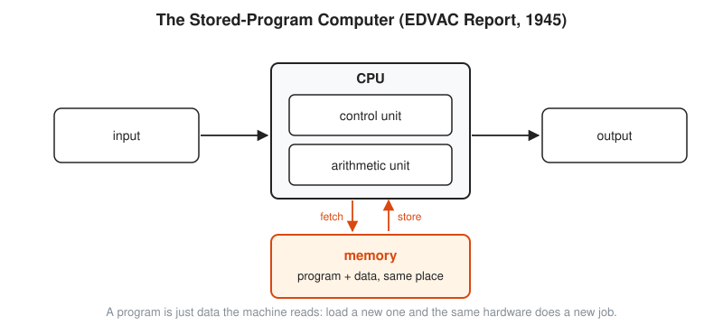
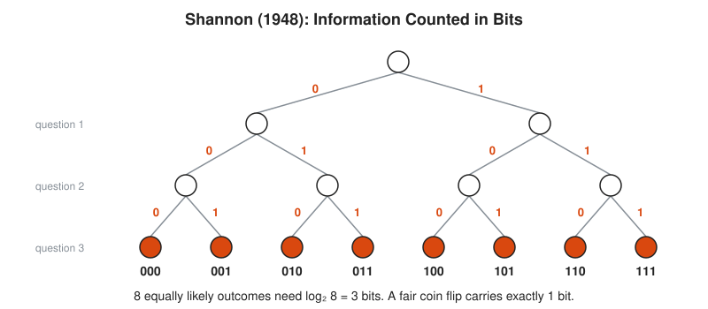

# 09 20th-Century Foundations and Computing

**Era:** about 1900 to 1970 · **Reading time:** about 25 minutes · **Previous:** [08 The 18th and 19th Centuries: Rigor](../08-18th-and-19th-century-rigor/README.md) · **Next:** [10 Modern Mathematics](../10-modern-mathematics/README.md)

## The Big Idea

Mathematicians try to put all of mathematics on one solid, checkable foundation. Gödel and Turing prove that no such foundation can answer every question, and in the same stroke Turing defines what a computer is. Two world wars then turn that abstract machine into real hardware, and Shannon shows how to measure information itself.

## The World at That Time

The century opens with confidence. Electricity, telephones, and railways spread across Europe and North America. Physics is about to break open: relativity arrives in 1905 and 1915, quantum mechanics in the 1920s. Both need new mathematics, and both get it.

Inside mathematics the mood is less calm. Cantor has shown that infinities come in different sizes. Paradoxes appear at the edges of set theory. If the ground under mathematics has holes, everything built on it is suspect. The leading mathematicians decide to inspect the foundations, the way an operations team audits a system that everyone depends on and nobody fully understands.

Then come two world wars. War needs mathematics in bulk: artillery **firing tables** (printed tables that tell a gunner the barrel angle for a given range), code making and code breaking, convoy routing, supply logistics, radar, and the atomic bomb. Rooms full of human **computers**, at first a job title for people who calculate by hand, cannot keep up. Electronic machines replace them. After 1945 telephone networks and the new computers need a theory of signals, noise, and storage.

```txt
  need                       mathematics it pulls in
  -------------------------  ------------------------------------------
  trust in proofs            logic, set theory, axioms
  artillery tables           numerical methods, electronic computers
  breaking ciphers           permutations, statistics, machines
  convoys and supply         operations research, linear programming
  telephone and radio        information theory, probability
```

## Key People

| Person | Dates | One-Line Contribution |
| --- | --- | --- |
| [David Hilbert](../biographies/hilbert.md) | 1862 to 1943 | Sets 23 problems in 1900 and launches the program to prove mathematics consistent and complete |
| Bertrand Russell | 1872 to 1970 | Finds the paradox that breaks naive set theory; writes *Principia Mathematica* with Alfred North Whitehead |
| Ernst Zermelo | 1871 to 1953 | Gives the first axioms for set theory in 1908 |
| L. E. J. Brouwer | 1881 to 1966 | Founds intuitionism, which accepts only proofs that construct their objects |
| [Emmy Noether](../biographies/noether.md) | 1882 to 1935 | Links symmetry to conservation laws (1918) and shapes modern abstract algebra |
| [Srinivasa Ramanujan](../biographies/ramanujan.md) | 1887 to 1920 | Self-taught genius who finds thousands of formulas for series, partitions, and pi |
| [Kurt Gödel](../biographies/godel.md) | 1906 to 1978 | Proves the incompleteness theorems (1931) |
| Alonzo Church | 1903 to 1995 | Shows in 1936, with his lambda calculus, that some questions have no mechanical answer |
| [Alan Turing](../biographies/turing.md) | 1912 to 1954 | Defines the Turing machine (1936) and helps break Enigma |
| Marian Rejewski | 1905 to 1980 | Reconstructs the wiring of the Enigma machine in 1932 with permutation math |
| [John von Neumann](../biographies/von-neumann.md) | 1903 to 1957 | Game theory, the stored-program computer design (1945), and much more |
| Andrey Kolmogorov | 1903 to 1987 | Puts probability on axioms (1933) |
| George Dantzig | 1914 to 2005 | Invents the simplex method for linear programming (1947) |
| Claude Shannon | 1916 to 2001 | Founds information theory and defines the bit as its unit (1948) |
| Nicolas Bourbaki | from 1935 | Pen name of a group of French mathematicians who rewrite mathematics from axioms |

## Key Ideas

### Paradox, Axioms, and the Hilbert Program

In August 1900, at the International Congress of Mathematicians in Paris, David Hilbert presents a list of open problems. The printed version has 23. They steer research for the whole century. The second asks for a proof that arithmetic is **consistent**, that is, its rules never lead to a contradiction.

The worry is real. In 1901 Bertrand Russell finds a contradiction inside the simplest idea in mathematics: a **set**, a collection of things. In 1902 he writes to Gottlob Frege, whose book on the logical foundations of arithmetic is at the printer. Frege adds an appendix admitting that his foundation collapses.

<!-- diagram: type=paradox-loop ref=russell-1901 caption="Russell's paradox: R is in R exactly when R is not in R" -->


The picture has two boxes joined by orange arrows. Define R as the set of all sets that are not members of themselves. Left box: suppose R is in R. Then R breaks its own entry rule, and the arrow says R is not in R. Right box: suppose R is not in R. Then R obeys the rule, and the arrow says R is in R. Each answer forces the other, round and round. The note at the bottom gives the repair: Zermelo, 1908.

```txt
  R = { sets X : X is not in X }              entry rule: a set gets in if it does not contain itself
  ask: is R in R?
  if yes: R is in R                           assumption
          R fails the entry rule              members of R must not contain themselves
          R is not in R                       contradiction with the assumption
  if no:  R is not in R                       assumption
          R passes the entry rule             it does not contain itself
          R is in R                           contradiction again
  both answers fail                           the definition of R itself is broken
  Zermelo fix: R_A = { X in A : X not in X }  only carve subsets out of an existing set A
          R_A is in R_A?  leads to R_A not in A, no contradiction, just a fact
```

The lesson: you cannot form a set from any description you like. Russell and Alfred North Whitehead respond with *Principia Mathematica* (three volumes, 1910 to 1913), which builds arithmetic from pure logic. It is famously slow: the proof that 1 + 1 = 2 arrives hundreds of pages in. Ernst Zermelo takes a lighter route in 1908. He lists a few **axioms**, plain rules accepted without proof, that say which sets exist. With additions by Abraham Fraenkel and Thoralf Skolem in 1922, plus the axiom of choice, this becomes **ZFC** (Zermelo-Fraenkel with Choice). Most mathematicians still use ZFC as the default foundation.

Not everyone accepts the rescue. L. E. J. Brouwer argues that a proof of existence must show how to build the object. His **intuitionism** refuses to use "either A or not A" for infinite collections. Hilbert answers with his program of the 1920s: write all of mathematics as a formal system, a fixed set of symbols and rules, then prove by simple, finite reasoning that the system is consistent, **complete** (every statement is provable or disprovable), and decidable by a mechanical procedure. In September 1930, in Königsberg, he ends a broadcast speech with his motto: "Wir müssen wissen. Wir werden wissen." (We must know. We shall know.) The day before, at a meeting in the same city, a 24-year-old Kurt Gödel quietly announces the result that ends the program. Timing is everything.

The same axiomatic spirit spreads everywhere. Emmy Noether proves in 1918 that every continuous symmetry of a physical law gives a conserved quantity: symmetry in time gives conservation of energy. In the 1920s she rebuilds algebra around abstract structures such as rings and ideals, studied by their rules rather than by their numbers. Andrey Kolmogorov does the same for probability in 1933. From 1935 a group of young French mathematicians writing as Nicolas Bourbaki rewrites whole fields from axioms. They introduce the empty set symbol ∅ along the way.

Srinivasa Ramanujan is the opposite story. Mostly self-taught in India, he sends G. H. Hardy a letter full of formulas in 1913. Some are known, some are wrong, many are new and astonishing. Hardy brings him to Cambridge in 1914. Their work on **partitions** (the ways to write a number as a sum, for example 4 = 3 + 1 = 2 + 2 = 2 + 1 + 1 = 1 + 1 + 1 + 1, five ways in all) gives a formula accurate enough to compute the partitions of 200 exactly. Ramanujan dies in 1920, age 32. Mathematicians spend decades proving what he wrote down.

### Gödel, Turing, and the Limits of Proof and Computation

Hilbert asks for a system that proves every true statement and no false ones. In 1931 Kurt Gödel shows that this is impossible. In plain words:

* **First incompleteness theorem:** take any consistent formal system whose axioms a machine can list and which can do basic arithmetic of whole numbers. Then some statement about whole numbers can be neither proved nor disproved inside that system.
* **Second incompleteness theorem:** such a system cannot prove its own consistency, unless it is in fact inconsistent.

The theorems do not say that mathematics is broken or that truth is a matter of opinion. They say that no single fixed rulebook captures all of arithmetic. Add the missing statement as a new axiom and a new unprovable statement appears.

The key trick is **Gödel numbering**: turn every formula into a whole number. Then statements about formulas become statements about numbers, and arithmetic can talk about its own proofs. Gödel builds a statement G that says, in effect, "G has no proof in this system". If the system proves G, then G is false, and the system proves a false statement. If the system is consistent, G is unprovable, and therefore true.

```txt
  symbol codes:   0 -> 1    = -> 2              a fixed table, chosen once
  formula:        0 = 0                         three symbols
  codes:          1, 2, 1                       look each one up
  Gödel number:   2^1 x 3^2 x 5^1 = 90          primes in order, codes as exponents
  decode 90:      90 = 2 x 3 x 3 x 5            factor it: unique by the fundamental theorem
                  exponents 1, 2, 1             read off the codes, recover 0 = 0
```

Hilbert also asks for a mechanical procedure that decides any statement, the **Entscheidungsproblem** (German for decision problem). To prove that no such procedure exists, someone has to define "mechanical procedure" exactly. In 1936 Alonzo Church does it with his lambda calculus, and Alan Turing, independently, with a machine.

<!-- diagram: type=turing-machine ref=binary-increment caption="Turing machine adding 1 to binary 1011" -->


A **Turing machine** has an endless tape of cells, a head that reads and writes one cell at a time, a current state, and a finite rule table. The top tape in the picture holds 1011 (eleven) with the head, in state carry, on the last digit. The rule table on the right has three rows. Reading 1 while carrying, write 0 and move left: 1 + 1 makes 0 with a carry. Reading 0 or a blank, write 1 and halt. The bottom tape shows the result 1100 (twelve), with the head on the cell it last changed.

```txt
  tape     head on     state   read  action                       reason
  _1011_   4th digit   carry   1     write 0, move left           1 + 1 = 10 in binary: keep carrying
  _1001_   3rd digit   carry   1     write 0, move left           same again
  _1000_   2nd digit   carry   0     write 1, halt                0 + 1 = 1: the carry is absorbed
  _1100_   -           halt    -     done                         1011 + 1 = 1100, that is 11 + 1 = 12
```

The machine looks like a toy. Turing argues that anything a human clerk does with pencil, paper, and fixed instructions, such a machine also does. He also describes a **universal machine** that reads the rule table of any other machine from its tape and imitates it. That is a stored program, years before one is built: the Manchester Baby runs the first stored program in 1948. The claim that Turing machines capture all mechanical computation is the **Church-Turing thesis**. It is a thesis, not a theorem, because "mechanical" is an informal idea. No counterexample has turned up.

Now the limit. The **halting problem** asks: given a program and its input, does it eventually stop or run forever? Every SRE has wanted this checker for a stuck job. Turing proves that no program decides it for all programs. The argument is a diagonal, like Cantor's:

```txt
                    input:   P1   P2   P3   P4   ...
  program P1                 H    L    H    H          H = halts, L = loops forever
  program P2                 L    L    H    L
  program P3                 H    H    H    L
  program P4                 L    H    L    L
  ...
  trouble                    L    H    L    H          flip each diagonal entry
```

Suppose a program `halts(P, x)` always answers correctly. Build `trouble(P)`: ask `halts(P, P)`. If the answer is yes, loop forever. If no, stop. Now run `trouble(trouble)`. If `halts` says it stops, it loops. If `halts` says it loops, it stops. Either way `halts` is wrong. In the table, `trouble` differs from program k at input k for every k, and therefore it is not any row. The assumption fails: no such `halts` exists. The Entscheidungsproblem has a negative answer.

### Machines for War: Codes, Tables, and Planning

The German Enigma machine scrambles each letter through rotating wired wheels. In December 1932 Marian Rejewski, a young mathematician at the Polish Cipher Bureau, reconstructs the wiring of its rotors using the theory of **permutations** (rearrangements of a list), helped by documents obtained by French intelligence. With Jerzy Różycki and Henryk Zygalski he reads Enigma traffic for years. In July 1939, weeks before the invasion, the Poles hand their methods and replica machines to the British and French.

At Bletchley Park in England, Turing and Gordon Welchman design the **bombe**, an electromechanical machine that tests rotor settings against a guessed fragment of plain text and rejects the ones that lead to contradictions. The first bombe runs in 1940. For the Lorenz cipher used by the German high command, Bill Tutte works out the machine logic from intercepts alone, and Tommy Flowers builds Colossus (1944), an electronic machine with about 1,600 vacuum tubes in its first version.

In the United States, the Army needs firing tables. A human computer with a desk calculator spends hours on one trajectory, and each table needs thousands. ENIAC, built at the University of Pennsylvania, is finished at the end of 1945 and announced in February 1946. It has about 18,000 vacuum tubes and does about 5,000 additions per second. Six women, among them Kay McNulty and Betty Jennings, program it by setting switches and plugging cables. Changing the program takes days.

<!-- diagram: type=architecture ref=von-neumann-1945 caption="Stored-program computer: CPU, memory with program and data, input and output" -->


John von Neumann joins the ENIAC team and in June 1945 writes the *First Draft of a Report on the EDVAC*. The picture shows its plan. Input flows into the CPU and output flows out. The CPU has a control unit, which decides what to do next, and an arithmetic unit, which does the sums. The orange box is the key: memory holds the program and the data in the same place. The CPU fetches from memory and stores back. The design owes much to J. Presper Eckert and John Mauchly, the ENIAC engineers, and the credit dispute is old and bitter. The idea wins regardless: load a new program and the same hardware does a new job.

```txt
  addr  contents                              reason
  0     LOAD 4                                copy memory[4] into the register: register = 7
  1     ADD 5                                 add memory[5]: register = 7 + 5 = 12
  2     STORE 6                               write the register to memory[6]: memory[6] = 12
  3     HALT                                  stop
  4     7                                     data lives in the same memory
  5     5                                     as the instructions above it
  6     0  -> becomes 12                      the result
```

Planning becomes mathematics too. British scientists study radar and convoy tactics from the late 1930s, and the field gets a name: **operations research**. After the war George Dantzig, working for the US Air Force, invents the **simplex method** (1947) for **linear programming**: choose quantities to maximize or minimize a linear goal, subject to linear limits. Leonid Kantorovich in the Soviet Union reaches similar ideas in 1939. The best answer always sits at a corner of the allowed region, and the simplex method walks from corner to better corner.

```txt
  maximize 3x + 2y  subject to  x + y <= 4,  x + 3y <= 6,  x >= 0,  y >= 0

  y
  2 *
    |   '''-.
  1 |        *
    | allowed '.
  0 *-----------*--- x
    0     2     4

  corner    3x + 2y    reason
  (0, 0)    0          start at the origin
  (0, 2)    4          on x + 3y = 6 with x = 0
  (3, 1)    11         where x + y = 4 meets x + 3y = 6
  (4, 0)    12         on x + y = 4 with y = 0
  best: x = 4, y = 0, value 12
```

Von Neumann proves the **minimax theorem** of game theory in 1928: in a two-player game where one player wins what the other loses, each player has a mixed strategy (a random mix of moves) that guarantees the best worst case. His 1944 book with Oskar Morgenstern, *Theory of Games and Economic Behavior*, carries the idea into economics. Linear programming and game theory turn out to be two views of the same mathematics.

### Information Measured in Bits

Telephone engineers want to know how much a wire can carry and how to beat noise. In 1948 Claude Shannon, at Bell Labs, publishes *A Mathematical Theory of Communication*. His insight: information is the resolution of uncertainty, and it has a unit, the **bit**, the information in one fair yes or no answer. The word bit is credited to his colleague John Tukey.

<!-- diagram: type=binary-tree ref=shannon-1948 depth=3 caption="Three yes/no questions pick one of eight outcomes: three bits" -->


The tree in the picture asks three yes or no questions. Each branch is labeled 0 or 1. After three answers you stand at one of eight leaves, labeled 000 through 111. Eight equally likely outcomes therefore carry $\log_2 8 = 3$ bits. When outcomes are not equally likely, the average is smaller. Shannon defines the **entropy** of a source with probabilities $p_1, p_2, \ldots$ as

$$H = -\sum_i p_i \log_2 p_i \text{ bits.}$$

```txt
  coin that lands heads 90% of the time
  H = -(0.9 log2 0.9 + 0.1 log2 0.1)         the definition with two outcomes
    = -(0.9 x -0.152 + 0.1 x -3.322)          log2 0.9 = -0.152, log2 0.1 = -3.322
    = 0.137 + 0.332                           multiply and flip signs
    = 0.469 bits per flip                     less than one bit: the outcome is unsurprising
```

Entropy is the floor for lossless compression. A log file full of repeated lines has low entropy and gzip shrinks it to a fraction of its size. Random bytes have high entropy and do not shrink at all. Shannon also proves that every noisy channel has a **capacity**: below that rate, clever codes make errors as rare as you like. Error-correcting codes, which Richard Hamming publishes at Bell Labs in 1950, are why a scratched disk or a noisy radio link still delivers clean data.

Information theory rests on probability, and probability gets its own foundation in the same era. In 1933 Andrey Kolmogorov states three axioms: every probability is at least 0, the probability that something happens is 1, and probabilities of separate events add. Everything else in probability follows from these.

## What It Unlocked Next

* Computers become a tool of mathematics, not only of war: simulation, numerical methods, and computer-assisted proofs in [10 Modern Mathematics](../10-modern-mathematics/README.md).
* Number theory meets computing: modular arithmetic plus fast machines gives public-key cryptography in 1977, see [10 Modern Mathematics](../10-modern-mathematics/README.md).
* The question of what is feasible, not just computable, leads to complexity theory and the P versus NP problem, one of the Millennium Prize Problems in [chapter 10](../10-modern-mathematics/README.md).
* Formal systems come back as proof assistants: the dream of Principia, run on a machine, see [10 Modern Mathematics](../10-modern-mathematics/README.md).
* Abstract algebra and axiomatic probability become the standard language of later mathematics and statistics.

## Connects To

* [Course 501: Linear Algebra, Probability and Discrete Math](../../course/501/README.md): logic, sets, probability, and matrices used throughout this chapter.
* [Course 601: Proof and Higher Math](../../course/601/README.md): proof by contradiction is the engine of Russell, Gödel, and Turing.
* [Logic and set theory track](../../tracks/logic-and-set-theory/README.md): axioms, ZFC, and incompleteness in full.
* [Discrete math track](../../tracks/discrete-math/README.md): Turing machines, binary, and algorithms.
* [Probability track](../../tracks/probability/README.md): Kolmogorov axioms as the starting point.
* [Information theory track](../../tracks/information-theory/README.md): Shannon entropy, coding, and compression.
* [Abstract algebra track](../../tracks/abstract-algebra/README.md): the structures Noether makes central.
* [Linear algebra track](../../tracks/linear-algebra/README.md): linear programming lives in this language.
* [Story of infinity](../story-of-an-idea/infinity.md): Cantor diagonal reused by Gödel and Turing.
* [Story of proof](../story-of-an-idea/proof.md): what proof means after Gödel.
* Biographies: [Hilbert](../biographies/hilbert.md), [Noether](../biographies/noether.md), [Ramanujan](../biographies/ramanujan.md), [Gödel](../biographies/godel.md), [Turing](../biographies/turing.md), [von Neumann](../biographies/von-neumann.md) for the people behind the ideas.

## Try It

1. Run the binary increment machine by hand on the tape 0111. Write the tape after each step and count the steps.
2. Run the same machine on 1111. What does the rule for a blank cell do here?
3. A village barber shaves exactly those villagers who do not shave themselves. Who shaves the barber? Relate the answer to Russell.
4. Gödel number the formula with codes 3, 1, 2 using the primes 2, 3, 5. Then decode the number 600.
5. In the halting table above, change the entry for P3 on input P3 from H to L. What is the new row for `trouble`?
6. How many yes or no questions does it take to pick one card from 64 equally likely cards? One number from 1 to 1,000?
7. Compute the entropy of a coin that lands heads three times out of four. Is it more or less than one bit?
8. Maximize x + 2y subject to x + y ≤ 4, x + 3y ≤ 6, x ≥ 0, y ≥ 0 by checking the four corners.

<details>
<summary>Answers</summary>

1. 0111 to 0110 to 0100 to 0000 to 1000, four steps: three carries, then the 0 absorbs the carry (7 + 1 = 8).
2. After four carries the tape is 0000 and the head sits on a blank, which becomes 1: the result is 10000 (15 + 1 = 16) in five steps.
3. If he shaves himself he must not, and if he does not he must: no such barber exists, just as no set R exists.
4. 2^3 x 3^1 x 5^2 = 8 x 3 x 25 = 600, and 600 decodes back to the codes 3, 1, 2.
5. The diagonal becomes H, L, L, L, and `trouble` becomes L, H, H, H.
6. Six questions, because 2^6 = 64; ten questions, because 2^10 = 1,024 is the first power of two at least 1,000.
7. H = -(0.75 log2 0.75 + 0.25 log2 0.25) = 0.311 + 0.5 = 0.811 bits, less than one bit.
8. Corners (0, 0), (4, 0), (0, 2), (3, 1) give 0, 4, 4, 5: the maximum is 5 at x = 3, y = 1.

</details>

## Code Corner

The program [code/main.go](code/main.go) simulates a Turing machine as a map from (state, symbol) to (write, move, next state). It runs the binary increment machine from the diagram and prints every step for 1011. It runs the two-state **busy beaver**, the two-state machine that writes the most 1s before halting on a blank tape. Then it computes the Shannon entropy of a few distributions.

The heart of the simulator:

```go
for state != "halt" {
	sym, ok := cells[head]
	if !ok {
		sym = '_' // blank cell
	}
	r := m[state+","+string(sym)]
	cells[head] = r.write
	head += r.move
	state = r.next
	steps++
}
```

The increment machine and the busy beaver are just tables:

```go
increment := machine{
	"carry,1": {'0', -1, "carry"}, // 1 + carry = 0, carry moves left
	"carry,0": {'1', 0, "halt"},   // 0 + carry = 1, done
	"carry,_": {'1', 0, "halt"},   // ran off the left end: new digit
}
beaver := machine{
	"A,_": {'1', +1, "B"}, "A,1": {'1', -1, "B"},
	"B,_": {'1', -1, "A"}, "B,1": {'1', +1, "halt"},
}
```

Run it:

```txt
cd code && go run main.go
```

Output:

```txt
Binary increment machine
  step 1: state carry head 3 reads 1 -> write 0, move -1, next carry
  step 2: state carry head 2 reads 1 -> write 0, move -1, next carry
  step 3: state carry head 1 reads 0 -> write 1, move +0, next halt
  1011 + 1 = 1100 in 3 steps
  111 + 1 = 1000 in 4 steps

Two-state busy beaver: tape 1111, 4 ones, 6 steps

Shannon entropy (bits per outcome)
  fair coin         1.000
  coin 90/10        0.469
  fair die          2.585
  8 equal outcomes  3.000
  1/2 1/4 1/8 1/8   1.750
```

The busy beaver numbers grow faster than any function a program computes. No program computes them all, for the same reason that no program solves the halting problem.

## Flashcards

Anki deck in [cards.tsv](cards.tsv) (tab-separated: front, back, tags).

## Go Deeper

* [MacTutor: Beginnings of set theory](https://mathshistory.st-andrews.ac.uk/HistTopics/Beginnings_of_set_theory/): Cantor, Russell, and Zermelo in context.
* [MacTutor biography of Kurt Gödel](https://mathshistory.st-andrews.ac.uk/Biographies/Godel/): the life behind the incompleteness theorems.
* [MacTutor biography of Alan Turing](https://mathshistory.st-andrews.ac.uk/Biographies/Turing/): computable numbers, Bletchley, and Manchester.
* [MacTutor biography of John von Neumann](https://mathshistory.st-andrews.ac.uk/Biographies/Von_Neumann/): games, computers, and quantum mechanics.
* [MacTutor biography of Claude Shannon](https://mathshistory.st-andrews.ac.uk/Biographies/Shannon/): the founder of information theory.
* [MacTutor biography of George Dantzig](https://mathshistory.st-andrews.ac.uk/Biographies/Dantzig/): linear programming and the simplex method.
