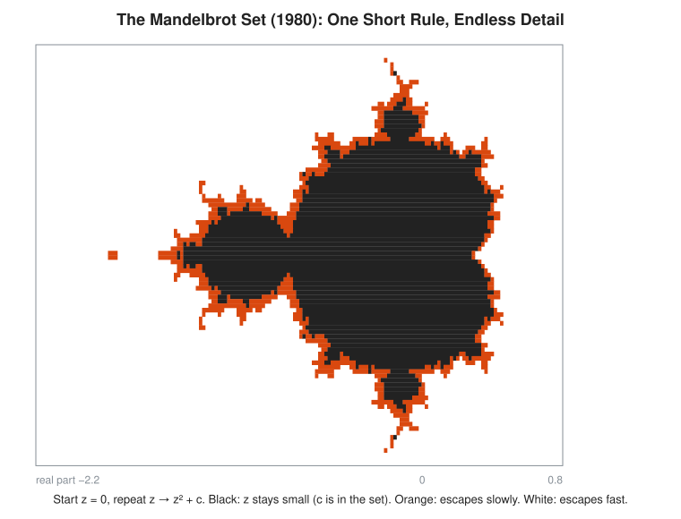
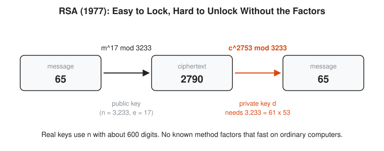
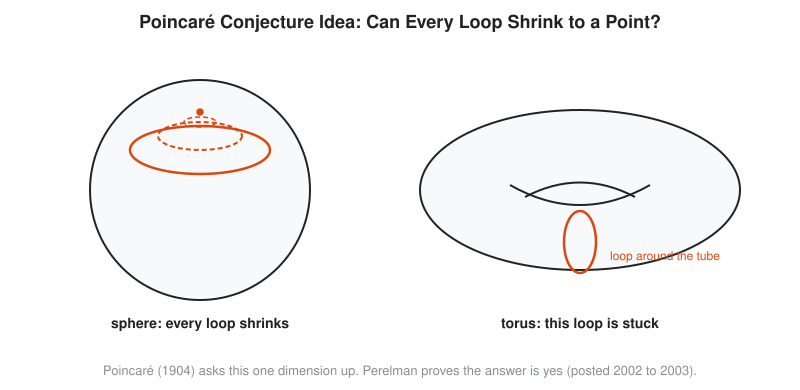

# 10 Modern Mathematics

**Era:** about 1970 to today · **Reading time:** about 25 minutes · **Previous:** [09 20th-Century Foundations and Computing](../09-20th-century-foundations-and-computing/README.md) · **Next:** [Story of an Idea](../story-of-an-idea/README.md)

## The Big Idea

Computers become a partner in mathematics: they draw pictures nobody can draw by hand, check cases nobody can check by hand, and now check whole proofs line by line. Old number theory turns into the lock on every web browser. Meanwhile some of the oldest open problems, Fermat and Poincaré among them, finally fall to human proofs.

## The World at That Time

From 1970 the computer leaves the basement. Minicomputers sit in university departments, the personal computer arrives in the late 1970s, and ARPANET (1969) grows into the internet. The web (1991) puts banking and shopping online, and each of those connections needs a secret shared between strangers who have never met.

Science turns into computation. Weather and climate models, crash simulations, and nuclear physics run on supercomputers. Finance prices options with differential equations (the Black-Scholes model, 1973). Biology reads genomes: the Human Genome Project finishes in 2003, and assembling a genome from millions of short fragments is a problem in strings, graphs, and statistics. By the 2010s data is everywhere, and statistics, linear algebra, and optimization grow into data science and machine learning.

```txt
  need                       mathematics it pulls in
  -------------------------  ---------------------------------------------
  internet security          number theory, modular arithmetic, elliptic curves
  weather and physics        differential equations, numerical methods, chaos
  finance                    probability, stochastic calculus, optimization
  biology and genomes        statistics, graph algorithms, string matching
  data and machine learning  linear algebra, calculus, probability, optimization
```

## Key People

| Person | Dates | One-Line Contribution |
| --- | --- | --- |
| Edward Lorenz | 1917 to 2008 | Finds chaos in a simple weather model (1963) |
| Benoit Mandelbrot | 1924 to 2010 | Names fractals and draws the Mandelbrot set (1980) |
| Whitfield Diffie and Martin Hellman | born 1944 and 1945 | Publish public-key cryptography and key exchange (1976) |
| Ron Rivest, Adi Shamir, Leonard Adleman | born 1947, 1952, 1945 | Invent the RSA cipher (1977) |
| Clifford Cocks | born 1950 | Finds the same idea as RSA in secret at GCHQ (1973) |
| Kenneth Appel and Wolfgang Haken | 1932 to 2013 and 1928 to 2022 | Prove the four color theorem with a computer (1976) |
| [Paul Erdős](../biographies/erdos.md) | 1913 to 1996 | About 1,500 papers with about 500 coauthors: mathematics as a social network |
| [Alexander Grothendieck](../biographies/grothendieck.md) | 1928 to 2014 | Rebuilds algebraic geometry on schemes; Fields Medal 1966 |
| Andrew Wiles | born 1953 | Proves Fermat's Last Theorem (1994, published 1995) |
| Grigori Perelman | born 1966 | Proves the Poincaré conjecture (2002 to 2003) and declines the prizes |
| Thomas Hales | born 1958 | Proves the Kepler conjecture (1998) and leads its formal check (2014) |
| [Maryam Mirzakhani](../biographies/mirzakhani.md) | 1977 to 2017 | Geometry of curved surfaces; first woman to win the Fields Medal (2014) |
| Peter Scholze | born 1987 | Sets the challenge behind the Liquid Tensor Experiment (2020) |

## Key Ideas

### Computers Change How Mathematics Is Done

For most of history a mathematician works with a pencil, and a hard calculation takes a week. A computer does it in a second. That changes what mathematicians try. **Numerical methods**, step-by-step recipes that approximate answers to equations with no exact formula, let engineers solve the equations of airflow and heat directly. **Simulation** runs a model forward in time to see what happens. **Experimental mathematics** uses the computer to find patterns first and proofs later. In 1995 David Bailey, Peter Borwein, and Simon Plouffe find by computer search a formula that computes any hexadecimal digit of pi without computing the digits before it.

The computer also shows things nobody expects. In 1961 the meteorologist Edward Lorenz reruns a weather simulation and types 0.506 instead of 0.506127 to save time. Within a few simulated months the new forecast has nothing in common with the old one. His 1963 paper shows that a deterministic system, with no randomness at all, can still be unpredictable in practice: tiny differences in the start grow exponentially. This is **chaos**. The popular name, the butterfly effect, comes from a 1972 talk. For an SRE the lesson is familiar: two servers with the same config and a one-byte difference in state can end up in very different places.

Benoit Mandelbrot, at IBM, studies shapes that look equally rough at every scale: coastlines, clouds, price charts. In 1975 he names them **fractals**. In 1980 he uses IBM computers to draw the set that now bears his name, and in 1982 he publishes *The Fractal Geometry of Nature*.

<!-- diagram: type=escape-time ref=mandelbrot-1980 range=-2.2..0.8 caption="Mandelbrot set from z -> z^2 + c" -->


The picture is a grid of points c in the plane of **complex numbers** (numbers with a real part, left to right, and an imaginary part, up and down). For each c, start with z = 0 and repeat the rule z → z² + c. Black points are those where z stays small forever: they belong to the set. Orange points escape slowly, white ones escape fast. The axis runs from −2.2 on the left to 0.8 on the right. One line of rule, and the boundary has detail at every zoom level.

```txt
  c = 0.5                                     c = -0.5
  z0 = 0                start                 z0 = 0
  z1 = 0^2 + 0.5        = 0.5                 z1 = -0.5
  z2 = 0.5^2 + 0.5      = 0.75                z2 = 0.25 - 0.5      = -0.25
  z3 = 0.75^2 + 0.5     = 1.0625              z3 = 0.0625 - 0.5    = -0.4375
  z4 = 1.0625^2 + 0.5   = 1.6289              z4 = 0.1914 - 0.5    = -0.3086
  z5 = 1.6289^2 + 0.5   = 3.1533              z5 = 0.0952 - 0.5    = -0.4048
  passes 2: escapes, not in the set           settles near -0.366: in the set
```

Once |z| passes 2 it is guaranteed to run off to infinity. That is the test the code below uses.

### Public-Key Cryptography

For all of history, two people who want to share secrets first meet to agree on a key. That fails on the internet, where your browser talks to a bank it has never met. In 1976 Whitfield Diffie and Martin Hellman publish *New Directions in Cryptography*. Their **key exchange** allows two strangers to agree on a shared secret over a public line.

```txt
  public: prime p = 23, base g = 5            everyone, including the eavesdropper, sees these
  Alice picks secret a = 6                    never sent
  Alice sends A = 5^6 mod 23 = 8              15,625 = 679 x 23 + 8
  Bob picks secret b = 15                     never sent
  Bob sends B = 5^15 mod 23 = 19              computed the same way
  Alice computes B^a = 19^6 mod 23 = 2        her secret times his public number
  Bob computes A^b = 8^15 mod 23 = 2          same number: both equal 5^(6 x 15) mod 23
  eavesdropper sees 23, 5, 8, 19              recovering 6 or 15 from these is the hard part
```

In 1977 Ron Rivest, Adi Shamir, and Leonard Adleman at MIT invent **RSA**, the first practical **public-key** system: a lock anyone can close with a public key, and only the holder of the private key can open. Martin Gardner describes it in *Scientific American* that year with a challenge number of 129 digits. It takes about 600 volunteers and their computers until 1994 to factor it.

There is a twist. At GCHQ, the British signals agency, James Ellis has the idea of non-secret encryption around 1970, and in 1973 Clifford Cocks finds essentially RSA in about half an hour. It stays classified until 1997.

<!-- diagram: type=pipeline ref=rsa-toy caption="Toy RSA: n = 3,233, e = 17, d = 2,753, 65 -> 2,790 -> 65" -->


The picture has three boxes. The message 65 goes through the black arrow, m^17 mod 3233, using the public key (n = 3,233, e = 17), and comes out as 2790. The orange arrow, c^2753 mod 3233, turns 2790 back into 65. The private exponent 2,753 needs the factors 3,233 = 61 × 53. The note says real keys use n with about 600 digits.

Key generation and why it works:

```txt
  p = 61, q = 53                              two secret primes
  n = 61 x 53 = 3,233                         public modulus
  phi = 60 x 52 = 3,120                       (p - 1)(q - 1): needs the factors
  e = 17                                      public exponent, shares no factor with 3,120
  d = 2,753                                   17 x 2,753 = 46,801 = 15 x 3,120 + 1
  encrypt: 65^17 mod 3,233 = 2,790            anyone with the public key
  decrypt: 2,790^2,753 mod 3,233 = 65         m^(ed) = m^(1 + 15 x phi) = m mod n, by Euler
```

Raising 65 to the 17th power by repeated multiplying is slow for real key sizes. **Square-and-multiply** uses the binary digits of the exponent. Here 17 is 10001 in binary, that is 16 + 1:

```txt
  65^1  mod 3,233 = 65                        start
  65^2  mod 3,233 = 4,225 - 3,233 = 992       square
  65^4  mod 3,233 = 992^2 mod 3,233 = 1,232   square
  65^8  mod 3,233 = 1,232^2 mod 3,233 = 1,547 square
  65^16 mod 3,233 = 1,547^2 mod 3,233 = 789   square
  65^17 = 65^16 x 65^1 = 789 x 65 = 51,285    multiply the powers where binary 17 has a 1
  51,285 mod 3,233 = 2,790                    51,285 - 15 x 3,233 = 2,790
```

Four squarings and one multiply instead of 16 multiplies. For a 2,048-bit exponent it is about 2,048 squarings instead of an astronomical count. Security rests on a gap: multiplying two large primes is easy, and no known method on ordinary computers factors their 617-digit product in any useful time. Every TLS handshake on your load balancers stands on that gap, though modern TLS mostly uses elliptic-curve versions of the Diffie-Hellman idea.

### Proofs With Computers, and Proofs Checked by Computers

In 1852 Francis Guthrie asks whether four colors always suffice to color a map such that regions sharing a border get different colors. Alfred Kempe publishes a proof in 1879. In 1890 Percy Heawood finds the hole in it.

<!-- diagram: type=map-coloring ref=wheel-5 caption="Center plus ring of five plus outer region needs four colors" -->


The picture shows why three colors are not enough. A ring of five regions surrounds a center. Going around the ring, the colors read 1, 2, 1, 2, and then the fifth region touches both a 1 and a 2 and needs color 3. The center touches all five ring regions and needs a fourth color. The outer region touches only the ring, and it reuses color 4.

```txt
  ring region 1: color 1                      any start
  ring region 2: color 2                      touches region 1
  ring region 3: color 1                      touches region 2 only, among those colored
  ring region 4: color 2                      touches region 3
  ring region 5: color 3                      touches region 4 (color 2) and region 1 (color 1)
  center:        color 4                      touches colors 1, 2, and 3
  outer region:  color 4                      touches the ring, not the center
  odd ring + hub needs 4 colors; an even ring + hub needs only 3
```

In 1976 Kenneth Appel and Wolfgang Haken at the University of Illinois prove that four colors always suffice. Their proof reduces every possible map to one of almost 2,000 special configurations and then checks each one by computer, using over 1,200 hours of machine time. Many mathematicians are uneasy: no human reads the whole proof. In 1996 Neil Robertson, Daniel Sanders, Paul Seymour, and Robin Thomas give a cleaner version with 633 configurations. In 2005 Georges Gonthier checks the whole proof in the Coq **proof assistant**, a program that accepts a proof only if every step follows from the rules.

The Kepler conjecture (1611) says that the grocer's stacking of oranges is the densest way to pack equal spheres. Thomas Hales, with Samuel Ferguson, proves it in 1998 with heavy computer work. The referees report that they are very sure but cannot check everything. Hales responds by leading Flyspeck, a project to check the proof in proof assistants, finished in 2014. Think of it as moving from code review to a type checker that rejects the build on any error.

Proof assistants keep growing. **Lean**, started by Leonardo de Moura at Microsoft Research in 2013, gains a large shared library, mathlib. In December 2020 Peter Scholze challenges the Lean community to check a hard theorem of his own work with Dustin Clausen, since he is not fully sure of it himself. The **Liquid Tensor Experiment** checks the key part by mid-2021 and finishes in 2022. In 2023 a new proof of the polynomial Freiman-Ruzsa conjecture, by Tim Gowers, Ben Green, Freddie Manners, and Terence Tao, is checked in Lean within about three weeks. In 2024 and 2025 AI systems reach medal-level scores on International Mathematical Olympiad problems. How much such systems change research mathematics is still an open question, and the honest answer in the mid-2020s is: some, and growing, but nobody knows the end state.

### Old Problems Fall

The late 20th century solves problems that resisted centuries.

**Fermat's Last Theorem.** Around 1637 Pierre de Fermat writes in a margin that $x^n + y^n = z^n$ has no solutions in positive whole numbers when n is greater than 2. For n = 2 there are plenty, for example $3^2 + 4^2 = 9 + 16 = 25 = 5^2$. In 1986 Ken Ribet shows that Fermat follows from a special case of a deep conjecture linking elliptic curves and modular forms. Andrew Wiles works on that case for about seven years, mostly in secret, and announces a proof in Cambridge in June 1993. A gap appears. With help from his former student Richard Taylor he repairs it in September 1994, and the proof appears in 1995.

**Finite simple groups.** A **group** is the math of symmetry. **Simple** groups are the ones that do not break into smaller pieces, the way primes do not break into smaller factors. Their classification says every finite simple group belongs to one of 18 infinite families or is one of 26 exceptional **sporadic** groups. The largest, the Monster, has about $8 \times 10^{53}$ elements. The proof fills tens of thousands of journal pages by about a hundred authors. It is largely complete by the early 1980s, and the last gap is closed in 2004 by Michael Aschbacher and Stephen Smith.

**The Poincaré conjecture.** On the surface of a ball, any loop of string slides off to a point. On the surface of a doughnut, some loops cannot.

<!-- diagram: type=topology ref=sphere-vs-torus caption="A loop shrinks on a sphere but is stuck around a torus" -->


On the left of the picture, an orange loop on a sphere shrinks through smaller dashed loops to a single point. On the right, an orange loop wraps around the tube of a torus, the doughnut surface. It cannot shrink without leaving the surface. In 1904 Henri Poincaré asks the same question one dimension up: if a closed three-dimensional space (finite, with no edge) has the property that every loop shrinks to a point, is it just a stretched version of the three-dimensional sphere? Perelman proves the answer is yes in three preprints posted in 2002 and 2003, building on Richard Hamilton's **Ricci flow**, a way of letting a shape smooth itself out the way heat spreads.

Topologists also tell shapes apart with numbers that do not change under stretching. The simplest is the **Euler characteristic**: draw the surface as a net of vertices, edges, and faces, and compute V − E + F.

```txt
  cube (a sphere, stretched)
  V = 8                                       corners
  E = 12                                      edges
  F = 6                                       faces
  V - E + F = 8 - 12 + 6 = 2                  every net on a sphere gives 2

  torus from a 3 x 3 grid of squares, opposite edges glued
  V = 9                                       gluing merges the border corners
  E = 18                                      two edges per corner
  F = 9                                       nine squares
  V - E + F = 9 - 18 + 9 = 0                  every net on a torus gives 0: a different shape
```

Perelman declines the Fields Medal in 2006 and the million-dollar Millennium Prize in 2010. The Clay Mathematics Institute names its seven **Millennium Prize Problems** in 2000, at one million dollars each: P versus NP, the Riemann hypothesis, the Poincaré conjecture, Navier-Stokes, Yang-Mills, Hodge, and Birch and Swinnerton-Dyer. **P versus NP** asks whether every problem whose answers are quick to check is also quick to solve. Checking a factorization of 3,233 takes one multiplication. Finding it takes a search. As of the mid-2020s, Poincaré is the only one solved.

The people change too. Paul Erdős has no home and no job for decades. He travels with a suitcase from one collaborator to the next and writes about 1,500 papers with about 500 coauthors. Mathematicians measure their distance from him in the collaboration graph, the **Erdős number**: a coauthor of Erdős has number 1, their coauthors have 2, and onward. It is a breadth-first search on a social network.

```txt
  Erdős --- Ana --- Ben                       Ana: 1, Ben: 2 (shortest path length)
    |
   Dee --- Cy                                 Dee: 1, Cy: 2
```

Alexander Grothendieck rebuilds algebraic geometry in the 1960s on **schemes**, a language general enough that later proofs, including the road to Fermat, run on it. He wins the Fields Medal in 1966, leaves his institute in 1970 over military funding, and in 1991 withdraws to a village in the Pyrenees. Maryam Mirzakhani studies the geometry of curved surfaces with holes and counts their shortest closed loops. In 2014 she becomes the first woman to win the Fields Medal. She dies in 2017, age 40.

## What It Unlocked Next

* Public-key cryptography runs the secure internet, and the threat of quantum computers drives new post-quantum schemes based on lattices.
* Chaos theory changes weather forecasting: forecasters run many slightly different starts, an ensemble, and report probabilities.
* Proof assistants and AI tools start to change how proofs are written, checked, and shared.
* Statistics, linear algebra, and calculus become the core of data science and machine learning, where training a model is minimizing an error function by gradient descent.
* The open Millennium Problems, P versus NP above all, remain the map of what is still unknown. Continue with the cross-era essays in [Story of an Idea](../story-of-an-idea/README.md).

## Connects To

* [Course 601: Proof and Higher Math](../../course/601/README.md): modular arithmetic, Fermat's little theorem, groups, and a topology taster.
* [Course 501: Linear Algebra, Probability and Discrete Math](../../course/501/README.md): graphs, coloring, and the linear algebra behind machine learning.
* [Number theory track](../../tracks/number-theory/README.md): the math under RSA and Fermat's Last Theorem.
* [Graph theory track](../../tracks/graph-theory/README.md): map coloring as graph coloring, and collaboration graphs.
* [Complex analysis track](../../tracks/complex-analysis/README.md): the complex plane where the Mandelbrot set lives.
* [Topology track](../../tracks/topology/README.md): loops, spheres, tori, and the Euler characteristic.
* [Abstract algebra track](../../tracks/abstract-algebra/README.md): groups and the classification of finite simple groups.
* [Differential equations track](../../tracks/differential-equations/README.md): Lorenz equations and chaos.
* [Statistics track](../../tracks/statistics/README.md): the road to data science.
* [Story of proof](../story-of-an-idea/proof.md): what counts as a proof when a computer does part of it.
* Biographies: [Erdős](../biographies/erdos.md), [Grothendieck](../biographies/grothendieck.md), [Mirzakhani](../biographies/mirzakhani.md), and [Fermat](../biographies/fermat.md) for the margin note that started it all.

## Try It

1. Toy RSA by hand: take p = 5 and q = 11, e = 3. Compute n, phi, and d. Encrypt m = 2 and decrypt the result.
2. Compute 3^13 mod 7 by square-and-multiply. Write 13 in binary first.
3. A map has a center region surrounded by a ring of four regions, each touching its two neighbors and the center. How many colors does it need?
4. Iterate z → z² + c from z = 0 for c = −1 and for c = 1. Which c is in the Mandelbrot set?
5. Do the same for c = i, where i² = −1. Is i in the set?
6. Chaos in miniature: the doubling map sends x to 2x, dropping any whole part (0.6 goes to 0.2). Start at 0.1 and at 0.11 and apply it five times. How does the gap behave?
7. A torus is built from a 4 by 4 grid of squares with opposite edges glued: V = 16, E = 32, F = 16. Compute V − E + F. Does it match the 3 by 3 case?
8. Ana coauthors with Erdős. Ben coauthors with Ana. Cy coauthors with Ben and with Dee. Dee coauthors with Erdős. Eve coauthors only with Cy. Give everyone their Erdős number.

<details>
<summary>Answers</summary>

1. n = 55, phi = 4 x 10 = 40, d = 27 because 3 x 27 = 81 = 2 x 40 + 1; 2^3 = 8, and 8^27 mod 55 = 2 brings the message back.
2. 13 = 1101 in binary, that is 8 + 4 + 1; 3^1 = 3, 3^2 = 2, 3^4 = 4, 3^8 = 2 (all mod 7), and 2 x 4 x 3 = 24 = 3 mod 7: the answer is 3.
3. Three: the even ring alternates two colors and the center takes a third.
4. c = −1 gives 0, −1, 0, −1, ... and stays bounded: in the set. c = 1 gives 1, 2, 5, 26, 677, ... and escapes: not in the set.
5. z goes i, −1 + i, −i, −1 + i, −i, ... and cycles forever: i is in the set.
6. 0.1, 0.2, 0.4, 0.8, 0.6, 0.2 against 0.11, 0.22, 0.44, 0.88, 0.76, 0.52: the gap doubles each step, 0.01 to 0.32.
7. 16 − 32 + 16 = 0, the same as the 3 by 3 grid: the number depends on the shape, not the net.
8. Ana 1, Dee 1, Ben 2, Cy 2 (through Dee), Eve 3.

</details>

## Code Corner

The program [code/main.go](code/main.go) does four things. It builds the toy RSA key from 61 and 53 with `math/big`, encrypts 65, and decrypts. It shows square-and-multiply on 65^17 mod 3233 step by step. It brute-forces colorings of the wheel map (center 0, ring 1 to 5, outer region 6) with two, three, and four colors. It prints an ASCII Mandelbrot set.

Square-and-multiply in a few lines:

```go
func powMod(base, exp, m int64, show bool) int64 {
	result, sq := int64(1), base%m
	for e := exp; e > 0; e >>= 1 {
		if e&1 == 1 {
			result = result * sq % m
		}
		sq = sq * sq % m
	}
	return result
}
```

The RSA part leans on `math/big`:

```go
n := new(big.Int).Mul(p, q)
phi := new(big.Int).Mul(new(big.Int).Sub(p, one), new(big.Int).Sub(q, one))
d := new(big.Int).ModInverse(e, phi)
c := new(big.Int).Exp(m, e, n)
back := new(big.Int).Exp(c, d, n)
```

The Mandelbrot loop stops when |z|² passes 4, that is |z| passes 2, and picks a character by how long z survives:

```go
for ; i < 50 && zr*zr+zi*zi <= 4; i++ {
	zr, zi = zr*zr-zi*zi+cr, 2*zr*zi+ci
}
row.WriteByte(" .:-=+*%#@"[min(i, 50)*9/50])
```

Run it:

```txt
cd code && go run main.go
```

Output:

```txt
Toy RSA: n = 3233, phi = 3120, e = 17, d = 2753
  encrypt 65 -> 2790, decrypt 2790 -> 65

Square-and-multiply: 65^17 mod 3233 (17 = binary 10001)
  bit 1  square =   65  result =   65
  bit 0  square =  992  result =   65
  bit 0  square = 1232  result =   65
  bit 0  square = 1547  result =   65
  bit 1  square =  789  result = 2790
  answer: 2790

Wheel map (center, ring of 5, outer region)
  2 colors:    0 colorings  first: []
  3 colors:    0 colorings  first: []
  4 colors:  120 colorings  first: [1 2 3 2 3 4 1]

Mandelbrot set, real -2.2..0.8, imaginary -1.2..1.2

                                       ....
                                       ...-..
                                    ...-:@@--.
                                .......:@@@@:.......
                             ...:%@:=@@@@@@@@@@-:::::
                           ....#:@@@@@@@@@@@@@@@@@-...
                 ..:...:......@@@@@@@@@@@@@@@@@@@@@@+:
                 ...-@+@@@+:::@@@@@@@@@@@@@@@@@@@@@@=.
           .....%.:*@@@@@@@@@=@@@@@@@@@@@@@@@@@@@@@@..
    @@@@@@@@@@@@@@@@@@@@@@@@@@@@@@@@@@@@@@@@@@@@@@:...
           .....%.:*@@@@@@@@@=@@@@@@@@@@@@@@@@@@@@@@..
                 ...-@+@@@+:::@@@@@@@@@@@@@@@@@@@@@@=.
                 ..:...:......@@@@@@@@@@@@@@@@@@@@@@+:
                           ....#:@@@@@@@@@@@@@@@@@-...
                             ...:%@:=@@@@@@@@@@-:::::
                                .......:@@@@:.......
                                    ...-:@@--.
                                       ...-..
                                       ....

```

The coloring count is 120: four choices for the center, 30 ways to color the odd ring with the other three colors, and then the outer region has exactly one choice left, the center color. The first coloring found puts color 1 on both the center and the outer region, which never touch.

## Flashcards

Anki deck in [cards.tsv](cards.tsv) (tab-separated: front, back, tags).

## Go Deeper

* [MacTutor: The four colour theorem](https://mathshistory.st-andrews.ac.uk/HistTopics/The_four_colour_theorem/): from Guthrie to Appel and Haken.
* [MacTutor: Fermat's last theorem](https://mathshistory.st-andrews.ac.uk/HistTopics/Fermat%27s_last_theorem/): 350 years of attempts.
* [MacTutor: Fractals](https://mathshistory.st-andrews.ac.uk/HistTopics/fractals/): the history behind Mandelbrot's pictures.
* [MacTutor biography of Grigori Perelman](https://mathshistory.st-andrews.ac.uk/Biographies/Perelman/): the Poincaré conjecture and the declined prizes.
* [MacTutor biography of Andrew Wiles](https://mathshistory.st-andrews.ac.uk/Biographies/Wiles/): seven years on one problem.
* [MacTutor biography of Maryam Mirzakhani](https://mathshistory.st-andrews.ac.uk/Biographies/Mirzakhani/): geometry of surfaces and the 2014 Fields Medal.
