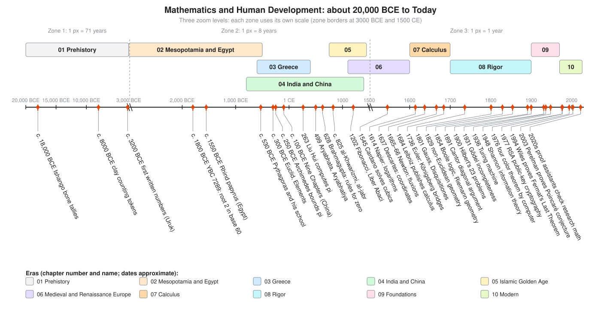

# History of Math

Math is not handed down from a mountain. People build it, piece by piece, because they have a problem in front of them: count the herd, split the harvest, tax the field, predict the flood, steer the ship, aim the cannon, break the code. This section tells that story from a notched bone about 20,000 years old to proofs checked by computers today. Every chapter draws the original methods the way people actually used them, and then shows where each one lives in the rest of this course.

## Four Ways In

Pick the door that suits your mood. They all lead to the same rooms.

| Door | Start here | Best when you want |
|---|---|---|
| **By era** | [The ten chapters](#by-era) | The full story in order, with the world around each idea |
| **By idea** | [Story of an Idea](story-of-an-idea/README.md) | One concept (zero, pi, infinity, notation, proof) followed across all eras |
| **By person** | [Biographies](biographies/README.md) | Thirty short lives with a life timeline and one idea worked small |
| **By place** | [The map](#by-place) | Where it all happened, from Ishango to Princeton |

New to all of this? Read this page, then Chapter 01, then let curiosity drive.

## The Big Picture

<!-- diagram: type=timeline range=-20000..2026 zones="-20000..-3000,-3000..1500,1500..2030" eras=10 events=33 caption="Mathematics and human development, about 20,000 BCE to today" -->

The timeline has three zoom levels, because the story speeds up. The first zone squeezes 17,000 years of prehistory into a short stretch: one pixel is about 71 years. The middle zone covers the ancient and medieval world at about 8 years per pixel. The last zone stretches 1500 to today to about one year per pixel, because that is where most of the dots crowd in. The colored bands above the axis are the ten chapters. Some bands overlap: Greece, India and China work at the same time, mostly unaware of each other. The orange ticks below the axis are key events, with leader lines fanned out to keep the labels readable.

## How Math Grew With People

Each step in the story starts with a need. Math answers it, and the answer opens the next door.

<!-- diagram: type=flow rows=9 caption="Human needs and the math they produced" -->

A short version of the whole story:

1. **Counting before writing.** Hunters and herders match things one to one: a pebble per sheep, a notch per day. Groups of five, ten, twenty or sixty come from hands and feet. ([Chapter 01](01-prehistory-and-counting/README.md))
2. **Cities need accountants.** Farming makes surpluses, surpluses make taxes, and taxes need records. Mesopotamian scribes invent place value in base 60. Egyptian scribes multiply by doubling and survey fields after the Nile floods. ([Chapter 02](02-mesopotamia-and-egypt/README.md))
3. **Greeks ask why.** Greek thinkers turn recipes into proofs from axioms, and measure the Earth with a stick and a shadow. ([Chapter 03](03-ancient-greece/README.md))
4. **India and China build the number system you use.** Place value with zero, negative numbers, efficient algorithms, and infinite series for pi. ([Chapter 04](04-india-and-china/README.md))
5. **Baghdad collects, translates and invents.** Algebra gets its name and its methods. Trigonometry grows to find the direction of Mecca and the time of prayer. ([Chapter 05](05-islamic-golden-age/README.md))
6. **European merchants switch digits.** Fibonacci teaches the new numerals. Bankers, printers and gunners push algebra forward until the cubic falls. ([Chapter 06](06-medieval-and-renaissance-europe/README.md))
7. **Motion becomes math.** Logarithms speed up astronomy. Coordinates join algebra to geometry. Calculus describes change. ([Chapter 07](07-scientific-revolution-and-calculus/README.md))
8. **Rigor.** Calculus works, but nobody can say exactly why. The 1700s and 1800s rebuild it on firm ground, invent new geometries, and discover infinities of different sizes. ([Chapter 08](08-18th-and-19th-century-rigor/README.md))
9. **Foundations crack, computers appear.** Paradoxes shake set theory. Gödel shows proof has limits. Turing defines computation, and wartime needs build the first computers. ([Chapter 09](09-20th-century-foundations-and-computing/README.md))
10. **Math with machines.** Computer proofs, public-key cryptography, chaos and fractals, and the end of famous centuries-old problems. ([Chapter 10](10-modern-mathematics/README.md))

A pattern worth noticing: almost every big idea arrives twice. Once as a practical trick, and later as a theory that explains why the trick works. Babylonians compute square roots 1,500 years before anyone proves $\sqrt{2}$ is irrational. Engineers use calculus for 150 years before Cauchy can define a limit. It is the same story as a production fix that works for months before someone writes the design doc.

## By Era

| # | Chapter | Era | The question people need answered | Methods drawn in the chapter |
|---|---|---|---|---|
| 01 | [Prehistory and Counting](01-prehistory-and-counting/README.md) | about 40,000 to 3000 BCE | How many, and is anything missing? | Ishango bone, pebble matching, knuckle counting to 60 |
| 02 | [Mesopotamia and Egypt](02-mesopotamia-and-egypt/README.md) | about 3200 to 300 BCE | How much grain, land and tax? | Tablet YBC 7289, cuneiform base 60, square roots, Egyptian doubling, unit fractions |
| 03 | [Ancient Greece](03-ancient-greece/README.md) | about 600 BCE to 415 CE | Why is it true? | Euclid I.1, Pythagoras by rearrangement, Archimedes' polygons, Eratosthenes' Earth |
| 04 | [India and China](04-india-and-china/README.md) | about 800 BCE to 1400s | How do we calculate fast and exactly? | Brahmagupta's zero rules, place value, counting rods, the gougu diagram, Madhava's series |
| 05 | [The Islamic Golden Age](05-islamic-golden-age/README.md) | about 750 to 1450 | How do we solve for the unknown? | al-Khwarizmi completing the square (two ways), Khayyam's cubic |
| 06 | [Medieval and Renaissance Europe](06-medieval-and-renaissance-europe/README.md) | about 1100 to 1600 | How do merchants calculate and bankers keep books? | Fibonacci's rabbits and ratios, lattice multiplication, Roman versus Hindu-Arabic |
| 07 | [The Scientific Revolution and Calculus](07-scientific-revolution-and-calculus/README.md) | about 1600 to 1700 | How do things move? | Descartes' coordinates, tangents and areas, slide rule logarithms, Pascal's triangle |
| 08 | [The 18th and 19th Centuries: Rigor](08-18th-and-19th-century-rigor/README.md) | about 1700 to 1900 | Why does calculus work, and what else is possible? | Königsberg bridges, Gauss's pairing, a triangle on a sphere, Cantor's diagonal and fraction list |
| 09 | [20th-Century Foundations and Computing](09-20th-century-foundations-and-computing/README.md) | about 1900 to 1970 | What can be proved, and what can be computed? | Russell's paradox, Turing machine, stored-program computer, bits |
| 10 | [Modern Mathematics](10-modern-mathematics/README.md) | about 1970 to today | What can computers and math do together? | Four color map, toy RSA, Mandelbrot set, loops on a sphere and a torus |

Every chapter follows the same shape: the world at that time, key people, key ideas with diagrams of the historical methods, what it unlocked next, links into the [course](../course/README.md) and [tracks](../tracks/README.md), exercises with answers, a Go Code Corner, flashcards, and further reading.

## By Idea

Five essays trace one concept through every era: [Story of an Idea](story-of-an-idea/README.md).

* [The Story of Zero](story-of-an-idea/zero.md): from an empty column to half of every computer.
* [The Story of Pi](story-of-an-idea/pi.md): from 3.16 to trillions of digits.
* [The Story of Infinity](story-of-an-idea/infinity.md): from Zeno to infinities of different sizes.
* [The Story of Algebraic Notation](story-of-an-idea/notation.md): from sentences to symbols.
* [The Story of Proof](story-of-an-idea/proof.md): from recipes to machine-checked certainty.

Other ideas, and where to follow them:

| Idea | Chapters, in order |
|---|---|
| Place value and number systems | [01](01-prehistory-and-counting/README.md), [02](02-mesopotamia-and-egypt/README.md), [04](04-india-and-china/README.md), [06](06-medieval-and-renaissance-europe/README.md) |
| The Pythagorean theorem | [02](02-mesopotamia-and-egypt/README.md), [03](03-ancient-greece/README.md), [04](04-india-and-china/README.md) |
| Solving equations | [02](02-mesopotamia-and-egypt/README.md), [05](05-islamic-golden-age/README.md), [06](06-medieval-and-renaissance-europe/README.md), [08](08-18th-and-19th-century-rigor/README.md) |
| Negative and complex numbers | [04](04-india-and-china/README.md), [06](06-medieval-and-renaissance-europe/README.md), [08](08-18th-and-19th-century-rigor/README.md) |
| Calculus and limits | [03](03-ancient-greece/README.md), [04](04-india-and-china/README.md), [07](07-scientific-revolution-and-calculus/README.md), [08](08-18th-and-19th-century-rigor/README.md) |
| Probability and statistics | [06](06-medieval-and-renaissance-europe/README.md), [07](07-scientific-revolution-and-calculus/README.md), [08](08-18th-and-19th-century-rigor/README.md), [09](09-20th-century-foundations-and-computing/README.md) |
| Graphs and networks | [08](08-18th-and-19th-century-rigor/README.md), [10](10-modern-mathematics/README.md) |
| Computation and algorithms | [02](02-mesopotamia-and-egypt/README.md), [05](05-islamic-golden-age/README.md), [09](09-20th-century-foundations-and-computing/README.md), [10](10-modern-mathematics/README.md) |
| Cryptography | [09](09-20th-century-foundations-and-computing/README.md), [10](10-modern-mathematics/README.md) |

## By Person

[Thirty biographies](biographies/README.md), each with a life timeline, from Euclid (c. 325 to c. 265 BCE) to Maryam Mirzakhani (1977 to 2017). The biographies page has a chart of all thirty life spans side by side, which shows at a glance whose lives overlap.

## By Place

<!-- diagram: type=map points=23 projection=equirectangular lon=-105..125 lat=-10..65 caption="Where math grew" -->

The dots sit at their true latitude and longitude. The coastlines are rough sketches, good enough to show where things are and no more. Watch the center of gravity move. It starts in Africa and the river valleys of the Middle East, spreads to the Mediterranean, India and China, gathers in Baghdad, then moves to Italy, to northern Europe, and in the 1930s partly across the Atlantic as scholars flee Nazi Germany.

| Place | What happens there | Chapters |
|---|---|---|
| Ishango (DR Congo) | The notched Ishango bone, about 20,000 years old | [01](01-prehistory-and-counting/README.md) |
| Uruk, Babylon (Iraq) | First written numbers, base 60, tablet YBC 7289 | [02](02-mesopotamia-and-egypt/README.md) |
| Thebes (Egypt) | Where the Rhind papyrus is said to have been found | [02](02-mesopotamia-and-egypt/README.md) |
| Alexandria (Egypt) | Euclid, Eratosthenes, Diophantus, Hypatia | [03](03-ancient-greece/README.md) |
| Athens, Syracuse | Plato's Academy; Archimedes | [03](03-ancient-greece/README.md) |
| Pataliputra, Ujjain, Kerala (India) | Aryabhata, Brahmagupta, the Kerala school of Madhava | [04](04-india-and-china/README.md) |
| Luoyang (China) | Liu Hui's commentary on the *Nine Chapters* | [04](04-india-and-china/README.md) |
| Maya cities (Mesoamerica) | A zero in the Long Count calendar | [04](04-india-and-china/README.md) |
| Baghdad (Iraq) | The House of Wisdom; al-Khwarizmi | [05](05-islamic-golden-age/README.md) |
| Nishapur, Samarkand | Omar Khayyam; al-Kashi and Ulugh Beg's observatory | [05](05-islamic-golden-age/README.md) |
| Pisa (Italy) | Fibonacci's *Liber Abaci* | [06](06-medieval-and-renaissance-europe/README.md) |
| Paris, Cambridge | Descartes, Pascal, Fermat's letters; Newton; later Turing | [07](07-scientific-revolution-and-calculus/README.md), [08](08-18th-and-19th-century-rigor/README.md), [09](09-20th-century-foundations-and-computing/README.md) |
| Basel, St Petersburg, Königsberg | Euler and the Bernoullis; the seven bridges | [08](08-18th-and-19th-century-rigor/README.md) |
| Göttingen (Germany) | Gauss, Riemann, Hilbert, Noether | [08](08-18th-and-19th-century-rigor/README.md), [09](09-20th-century-foundations-and-computing/README.md) |
| Vienna (Austria) | Gödel and the Vienna Circle | [09](09-20th-century-foundations-and-computing/README.md) |
| Princeton (USA) | Einstein, von Neumann, Gödel, Turing's PhD; Wiles | [09](09-20th-century-foundations-and-computing/README.md), [10](10-modern-mathematics/README.md) |

MacTutor also has an [interactive birthplace map](https://mathshistory.st-andrews.ac.uk/Map/) of thousands of mathematicians.

## Flashcards

Every chapter folder has a `cards.tsv` Anki deck (tab-separated: front, back, tags, no header). So do [Story of an Idea](story-of-an-idea/cards.tsv) and [Biographies](biographies/cards.tsv). In Anki, choose File, Import, pick the file, and set the field separator to Tab.

## Go Deeper

* [MacTutor History of Mathematics](https://mathshistory.st-andrews.ac.uk/): the standard free reference, with biographies and topic essays. Most links in this section point there.
* [MacTutor: An Overview of the History of Mathematics](https://mathshistory.st-andrews.ac.uk/HistTopics/History_overview/): a one-page tour.
* [Euclid's Elements, Clark University edition](https://mathcs.clarku.edu/~djoyce/elements/): every proposition with diagrams.
* [Resources](../resources/README.md): the wider reading list for the whole course.
