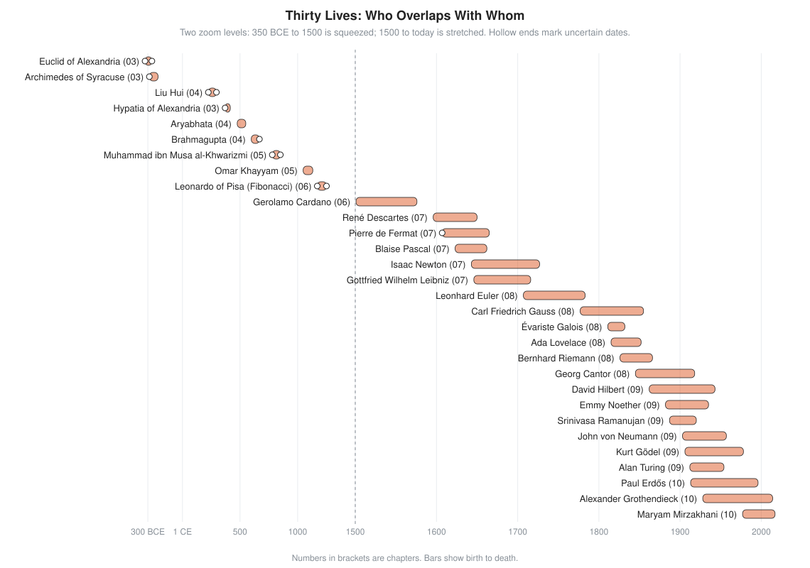

# Biographies

Thirty short lives, from Euclid to Maryam Mirzakhani. Each page has a life timeline (no portraits: few of the early faces are known, and the late ones are easy to find), what the person did in plain words, one key idea worked small, a human detail, and links.

## Who Overlaps With Whom

<!-- diagram: type=lifespans people=30 zones="-350..1500,1500..2025" caption="Life spans of 30 mathematicians" -->

Read the chart top to bottom. The ancient lives sit far apart: Euclid and Fibonacci are separated by about 1,500 years. After 1600 the bars start to overlap. Newton and Leibniz live at the same time and fight over who invented calculus. Euler is born before Newton dies. Gauss is six years old when Euler dies. Mathematics turns from a relay race into a crowd.

## By Era

| Person | Lived | One line | Chapter |
|---|---|---|---|
| [Euclid](euclid.md) | c. 325 to c. 265 BCE | Organizes geometry into one chain of proofs, the *Elements* | [03](../03-ancient-greece/README.md) |
| [Archimedes](archimedes.md) | c. 287 to 212 BCE | Traps pi between polygons; areas and volumes by exhaustion | [03](../03-ancient-greece/README.md) |
| [Hypatia](hypatia.md) | c. 370 to 415 | Teaches and edits the great Greek texts in Alexandria | [03](../03-ancient-greece/README.md) |
| [Liu Hui](liu-hui.md) | c. 225 to c. 295 | Adds proofs to the *Nine Chapters*; pi as 3.1416 | [04](../04-india-and-china/README.md) |
| [Aryabhata](aryabhata.md) | 476 to 550 | A verse textbook with place value, pi and sine tables | [04](../04-india-and-china/README.md) |
| [Brahmagupta](brahmagupta.md) | 598 to c. 668 | First rules for zero and negative numbers | [04](../04-india-and-china/README.md) |
| [al-Khwarizmi](al-khwarizmi.md) | c. 780 to c. 850 | Gives algebra its name and the word algorithm | [05](../05-islamic-golden-age/README.md) |
| [Omar Khayyam](omar-khayyam.md) | 1048 to 1131 | Solves cubics where curves cross; reforms the calendar | [05](../05-islamic-golden-age/README.md) |
| [Fibonacci](fibonacci.md) | c. 1170 to c. 1250 | Brings Hindu-Arabic digits to European merchants | [06](../06-medieval-and-renaissance-europe/README.md) |
| [Cardano](cardano.md) | 1501 to 1576 | Publishes the cubic formula; first book on chance | [06](../06-medieval-and-renaissance-europe/README.md) |
| [Descartes](descartes.md) | 1596 to 1650 | Names points with numbers: coordinate geometry | [07](../07-scientific-revolution-and-calculus/README.md) |
| [Fermat](fermat.md) | c. 1607 to 1665 | Coordinates, probability, number theory, all by letter | [07](../07-scientific-revolution-and-calculus/README.md) |
| [Pascal](pascal.md) | 1623 to 1662 | Calculating machine; founds probability with Fermat | [07](../07-scientific-revolution-and-calculus/README.md) |
| [Newton](newton.md) | 1643 to 1727 | Calculus and the laws of motion and gravity | [07](../07-scientific-revolution-and-calculus/README.md) |
| [Leibniz](leibniz.md) | 1646 to 1716 | Calculus with the notation still in use; binary numbers | [07](../07-scientific-revolution-and-calculus/README.md) |
| [Euler](euler.md) | 1707 to 1783 | The most productive mathematician; graph theory; modern notation | [08](../08-18th-and-19th-century-rigor/README.md) |
| [Gauss](gauss.md) | 1777 to 1855 | Number theory, least squares, curved surfaces | [08](../08-18th-and-19th-century-rigor/README.md) |
| [Lovelace](lovelace.md) | 1815 to 1852 | First published program for a general-purpose computer | [08](../08-18th-and-19th-century-rigor/README.md) |
| [Galois](galois.md) | 1811 to 1832 | Group theory, the math of symmetry, at age 20 | [08](../08-18th-and-19th-century-rigor/README.md) |
| [Riemann](riemann.md) | 1826 to 1866 | Curved geometry; the Riemann hypothesis about primes | [08](../08-18th-and-19th-century-rigor/README.md) |
| [Cantor](cantor.md) | 1845 to 1918 | Set theory; infinities of different sizes | [08](../08-18th-and-19th-century-rigor/README.md) |
| [Hilbert](hilbert.md) | 1862 to 1943 | 23 problems that set the century's agenda | [09](../09-20th-century-foundations-and-computing/README.md) |
| [Noether](noether.md) | 1882 to 1935 | Symmetry gives conservation laws; modern algebra | [09](../09-20th-century-foundations-and-computing/README.md) |
| [Ramanujan](ramanujan.md) | 1887 to 1920 | Self-taught genius of formulas and series | [09](../09-20th-century-foundations-and-computing/README.md) |
| [von Neumann](von-neumann.md) | 1903 to 1957 | Game theory, quantum math, the stored-program computer | [09](../09-20th-century-foundations-and-computing/README.md) |
| [Gödel](godel.md) | 1906 to 1978 | Incompleteness: the limits of proof | [09](../09-20th-century-foundations-and-computing/README.md) |
| [Turing](turing.md) | 1912 to 1954 | Defines computation; breaks codes; asks if machines think | [09](../09-20th-century-foundations-and-computing/README.md) |
| [Erdős](erdos.md) | 1913 to 1996 | Hundreds of coauthors; random graphs; combinatorics | [10](../10-modern-mathematics/README.md) |
| [Grothendieck](grothendieck.md) | 1928 to 2014 | Rebuilds algebraic geometry from the ground up | [10](../10-modern-mathematics/README.md) |
| [Mirzakhani](mirzakhani.md) | 1977 to 2017 | Geometry of curved surfaces; first woman to win the Fields Medal | [10](../10-modern-mathematics/README.md) |

## By Field

* **Geometry:** Euclid, Archimedes, Descartes, Gauss, Riemann, Grothendieck, Mirzakhani.
* **Algebra:** al-Khwarizmi, Omar Khayyam, Cardano, Galois, Noether.
* **Numbers and number theory:** Brahmagupta, Fibonacci, Fermat, Euler, Gauss, Ramanujan, Erdős.
* **Calculus and analysis:** Archimedes, Newton, Leibniz, Euler, Riemann, Cantor.
* **Probability and games:** Cardano, Pascal, Fermat, von Neumann.
* **Logic and computing:** Leibniz, Lovelace, Hilbert, Gödel, Turing, von Neumann.
* **Teachers and editors:** Hypatia, Liu Hui, Aryabhata.

## Missing Names

Thirty is a short list. Many others appear in the chapters: Thales, Pythagoras, Eratosthenes, Diophantus, Zu Chongzhi, Madhava, Bhaskara II, al-Kashi, Viète, Napier, Lagrange, Cauchy, Boole, Kovalevskaya, Russell, Shannon, Wiles and Perelman among them. The [MacTutor biography index](https://mathshistory.st-andrews.ac.uk/Biographies/) covers more than 3,000.

## Flashcards

An Anki deck for these biographies is in [cards.tsv](cards.tsv) (tab-separated: front, back, tags).

## See Also

* [History of Math](../README.md): the era chapters, timeline and map.
* [Story of an Idea](../story-of-an-idea/README.md): five concepts traced across all eras.
