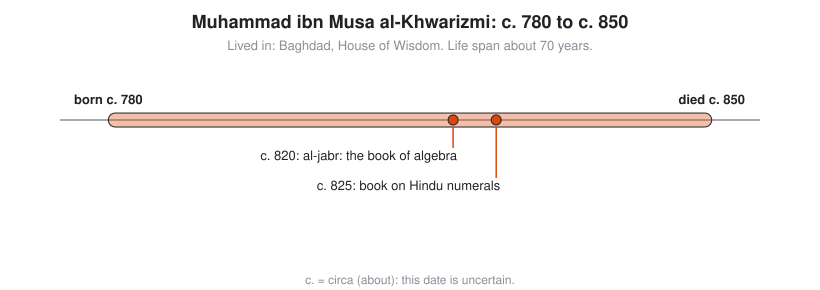
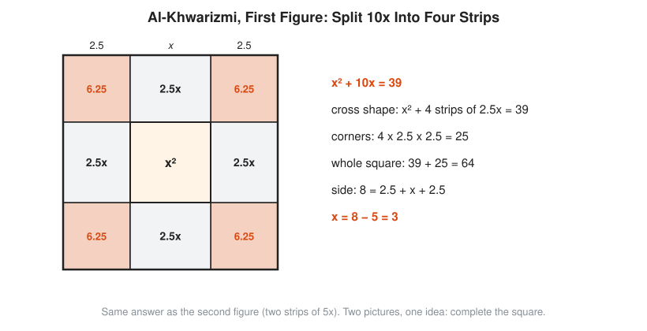

# Muhammad ibn Musa al-Khwarizmi

**Lived:** c. 780 to c. 850 · **Where:** Baghdad, House of Wisdom · **Era:** [Chapter 05: The Islamic Golden Age](../05-islamic-golden-age/README.md)

Al-Khwarizmi is the Baghdad scholar whose book gives algebra its name and whose own name becomes the word **algorithm**.

## Life at a Glance

<!-- diagram: type=life-timeline person=al-khwarizmi born=780 died=850 caption="Muhammad ibn Musa al-Khwarizmi, c. 780 to c. 850" -->


Both life dates are estimates. Around 820 he writes his book on *al-jabr*, the book of algebra. Around 825 he writes a book on the Hindu numerals, which later carries the digits 0 to 9 into Europe.

## The World Around Them

The Abbasid caliphs rule from Baghdad, a new city on the trade routes between India, Persia, and the Mediterranean. Caliph al-Mamun supports the **House of Wisdom**, a center where scholars translate Greek, Persian, and Indian texts and extend them. Daily life needs practical math: dividing inheritances under Islamic law, measuring land, settling trade, and fixing prayer times and the direction of Mecca.

## What They Did

* Writes *The Compendious Book on Calculation by Completion and Balancing*. The word *al-jabr* (completion) in its title becomes "algebra".
* Sorts equations into six standard types and gives a solution recipe for each, in words, with no symbols.
* Proves each recipe with a geometric picture of squares and rectangles.
* Writes on Hindu-Arabic numerals. Its Latin translation begins "Dixit Algoritmi" ("Algoritmi says"), the source of the word algorithm.
* Compiles astronomical tables and a revised world geography with coordinates for cities.

## Key Idea, Worked Small

**Completing the square.** His own example, in words: a square plus ten roots equals thirty-nine. In symbols, $x^2 + 10x = 39$. His recipe: halve the roots, square the half, add it, take the root, subtract the half.

```txt
  x^2 + 10x = 39
  half of 10 is 5                  halve the number of roots
  5^2 = 25                         square the half
  x^2 + 10x + 25 = 39 + 25 = 64    add it to both sides: completing
  (x + 5)^2 = 64                   the left side is now a perfect square
  x + 5 = 8                        take the positive root (he accepts only positive answers)
  x = 3                            subtract the half
  check: 3^2 + 10 x 3 = 9 + 30 = 39
```

The picture: a square of side $x$, plus four strips of $x$ by $\frac{10}{4}$, leaves four corner gaps of $\frac{5}{2}$ by $\frac{5}{2}$. Fill them in, and you have a perfect square.

<!-- diagram: type=construction ref=khwarizmi-four-strips -->


<!-- diagram: type=construction ref=completing-the-square -->


## A Human Detail

He says he writes the algebra book for what people need "in cases of inheritance, legacies, partition, lawsuits, and trade". Every algorithm in your stack is named after a man who wants to help families split an estate fairly.

## Connects To

* [Course 201: Algebra I and Geometry](../../course/201/README.md): linear and quadratic equations.
* [Course 301: Algebra II, Trig and Precalculus](../../course/301/README.md): completing the square in full.
* [Algebra track](../../tracks/algebra/README.md): where the name and the method begin.

## Go Deeper

* [MacTutor biography of al-Khwarizmi](https://mathshistory.st-andrews.ac.uk/Biographies/Al-Khwarizmi/): the standard scholarly short life.
* [Chapter 05: The Islamic Golden Age](../05-islamic-golden-age/README.md): the era in full.
