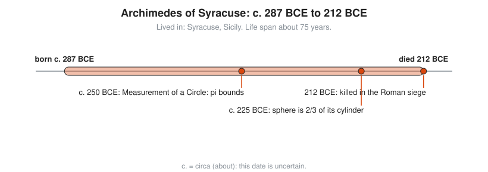

# Archimedes of Syracuse

**Lived:** c. 287 BCE to 212 BCE · **Where:** Syracuse, Sicily · **Era:** [Chapter 03: Ancient Greece](../03-ancient-greece/README.md)

Archimedes is the Greek engineer and mathematician who trapped pi between two fractions and found the volume of a sphere, using ideas close to calculus nineteen centuries early.

## Life at a Glance

<!-- diagram: type=life-timeline person=archimedes born=-287 died=-212 caption="Archimedes of Syracuse, c. 287 BCE to 212 BCE" -->


The birth year is an estimate from a later report that he dies at about 75. Around 250 BCE he writes *Measurement of a Circle* with its bounds on pi. Around 225 BCE he proves that a sphere has two thirds the volume of the cylinder that wraps it. In 212 BCE a Roman soldier kills him when Syracuse falls.

## The World Around Them

Syracuse is a rich Greek city caught between Rome and Carthage. King Hiero II needs ships, pumps, and defenses. Archimedes supplies them, and he trades letters with the scholars of Alexandria about pure geometry.

## What They Did

* Proves that pi lies between $3\frac{10}{71}$ and $3\frac{1}{7}$, using polygons with 96 sides.
* Finds the area of a circle, the area under a parabola, and the surface and volume of a sphere.
* Uses the **method of exhaustion**: squeeze a curved shape between straight-sided shapes until the gap is as small as you like.
* States the law of the lever and the principle of buoyancy (a floating body pushes aside its own weight of water).
* Builds war machines that hold off the Roman siege of Syracuse for about two years.
* Writes *The Sand Reckoner*, a system for naming numbers big enough to count the grains of sand that fill the universe.

## Key Idea, Worked Small

**Squeeze pi between polygons.** Draw a circle with diameter 1. Its circumference is pi. A polygon drawn inside has a shorter perimeter. A polygon drawn outside has a longer one.

```txt
  inside hexagon: 6 sides, each 1/2 long     each side equals the radius
  perimeter = 6 x 1/2 = 3                     pi must exceed 3
  double the sides: 12, 24, 48, 96            each step uses Pythagoras
  inside 96-gon perimeter  > 223/71           Archimedes rounds down to stay safe
  outside 96-gon perimeter < 22/7             he rounds up to stay safe
  223/71 = 3.1408...   22/7 = 3.1428...       pi = 3.1415... sits between
```

<!-- diagram: type=construction ref=archimedes-pi -->


## A Human Detail

The "Eureka" bath story comes from the Roman writer Vitruvius, about two centuries later, and is probably legend. His last words, "do not disturb my circles", are also legend. What is true: he asks for a sphere inside a cylinder on his tomb, and Cicero finds the overgrown grave in 75 BCE by spotting that carving.

## Connects To

* [Course 201: Algebra I and Geometry](../../course/201/README.md): circles, area, and volume.
* [Course 401: Calculus](../../course/401/README.md): exhaustion is the ancestor of the limit and the integral.
* [Geometry track](../../tracks/geometry/README.md): pi, circles, and solids.
* [Calculus track](../../tracks/calculus/README.md): areas under curves.

## Go Deeper

* [MacTutor biography of Archimedes](https://mathshistory.st-andrews.ac.uk/Biographies/Archimedes/): the standard scholarly short life.
* [Chapter 03: Ancient Greece](../03-ancient-greece/README.md): the era in full.
