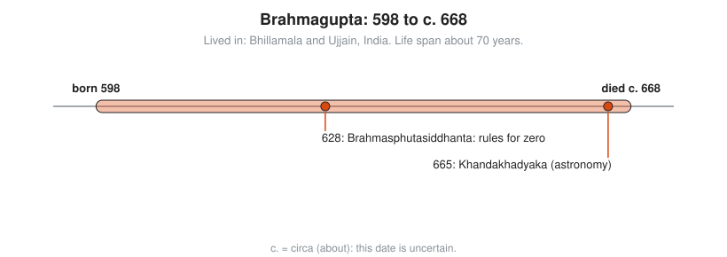

# Brahmagupta

**Lived:** 598 to c. 668 · **Where:** Bhillamala and Ujjain, India · **Era:** [Chapter 04: India and China](../04-india-and-china/README.md)

Brahmagupta is the Indian astronomer who first writes down rules for calculating with zero and negative numbers as numbers in their own right.

## Life at a Glance

<!-- diagram: type=life-timeline person=brahmagupta born=598 died=668 caption="Brahmagupta, 598 to c. 668" -->


He states his own birth year in his text. In 628, at about 30, he finishes the *Brahmasphutasiddhanta*, with its rules for zero. In 665, in his late sixties, he writes the *Khandakhadyaka*, a practical handbook for astronomical calculation.

## The World Around Them

Bhillamala, in modern Rajasthan, is a regional capital. Ujjain has the leading observatory in India. Astronomers there need exact arithmetic for planet positions, eclipses, and calendars, and merchants need a way to record debts. Place-value notation with a zero digit is already in use. The open question is how zero behaves when you calculate with it.

## What They Did

* Writes the *Brahmasphutasiddhanta* (the "Correctly Established Doctrine of Brahma") in 628, in verse.
* Gives rules for adding, subtracting, and multiplying zero, **fortunes** (positive numbers), and **debts** (negative numbers).
* Gives a general rule for solving quadratic equations.
* Finds a formula for the area of a four-sided figure whose corners lie on a circle: **Brahmagupta's formula**.
* Works on equations like $x^2 - 92y^2 = 1$ and finds whole-number solutions, a problem Europe takes up a thousand years later.

## Key Idea, Worked Small

**Arithmetic with zero, fortunes, and debts.** His rules, in modern symbols:

```txt
  5 + (-3) = 2                a fortune plus a debt: subtract, keep the larger sign
  3 - 5 = -2                  taking a bigger amount from a smaller leaves a debt
  (-3) x (-4) = 12            the product of two debts is a fortune
  (-3) x 4 = -12              a debt times a fortune is a debt
  7 + 0 = 7                   zero added changes nothing
  7 x 0 = 0                   anything times zero is zero
  0 / 0 = 0                   his rule here is wrong: modern math leaves 0/0 undefined
```

Six of seven rules match today. The last one stumps mathematicians for another thousand years.

<!-- diagram: type=concept ref=brahmagupta-zero -->


## A Human Detail

He sets $x^2 - 92y^2 = 1$ as a challenge and says that a person who solves it within a year is a mathematician. The smallest answer is $x = 1151$, $y = 120$: check $1151^2 = 1{,}324{,}801$ and $92 \times 120^2 = 1{,}324{,}800$.

## Connects To

* [Course 101: Foundations](../../course/101/README.md): negative numbers and zero.
* [Course 201: Algebra I and Geometry](../../course/201/README.md): quadratic equations.
* [Arithmetic and number sense track](../../tracks/arithmetic-and-number-sense/README.md): the rules of signs.
* [Number theory track](../../tracks/number-theory/README.md): whole-number equations like $x^2 - 92y^2 = 1$.

## Go Deeper

* [MacTutor biography of Brahmagupta](https://mathshistory.st-andrews.ac.uk/Biographies/Brahmagupta/): the standard scholarly short life.
* [Chapter 04: India and China](../04-india-and-china/README.md): the era in full.
