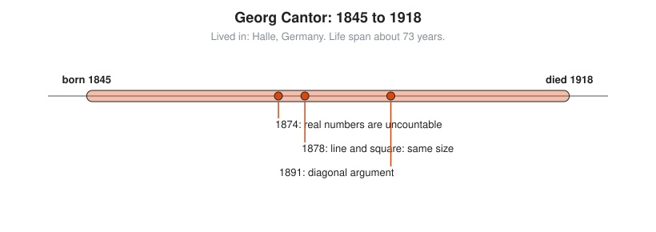

# Georg Cantor

**Lived:** 1845 to 1918 · **Where:** Halle, Germany · **Era:** [Chapter 08: The 18th and 19th Centuries: Rigor](../08-18th-and-19th-century-rigor/README.md)

Georg Cantor is the founder of set theory, who shows that some infinities are larger than others.

## Life at a Glance

<!-- diagram: type=life-timeline person=cantor born=1845 died=1918 caption="Georg Cantor, 1845 to 1918: Halle" -->


Cantor is born in St Petersburg and spends his career at the University of Halle. In 1874 he proves the real numbers cannot be listed. In 1878 he publishes the result that a line and a square hold the same number of points. In 1891 he gives the diagonal argument.

## The World Around Them

Mathematicians are rebuilding calculus on exact definitions. To do that they need to talk about infinite collections of numbers, for example all points on a line. Most treat infinity as a direction, not a size. Cantor treats it as a size and compares sizes.

## What They Did

* Defines two sets as the same size when their members pair up one to one with none left over.
* Shows the whole numbers and the fractions are the same size: both can be listed.
* Proves the real numbers cannot be listed, a strictly larger infinity.
* Shows a line segment and a square hold the same number of points. He writes to Dedekind, "I see it, but I do not believe it."
* Builds a ladder of ever-larger infinities.

## Key Idea, Worked Small

**The diagonal argument.** Suppose someone claims a complete list of infinite strings of 0s and 1s. Build a string that is not on the list.

<!-- diagram: type=grid ref=cantor-diagonal -->


```txt
  s1 = 0 1 0 1 1 0 ...      digit 1 of s1 is 0
  s2 = 1 1 0 0 1 0 ...      digit 2 of s2 is 1
  s3 = 0 0 0 1 0 1 ...      digit 3 of s3 is 0
  s4 = 1 0 1 1 0 0 ...      digit 4 of s4 is 1
  s5 = 0 1 1 0 0 1 ...      digit 5 of s5 is 0
  s6 = 1 1 1 0 1 0 ...      digit 6 of s6 is 0
  diagonal = 0 1 0 1 0 0    read down the diagonal
  new      = 1 0 1 0 1 1    flip every digit
  new differs from sn in place n, for every n
  new is not on the list    the list was not complete
```

Any list misses something. The strings, and the real numbers they encode, cannot be listed.

## A Human Detail

Leopold Kronecker, a powerful Berlin professor, attacks Cantor's work for years. Cantor suffers repeated bouts of depression and dies in a sanatorium in Halle in 1918. In calmer moments he also publishes pamphlets arguing that Francis Bacon wrote the plays of Shakespeare, a theory with fewer followers than set theory.

## Connects To

* [Course 601: Proof and Higher Math](../../course/601/README.md): cardinality and the diagonal argument.
* [Logic and set theory track](../../tracks/logic-and-set-theory/README.md): sets as the base of mathematics.
* [Real analysis track](../../tracks/real-analysis/README.md): what the real numbers are.

## Go Deeper

* [MacTutor biography of Georg Cantor](https://mathshistory.st-andrews.ac.uk/Biographies/Cantor/): the standard scholarly short life.
* [Chapter 08: The 18th and 19th Centuries: Rigor](../08-18th-and-19th-century-rigor/README.md): the era in full.
