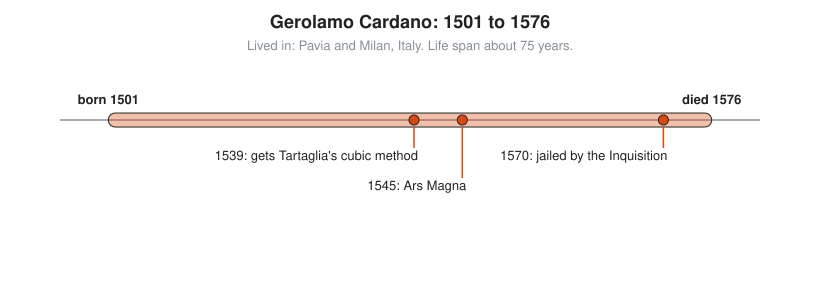

# Gerolamo Cardano

**Lived:** 1501 to 1576 · **Where:** Pavia and Milan, Italy · **Era:** [Chapter 06: Medieval and Renaissance Europe](../06-medieval-and-renaissance-europe/README.md)

Gerolamo Cardano is the Italian doctor, gambler, and mathematician who publishes the first formula for solving cubic equations and writes the first book on the math of chance.

## Life at a Glance

<!-- diagram: type=life-timeline person=cardano born=1501 died=1576 caption="Gerolamo Cardano, 1501 to 1576" -->


In 1539 he persuades Niccolò Tartaglia to reveal his method for cubics, under a promise of secrecy. In 1545 he publishes it anyway in the *Ars Magna* ("The Great Art"). In 1570 the Inquisition jails him for heresy, and he spends his last years in Rome.

## The World Around Them

Renaissance Italy runs on trade and banking, and mathematicians earn jobs and fame in public problem-solving contests. A secret method is a weapon in those contests. Universities teach medicine and astrology side by side, and Cardano practices both.

## What They Did

* Publishes the *Ars Magna* in 1545: the first printed solutions of cubic equations and, through his student Lodovico Ferrari, of quartic equations (with $x^4$).
* Credits Scipione del Ferro, who found the cubic method first, and Tartaglia, who found it again. Tartaglia is still furious.
* Meets square roots of negative numbers inside his formulas and calls them "as subtle as they are useless". They later become the complex numbers.
* Writes *Liber de Ludo Aleae* ("Book on Games of Chance"), with early rules of probability for dice. It is published in 1663, long after his death.
* Describes a joint for connecting rotating shafts, still called the cardan joint.

## Key Idea, Worked Small

**The cubic formula.** The *Ars Magna* solves "a cube and six times the side equal 20", that is, $x^3 + 6x = 20$. For $x^3 + px = q$, the rule is:

$$x = \sqrt[3]{\frac{q}{2} + \sqrt{\left(\frac{q}{2}\right)^2 + \left(\frac{p}{3}\right)^3}} - \sqrt[3]{-\frac{q}{2} + \sqrt{\left(\frac{q}{2}\right)^2 + \left(\frac{p}{3}\right)^3}}$$

```txt
  p = 6, q = 20                      read them off x^3 + 6x = 20
  (q/2)^2 = 10^2 = 100               half of q, squared
  (p/3)^3 = 2^3 = 8                  a third of p, cubed
  sqrt(100 + 8) = sqrt(108)          add them and take the square root
                = 10.3923
  cube root of (10 + 10.3923)        first term
    = cube root of 20.3923 = 2.7321
  cube root of (-10 + 10.3923)       second term
    = cube root of 0.3923 = 0.7321
  x = 2.7321 - 0.7321 = 2            subtract
  check: 2^3 + 6 x 2 = 8 + 12 = 20
```

The ugly roots collapse to a clean 2. In exact form, the two cube roots are $\sqrt{3} + 1$ and $\sqrt{3} - 1$.

## A Human Detail

He writes an autobiography, *The Book of My Life*, that lists his own faults with odd candor, gambling first among them. A popular story says he predicts the date of his own death and then starves himself to be right. That story is probably legend.

## Connects To

* [Course 301: Algebra II, Trig and Precalculus](../../course/301/README.md): polynomials and complex numbers.
* [Course 501: Linear Algebra, Probability and Discrete Math](../../course/501/README.md): the first steps in probability.
* [Algebra track](../../tracks/algebra/README.md): the cubic formula and its drama.
* [Probability track](../../tracks/probability/README.md): dice and fair games.

## Go Deeper

* [MacTutor biography of Cardano](https://mathshistory.st-andrews.ac.uk/Biographies/Cardan/): the standard scholarly short life.
* [Chapter 06: Medieval and Renaissance Europe](../06-medieval-and-renaissance-europe/README.md): the era in full.
