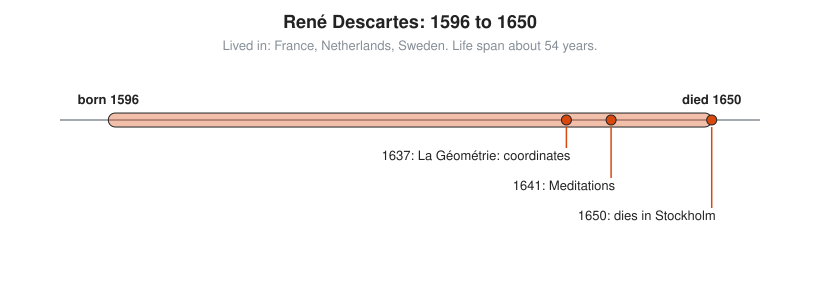
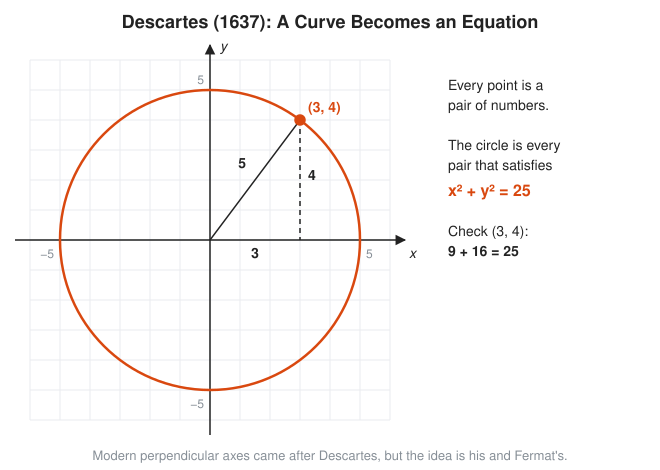

# René Descartes

**Lived:** 1596 to 1650 · **Where:** France, Netherlands, Sweden · **Era:** [Chapter 07: The Scientific Revolution and Calculus](../07-scientific-revolution-and-calculus/README.md)

René Descartes is the French philosopher who joins algebra and geometry by naming points with numbers, the idea behind every graph you have ever drawn.

## Life at a Glance

<!-- diagram: type=life-timeline person=descartes born=1596 died=1650 caption="René Descartes, 1596 to 1650" -->


He is born in La Haye, France, and does most of his writing in the Netherlands. In 1637 he publishes *La Géométrie*, the coordinate method, as an appendix to his *Discourse on Method*. In 1641 come the *Meditations*, with "I think, therefore I am" at the core of its argument. In 1650 he dies of pneumonia in Stockholm, a few months after joining the court of Queen Christina.

## The World Around Them

Europe is in the Thirty Years War, and Descartes serves for a time as a gentleman soldier. Galileo is turning physics into measurement, and the Church condemns him in 1633, which makes Descartes hold back his own book on the physical world. Science needs a way to describe curves, motion, and orbits with numbers.

## What They Did

* Publishes *La Géométrie* in 1637: label a point by its distances from two fixed lines, and every curve becomes an equation.
* Turns geometry problems into algebra problems, and algebra into pictures.
* Sets the notation still in use: $x, y, z$ for unknowns, $a, b, c$ for known values, and raised exponents like $x^3$.
* States the **rule of signs**: a way to bound how many positive roots a polynomial has by counting sign changes.
* Writes the *Meditations* (1641), which make him a founder of modern philosophy.

## Key Idea, Worked Small

**Geometry as algebra.** Where does the line $y = x + 1$ cross the circle of radius 5 around the origin? With coordinates, the circle is every point with $x^2 + y^2 = 25$ (Pythagoras). Substitute the line into the circle:

```txt
  x^2 + y^2 = 25                     the circle
  x^2 + (x + 1)^2 = 25               replace y with x + 1
  x^2 + x^2 + 2x + 1 = 25            expand (x + 1)^2
  2x^2 + 2x - 24 = 0                 subtract 25 from both sides
  x^2 + x - 12 = 0                   divide by 2
  (x + 4)(x - 3) = 0                 factor: 4 x -3 = -12 and 4 - 3 = 1
  x = 3 or x = -4                    either factor is zero
  points: (3, 4) and (-4, -3)        y = x + 1 for each
  check: 9 + 16 = 25 and 16 + 9 = 25
```

No ruler, no compass. Two crossing points fall out of a quadratic equation.

<!-- diagram: type=concept ref=descartes-coordinates -->


## A Human Detail

He likes to stay in bed until late morning, thinking. The story that he invents coordinates while watching a fly on the ceiling is a legend. In Stockholm the queen wants lessons at five in the morning, and he dies that winter. Some historians suspect arsenic, but the evidence is thin.

## Connects To

* [Course 201: Algebra I and Geometry](../../course/201/README.md): lines, graphs, and coordinates.
* [Course 301: Algebra II, Trig and Precalculus](../../course/301/README.md): circles and conics as equations.
* [Algebra track](../../tracks/algebra/README.md): notation and polynomials.
* [Geometry track](../../tracks/geometry/README.md): coordinate geometry.

## Go Deeper

* [MacTutor biography of Descartes](https://mathshistory.st-andrews.ac.uk/Biographies/Descartes/): the standard scholarly short life.
* [Chapter 07: The Scientific Revolution and Calculus](../07-scientific-revolution-and-calculus/README.md): the era in full.
