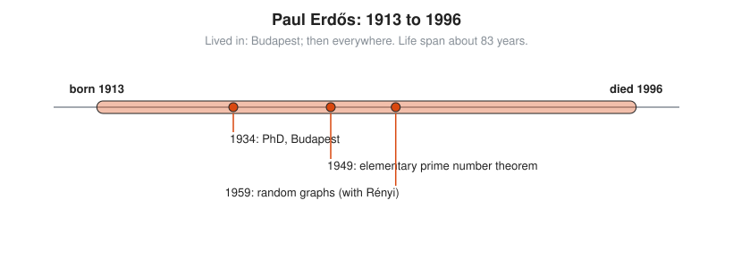

# Paul Erdős

**Lived:** 1913 to 1996 · **Where:** Budapest; then everywhere · **Era:** [Chapter 10: Modern Mathematics](../10-modern-mathematics/README.md)

Paul Erdős is the Hungarian mathematician who has no home, owns almost nothing, and writes more joint papers than anyone in history.

## Life at a Glance

<!-- diagram: type=life-timeline person=erdos born=1913 died=1996 caption="Paul Erdős, 1913 to 1996: Budapest, then everywhere" -->


Erdős earns his PhD in Budapest in 1934, at 21. In 1949 he and Atle Selberg find an elementary proof of the prime number theorem. In 1959 he and Alfréd Rényi start the theory of random graphs. He dies of a heart attack at a conference in Warsaw in 1996, still working.

## The World Around Them

As a Jew in 1930s Hungary, Erdős leaves for England and then the USA. After the war, mathematics grows into a large international network of universities and conferences. Erdős lives inside that network, traveling from one colleague to the next with a suitcase and a fresh problem.

## What They Did

* At 19, gives a short, simple proof that there is always a prime between $n$ and $2n$.
* With Selberg, proves the prime number theorem without complex analysis. The two quarrel over credit.
* With Rényi, studies random graphs: networks where each possible link appears by chance.
* Founds much of modern combinatorics and probabilistic methods: prove something exists by showing a random choice works with positive probability.
* Writes about 1,500 papers with more than 500 coauthors.

## Key Idea, Worked Small

**Bertrand's postulate.** For every whole number $n \ge 1$, there is a prime $p$ with $n < p \le 2n$. Chebyshev first proves it in 1852. Erdős gives a short, elementary proof in 1932. A **prime** is a whole number above 1 whose only divisors are 1 and itself. Check small cases.

```txt
  n = 1:   between 1 and 2:    2                     2 is prime
  n = 2:   between 2 and 4:    3                     3 is prime
  n = 5:   between 5 and 10:   7                     6, 8, 9, 10 are not prime
  n = 10:  between 10 and 20:  11, 13, 17, 19        four primes
  n = 25:  between 25 and 50:  29, 31, 37, 41, 43, 47   six primes
```

The window keeps catching primes, and the count inside it grows. Checking cases does not prove the rule. The proof shows that the number $\binom{2n}{n}$ is too large to be built only from primes no bigger than $n$.

## A Human Detail

Erdős says "another roof, another proof," and lives out of a suitcase, staying with collaborators who handle his laundry and his mail. Mathematicians measure their distance from him by the **Erdős number**: coauthors of Erdős have number 1, their coauthors have number 2, and so on outward. The line "a mathematician is a machine for turning coffee into theorems" is often credited to Erdős, but it belongs to his friend Rényi.

## Connects To

* [Number theory track](../../tracks/number-theory/README.md): primes and the prime number theorem.
* [Graph theory track](../../tracks/graph-theory/README.md): random graphs and Erdős numbers.
* [Combinatorics track](../../tracks/combinatorics/README.md): counting and the probabilistic method.
* [Course 501: Linear Algebra, Probability and Discrete Math](../../course/501/README.md): graphs and probability.

## Go Deeper

* [MacTutor biography of Paul Erdős](https://mathshistory.st-andrews.ac.uk/Biographies/Erdos/): the standard scholarly short life.
* [Chapter 10: Modern Mathematics](../10-modern-mathematics/README.md): the era in full.
