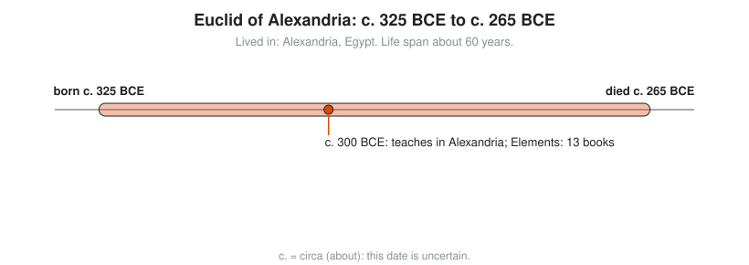

# Euclid of Alexandria

**Lived:** c. 325 BCE to c. 265 BCE · **Where:** Alexandria, Egypt · **Era:** [Chapter 03: Ancient Greece](../03-ancient-greece/README.md)

Euclid is the Greek teacher whose *Elements* organized geometry and number theory into one chain of proofs that schools used for more than two thousand years.

## Life at a Glance

<!-- diagram: type=life-timeline person=euclid born=-325 died=-265 caption="Euclid of Alexandria, c. 325 BCE to c. 265 BCE" -->


The birth and death dates are guesses. Almost nothing about his life survives. The timeline marks the one solid anchor: around 300 BCE he teaches in Alexandria and writes the *Elements* in thirteen books.

## The World Around Them

Alexander the Great founds Alexandria in 331 BCE. The Ptolemy kings who rule Egypt after him build the Museum and the Library to draw scholars to the city. Greek mathematicians already know many results by then. What they lack is one ordered account that proves each result from a few starting assumptions.

## What They Did

* Writes the *Elements*: thirteen books on plane geometry, ratios, whole numbers, and solid geometry.
* Starts from a short list of **axioms**: plain statements accepted without proof, for example "a straight line can be drawn between any two points".
* Proves every later result from those axioms and from earlier results, step by step.
* Proves that the prime numbers never run out (Book IX, Proposition 20).
* Gives the method now called the **Euclidean algorithm** for the greatest common divisor (Book VII).
* Also writes on optics, astronomy, and music theory. Some of those works survive.

## Key Idea, Worked Small

**The Euclidean algorithm** finds the largest number that divides two numbers evenly. Divide the bigger by the smaller, keep the remainder, and repeat with the smaller number and the remainder. Stop at remainder 0. Find the greatest common divisor of 48 and 18:

```txt
  48 = 2 x 18 + 12        divide 48 by 18: remainder 12
  18 = 1 x 12 + 6         now divide 18 by 12: remainder 6
  12 = 2 x 6  + 0         now divide 12 by 6: remainder 0, stop
  gcd(48, 18) = 6         the last nonzero remainder is the answer
  check: 48 = 6 x 8, 18 = 6 x 3, and 8 and 3 share no factor
```

Euclid states it with lengths, not digits, but the steps are the same. Computers still run it today, for example inside RSA key generation.

The *Elements* opens with a construction. Proposition I.1 builds an equilateral triangle with only a straightedge and a compass:

<!-- diagram: type=construction ref=euclid-i-1 -->


## A Human Detail

Proclus, writing about 750 years later, says King Ptolemy asks for a shortcut through the *Elements*. Euclid replies that there is no royal road to geometry. The same story is told about other teachers, and it is likely legend. The advice holds up anyway.

## Connects To

* [Course 201: Algebra I and Geometry](../../course/201/README.md): Euclidean geometry and proof from axioms.
* [Geometry track](../../tracks/geometry/README.md): the full story of lines, circles, and triangles.
* [Number theory track](../../tracks/number-theory/README.md): primes and the greatest common divisor.

## Go Deeper

* [MacTutor biography of Euclid](https://mathshistory.st-andrews.ac.uk/Biographies/Euclid/): the standard scholarly short life.
* [Chapter 03: Ancient Greece](../03-ancient-greece/README.md): the era in full.
