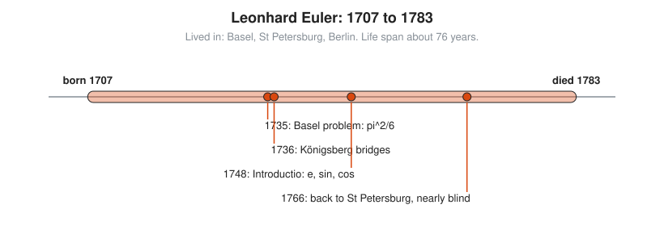
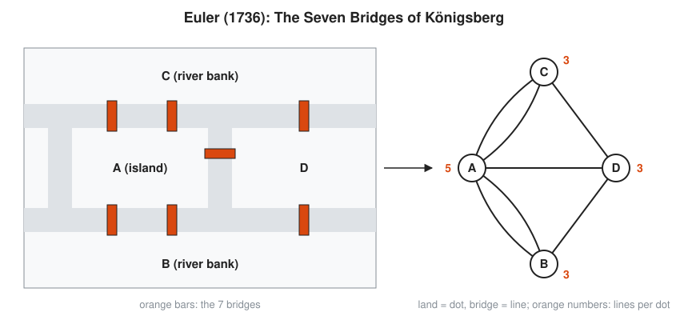

# Leonhard Euler

**Lived:** 1707 to 1783 · **Where:** Basel, St Petersburg, Berlin · **Era:** [Chapter 08: The 18th and 19th Centuries: Rigor](../08-18th-and-19th-century-rigor/README.md)

Leonhard Euler is the most productive mathematician in history, and much of the notation you use every day comes from him.

## Life at a Glance

<!-- diagram: type=life-timeline person=euler born=1707 died=1783 caption="Leonhard Euler, 1707 to 1783: Basel, St Petersburg, Berlin" -->


Euler grows up in Basel and moves to the St Petersburg Academy at 20. In 1735 he solves the Basel problem and in 1736 the Königsberg bridges puzzle. He spends 25 years in Berlin, writes the *Introductio* in 1748, and returns to St Petersburg in 1766, nearly blind and still working.

## The World Around Them

Kings fund academies of science to win prestige and solve practical problems. Euler works on ship design, artillery, lotteries, map making, and the motion of the Moon for navigation. Calculus is new and powerful, but nobody has organized it yet. Euler organizes it.

## What They Did

* Shows that $1 + \frac{1}{4} + \frac{1}{9} + \frac{1}{16} + \dots = \frac{\pi^2}{6}$, the Basel problem, which had beaten the best minds for about 90 years.
* Solves the Königsberg bridges puzzle in 1736 and starts graph theory.
* Makes $e$, $\pi$, $i$, $f(x)$, and $\sum$ standard notation, and treats sine and cosine as functions.
* Finds $e^{ix} = \cos x + i \sin x$. Put in $x = \pi$ and you get $e^{i\pi} + 1 = 0$, which links five famous numbers in one line.
* Writes over 800 papers and books; his collected works fill more than 70 volumes.

## Key Idea, Worked Small

**Degree counting.** Draw each piece of land as a dot and each bridge as a line. The **degree** of a dot is the number of lines touching it. A walker who passes through a dot uses one bridge to enter and one to leave, which uses bridges in pairs.

<!-- diagram: type=graph ref=konigsberg -->


```txt
  A (island):  5 bridges          odd
  B (bank):    3 bridges          odd
  C (bank):    3 bridges          odd
  D:           3 bridges          odd
  5 + 3 + 3 + 3 = 14 = 2 × 7      each bridge has two ends: check
  odd dots = 4                    count the odd degrees
  pass-through dots need even     in and out come in pairs
  only start and end can be odd   at most two odd dots allowed
  4 > 2                           no walk crosses each bridge exactly once
```

The answer does not depend on distances or shapes. It depends only on what connects to what.

## A Human Detail

Euler loses most of the sight in his right eye in his thirties and nearly all his sight by 1771. His output goes up. He dictates to assistants and does long calculations in his head, and is said to have remarked that blindness at least spared him distractions.

## Connects To

* [Course 501: Linear Algebra, Probability and Discrete Math](../../course/501/README.md): graphs and degree counting start here.
* [Graph theory track](../../tracks/graph-theory/README.md): Königsberg is lesson zero.
* [Course 301: Algebra II, Trig and Precalculus](../../course/301/README.md): $e$, exponentials, and complex numbers.
* [Complex analysis track](../../tracks/complex-analysis/README.md): where $e^{i\pi} + 1 = 0$ comes from.

## Go Deeper

* [MacTutor biography of Leonhard Euler](https://mathshistory.st-andrews.ac.uk/Biographies/Euler/): the standard scholarly short life.
* [Chapter 08: The 18th and 19th Centuries: Rigor](../08-18th-and-19th-century-rigor/README.md): the era in full.
