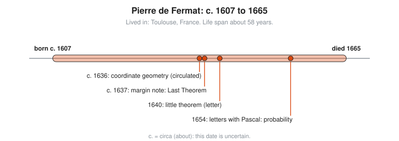

# Pierre de Fermat

**Lived:** c. 1607 to 1665 · **Where:** Toulouse, France · **Era:** [Chapter 07: The Scientific Revolution and Calculus](../07-scientific-revolution-and-calculus/README.md)

Pierre de Fermat is the French lawyer who does mathematics in his spare time and helps found coordinate geometry, probability, and modern number theory, mostly in letters.

## Life at a Glance

<!-- diagram: type=life-timeline person=fermat born=1607 died=1665 caption="Pierre de Fermat, c. 1607 to 1665" -->


His birth year is disputed. Older books say 1601. Around 1636 his coordinate geometry circulates in manuscript, before Descartes publishes. Around 1637 he writes the margin note now called his Last Theorem. In 1640 a letter states his little theorem. In 1654 his letters with Pascal found probability.

## The World Around Them

France has no research universities in the modern sense. Mathematicians share results by letter, often through the friar Marin Mersenne in Paris, who acts as a human mailing list. Fermat works as a magistrate in the Parliament of Toulouse, the regional high court, and does math in the evenings.

## What They Did

* Develops coordinate geometry at the same time as Descartes, independently.
* Finds tangents and highest and lowest points of curves by a method close to the derivative.
* Founds probability with Pascal in 1654 by solving the **problem of points**: how to split the stakes of a game stopped early.
* States **Fermat's little theorem** in a 1640 letter, without a proof.
* Writes in his copy of Diophantus that $x^n + y^n = z^n$ has no whole-number solutions for $n > 2$, and that the margin is too small for his proof.

## Key Idea, Worked Small

**Fermat's little theorem.** If $p$ is prime and $a$ is not a multiple of $p$, then $a^{p-1}$ leaves remainder 1 when divided by $p$. Try $a = 3$, $p = 7$:

```txt
  3^6 = 3 x 3 x 3 x 3 x 3 x 3        a^(p - 1) with a = 3, p = 7
      = 729
  729 = 7 x 104 + 1                  divide by 7
  remainder = 1                      just as the theorem says
  try a = 2, p = 5:
  2^4 = 16 = 5 x 3 + 1               remainder 1 again
```

This lets a computer test whether a huge number is likely prime without factoring it. It also sits under RSA, an encryption method behind much of HTTPS.

## A Human Detail

The famous margin note survives only because his son prints it in a 1670 edition. The book with the original margin is lost. Andrew Wiles finally proves the Last Theorem in 1994, with tools Fermat never had. Historians doubt Fermat had a valid proof, but the margin remains the most expensive shortage of paper in history.

## Connects To

* [Course 501: Linear Algebra, Probability and Discrete Math](../../course/501/README.md): the first problems in probability.
* [Course 601: Proof and Higher Math](../../course/601/README.md): number theory with proofs.
* [Number theory track](../../tracks/number-theory/README.md): primes and remainders.
* [Probability track](../../tracks/probability/README.md): the problem of points.

## Go Deeper

* [MacTutor biography of Fermat](https://mathshistory.st-andrews.ac.uk/Biographies/Fermat/): the standard scholarly short life.
* [Chapter 07: The Scientific Revolution and Calculus](../07-scientific-revolution-and-calculus/README.md): the era in full.
