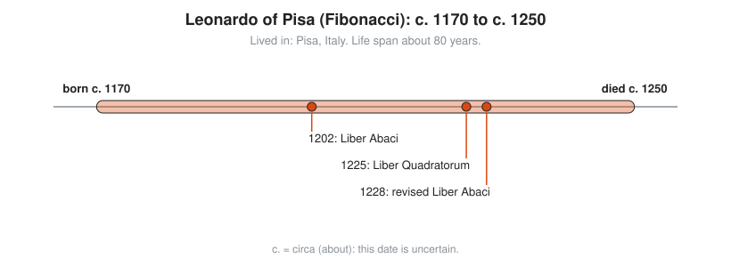
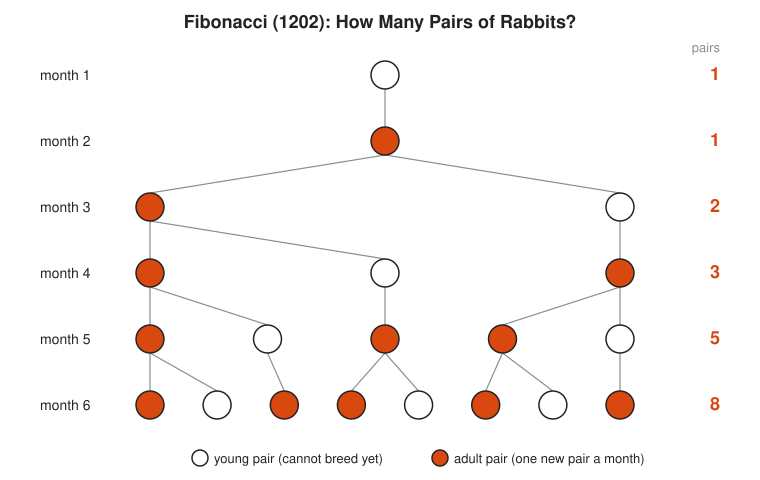

# Leonardo of Pisa (Fibonacci)

**Lived:** c. 1170 to c. 1250 · **Where:** Pisa, Italy · **Era:** [Chapter 06: Medieval and Renaissance Europe](../06-medieval-and-renaissance-europe/README.md)

Leonardo of Pisa is the merchant's son whose *Liber Abaci* teaches Europe the Hindu-Arabic digits 0 to 9, and whose rabbit puzzle gives the world the Fibonacci numbers.

## Life at a Glance

<!-- diagram: type=life-timeline person=fibonacci born=1170 died=1250 caption="Leonardo of Pisa (Fibonacci), c. 1170 to c. 1250" -->


Both life dates are estimates. In 1202 he publishes the *Liber Abaci* ("Book of Calculation"). In 1225 he writes the *Liber Quadratorum* ("Book of Squares") on number theory. In 1228 he issues a revised *Liber Abaci*, the version that survives.

## The World Around Them

Pisa is a sea-trading republic with posts across the Mediterranean. Merchants keep accounts in Roman numerals and calculate on a counting board. His father, a Pisan customs official in Bugia (now Béjaïa, Algeria), brings him there as a boy, and he learns the Hindu-Arabic digits from local teachers. He sees at once that they make trade arithmetic faster.

## What They Did

* Publishes the *Liber Abaci* in 1202: place-value digits, long multiplication and division, fractions, and square roots.
* Fills it with merchant problems: currency exchange, profit sharing, interest, and conversions of weights and measures.
* Poses the rabbit problem that produces the sequence 1, 1, 2, 3, 5, 8, 13, ...
* Writes the *Liber Quadratorum* in 1225, a serious work on equations with square numbers, dedicated to Emperor Frederick II.
* Receives a yearly salary from Pisa around 1240 for teaching its officials accounting.

## Key Idea, Worked Small

**The rabbit sequence.** Start with one young pair of rabbits. A pair matures in one month and then produces one new pair every month. No rabbit dies. Count the pairs each month. Each month's count equals the sum of the two months before it, because every pair alive two months ago is now old enough to breed.

```txt
  month 1: 1                    one young pair
  month 2: 1                    it matures, no babies yet
  month 3: 1 + 1 = 2            the mature pair has a baby pair
  month 4: 1 + 2 = 3            add the two previous counts
  month 5: 2 + 3 = 5
  month 6: 3 + 5 = 8
  month 7: 5 + 8 = 13
  month 8: 8 + 13 = 21          the pattern continues forever
```

His book starts with a pair that is already mature and reaches 377 pairs after twelve months. Real rabbits do not cooperate this neatly.

<!-- diagram: type=concept ref=fibonacci-rabbits -->


## A Human Detail

He never calls himself Fibonacci. He signs as Leonardo Pisano and sometimes Bigollo. The nickname, short for *filius Bonacci* ("son of Bonacci"), becomes popular in the 1800s.

## Connects To

* [Course 101: Foundations](../../course/101/README.md): place value and the four operations.
* [Course 301: Algebra II, Trig and Precalculus](../../course/301/README.md): sequences and series.
* [Arithmetic and number sense track](../../tracks/arithmetic-and-number-sense/README.md): why digits beat Roman numerals.
* [Discrete math track](../../tracks/discrete-math/README.md): sequences defined by recurrence.

## Go Deeper

* [MacTutor biography of Fibonacci](https://mathshistory.st-andrews.ac.uk/Biographies/Fibonacci/): the standard scholarly short life.
* [Chapter 06: Medieval and Renaissance Europe](../06-medieval-and-renaissance-europe/README.md): the era in full.
