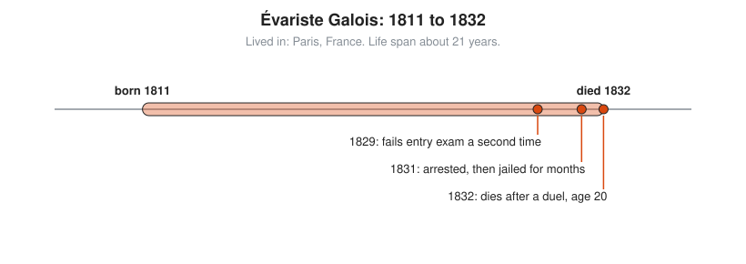

# Évariste Galois

**Lived:** 1811 to 1832 · **Where:** Paris, France · **Era:** [Chapter 08: The 18th and 19th Centuries: Rigor](../08-18th-and-19th-century-rigor/README.md)

Évariste Galois is a French radical who dies at 20 and leaves behind group theory, the study of symmetry.

## Life at a Glance

<!-- diagram: type=life-timeline person=galois born=1811 died=1832 caption="Évariste Galois, 1811 to 1832: Paris" -->


Galois fails the entrance exam of the École Polytechnique twice, the second time in 1829. In 1831 he is arrested after a political toast, acquitted, and then jailed later that year for wearing a banned uniform. In 1832 he is shot in a duel and dies the next day, age 20.

## The World Around Them

France is unstable after the 1830 revolution, and students fight over politics in the streets. In mathematics, a 300-year-old question is open: is there a formula, like the quadratic formula, for every polynomial equation? Formulas exist for degrees two, three, and four. Abel shows in 1824 that no general formula exists for degree five. Galois explains which equations have such a formula and why.

## What They Did

* Attaches to each equation a **group**: the set of ways to shuffle its roots that keep every true equation among them true.
* Shows that an equation is solvable by radicals (square roots, cube roots, and so on) exactly when its group has a certain layered structure.
* Sends papers to the Academy of Sciences. One is lost, one is rejected as unclear.
* Leaves work that Joseph Liouville publishes in 1846, 14 years after his death.

## Key Idea, Worked Small

**Symmetry of roots.** Take a small equation and ask which shuffles of its roots keep every whole-number fact about them true.

```txt
  x^2 - 2 = 0                    the equation
  a = √2,  b = -√2               its two roots
  a + b = 0                      a fact using only whole numbers
  a × b = -2                     another such fact
  swap a and b:  b + a = 0       still true
                 b × a = -2      still true
  group = {do nothing, swap}     two allowed shuffles
```

For the general equation of degree five, every one of the $5! = 120$ shuffles of the five roots is allowed. That group lacks the layered structure that radicals need, and no formula exists.

## A Human Detail

The popular story says Galois writes all of his mathematics in one desperate night before the duel. That is a legend. He does write a long letter to his friend Auguste Chevalier that night, summarizing and correcting work he had already submitted. The reason for the duel is unclear to this day.

## Connects To

* [Abstract algebra track](../../tracks/abstract-algebra/README.md): groups begin here.
* [Course 601: Proof and Higher Math](../../course/601/README.md): groups and symmetry.
* [Course 301: Algebra II, Trig and Precalculus](../../course/301/README.md): polynomials and the quadratic formula.

## Go Deeper

* [MacTutor biography of Évariste Galois](https://mathshistory.st-andrews.ac.uk/Biographies/Galois/): the standard scholarly short life.
* [Chapter 08: The 18th and 19th Centuries: Rigor](../08-18th-and-19th-century-rigor/README.md): the era in full.
