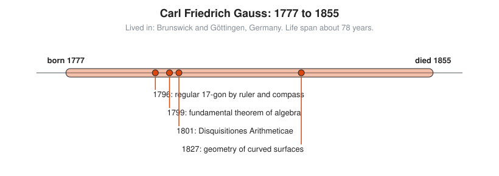
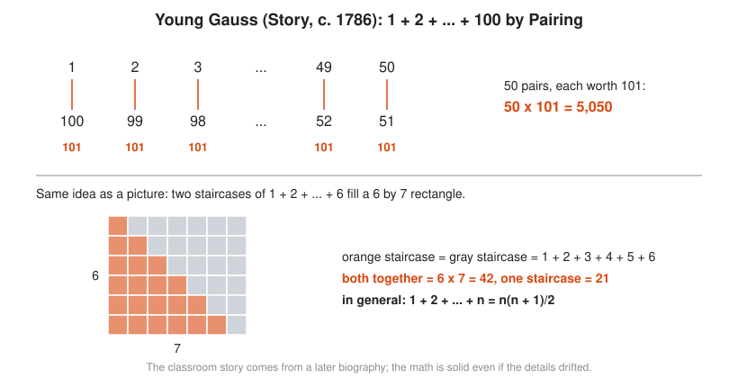

# Carl Friedrich Gauss

**Lived:** 1777 to 1855 · **Where:** Brunswick and Göttingen, Germany · **Era:** [Chapter 08: The 18th and 19th Centuries: Rigor](../08-18th-and-19th-century-rigor/README.md)

Carl Friedrich Gauss is the son of a laborer who becomes the leading mathematician of his age and founds modern number theory.

## Life at a Glance

<!-- diagram: type=life-timeline person=gauss born=1777 died=1855 caption="Carl Friedrich Gauss, 1777 to 1855: Brunswick and Göttingen" -->


At 18, in 1796, Gauss shows how to draw a regular 17-sided polygon with ruler and compass. His 1799 thesis proves the fundamental theorem of algebra, and his 1801 book *Disquisitiones Arithmeticae* sets up number theory. In 1827 he publishes his study of curved surfaces. He spends most of his working life in Göttingen.

## The World Around Them

German states need surveys of their land, and astronomers need orbits for newly found bodies. In 1801 the dwarf planet Ceres slips behind the Sun and is lost. Gauss computes its orbit from a few observations, and astronomers find it again where he says. He also runs a land survey of Hanover and builds an early electric telegraph with the physicist Wilhelm Weber.

## What They Did

* Constructs the regular 17-gon, the first new constructible polygon since the Greeks.
* Proves that every polynomial equation has a root among the complex numbers (the fundamental theorem of algebra).
* Writes *Disquisitiones Arithmeticae*, which introduces modular arithmetic (clock arithmetic) in its modern form.
* Develops the method of least squares and the bell curve for measurement errors.
* Shows that the curvature of a surface can be measured from inside it, without leaving it.

## Key Idea, Worked Small

**Pairing.** The famous story says a young Gauss adds 1 through 100 in seconds. The story comes from a memoir written after his death by his friend Sartorius von Waltershausen. The core is likely true, but the exact numbers and the drama are later decoration. The method is real and worth keeping.

<!-- diagram: type=pairing ref=gauss-pairing -->


```txt
  S = 1 + 2 + 3 + ... + 98 + 99 + 100     the sum we want
  1 + 100 = 101                           pair the first and last
  2 + 99 = 101                            the next pair inward
  3 + 98 = 101                            every pair sums to 101
  100 numbers / 2 = 50 pairs              each pair uses two numbers
  S = 50 × 101                            50 pairs of 101
  S = 5,050                               multiply
```

The same trick gives the general rule $1 + 2 + \dots + n = \frac{n(n+1)}{2}$.

## A Human Detail

Gauss publishes little and polishes much. His motto is *pauca sed matura*, "few, but ripe." He asks for a 17-gon on his tombstone. As the story goes, the stonemason refuses because it looks too much like a circle.

## Connects To

* [Course 101: Foundations](../../course/101/README.md): sums and the pairing trick.
* [Number theory track](../../tracks/number-theory/README.md): modular arithmetic starts with Gauss.
* [Statistics track](../../tracks/statistics/README.md): least squares and the bell curve.
* [Course 301: Algebra II, Trig and Precalculus](../../course/301/README.md): sequences, series, and complex roots.

## Go Deeper

* [MacTutor biography of Carl Friedrich Gauss](https://mathshistory.st-andrews.ac.uk/Biographies/Gauss/): the standard scholarly short life.
* [Chapter 08: The 18th and 19th Centuries: Rigor](../08-18th-and-19th-century-rigor/README.md): the era in full.
