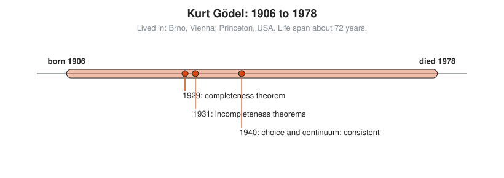

# Kurt Gödel

**Lived:** 1906 to 1978 · **Where:** Brno, Vienna; Princeton, USA · **Era:** [Chapter 09: 20th-Century Foundations and Computing](../09-20th-century-foundations-and-computing/README.md)

Kurt Gödel is the Austrian logician who proves that any consistent system of rules strong enough for arithmetic contains true statements it cannot prove.

## Life at a Glance

<!-- diagram: type=life-timeline person=godel born=1906 died=1978 caption="Kurt Gödel, 1906 to 1978: Brno, Vienna, Princeton" -->


Gödel is born in Brno, then part of Austria-Hungary, and studies in Vienna. In 1929 he proves the completeness theorem, and in 1931 the incompleteness theorems. By 1940 he shows the axiom of choice and the continuum hypothesis are consistent with set theory, and he leaves Europe for Princeton that same year.

## The World Around Them

Hilbert wants proof that mathematics is consistent (never proves a contradiction) and complete (proves every true statement). Logicians in Vienna believe careful rules can settle every question. Gödel, a quiet member of their circle, shows the plan has a hard limit.

## What They Did

* Proves the completeness theorem: in first-order logic, every statement true in all models has a proof.
* Proves the first incompleteness theorem: any consistent formal system that includes basic arithmetic has true statements it cannot prove.
* Proves the second: such a system cannot prove its own consistency.
* Shows the axiom of choice and the continuum hypothesis cannot be disproved from the usual axioms of set theory.
* Finds solutions to Einstein's equations that allow time travel, as a birthday gift for Einstein.

## Key Idea, Worked Small

**Gödel numbering.** Gödel turns statements about numbers into numbers. Give each symbol a code, then pack a string of codes into one number using prime powers. Factoring unpacks it.

```txt
  code: "0" -> 1,  "=" -> 2           a tiny symbol table
  "0 = 0" -> codes (1, 2, 1)          one code per symbol
  2^1 × 3^2 × 5^1                     primes 2, 3, 5 in order, codes as powers
  2 × 9 × 5 = 90                      the statement is now the number 90
  90 = 2 × 3 × 3 × 5                  factor to decode
  powers of 2, 3, 5 = 1, 2, 1         read the codes back
  (1, 2, 1) -> "0 = 0"                the original statement
```

Every factorization into primes is unique, which makes the code reversible. With this, arithmetic can talk about its own statements and proofs. Gödel then builds a statement that says, in effect, "this statement has no proof."

## A Human Detail

At his 1947 US citizenship hearing, Gödel tells the judge he has found a flaw in the Constitution that allows a dictatorship. Einstein and the economist Oskar Morgenstern, there as witnesses, steer the talk elsewhere. He becomes a citizen.

## Connects To

* [Logic and set theory track](../../tracks/logic-and-set-theory/README.md): completeness and incompleteness.
* [Course 601: Proof and Higher Math](../../course/601/README.md): what proof can and cannot do.
* [Number theory track](../../tracks/number-theory/README.md): unique prime factorization.

## Go Deeper

* [MacTutor biography of Kurt Gödel](https://mathshistory.st-andrews.ac.uk/Biographies/Godel/): the standard scholarly short life.
* [Chapter 09: 20th-Century Foundations and Computing](../09-20th-century-foundations-and-computing/README.md): the era in full.
