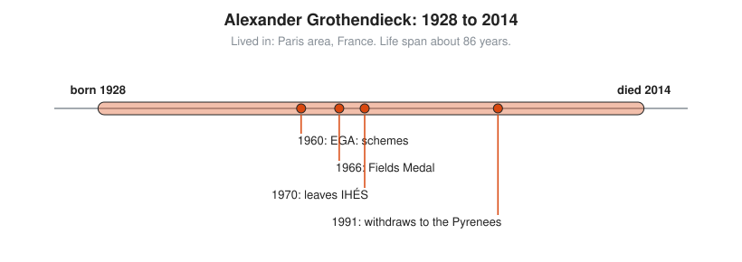

# Alexander Grothendieck

**Lived:** 1928 to 2014 · **Where:** Paris area, France · **Era:** [Chapter 10: Modern Mathematics](../10-modern-mathematics/README.md)

Alexander Grothendieck is the stateless mathematician who rebuilds algebraic geometry from the ground up and then walks away from mathematics.

## Life at a Glance

<!-- diagram: type=life-timeline person=grothendieck born=1928 died=2014 caption="Alexander Grothendieck, 1928 to 2014: Paris area" -->


In 1960 Grothendieck begins publishing *EGA* (Elements of Algebraic Geometry) with Jean Dieudonné, built on his new idea of schemes. He wins the Fields Medal in 1966. In 1970 he leaves the IHÉS, the research institute near Paris, over its military funding. In 1991 he withdraws to a village in the Pyrenees and cuts nearly all contact. He dies there in 2014.

## The World Around Them

Grothendieck is born in Berlin. His father, a Russian-Jewish anarchist, dies at Auschwitz, and he spends part of the war interned in France with his mother. After the war, French mathematics favors big, general foundations, in the style of the Bourbaki group. Number theorists want to use the tools of geometry on equations over whole numbers and finite number systems, and they need a language that covers both.

## What They Did

* Invents **schemes**, a way to treat any system of equations, over any number system, as a geometric space.
* Builds new tools for counting holes in such spaces, which lead to the proof of the Weil conjectures by his student Pierre Deligne in 1974.
* Writes thousands of pages, in *EGA* and the seminar notes *SGA*, that become the standard foundation of the field.
* Refuses to travel to Moscow to collect his Fields Medal in 1966, as a protest against Soviet military actions in Eastern Europe.
* Writes *Récoltes et Semailles*, a long memoir about his life and the mathematical community.

## Key Idea, Worked Small

**Numbers as functions on primes.** In a scheme, a whole number like 12 acts like a function, and the primes act like points. The value of 12 at the point $p$ is its remainder when divided by $p$. Where the remainder is 0, the function vanishes.

```txt
  12 mod 2 = 0         12 vanishes at the point 2
  12 mod 3 = 0         12 vanishes at the point 3
  12 mod 5 = 2         not zero at 5
  12 mod 7 = 5         not zero at 7
  12 = 2^2 × 3         zeros exactly at 2 and 3, and the zero at 2 is double
  compare: x^2(x - 1)  a polynomial with a double zero at 0 and a zero at 1
```

Factoring a number and finding the zeros of a polynomial become the same act. That one view lets geometry and number theory share tools.

## A Human Detail

In a lecture, someone asks Grothendieck to name a specific prime number. As the story goes, he answers "all right, take 57," which equals 3 × 19. Mathematicians now call 57 the Grothendieck prime.

## Connects To

* [Abstract algebra track](../../tracks/abstract-algebra/README.md): rings, the raw material of schemes.
* [Number theory track](../../tracks/number-theory/README.md): primes and remainders.
* [Topology track](../../tracks/topology/README.md): spaces defined by what is near what.
* [Course 601: Proof and Higher Math](../../course/601/README.md): number theory and abstract algebra.

## Go Deeper

* [MacTutor biography of Alexander Grothendieck](https://mathshistory.st-andrews.ac.uk/Biographies/Grothendieck/): the standard scholarly short life.
* [Chapter 10: Modern Mathematics](../10-modern-mathematics/README.md): the era in full.
