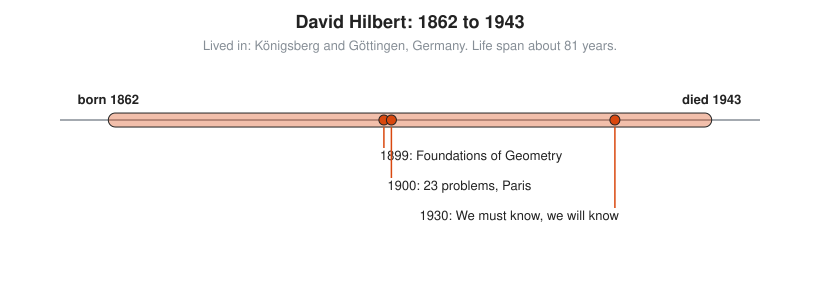

# David Hilbert

**Lived:** 1862 to 1943 · **Where:** Königsberg and Göttingen, Germany · **Era:** [Chapter 09: 20th-Century Foundations and Computing](../09-20th-century-foundations-and-computing/README.md)

David Hilbert is the German mathematician who sets the agenda for 20th-century mathematics and tries to put all of it on a secure base.

## Life at a Glance

<!-- diagram: type=life-timeline person=hilbert born=1862 died=1943 caption="David Hilbert, 1862 to 1943: Königsberg and Göttingen" -->


Hilbert grows up in Königsberg and moves to Göttingen in 1895. In 1899 he rebuilds Euclid's geometry on a complete list of axioms. In 1900, in Paris, he lists 23 open problems for the new century. In 1930 he ends a radio address with "Wir müssen wissen, wir werden wissen": we must know, and we are going to know.

## The World Around Them

Around 1900, paradoxes about infinite sets shake confidence in the foundations of mathematics. Physics is about to change with relativity and quantum theory, and both need new mathematics. Göttingen, under Hilbert and Felix Klein, becomes the center of the mathematical world.

## What They Did

* Rewrites Euclidean geometry with every assumption stated, with no appeal to pictures.
* Poses 23 problems in 1900, presenting ten of them in the Paris lecture. They guide research for a century, and some remain open.
* Builds the theory of infinite-dimensional spaces now called Hilbert spaces, the language of quantum mechanics.
* Launches Hilbert's program: prove, by finite and checkable steps, that mathematics never contradicts itself.
* Brings Emmy Noether to Göttingen and fights for her right to teach.

## Key Idea, Worked Small

**Hilbert's hotel.** In a 1924 lecture, Hilbert describes a hotel with infinitely many rooms, all full. A new guest arrives. Infinite sets behave in ways finite ones do not.

```txt
  rooms 1, 2, 3, 4, ...               every room has a guest
  rule: guest in room n moves to n + 1  every room has a next room
  room 1 -> 2, room 2 -> 3, ...       everyone moves at once
  room 1 is now empty                 nobody moved into it
  new guest takes room 1              one more guest fits
  rule: guest in room n moves to 2n   for a busload of infinitely many guests
  rooms 1, 3, 5, 7, ... are empty     the odd rooms free up
```

A full infinite hotel still has room. This is Cantor's idea of size, told as a joke.

## A Human Detail

Hilbert gives his radio address in Königsberg in 1930. The day before, at a meeting in the same city, the young Kurt Gödel first announces the result that shows Hilbert's program cannot succeed as planned. The phrase "Wir müssen wissen, wir werden wissen" is carved on Hilbert's tombstone in Göttingen anyway.

## Connects To

* [Logic and set theory track](../../tracks/logic-and-set-theory/README.md): axioms, proof, and Hilbert's program.
* [Course 601: Proof and Higher Math](../../course/601/README.md): axioms and infinite sets.
* [Linear algebra track](../../tracks/linear-algebra/README.md): vector spaces lead to Hilbert spaces.
* [Geometry track](../../tracks/geometry/README.md): geometry from axioms.

## Go Deeper

* [MacTutor biography of David Hilbert](https://mathshistory.st-andrews.ac.uk/Biographies/Hilbert/): the standard scholarly short life.
* [Chapter 09: 20th-Century Foundations and Computing](../09-20th-century-foundations-and-computing/README.md): the era in full.
