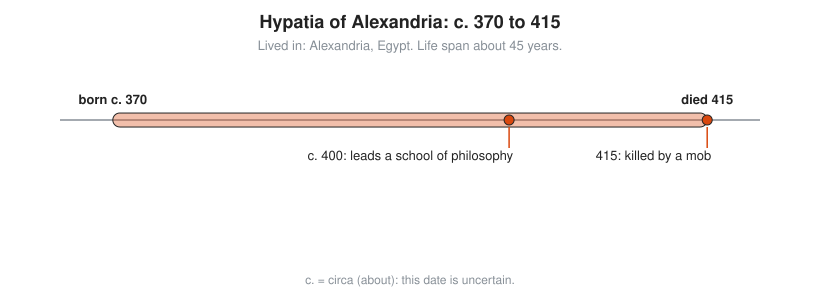

# Hypatia of Alexandria

**Lived:** c. 370 to 415 · **Where:** Alexandria, Egypt · **Era:** [Chapter 03: Ancient Greece](../03-ancient-greece/README.md)

Hypatia is the Alexandrian philosopher, astronomer, and mathematics teacher who edits and explains the great Greek texts, and the first woman mathematician whose life is reasonably well recorded.

## Life at a Glance

<!-- diagram: type=life-timeline person=hypatia born=370 died=415 caption="Hypatia of Alexandria, c. 370 to 415" -->


Her birth year is uncertain. Some scholars put it near 355. By about 400 she leads a school of philosophy in Alexandria, and students travel from across the eastern Mediterranean to hear her. In 415 a Christian mob kills her during a political fight between the city governor, Orestes, and the bishop, Cyril.

## The World Around Them

Alexandria is still a center of learning, but the old Museum is fading and the Roman Empire is now officially Christian. Teachers keep the classic texts alive by copying them, correcting errors, and writing **commentaries**: line-by-line explanations for students. Astronomy matters for calendars, navigation, and astrology.

## What They Did

* Works with her father, Theon, on an edition of Ptolemy's *Almagest*, the standard astronomy text. She probably revises Book III.
* Writes a commentary on the *Arithmetica* of Diophantus, a book of number puzzles solved with early algebra.
* Writes a commentary on the *Conics* of Apollonius, the geometry of ellipses, parabolas, and hyperbolas.
* Teaches the philosophy of Plato and Aristotle in public as well as to private students.
* None of her writing survives under her own name. Scholars infer her work from letters and later sources.

## Key Idea, Worked Small

**Diophantus-style algebra**, the kind of problem Hypatia explains. Find two numbers whose sum is 20 and whose squares add to 208. The trick: write both numbers around their midpoint, 10.

```txt
  numbers: 10 + x and 10 - x                  they add to 20 for any x
  (10 + x)^2 + (10 - x)^2 = 208               the squares must add to 208
  100 + 20x + x^2 + 100 - 20x + x^2 = 208     expand both squares
  200 + 2x^2 = 208                            the 20x terms cancel
  2x^2 = 8                                    subtract 200
  x^2 = 4                                     divide by 2
  x = 2                                       Diophantus takes positive answers only
  numbers: 12 and 8                           check: 144 + 64 = 208
```

This exact problem appears in Book I of the *Arithmetica*. One clever choice of unknown turns two unknowns into one.

## A Human Detail

Her student Synesius, later a bishop, writes to her for help building a **hydrometer**, a float that measures the density of a liquid. He addresses her as mother, sister, and teacher. The tech-support request from a former student is apparently timeless.

## Connects To

* [Course 201: Algebra I and Geometry](../../course/201/README.md): solving equations with one unknown.
* [Course 301: Algebra II, Trig and Precalculus](../../course/301/README.md): conic sections.
* [Algebra track](../../tracks/algebra/README.md): from word puzzles to symbols.

## Go Deeper

* [MacTutor biography of Hypatia](https://mathshistory.st-andrews.ac.uk/Biographies/Hypatia/): the standard scholarly short life.
* [Chapter 03: Ancient Greece](../03-ancient-greece/README.md): the era in full.
