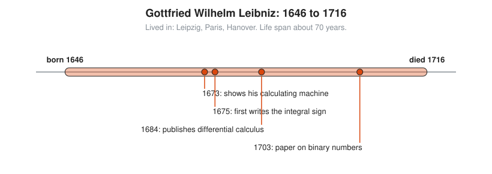

# Gottfried Wilhelm Leibniz

**Lived:** 1646 to 1716 · **Where:** Leipzig, Paris, Hanover · **Era:** [Chapter 07: The Scientific Revolution and Calculus](../07-scientific-revolution-and-calculus/README.md)

Gottfried Wilhelm Leibniz is the German thinker who invents calculus independently of Newton, gives it the notation still in use, and works out binary arithmetic long before computers need it.

## Life at a Glance

<!-- diagram: type=life-timeline person=leibniz born=1646 died=1716 caption="Gottfried Wilhelm Leibniz, 1646 to 1716" -->


He is born in Leipzig and spends four key years in Paris, where he learns modern math. In 1673 he shows his calculating machine to the Royal Society in London. In 1675 he first writes the integral sign $\int$ in his notes. In 1684 he publishes the first paper on differential calculus. In 1703 he publishes a paper on binary numbers. He spends his last decades serving the dukes of Hanover.

## The World Around Them

Germany is recovering from the Thirty Years War and split into many small states. Scholars like Leibniz earn a living as diplomats, lawyers, and court librarians. Across Europe, mathematicians are hunting for a general method to find tangents and areas. Leibniz wants more: a universal symbolic language in which arguments become calculations.

## What They Did

* Invents the **differential calculus**: $dx$ for a tiny change in $x$, and $\frac{dy}{dx}$ for a rate of change.
* Invents the integral sign $\int$, a stretched S for *summa* (sum).
* Publishes first, in 1684. Newton has the method earlier but publishes later. Historians today credit both, working independently.
* Builds the **stepped reckoner**, a machine that adds, subtracts, multiplies, and divides.
* Writes up **binary arithmetic**: every number written with only 0 and 1.
* Also works in philosophy, law, history, logic, and diplomacy.

## Key Idea, Worked Small

**Binary numbers.** Each place is worth double the place to its right: 1, 2, 4, 8, 16. To write 13 in binary, divide by 2 again and again and keep the remainders:

```txt
  13 / 2 = 6 remainder 1             lowest bit
   6 / 2 = 3 remainder 0
   3 / 2 = 1 remainder 1
   1 / 2 = 0 remainder 1             highest bit, stop at 0
  read the remainders bottom to top: 1101
  check: 1 x 8 + 1 x 4 + 0 x 2 + 1 x 1 = 8 + 4 + 0 + 1 = 13
```

Leibniz shows that all arithmetic works in this two-symbol system. Every server you run does exactly this, billions of times a second.

## A Human Detail

He spends decades on a commissioned history of the House of Brunswick and never finishes it. Few people attend his funeral in Hanover. Meanwhile, every calculus student on Earth writes his $\frac{dy}{dx}$, not Newton's dots.

## Connects To

* [Course 401: Calculus](../../course/401/README.md): the $\frac{dy}{dx}$ and $\int$ notation.
* [Course 101: Foundations](../../course/101/README.md): place value, in base 10 and base 2.
* [Calculus track](../../tracks/calculus/README.md): the notation that won.
* [Logic and set theory track](../../tracks/logic-and-set-theory/README.md): his dream of reasoning as calculation.

## Go Deeper

* [MacTutor biography of Leibniz](https://mathshistory.st-andrews.ac.uk/Biographies/Leibniz/): the standard scholarly short life.
* [Chapter 07: The Scientific Revolution and Calculus](../07-scientific-revolution-and-calculus/README.md): the era in full.
