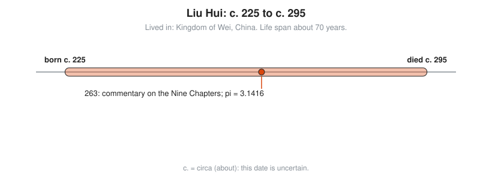
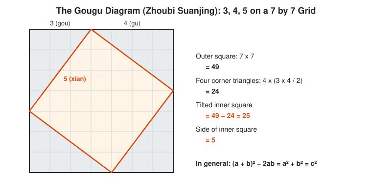

# Liu Hui

**Lived:** c. 225 to c. 295 · **Where:** Kingdom of Wei, China · **Era:** [Chapter 04: India and China](../04-india-and-china/README.md)

Liu Hui is the Chinese mathematician whose commentary on the *Nine Chapters on the Mathematical Art* adds proofs to old recipes and computes pi as 3.1416.

## Life at a Glance

<!-- diagram: type=life-timeline person=liu-hui born=225 died=295 caption="Liu Hui, c. 225 to c. 295" -->


Both life dates are estimates. The one firm date is 263, when he completes his commentary on the *Nine Chapters*. In it he cuts a circle into polygons with more and more sides and reaches pi = 3.1416.

## The World Around Them

China is split into the Three Kingdoms, and Wei is the largest. The state needs land surveys, taxes, granary volumes, canal digging, and calendars. The *Nine Chapters*, already centuries old, is the working manual for those jobs. It gives correct methods but rarely says why they work.

## What They Did

* Writes the commentary on the *Nine Chapters* in 263, explaining and justifying its methods.
* Computes pi by inscribing polygons in a circle, first a 96-gon and a 192-gon for 3.14, then, by tradition, a 3,072-gon for 3.1416.
* Uses the **gougu** rule (the Chinese name for the Pythagorean theorem) and proves it by cutting and rearranging squares.
* Solves systems of equations by a method close to modern Gaussian elimination, with counting rods on a board, and handles negative numbers.
* Writes the *Sea Island Mathematical Manual*: how to measure the height of a distant island using two poles and similar triangles.

## Key Idea, Worked Small

**Double the sides of a polygon.** Put a regular hexagon inside a circle of radius 1. Each side is 1. Find the side of the 12-gon using the gougu rule twice.

```txt
  half a hexagon side = 0.5                       cut one side in half
  center to that midpoint = sqrt(1 - 0.25)        gougu: radius^2 - half^2
                          = 0.866025
  gap from midpoint to circle = 1 - 0.866025      the radius minus that distance
                              = 0.133975
  12-gon side = sqrt(0.5^2 + 0.133975^2)          gougu on the small triangle
              = sqrt(0.267949) = 0.517638
  12-gon perimeter = 12 x 0.517638 = 6.21166      twelve equal sides
  pi is about 6.21166 / 2 = 3.1058                perimeter / diameter
```

Repeat the same two steps to reach 24, 48, 96 sides and beyond. Each round brings the estimate closer to 3.14159.

<!-- diagram: type=construction ref=gougu-diagram -->


## A Human Detail

Nothing about his life is known except what his math reveals. He fails to find the volume of a sphere and says so in print, leaving the problem for whoever can solve it. About two centuries later, Zu Chongzhi and his son Zu Geng do.

## Connects To

* [Course 201: Algebra I and Geometry](../../course/201/README.md): the Pythagorean theorem and circles.
* [Course 501: Linear Algebra, Probability and Discrete Math](../../course/501/README.md): systems of equations by elimination.
* [Geometry track](../../tracks/geometry/README.md): polygons and pi.
* [Linear algebra track](../../tracks/linear-algebra/README.md): elimination, done with rods 1,700 years ago.

## Go Deeper

* [MacTutor biography of Liu Hui](https://mathshistory.st-andrews.ac.uk/Biographies/Liu_Hui/): the standard scholarly short life.
* [Chapter 04: India and China](../04-india-and-china/README.md): the era in full.
