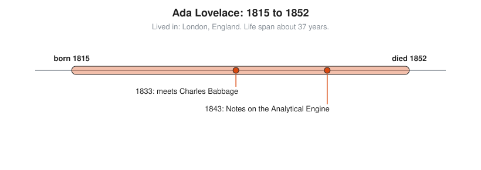

# Ada Lovelace

**Lived:** 1815 to 1852 · **Where:** London, England · **Era:** [Chapter 08: The 18th and 19th Centuries: Rigor](../08-18th-and-19th-century-rigor/README.md)

Ada Lovelace is an English mathematician who writes the first published description of a program for a general-purpose computer and sees that such machines can work with more than numbers.

## Life at a Glance

<!-- diagram: type=life-timeline person=lovelace born=1815 died=1852 caption="Ada Lovelace, 1815 to 1852: London" -->


Ada is the only legitimate child of the poet Lord Byron, who leaves when she is a month old. In 1833, at 17, she meets Charles Babbage and sees his calculating engine. In 1843 she publishes her Notes on his Analytical Engine. She dies of cancer at 36.

## The World Around Them

Britain runs on printed tables: logarithms for navigation, interest for banks, tides for ports. Human computers make errors, and errors sink ships. Babbage designs machines to compute tables mechanically. His Analytical Engine, never built, has a memory (the store), a processor (the mill), and punched cards for instructions, borrowed from the Jacquard loom.

## What They Did

* Translates into English a French article on the Analytical Engine by the Italian engineer Luigi Menabrea.
* Adds seven Notes, labeled A to G, about three times longer than the article itself.
* In Note G, lays out step by step how the Engine computes Bernoulli numbers, with a table of operations and variables.
* Argues the Engine can act on any symbols, for example musical notes, not only numbers.
* Also argues the Engine has no power to originate anything, a point Alan Turing answers a century later.

## Key Idea, Worked Small

**Bernoulli numbers by a rule a machine can follow.** Bernoulli numbers appear in formulas for sums like $1^2 + 2^2 + \dots + n^2$. Each one comes from the ones before, which suits a machine with a loop. One modern form of the rule: for each $n \ge 1$, $\sum_{k=0}^{n} \binom{n+1}{k} B_k = 0$, where $\binom{n+1}{k}$ is an entry from Pascal's triangle.

```txt
  B0 = 1                                  starting value
  n = 1:  1·B0 + 2·B1 = 0                 row 2 of Pascal's triangle: 1, 2
          1 + 2·B1 = 0                    put in B0 = 1
          B1 = -1/2                       solve
  n = 2:  1·B0 + 3·B1 + 3·B2 = 0          row 3 of Pascal's triangle: 1, 3, 3
          1 - 3/2 + 3·B2 = 0              put in B0 and B1
          3·B2 = 1/2                      move the known terms over
          B2 = 1/6                        divide by 3
```

Note G aims at the number now written $B_8 = -\frac{1}{30}$. Her numbering differs from the modern one.

## A Human Detail

Her mother pushes her toward mathematics, partly to keep her from turning out like her father. Ada answers by calling her own approach "poetical science." Historians debate how much of the program is hers and how much is Babbage's, who had sketched earlier examples. The Notes and their reach of vision are hers. The published table also contains a small slip in one step, which makes it feel like real code.

## Connects To

* [Course 501: Linear Algebra, Probability and Discrete Math](../../course/501/README.md): counting and Pascal's triangle.
* [Discrete math track](../../tracks/discrete-math/README.md): algorithms and recurrences.
* [Combinatorics track](../../tracks/combinatorics/README.md): binomial coefficients.

## Go Deeper

* [MacTutor biography of Ada Lovelace](https://mathshistory.st-andrews.ac.uk/Biographies/Lovelace/): the standard scholarly short life.
* [Chapter 08: The 18th and 19th Centuries: Rigor](../08-18th-and-19th-century-rigor/README.md): the era in full.
