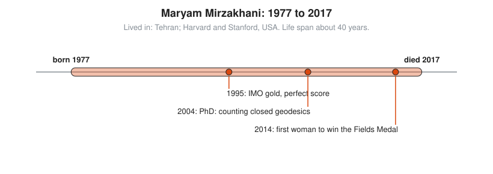

# Maryam Mirzakhani

**Lived:** 1977 to 2017 · **Where:** Tehran; Harvard and Stanford, USA · **Era:** [Chapter 10: Modern Mathematics](../10-modern-mathematics/README.md)

Maryam Mirzakhani is the Iranian mathematician who studies the geometry of curved surfaces and becomes the first woman to win the Fields Medal.

## Life at a Glance

<!-- diagram: type=life-timeline person=mirzakhani born=1977 died=2017 caption="Maryam Mirzakhani, 1977 to 2017: Tehran, Harvard, Stanford" -->


Mirzakhani grows up in Tehran and wins gold at the International Mathematical Olympiad in 1994 and again in 1995, with a perfect score. Her 2004 Harvard PhD counts closed geodesics on surfaces. In 2014 she wins the Fields Medal. She dies of breast cancer in 2017, age 40.

## The World Around Them

Mirzakhani grows up just after the Iran-Iraq war, as Iran expands schools for gifted students. In mathematics, surfaces with holes, like a donut or a pretzel, can carry many shapes. Researchers study the space of all those shapes, called moduli space, and want to measure it and count paths inside it.

## What They Did

* Counts simple closed geodesics on hyperbolic surfaces. A **geodesic** is the straightest possible path on a surface. **Closed** means it returns to its start and repeats. **Simple** means it never crosses itself.
* Shows the number of simple ones with length at most $L$ on a surface with $g$ holes grows like $L^{6g-6}$.
* Uses that counting to compute volumes of moduli spaces, linking them to a result in physics by Edward Witten.
* With Alex Eskin, proves deep results about how billiard paths behave on tables built from polygons.
* Teaches at Princeton and then Stanford.

## Key Idea, Worked Small

**Counting closed straight paths.** Her surfaces are hyperbolic, which is hard to draw. A flat torus gives the flavor. Take a 1 by 1 square and glue opposite edges, as in an old video game where leaving the right side brings you back on the left. A straight path that closes up moves $p$ across and $q$ up, with $p$ and $q$ sharing no common factor. Its length is $\sqrt{p^2 + q^2}$, by the Pythagorean theorem.

```txt
  (1, 0)              length 1                      across once
  (0, 1)              length 1                      up once
  (1, 1), (1, -1)     length √2 ≈ 1.414             the two diagonals
  (2, 1), (1, 2)      length √5 ≈ 2.236             two across one up, and the reverse
  (2, -1), (1, -2)    length √5 ≈ 2.236             the same, tilted down
  (2, 2)              skip                          shares the factor 2: repeats (1, 1)
  length ≤ 2.3        8 paths                       count the list
```

On the flat torus, the count grows like $L^2$. Mirzakhani proves the exact growth law for every hyperbolic surface, where the answer depends on the number of holes.

## A Human Detail

Mirzakhani works by drawing on huge sheets of paper spread over the floor. Her young daughter, watching, describes her mother as painting.

## Connects To

* [Geometry track](../../tracks/geometry/README.md): curved surfaces and straight paths on them.
* [Topology track](../../tracks/topology/README.md): surfaces with holes.
* [Course 201: Algebra I and Geometry](../../course/201/README.md): the Pythagorean theorem behind every length above.
* [Number theory track](../../tracks/number-theory/README.md): pairs with no common factor.

## Go Deeper

* [MacTutor biography of Maryam Mirzakhani](https://mathshistory.st-andrews.ac.uk/Biographies/Mirzakhani/): the standard scholarly short life.
* [Chapter 10: Modern Mathematics](../10-modern-mathematics/README.md): the era in full.
